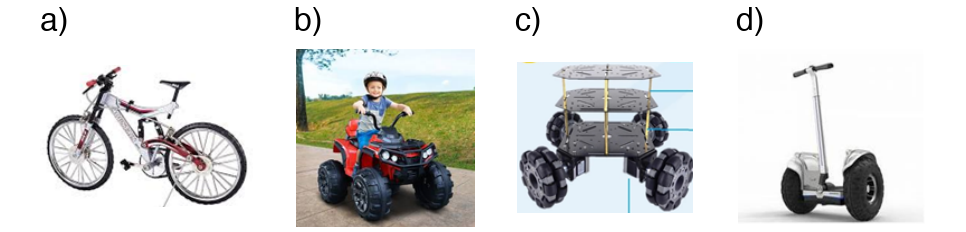
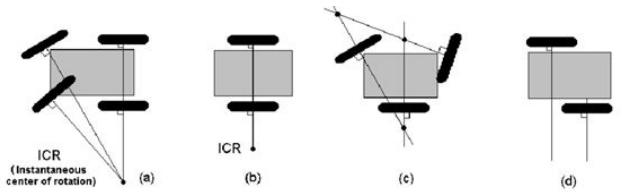
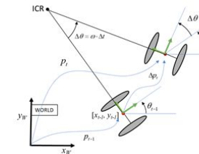
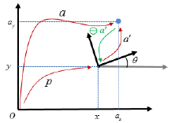
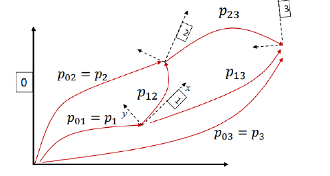
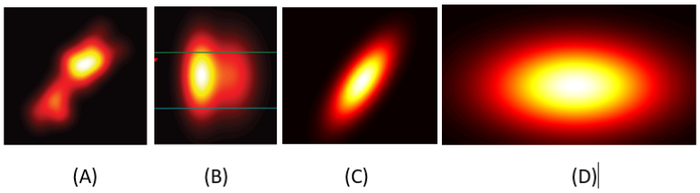
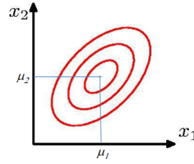
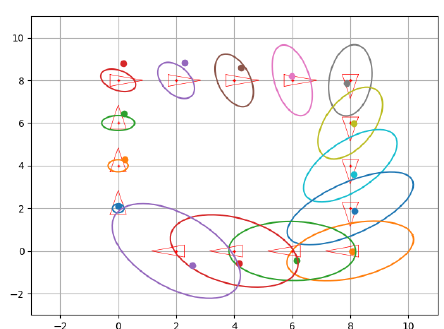
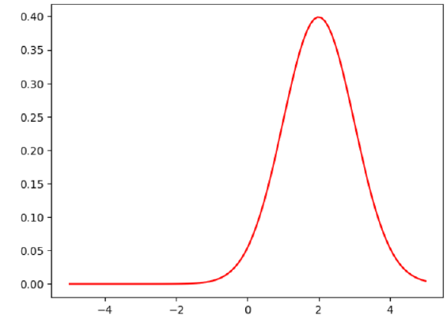
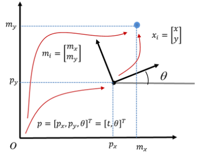

# Primer parcial — Banco de preguntas (sin soluciones)

Las soluciones explicadas están en [Soluciones_Parcial1.md](Soluciones_Parcial1.md) (misma numeración).

## 0. Cómo usar este documento

- **Parte A:** preguntas extraídas de los documentos de `ref:preguntas-examen/` (curso 2024-2025):
  - `E-n`: *Examen de prueba del primer parcial* (autoevaluación del Campus Virtual).
  - `T-n`: *Preguntas de teoría del primer parcial* (apuntes de un alumno; muchas se han **reconstruido** en formato test a partir de sus notas, y se indica así).
  - `P-n`: *Preguntas de prácticas del primer parcial*.
- **Parte B:** preguntas **nuevas** (`N-n`) del mismo estilo para practicar.
- **Diapositivas de L3:** el banco está actualizado a la versión **v6** de las diapositivas. Las preguntas N-94 a N-101 (al final de B.7) tratan el contenido nuevo de v6.
- **Probabilidad:** solo se incluye la que aparece en L3 (diapositivas 27-48 de v6): variables aleatorias, pdf, reglas de probabilidad, independencia, hipótesis de Markov, gaussianas, propagación de covarianza y modelos de movimiento probabilísticos (gaussianos y por muestras). Las preguntas de probabilidad que se salen de L3 están listadas en la sección A.0.
- **Tipo de respuesta:** *(Una)* = una sola respuesta correcta; *(Una o más)* = puede haber varias.

---

# PARTE A — Preguntas de exámenes anteriores

## A.0. Preguntas excluidas (probabilidad que no aparece en L3)

- **E-16** (histogramas construidos con distinto número de muestras): L3 no trata los histogramas.
- **T-5** (distribución conjunta $p(x_t, x_{t-1} \mid z_{1:t}, u_{1:t+1})$ y sus marginales): es de filtrado bayesiano, no de L3.
- **T-6** (valor esperado): los apuntes solo ponen «expected value????» sin enunciado, y L3 solo usa $E[\mathbf{x}]$ para definir la media de la gaussiana.

## A.1. Introducción a la robótica autónoma

**E-1.** Un robot autónomo... *(Una o más)*

- a) Emplea información sensorial para tomar decisiones.
- b) Consiste en un brazo articulado que mueve sus articulaciones de acuerdo con un programa informático.
- c) Realiza tareas repetitivas y preestablecidas.
- d) Puede operar en entornos no totalmente conocidos.

**T-1.** *(Reconstruida)* El concepto de *embodiment* (encarnación) se refiere a... *(Una)*

- a) La capacidad del robot de ejecutar programas sin necesidad de sensores.
- b) Percibir el estado de un entorno cambiante y modificar el estado del robot en consecuencia (percibir y actuar).
- c) Que el robot tenga forma humanoide.
- d) Que toda la inteligencia del robot resida en la nube.

## A.2. Cinemática de robots con ruedas

**E-6.** ¿Cuál de estos vehículos es holonómico? *(Una)*



**E-9.** ¿Cuál de estos vehículos tendrá un movimiento con deslizamiento de las ruedas? *(Una)*



- a) (a) — b) (b) — c) (c) — d) (d)

## A.3. Poses y transformaciones

**E-7.** En referencia a la figura siguiente, que muestra el desplazamiento incremental de un robot en el plano entre dos instantes $t-1$ y $t$, ¿cuál es la pose del robot en el instante $t$ en el sistema de referencia del mundo (*World*)? *(Una)*



- a) $\begin{bmatrix} x_{t-1} + \Delta x_t\cos\theta_{t-1} - \Delta y_t\sin\theta_{t-1} \\ y_{t-1} + \Delta x_t\sin\theta_{t-1} + \Delta y_t\cos\theta_{t-1} \\ \theta_{t-1} + \Delta\theta_t \end{bmatrix}$
- b) $\begin{bmatrix} \Delta x_t\cos\theta_{t-1} - \Delta y_t\sin\theta_{t-1} \\ \Delta x_t\sin\theta_{t-1} + \Delta y_t\cos\theta_{t-1} \\ \Delta\theta_t \end{bmatrix}$
- c) $\begin{bmatrix} x_{t-1} + \Delta x_t\cos\theta_{t-1} \\ y_{t-1} + \Delta y_t\sin\theta_{t-1} \\ \theta_{t-1} + \Delta\theta_t \end{bmatrix}$
- d) $\begin{bmatrix} x_{t-1}\cos\theta_{t-1} \\ y_{t-1}\sin\theta_{t-1} \\ \theta_{t-1} + \Delta\theta_t \end{bmatrix}$

**E-11.** Dada la configuración de la figura, ¿cuáles de las siguientes expresiones son ciertas? *(Una o más)*
*Nota: las flechas conectan tanto poses como puntos (landmarks).*



- a) $a = p \oplus a'$
- b) $a' = \ominus p \oplus a = a \ominus p$
- c) $p = a \oplus (\ominus a')$
- d) $a = p + a'$

**T-8.** *(Reconstruida; solo la opción a procede de los apuntes)* Dada la figura, elige las secuencias de transformaciones correctas. *(Una o más)*



- a) $\ominus p_{23} = \ominus p_{13} \oplus p_{12}$
- b) $p_{23} = p_{13} \oplus (\ominus p_{12})$
- c) $p_2 = p_1 \oplus p_{12}$
- d) $p_{13} = p_{12} + p_{23}$

## A.4. Modelos de movimiento deterministas

**T-9.** *(Reconstruida)* Sobre el modelo de movimiento $\mathbf{x}_t = \mathbf{g}(\mathbf{x}_{t-1}, \mathbf{u}_t)$, señala las afirmaciones correctas. *(Una o más)*

- a) La entrada es la pose en $t-1$ y un comando de movimiento.
- b) El comando puede ser una velocidad $[v, \omega]$ (dimensión 2) o un incremento odométrico $[\Delta x, \Delta y, \Delta\theta]$ (dimensión 3).
- c) Con entrada de velocidad, $\mathbf{x}_t$ se obtiene sumando directamente $[v, \omega]$ a la pose.
- d) $\mathbf{x}_t$ se obtiene siempre con una composición de poses; con entrada $[v, \omega]$ hay que convertirla antes en un incremento.

**T-10.** *(Reconstruida)* Cuando un robot con ruedas se mueve en el plano, la posición estimada por odometría puede no ser la verdadera debido a... *(Una o más)*

- a) El deslizamiento de las ruedas.
- b) Un periodo de muestreo de los codificadores (encoders) demasiado grande.
- c) Un diámetro de las ruedas impreciso.
- d) El desconocimiento del mapa del entorno.

**P-3.** La siguiente función de las prácticas aplica el modelo de tracción diferencial:

```python
def next_pose(x, u, dt, cov=None):
    ''' This function takes pose x and transform it according to the motion u=[v,w]'
        applying the differential drive model.

        Args:
            x: current pose
            u: differential command as a vector [v, w]'
            dt: Time interval in which the movement occurs
            cov: covariance of our movement. If not None, then add gaussian noise
    '''
    if cov is not None:
        u += np.sqrt(cov) @ random.randn(2, 1)
        #u = np.random.multivariate_normal(u.flatten(),cov)

    if u[1] == 0: #linear motion w=0
        next_x = np.vstack([
            x[0] + u[0] * dt * np.cos(x[2]),
            x[1] + u[0] * dt * np.sin(x[2]),
            x[2]
        ])
    else: #Non-linear motion w=!0
        R = u[0]/u[1] #v/w=r is the curvature radius
        next_x = np.vstack([
            x[0] - R * np.sin(x[2]) + R * np.sin(x[2] + u[1] * dt),
            x[1] + R * np.cos(x[2]) - R * np.cos(x[2] + u[1] * dt),
            x[2] + u[1] * dt
        ])

    return next_x
```

*(Reconstruida)* Responde:

1. ¿Qué dimensiones tiene `cov`?
2. ¿Qué genera `random.randn(2, 1)` y qué media tiene el ruido que se añade?
3. ¿Qué comprueba el segundo `if` y por qué hace falta?
4. ¿Qué representa `R`?

## A.5. Probabilidad y modelos de movimiento probabilísticos (L3)

**T-2.** *(Reconstruida)* Si la posición del robot es una variable aleatoria continua, la probabilidad de que el robot se encuentre **exactamente** en una posición concreta es... *(Una)*

- a) El valor de la pdf en esa posición.
- b) Cero.
- c) Uno.
- d) Depende de la varianza.

**E-2.** Dadas las pdf conjuntas de las variables $x$ e $y$, indica si son dependientes o independientes. *(Emparejar: A, B, C, D → Dependiente / Independiente)*



**E-3.** ¿Cuáles de las siguientes expresiones son correctas? *(Una o más)*

- a) $p(x) = \int_y p(x, y)\, dy$
- b) $p(x \mid y) = \int_z p(x \mid y, z)\, p(z)\, dz$
- c) $p(y) = \int_y p(x, y)\, dy$
- d) $p(x, y) = \int_y p(x \mid y)\, dy$

**E-4.** Un robot está en un espacio rectangular de 10×5 baldosas (celdas) y puede estar orientado en 4 direcciones: Norte (N), Sur (S), Este (E) y Oeste (O), con probabilidades $P(N) = P(S) = 1/6$ y $P(E) = P(O) = 1/3$. La probabilidad de que esté en la baldosa (3,2) es $P(3,2) = 1/8$ y es independiente de su orientación. ¿Cuál es la probabilidad de que esté en la baldosa (3,2) y no mire al Norte ni al Oeste? *(Una)*

- a) Ninguna de las otras.
- b) 1/24
- c) 1/16
- d) 45/48

**T-3.** *(Reconstruida)* La tabla muestra la distribución de probabilidad de la ubicación de un robot en una cuadrícula (las celdas vacías valen 0). ¿Cuál es la probabilidad de que el robot esté en la posición (3,4) (fila, columna) **sabiendo que** está en la columna 4? *(Una)*

| | columna 1 | columna 2 | columna 3 | columna 4 |
|---|---|---|---|---|
| **fila 1** | | | | 0.1 |
| **fila 2** | | | | |
| **fila 3** | 0.3 | 0.3 | 0.3 | 0.1 |
| **fila 4** | | | | 0.1 |

- a) 0.1
- b) 1/3
- c) 0.3
- d) 1/4

**T-4.** *(Reconstruida)* La figura muestra las curvas de igual densidad de una distribución gaussiana $p(x_1, x_2)$. Señala las afirmaciones correctas. *(Una o más)*



- a) $x_1$ y $x_2$ son dependientes (están correlacionadas).
- b) Su matriz de covarianza es diagonal.
- c) La media de la distribución es el vector $[\mu_1, \mu_2]^T$, no solo $\mu_1$.
- d) Las elipses son curvas de igual densidad de probabilidad.

**T-7.** *(Reconstruida)* Un robot en un pasillo tiene un sensor que mide la distancia al origen y toma las observaciones $z = [z_1, z_2, \ldots, z_k]$. ¿Cuándo se cumple $p(z \mid x, m) = \prod_k p(z_k \mid x, m)$? *(Una)*

- a) Siempre.
- b) Cuando las observaciones son condicionalmente independientes dadas la pose $x$ (y el mapa $m$).
- c) Solo si todas las observaciones son iguales.
- d) Cuando las observaciones son independientes de la pose.

**E-5.** Sea la variable aleatoria $X \sim N(\mu, \Sigma)$ y su transformación lineal $Y = AX + B$, siendo $A$ una matriz y $B$ un vector. Marca la respuesta correcta. *(Una)*

- a) $Y \sim N(A\mu + B,\; A\Sigma A^T)$
- b) $Y \sim N(A\mu + B,\; A\Sigma A^T + B)$
- c) $Y \sim N(A\mu,\; A\Sigma A^T)$
- d) $Y \sim N(A\mu + B,\; A^T\Sigma A)$

**T-15.** *(Reconstruida)* Sea $z = Hx + e$ con $z = 3x + e$, donde $x \sim N(2, 1)$ y $e \sim N(0, 2)$ son independientes. ¿Cuál es la varianza de $z$? *(Una)*

- a) 5
- b) 9
- c) 11
- d) 3

**T-22.** *(Reconstruida)* Un robot está en un pasillo (1D) con $x \sim N(1, 1)$ y se mueve con $u \sim N(1, 2)$, independientes. ¿Cuál es la distribución de la nueva posición? *(Una)*

- a) $N(2, 3)$
- b) $N(2, 1)$
- c) $N(1, 3)$
- d) $N(2, 2)$

**E-8.** ¿Cuál es la expresión que describe probabilísticamente el modelo de movimiento? ($x_t$: pose en $t$; $x_{t-1}$: pose en $t-1$; $u_t$: comando de movimiento en $t-1$) *(Una)*

- a) $p(x_t \mid u_t, x_{t-1})$
- b) $p(u_t \mid x_t, x_{t-1})$
- c) $p(u_t, x_t \mid x_{t-1})$
- d) $p(x_t, x_{t-1} \mid u_t)$

**E-17.** La siguiente gráfica es el resultado de ejecutar comandos de movimiento basados en odometría (forma analítica), como en las sesiones prácticas. ¿Qué significan los puntos que aparecen? *(Una)*



- a) Cada punto es una posible posición del robot, fruto de componer una acción de control ruidosa con la posición ruidosa anterior.
- b) Cada punto es una posible posición del robot, fruto de componer una acción de control ruidosa con la posición ideal anterior.
- c) Representan la posición ideal del robot.
- d) Representan la posición real del robot en todas las ejecuciones del algoritmo.

**P-1.** La siguiente celda evalúa una pdf gaussiana y la dibuja. Tras ejecutarla se obtiene la gráfica:



```python
# Create the array of values where the gaussian distribution is going to be evaluated
min_interval = ___
max_interval = ___
n_samples = ___
X = np.linspace(min_interval, max_interval, n_samples)

# Call the function and plot the results
res = evaluate_gaussian(mu, sigma, X)
plt.plot(X, res, ___) # Show the results
plt.show()
```

*(Reconstruida)* Indica los valores de `mu`, `sigma`, `min_interval`, `max_interval`, un valor razonable de `n_samples` (¿podría ser 10?) y el tercer argumento de `plt.plot`.

**P-2.** *(Reconstruida)* En las prácticas se usa `np.random.randn(n)` para generar muestras gaussianas. Completa la función para que devuelva `n` muestras de $N(\mu, \sigma^2)$:

```python
def sample_gaussian(n, mu, sigma):
    """ Generate n samples of a gaussian distribution
        Args:
            n: Number of samples
            mu: mean of the distribution
            sigma: standard deviation of the distribution
        Returns:
            array of samples
    """
    samples = ___________________
    return samples
```

## A.6. Sensores y modelos de observación

**E-10.** Dado el modelo de observación $z = h(x, m) + w$, con $w \sim N(0, Q)$, selecciona la expresión correcta. *(Una)*

- a) $p(z \mid x, m) \sim N(h(x, m),\; J_h Q J_h^T)$
- b) $p(z \mid x, m) \sim N(h(x, m),\; Q)$
- c) $p(z \mid x, m) \sim N(0,\; Q)$
- d) $p(z \mid x, m) \sim N(h(x, m),\; Q^{-1})$

**E-19.** ¿Qué medidas toma el sensor implementado en el siguiente código? *(Una)*

```python
def take_measurement(pose: np.ndarray, m: np.ndarray, cov: int = 0) -> np.ndarray:
    """ Get observations for every landmark in the map.

        In this case our observations are range only.
        If cov > 0 then add gaussian noise with var covariance

        Args:
            pose: pose (true or noisy) of the robot taking observation
            m: Map containing all landmarks
            cov: Covariance of the sensor

        Returns
            z: numpy array containing measurements to all obs.
    """
    z = np.sqrt(np.sum((m-pose[0:2, :])**2, axis=0)) # compute distances to all landmarks

    if cov_d > 0:
        z += stats.norm(loc=0, scale=np.sqrt(z)*np.sqrt(cov_d)).rvs(z.shape[0]) # add noise if needed

    return z
```

- a) De rango.
- b) De rango y orientación.
- c) De orientación.
- d) De profundidad.

**P-4.** *(Reconstruida)* En el código de prácticas, ¿qué calcula $z = \lVert m - x \rVert$ (con `m` el mapa completo de $N$ marcas)? *(Una)*

- a) La distancia entre la posición del robot y un único landmark.
- b) Un vector cuyo elemento $i$ es la distancia euclídea entre el robot y el landmark $m_i$.
- c) El ángulo con el que el robot ve cada landmark.
- d) La pose del robot en coordenadas polares.

**E-18.** La siguiente función `to_world_frame()` recibe una pose del robot, su incertidumbre, una medida en coordenadas polares de un landmark y la covarianza del sensor. Devuelve la posición del landmark en el sistema del mundo y su incertidumbre. ¿Qué expresión calcula correctamente la incertidumbre asociada (`Wz1`)? *(Una)*

```python
def to_world_frame(p1_w, Qp1_w, z1_p_r, W1):
    """ Covert the observation z1_p_r to the world frame

        Args:
            p1_w: Pose of the robot(in world frame)
            Qp1_w: Covariance of the robot
            z1_p_r: Observation to a landmark (polar coordinates) from robots perspective
            W1: Covariance of the sensor in polar coordinates

        Returns:
            z1_w: Pose of landmark in the world frame
            Wz1: Covariance associated to z1_w
    """
    # Definition of useful variables
    r, a = z1_p_r[0,0], z1_p_r[1,0]
    s, c = np.sin(a), np.cos(a)

    # Jacobian to convert the measurement uncertainty from polar to cartesian coordinates
    Jac_pol_car = np.array([
        [c, -r*s],
        [s, r*c]
    ])

    # Built a tuple with:
    # z1_car_rel[0]: coordinates of the sensor measurement in cartesian coordinates relative to robot position
    # z1_car_rel[1]: its associated uncertainty expressed in cartesian coordinates
    z1_car_rel = (
        np.vstack([r*c,r*s]), # position
        Jac_pol_car@W1@Jac_pol_car.T # uncertainty
    )

    z1_ext = np.vstack([z1_car_rel[0], 0]) # Extends z1 for its usage in the Jacobian functions J1 and J2

    # Build the jacobians
    Jac_ap = J1(p1_w ,z1_ext)[0:2,:] # Jacobian for expressing the uncertainty in the robot pose in a global frame
    Jac_aa = J2(p1_w ,z1_ext)[0:2,0:2] # This one expresses the uncertainty in the measurment in a global frame

    z1_w = tcomp(p1_w ,z1_ext)[0:2,[0]] # Compute coordinates of the landmark in the world
    Wz1 = None # Finally, propagate the covariance!

    return z1_w, Wz1
```

- a) `Wz1 = Jac_ap @ z1_car_rel[1] @ Jac_ap.T + Jac_aa @ Qp1_w @ Jac_aa.T`
- b) `Wz1 = Jac_aa @ Qp1_w @ Jac_aa.T + Jac_ap @ z1_car_rel[1] @ Jac_ap.T`
- c) `Wz1 = Jac_ap @ Qp1_w @ Jac_ap.T + Jac_aa @ z1_car_rel[1] @ Jac_aa.T`
- d) `Wz1 = Jac_aa.T @ z1_car_rel[1] @ Jac_aa + Jac_ap.T @ Qp1_w @ Jac_ap`

**P-5.** *(Temas preguntados según los apuntes; sin enunciado completo)*

1. ¿Qué representa `Wz1`?
2. Dimensiones de las matrices del ejercicio anterior (`W1`, `Jac_pol_car`, `Qp1_w`, `Jac_ap`, `Jac_aa`, `Wz1`).
3. Ordenar los bloques de código de la localización por mínimos cuadrados.
4. Preguntas sobre el código de `EKFLocalization`.

**T-11.** *(Reconstruida)* Relaciona cada modelo de observación con el sensor que mejor se ajusta. *(Emparejar)*

| Modelo | Sensor |
|---|---|
| 1. Beam model | A. Cámara (solo un ángulo) |
| 2. Likelihood field | B. Láser (barrido) |
| 3. Range model | C. Cámara estéreo (triangulación/profundidad) |
| 4. Bearing model | D. Láser |

**T-12.** *(Reconstruida)* Relaciona cada técnica GPS con su precisión aproximada. *(Emparejar)*

| Técnica | Precisión |
|---|---|
| 1. Stand Alone | A. < 10 cm |
| 2. GPS diferencial (DGPS) | B. < 10 m |
| 3. RTK GPS | C. < 5 m |

**T-13.** *(Reconstruida)* Un sistema de localización con GPS está basado en... *(Una)*

- a) Medidas de distancia y de ángulo a los satélites.
- b) Solo medidas de distancia a los satélites.
- c) Solo medidas de ángulo a los satélites.
- d) Odometría corregida por los satélites.

**T-16.** *(Reconstruida)* El modelo de observación $h$ da una medida de dimensión 2 (por ejemplo, rango y ángulo) a partir de la pose $\mathbf{x}$ (dimensión 3). ¿Qué dimensión tiene su jacobiano respecto a la pose? ¿Y si se apilan $m$ observaciones?

## A.7. Localización

**E-12.** En la expresión para calcular la distribución de probabilidad de la pose del robot $x_t$:

$$
Bel(x_t) = \eta\; p(z_t \mid x_t, m) \int p(x_t \mid u_t, x_{t-1})\, Bel(x_{t-1})\, dx_{t-1}
$$

las variables de la función $p(z_t \mid x_t, m)$ son... *(Una)*

- a) $m$
- b) $x_t$
- c) $m, x_t, z_t$
- d) $z_t$

**E-13 / T-20.** En un Filtro de Kalman Extendido (EKF) para localización, indica a qué etapa (predicción o corrección) pertenece cada ecuación. *(Emparejar)*

1. $\bar{\mu}_t = g(u_t, \mu_{t-1})$
2. $K_t = \bar{\Sigma}_t H_t^T (H_t \bar{\Sigma}_t H_t^T + Q_t)^{-1}$
3. $\mu_t = \bar{\mu}_t + K_t(z_t - h(\bar{\mu}_t))$
4. $\bar{\Sigma}_t = G_t \Sigma_{t-1} G_t^T + R_t$
5. $\Sigma_t = (I - K_t H_t)\bar{\Sigma}_t$

**E-14.** En un problema de localización por emparejamiento (*matching*) de marcas $x_i$ observadas por un robot de pose $p$ con las marcas $m_i$ de un mapa 2D (ver figura), ¿cuál es una definición **INCORRECTA** de la función a minimizar? *(Una)*



- a) $E_i(R, t) = m_i - p \oplus x_i$
- b) $E_i(R, t) = \lVert m_i - p \oplus x_i \rVert^2$
- c) $E_i(R, t) = \lVert m_i - R(\theta)x_i - t \rVert^2$, con $t = [p_x, p_y]^T$
- d) $E_i(R, t) = \lVert p \oplus x_i - m_i \rVert^2$

**E-15.** Sobre un filtro de partículas para localización, marca las respuestas correctas. *(Una o más)*

- a) La idea es representar la distribución a posteriori de la pose mediante partículas, que son muestras de esa distribución.
- b) La función de *likelihood* se aplica cambiando el peso de las partículas.
- c) Las partículas se pesan aplicando el modelo de movimiento.
- d) Permite modelar múltiples hipótesis sobre la localización del robot.

**E-20.** Un robot con un sensor de distancia (*range*) toma medidas $z$ a marcas del entorno. Se localiza globalmente por mínimos cuadrados optimizando su pose de forma iterativa con Gauss-Newton, inicializado en la posición odométrica. Señala las afirmaciones correctas. *(Una o más)*

- a) La calidad de la odometría influye en el número de iteraciones que necesita el algoritmo para converger.
- b) El jacobiano del modelo de observación tiene dimensión (grados de libertad de la pose) × (número de landmarks).
- c) La orientación del robot puede obtenerse si contamos con distancias a tres o más marcas distintas.
- d) La incertidumbre (varianza) de la medida de distancia afecta al mínimo obtenido.

**T-14.** *(Reconstruida)* Cuando se recibe una observación $z_i$, ¿cómo se llama el problema de decidir a qué marca $m_i$ del mapa corresponde? *(Una)*

- a) Problema del robot secuestrado.
- b) Asociación de datos (correspondencia).
- c) Remuestreo.
- d) Linealización.

**T-17.** *(Reconstruida)* Hacer una estimación por mínimos cuadrados es equivalente a... *(Una)*

- a) Una estimación de máxima verosimilitud (ML) cuando el error minimizado es gaussiano.
- b) Un filtro de partículas con una sola partícula.
- c) Una estimación de máxima verosimilitud para cualquier distribución del error.
- d) Aplicar solo el modelo de movimiento.

**T-18.** *(Reconstruida; enunciado original incompleto)* Se quiere localizar un robot a partir de un escaneo láser y un mapa de puntos, **sin información de movimiento**. ¿Qué técnica es adecuada? *(Una)*

- a) Filtro de Kalman, porque solo necesita observaciones.
- b) Filtro de partículas, porque solo necesita el mapa.
- c) Alineamiento del escaneo con el mapa (ICP / mínimos cuadrados).
- d) Odometría.

**T-19.** *(Reconstruida)* En un filtro de partículas, ¿para qué se usa el remuestreo (*resampling*)? *(Una)*

- a) Para mover las partículas según el modelo de movimiento.
- b) Para evitar que unas pocas partículas con mucho peso dominen la estimación (degeneración); tras remuestrear, las partículas vuelven a tener el mismo peso.
- c) Para calcular el jacobiano del modelo de observación.
- d) Para añadir ruido a las observaciones.

**T-21.** *(Reconstruida)* Relaciona cada situación con el problema de localización correspondiente. *(Emparejar)*

| Situación | Problema |
|---|---|
| 1. El robot sabe aproximadamente dónde está | A. Robot secuestrado (*kidnapped robot*) |
| 2. El robot no sabe dónde está y es consciente de ello | B. Seguimiento (*tracking*) |
| 3. El robot no sabe dónde está y no es consciente de ello | C. Localización global |

**T-23.** *(Reconstruida)* Sobre la localización por mínimos cuadrados, señala las afirmaciones correctas. *(Una o más)*

- a) Utiliza el modelo de movimiento para predecir la pose.
- b) No utiliza modelo de movimiento; solo observaciones y mapa.
- c) Las medidas pueden ponderarse con su matriz de covarianza.
- d) Necesita un conjunto de partículas.

---

# PARTE B — Preguntas nuevas para practicar

## B.1. Introducción a la robótica autónoma (L1)

**N-1.** Sobre el paradigma deliberativo, señala las afirmaciones correctas. *(Una o más)*

- a) Sigue el ciclo *sense–plan–act*.
- b) Responde muy rápido en entornos dinámicos.
- c) Construye un modelo explícito del mundo para planificar.
- d) Conecta directamente los sensores con los actuadores, sin planificar.

**N-2.** ¿Cuál es el paradigma más usado en la robótica moderna y el principal foco del curso? *(Una)*

- a) Deliberativo.
- b) Reactivo.
- c) Híbrido.
- d) Teleoperado.

**N-3.** La pregunta fundamental «¿Dónde estoy?» engloba los problemas de... *(Una)*

- a) Localización y mapping/SLAM.
- b) Planificación de caminos y evitación de obstáculos.
- c) Planificación de tareas.
- d) Control de motores.

**N-4.** ¿Cuáles son razones para usar métodos probabilísticos en robótica? *(Una o más)*

- a) Los modelos del mundo y de las acciones del robot son inexactos.
- b) Los sensores producen medidas ruidosas.
- c) El mundo real cambia de forma imprevista.
- d) Reducen el coste computacional respecto a los métodos deterministas.

**N-5.** La hipótesis de la encarnación (*embodiment*) sostiene que... *(Una)*

- a) La inteligencia puede alcanzarse solo con software, sin cuerpo.
- b) La inteligencia emerge de la interacción de un agente con su entorno, como resultado de la actividad sensoriomotora.
- c) Un robot solo es inteligente si tiene forma humana.
- d) La percepción es innecesaria si el mapa es conocido.

## B.2. Arquitecturas de control y ROS 2 (L2)

**N-6.** Una arquitectura permite que el robot siga navegando con sensores de respaldo cuando falla el sensor principal. ¿Qué propiedad deseable cumple? *(Una)*

- a) Paralelismo.
- b) Modularidad.
- c) Robustez.
- d) Facilidad de uso.

**N-7.** Relaciona cada robot/autor con su paradigma. *(Emparejar)*

| | |
|---|---|
| 1. Shakey (1967) | A. Reactivo |
| 2. Michael Arbib (1980) | B. Deliberativo |
| 3. Planificación + reacción (desde los 90) | C. Híbrido |

**N-8.** En un árbol de comportamiento, un nodo **Sequence** tiene tres hijos A, B y C. En un *tick*, A devuelve `SUCCESS` y B devuelve `FAILURE`. ¿Qué ocurre? *(Una)*

- a) Se ejecuta C y el Sequence devuelve lo que devuelva C.
- b) El Sequence devuelve `FAILURE` y C no se ejecuta.
- c) El Sequence devuelve `SUCCESS` porque A tuvo éxito.
- d) El Sequence devuelve `RUNNING`.

**N-9.** Un nodo **Fallback/Selector** tiene hijos A y B. A devuelve `FAILURE` y B devuelve `RUNNING`. ¿Qué devuelve el Fallback? *(Una)*

- a) `FAILURE`
- b) `SUCCESS`
- c) `RUNNING`
- d) Vuelve a ejecutar A.

**N-10.** Sobre ROS 2 frente a ROS 1, señala las afirmaciones correctas. *(Una o más)*

- a) ROS 2 usa un protocolo de comunicaciones basado en DDS.
- b) ROS 2 necesita un maestro central para descubrir nodos.
- c) En ROS 2 cada nodo mantiene sus propios parámetros.
- d) ROS 2 se programa en Python 2.7.

**N-11.** Se necesita que un nodo ordene a otro «ve a la posición (3, 2)», recibiendo progreso periódico y pudiendo cancelar la orden. ¿Qué mecanismo es el adecuado? *(Una)*

- a) Topic.
- b) Servicio.
- c) Parámetro.
- d) Acción.

**N-12.** ¿Qué comando muestra por pantalla los mensajes que se publican en un topic? *(Una)*

- a) `ros2 topic list`
- b) `ros2 topic echo <topic_name>`
- c) `ros2 node info <topic_name>`
- d) `ros2 interface show <topic_name>`

**N-13.** En un workspace de `colcon` con varios paquetes, ¿cómo se compila solo `package_1`? *(Una)*

- a) `colcon build package_1`
- b) `ros2 pkg create package_1`
- c) `colcon build --packages-select package_1`
- d) `ros2 run package_1 build`

**N-14.** ¿Qué tipo de mensaje se publica en `/turtle1/cmd_vel` para mover la tortuga de `turtlesim`? *(Una)*

- a) `geometry_msgs/msg/Twist`
- b) `std_msgs/msg/String`
- c) `sensor_msgs/msg/LaserScan`
- d) `geometry_msgs/msg/Pose`

## B.3. Cinemática de robots con ruedas (L3)

**N-15.** Señala las afirmaciones correctas. *(Una o más)*

- a) Un vehículo holonómico puede moverse en cualquier dirección arbitraria.
- b) En un vehículo holonómico, el número de grados de libertad locales de movimiento coincide con el de grados de libertad globales.
- c) Un robot de tracción diferencial es holonómico.
- d) Un coche con dirección Ackermann es holonómico.

**N-16.** El ICR (centro instantáneo de rotación) es... *(Una)*

- a) El centro de masas del robot.
- b) La intersección de las prolongaciones de los ejes de las ruedas.
- c) El punto medio del eje de las ruedas.
- d) El origen del sistema de referencia global.

**N-17.** Un robot diferencial tiene $l = 0{,}4$ m, $v_l = 0{,}3$ m/s y $v_r = 0{,}5$ m/s. ¿Cuánto valen $\omega$, $v_P$ y $R$? *(Una)*

- a) $\omega = 0{,}5$ rad/s, $v_P = 0{,}4$ m/s, $R = 0{,}8$ m
- b) $\omega = 0{,}5$ rad/s, $v_P = 0{,}2$ m/s, $R = 0{,}4$ m
- c) $\omega = 2$ rad/s, $v_P = 0{,}4$ m/s, $R = 0{,}2$ m
- d) $\omega = -0{,}5$ rad/s, $v_P = 0{,}4$ m/s, $R = -0{,}8$ m

**N-18.** En un robot diferencial se cumple $v_r = -v_l \neq 0$. ¿Qué ocurre? *(Una)*

- a) Avanza en línea recta; el ICR está en el infinito.
- b) Gira sobre sí mismo: $v_P = 0$ y el ICR coincide con el punto medio del eje ($R = 0$).
- c) Gira alrededor de la rueda izquierda.
- d) No se mueve.

**N-19.** Un robot diferencial avanza girando hacia la **derecha**. ¿Qué relación hay entre las velocidades de sus ruedas? *(Una)*

- a) $v_r > v_l$
- b) $v_l > v_r$
- c) $v_l = v_r$
- d) $v_l = -v_r$

**N-20.** Un robot diferencial se mueve con $v_P = 1$ m/s y $\omega = \pi/2$ rad/s durante $\Delta t = 1$ s. ¿Cuál es el incremento de pose **en su sistema local**? *(Una)*

- a) $[1,\; 0,\; 90^\circ]^T$
- b) $[2/\pi,\; 2/\pi,\; 90^\circ]^T \approx [0{,}637,\; 0{,}637,\; 90^\circ]^T$
- c) $[2/\pi,\; -2/\pi,\; 90^\circ]^T$
- d) $[\pi/2,\; 1,\; 90^\circ]^T$

**N-21.** En la expresión $v_i = \omega R_i$ para la rueda $i$ de un chasis rígido, $\omega$ es... *(Una)*

- a) La velocidad de giro de la rueda $i$ sobre su propio eje.
- b) La velocidad angular (*yaw rate*) del vehículo alrededor del ICR, igual para todas las ruedas.
- c) La velocidad angular media de las dos ruedas motrices.
- d) Una velocidad distinta para cada rueda.

**N-22.** Relaciona cada configuración con sus dos actuadores. *(Emparejar)*

| Configuración | Actuadores |
|---|---|
| 1. Tracción diferencial | A. Velocidad de las ruedas traseras y ángulo de giro de la rueda delantera |
| 2. Ackermann (coche/bicicleta) | B. Velocidades de las dos ruedas |

**N-23.** Con $v_r = v_l = v_P$ ($\omega = 0$), el incremento de pose local durante $\Delta t$ es... *(Una)*

- a) $[v_P\Delta t,\; 0,\; 0]^T$
- b) $[0,\; v_P\Delta t,\; 0]^T$
- c) No se puede calcular porque $R = v_P/\omega$ es infinito.
- d) $[v_P\Delta t,\; v_P\Delta t,\; 0]^T$

## B.4. Poses planas y transformaciones (L3)

**N-24.** Un robot está en $\mathbf{x}_1 = [1,\; 2,\; 90^\circ]^T$ y aplica el incremento local $\Delta\mathbf{x} = [3,\; 0,\; -90^\circ]^T$. ¿Cuál es su nueva pose global? *(Una)*

- a) $[4,\; 2,\; 0^\circ]^T$
- b) $[1,\; 5,\; 0^\circ]^T$
- c) $[1,\; -1,\; 0^\circ]^T$
- d) $[4,\; 2,\; 180^\circ]^T$

**N-25.** Calcula $\ominus\mathbf{x}$ para $\mathbf{x} = [2,\; 0,\; 90^\circ]^T$. *(Una)*

- a) $[-2,\; 0,\; -90^\circ]^T$
- b) $[0,\; 2,\; -90^\circ]^T$
- c) $[0,\; -2,\; -90^\circ]^T$
- d) $[-2,\; 0,\; 90^\circ]^T$

**N-26.** Dos poses globales: $\mathbf{x}_1 = [1,\; 1,\; 90^\circ]^T$ y $\mathbf{x}_2 = [1,\; 3,\; 180^\circ]^T$. ¿Cuánto vale el incremento $\Delta\mathbf{x} = (\ominus\mathbf{x}_1) \oplus \mathbf{x}_2$? *(Una)*

- a) $[0,\; 2,\; 90^\circ]^T$
- b) $[2,\; 0,\; 90^\circ]^T$
- c) $[-2,\; 0,\; 90^\circ]^T$
- d) $[0,\; -2,\; 90^\circ]^T$

**N-27.** El sistema 1 tiene pose $\mathbf{x}_1 = [3,\; 4,\; 90^\circ]^T$ respecto al sistema 0. Un punto tiene coordenadas $\mathbf{r}_{12} = [1,\; 0]^T$ en el sistema 1. ¿Cuáles son sus coordenadas en el sistema 0? *(Una)*

- a) $[4,\; 4]^T$
- b) $[3,\; 5]^T$
- c) $[2,\; 4]^T$
- d) $[3,\; 3]^T$

**N-28.** Sean $\mathbf{x}_A = [1,\; 0,\; 90^\circ]^T$ y $\mathbf{x}_B = [1,\; 0,\; 0^\circ]^T$. Calcula $\mathbf{x}_A \oplus \mathbf{x}_B$ y $\mathbf{x}_B \oplus \mathbf{x}_A$. *(Una)*

- a) Ambas valen $[2,\; 0,\; 90^\circ]^T$.
- b) $\mathbf{x}_A \oplus \mathbf{x}_B = [1,\; 1,\; 90^\circ]^T$ y $\mathbf{x}_B \oplus \mathbf{x}_A = [2,\; 0,\; 90^\circ]^T$.
- c) $\mathbf{x}_A \oplus \mathbf{x}_B = [2,\; 0,\; 90^\circ]^T$ y $\mathbf{x}_B \oplus \mathbf{x}_A = [1,\; 1,\; 90^\circ]^T$.
- d) Ambas valen $[1,\; 1,\; 90^\circ]^T$.

**N-29.** Si ${}^{0}T_{1} = \begin{bmatrix} R_{\theta_1} & \mathbf{r}_1 \\ \mathbf{0}^T & 1 \end{bmatrix}$, ¿cuál es ${}^{1}T_{0}$? *(Una)*

- a) $\begin{bmatrix} R_{\theta_1}^T & -\mathbf{r}_1 \\ \mathbf{0}^T & 1 \end{bmatrix}$
- b) $\begin{bmatrix} R_{\theta_1}^T & -R_{\theta_1}^T\mathbf{r}_1 \\ \mathbf{0}^T & 1 \end{bmatrix}$
- c) $\begin{bmatrix} -R_{\theta_1} & -\mathbf{r}_1 \\ \mathbf{0}^T & 1 \end{bmatrix}$
- d) $\begin{bmatrix} R_{\theta_1} & -R_{\theta_1}\mathbf{r}_1 \\ \mathbf{0}^T & 1 \end{bmatrix}$

**N-30.** Con la figura de la pregunta T-8, señala las expresiones correctas. *(Una o más)*


- a) $p_3 = p_1 \oplus p_{13}$
- b) $p_{12} = \ominus p_1 \oplus p_2$
- c) $p_{23} = \ominus p_{12} \oplus p_{13}$
- d) $p_{13} = p_{12} \oplus p_{32}$
- e) $p_2 = p_3 \oplus p_{23}$

**N-31.** ¿Qué producto de matrices equivale a $\mathbf{x}_{03} = \mathbf{x}_{01} \oplus \mathbf{x}_{12} \oplus \mathbf{x}_{23}$? *(Una)*

- a) ${}^{2}T_{3}\;{}^{1}T_{2}\;{}^{0}T_{1}$
- b) ${}^{0}T_{1}\;{}^{1}T_{2}\;{}^{2}T_{3}$
- c) ${}^{0}T_{1} + {}^{1}T_{2} + {}^{2}T_{3}$
- d) $({}^{0}T_{1})^{-1}\;{}^{1}T_{2}\;{}^{2}T_{3}$

**N-32.** ¿Qué propiedades cumplen las poses planas con la operación $\oplus$ (grupo SE(2))? *(Una o más)*

- a) Clausura.
- b) Asociatividad.
- c) Conmutatividad.
- d) Existencia de elemento identidad $[0, 0, 0]^T$ y de inversa $\ominus\mathbf{x}$.

**N-33.** ¿Para qué se usan las coordenadas homogéneas en las transformaciones planas? *(Una)*

- a) Para trabajar en grados en lugar de radianes.
- b) Para expresar la rotación y la traslación con un único producto de matrices.
- c) Para eliminar la orientación de la pose.
- d) Para que la composición de poses sea conmutativa.

**N-34.** El robot B está, respecto al robot A, en $\mathbf{x}_{AB} = [0,\; 2,\; 180^\circ]^T$. ¿Cuál es la pose de A respecto a B? *(Una)*

- a) $[0,\; -2,\; 180^\circ]^T$
- b) $[0,\; 2,\; 180^\circ]^T$
- c) $[-2,\; 0,\; 180^\circ]^T$
- d) $[0,\; -2,\; 0^\circ]^T$

## B.5. Modelos de movimiento deterministas y odometría (L3)

**N-35.** Señala las afirmaciones correctas. *(Una o más)*

- a) En el modelo de velocidad, la entrada $\mathbf{u}_t = [v_t, \omega_t]^T$ tiene dimensión 2.
- b) En el modelo de odometría, la entrada $\Delta\mathbf{x}_t^{odo}$ tiene dimensión 3.
- c) $\Delta\mathbf{x}_t^{odo}$ está expresado en el sistema global.
- d) En ambos modelos, la nueva pose se obtiene componiendo con $\oplus$ la pose anterior y un incremento.

**N-36.** Un robot está en $\mathbf{x}_{t-1} = [1,\; 1,\; 90^\circ]^T$ y recibe $\mathbf{u}_t = [0{,}5 \text{ m/s},\; 0 \text{ rad/s}]^T$ durante $\Delta t = 2$ s. ¿Cuál es $\mathbf{x}_t$? *(Una)*

- a) $[2,\; 1,\; 90^\circ]^T$
- b) $[1,\; 2,\; 90^\circ]^T$
- c) $[1,\; 2,\; 0^\circ]^T$
- d) $[2,\; 2,\; 90^\circ]^T$

**N-37.** La odometría da $\mathbf{x}_{t-1}^{odo} = [2,\; 1,\; 0^\circ]^T$ y $\mathbf{x}_t^{odo} = [3,\; 2,\; 90^\circ]^T$. Nuestra estimación de la pose anterior es $\mathbf{x}_{t-1} = [0,\; 0,\; 90^\circ]^T$. ¿Cuál es $\mathbf{x}_t$ con el modelo de odometría? *(Una)*

- a) $[1,\; 1,\; 180^\circ]^T$
- b) $[-1,\; 1,\; 180^\circ]^T$
- c) $[3,\; 2,\; 180^\circ]^T$
- d) $[1,\; -1,\; 180^\circ]^T$

**N-38.** ¿Por qué el modelo de odometría usa el incremento $(\ominus\mathbf{x}_{t-1}^{odo}) \oplus \mathbf{x}_t^{odo}$ en lugar de tomar directamente $\mathbf{x}_t^{odo}$ como pose del robot? *(Una)*

- a) Porque $\mathbf{x}_t^{odo}$ está en grados y el modelo trabaja en radianes.
- b) Porque la pose odométrica está en su propio sistema de referencia y acumula error (deriva); el incremento relativo entre dos lecturas consecutivas es lo fiable y se compone con nuestra estimación.
- c) Porque el incremento tiene dimensión 2.
- d) Porque así el modelo se vuelve lineal.

**N-39.** Sobre un encoder óptico incremental, señala las afirmaciones correctas. *(Una o más)*

- a) El canal I (índice) da un pulso por revolución.
- b) Los canales A y B permiten medir el desplazamiento angular y el sentido de giro.
- c) Mide directamente la posición absoluta del robot en el mundo.
- d) Genera pulsos al pasar la luz por las ranuras del disco giratorio.

**N-40.** En un intervalo $\delta t$, los encoders indican $\Delta s_R = 0{,}30$ m y $\Delta s_L = 0{,}10$ m, con $l = 0{,}4$ m. Suponiendo curvatura constante: *(Una)*

- a) $\Delta s = 0{,}2$ m, $\Delta\theta = 0{,}5$ rad, $R = 0{,}4$ m
- b) $\Delta s = 0{,}4$ m, $\Delta\theta = 0{,}5$ rad, $R = 0{,}8$ m
- c) $\Delta s = 0{,}2$ m, $\Delta\theta = 1$ rad, $R = 0{,}2$ m
- d) $\Delta s = 0{,}1$ m, $\Delta\theta = 0{,}5$ rad, $R = 0{,}2$ m

**N-41.** Con los datos de N-40, ¿cuál es el incremento local $[\Delta x, \Delta y, \Delta\theta]$? *(Una)*

- a) $[0{,}200,\; 0,\; 0{,}5]$
- b) $[0{,}192,\; 0{,}049,\; 0{,}5]$
- c) $[0{,}049,\; 0{,}192,\; 0{,}5]$
- d) $[0{,}192,\; -0{,}049,\; 0{,}5]$

**N-42.** El firmware de un robot compone incrementos de encoder a 100 Hz y publica la odometría al módulo de navegación a 10 Hz. ¿Cuántos incrementos se componen entre dos publicaciones consecutivas? *(Una)*

- a) 1
- b) 10
- c) 100
- d) 1000

**N-43.** ¿Para qué se usa el modelo de movimiento con entrada de velocidad? *(Una o más)*

- a) Seguimiento y planificación de trayectorias.
- b) Simulación.
- c) Predicción de pose (por ejemplo, en el EKF).
- d) Medir distancias a landmarks.

**N-44.** Una secuencia de comandos de velocidad $\{\mathbf{u}_i\}$, cada uno constante durante $\Delta t$, genera una trayectoria formada por... *(Una)*

- a) Segmentos rectos únicamente.
- b) Tramos de curvatura constante (arcos de circunferencia o rectas).
- c) Una única circunferencia.
- d) Desplazamientos laterales puros.

**N-45.** Clasifica cada fuente de error de odometría como **sistemática (S)** o **aleatoria (A)**. *(Emparejar)*

1. Radios de rueda distintos entre sí.
2. Deslizamiento de las ruedas.
3. Distancia entre ruedas ($l$) mal medida.
4. Cuantización del encoder.
5. Irregularidades del terreno.

## B.6. Código de prácticas (L3)

**N-46.** Con la función `next_pose` de P-3, ¿qué devuelve `next_pose(np.vstack([0., 0., 0.]), np.vstack([1., np.pi/2]), 1)` (sin `cov`)? *(Una)*

- a) $\approx [1,\; 0,\; 1{,}571]^T$
- b) $\approx [0{,}637,\; 0{,}637,\; 1{,}571]^T$
- c) $\approx [0{,}637,\; -0{,}637,\; 1{,}571]^T$
- d) $\approx [1,\; 1,\; 1{,}571]^T$

**N-47.** En `next_pose`, si se eliminara la rama `if u[1] == 0` y siempre se usara la fórmula con `R = u[0]/u[1]`... *(Una)*

- a) No pasaría nada, las dos ramas son equivalentes.
- b) Para movimiento recto ($\omega = 0$) se dividiría entre cero.
- c) El robot giraría al revés.
- d) La orientación no se actualizaría nunca.

**N-48.** El robot está en `pose` y queremos que avance 2 m hacia delante y termine girado 90° a la **derecha**. ¿Qué llamada es correcta? *(Una)*

- a) `tcomp(pose, np.vstack([2, 0, np.pi/2]))`
- b) `tcomp(pose, np.vstack([2, 0, -np.pi/2]))`
- c) `tcomp(pose, np.vstack([0, 2, -np.pi/2]))`
- d) `pose + np.vstack([2, 0, -np.pi/2])`

**N-49.** En `utils/tcomp.py`, la función `inv_tcomp(toa, tob)` calcula... *(Una)*

```python
def inv_tcomp(toa, tob):
    ang = tob[2, 0] - toa[2, 0]
    s = sin(toa[2, 0]); c = cos(toa[2, 0])
    diff = tob - toa
    tab = np.vstack((array([[c, s], [-s, c]]) @ diff[0:2], ang))
    return tab
```

- a) $\mathbf{x}_{oa} \oplus \mathbf{x}_{ob}$
- b) $(\ominus\mathbf{x}_{oa}) \oplus \mathbf{x}_{ob}$, es decir, la pose de b vista desde a
- c) $\mathbf{x}_{ob} - \mathbf{x}_{oa}$ en coordenadas globales
- d) $\ominus\mathbf{x}_{ob}$

**N-50.** En el ejercicio del cuadrado de 8 × 8 m, el robot avanza en pasos de 2 m y gira 90° a la derecha al final de cada lado. ¿Cuántos pasos hacen falta para cerrar el recorrido? *(Una)*

- a) 4
- b) 12
- c) 15
- d) 16

**N-51.** En la función `to_world_frame` de E-18, ¿qué dimensiones tienen `Jac_ap`, `Jac_aa` y `Wz1`? *(Una)*

- a) $3\times3$, $2\times2$, $3\times3$
- b) $2\times3$, $2\times2$, $2\times2$
- c) $2\times2$, $2\times3$, $2\times2$
- d) $3\times2$, $2\times2$, $3\times3$

## B.7. Probabilidad y modelos de movimiento probabilísticos (L3)

> Numeradas a partir de N-64 para no cambiar la numeración del resto.

**N-64.** Sobre la función de densidad de probabilidad $p_X(x)$ de una variable continua, señala las afirmaciones correctas. *(Una o más)*

- a) $p_X(x) \geq 0$ para todo $x$.
- b) $\int_{-\infty}^{\infty} p_X(x)\, dx = 1$.
- c) $p_X(x) \leq 1$ para todo $x$.
- d) $P(a < X \leq b) = \int_a^b p_X(x)\, dx$.

**N-65.** Si $X \sim N(2, 1)$, ¿cuánto vale $P(X = 2{,}5)$? *(Una)*

- a) $p(2{,}5) \approx 0{,}352$
- b) 0
- c) 0,5
- d) 1

**N-66.** La función de distribución acumulada (CDF) de $X$ es... *(Una)*

- a) $F_X(x) = P(X = x)$
- b) $F_X(x) = P(X \leq x)$
- c) $F_X(x) = p_X(x)\,\delta x$
- d) $F_X(x) = \frac{d}{dx}p_X(x)$

**N-67.** Se sabe que $p(x, y) = 0{,}12$ y $p(y) = 0{,}4$. ¿Cuánto vale $p(x \mid y)$? *(Una)*

- a) 0,048
- b) 0,3
- c) 0,52
- d) 3,33

**N-68.** Un robot puede estar en la habitación $y_1$ con probabilidad 0,75 o en la $y_2$ con probabilidad 0,25. La probabilidad de que su sensor detecte una puerta ($x$) es $p(x \mid y_1) = 0{,}2$ y $p(x \mid y_2) = 0{,}6$. ¿Cuál es $p(x)$? *(Una)*

- a) 0,40
- b) 0,30
- c) 0,80
- d) 0,15

**N-69.** Se tiene $p(x) = 0{,}5$, $p(y) = 0{,}4$ y $p(x, y) = 0{,}2$. *(Una)*

- a) $X$ e $Y$ son independientes, porque $p(x, y) = p(x)\,p(y)$.
- b) $X$ e $Y$ son dependientes, porque $p(x, y) \neq 0$.
- c) No se puede saber sin $p(x \mid y)$.
- d) Son condicionalmente independientes dado $x$.

**N-70.** Si $X \perp Y \mid Z$ (independencia condicional), señala las afirmaciones correctas. *(Una o más)*

- a) $p(x, y \mid z) = p(x \mid z)\, p(y \mid z)$
- b) $p(x \mid z, y) = p(x \mid z)$
- c) Implica necesariamente que $p(x, y) = p(x)\, p(y)$.
- d) Requiere al menos 3 variables aleatorias.

**N-71.** Por la hipótesis de Markov, $p(\mathbf{x}_t \mid \mathbf{x}_{1:t-1}, \mathbf{u}_{1:t})$ es igual a... *(Una)*

- a) $p(\mathbf{x}_t \mid \mathbf{u}_t)$
- b) $p(\mathbf{x}_t \mid \mathbf{x}_{t-1}, \mathbf{u}_t)$
- c) $p(\mathbf{x}_t \mid \mathbf{x}_1, \mathbf{u}_1)$
- d) $p(\mathbf{x}_t)$

**N-72.** Sobre la representación gaussiana de la pose $\mathbf{x} = [x, y, \theta]^T$, señala las afirmaciones correctas. *(Una o más)*

- a) La media y la covarianza caracterizan completamente la distribución.
- b) La matriz de covarianza es $3\times3$ y simétrica.
- c) Un elemento fuera de la diagonal distinto de cero indica dependencia lineal entre dos componentes.
- d) Los elementos de la diagonal pueden ser negativos.

**N-73.** ¿Qué forma tienen las curvas de igual densidad de una gaussiana 2D con $\Sigma = \begin{bmatrix} 4 & 0 \\ 0 & 1 \end{bmatrix}$? *(Una)*

- a) Círculos.
- b) Elipses alineadas con los ejes, alargadas en la dirección $x$.
- c) Elipses alineadas con los ejes, alargadas en la dirección $y$.
- d) Elipses inclinadas.

**N-74.** Una gaussiana 2D tiene $\Sigma = \begin{bmatrix} 2 & -1{,}5 \\ -1{,}5 & 2 \end{bmatrix}$. ¿Qué se puede afirmar? *(Una)*

- a) Correlación positiva: las elipses suben hacia la derecha.
- b) Correlación negativa: las elipses bajan hacia la derecha (cuando $\Delta x > 0$ tiende a darse $\Delta y < 0$).
- c) Las variables son independientes.
- d) Las curvas de igual densidad son círculos.

**N-75.** ¿Cuáles de estas matrices pueden ser una matriz de covarianza 2×2? *(Una o más)*

- a) $\begin{bmatrix} 1 & 0 \\ 0 & 2 \end{bmatrix}$
- b) $\begin{bmatrix} 2 & 1 \\ 1 & 2 \end{bmatrix}$
- c) $\begin{bmatrix} -1 & 0 \\ 0 & 2 \end{bmatrix}$
- d) $\begin{bmatrix} 1 & 0{,}5 \\ 0{,}3 & 1 \end{bmatrix}$

**N-76.** Un robot en un pasillo (1D) está en $x \sim N(5;\; 0{,}5)$ y avanza $u \sim N(2;\; 0{,}3)$, independientes (el segundo parámetro es la varianza). ¿Cuál es la distribución de la nueva posición? *(Una)*

- a) $N(7;\; 0{,}8)$
- b) $N(7;\; 0{,}2)$
- c) $N(7;\; 0{,}15)$
- d) $N(3;\; 0{,}8)$

**N-77.** Si $a \sim N(3, 4)$ y $z = 2a + 1$, ¿cuál es la distribución de $z$? *(Una)*

- a) $N(7, 8)$
- b) $N(7, 16)$
- c) $N(6, 16)$
- d) $N(7, 9)$

**N-78.** Sean $a \sim N(0, 1)$ y $b \sim N(0, 2)$ independientes, y $z = 3a - 2b$. ¿Cuál es la varianza de $z$? *(Una)*

- a) 1
- b) 5
- c) 13
- d) 17

**N-79.** Sea $z = a^2$ con $a \sim N(2;\; 0{,}1)$. Con propagación de primer orden, ¿cuánto valen aproximadamente la media y la varianza de $z$? *(Una)*

- a) $\bar z \approx 4$, $\sigma_z^2 \approx 0{,}4$
- b) $\bar z \approx 4$, $\sigma_z^2 \approx 1{,}6$
- c) $\bar z \approx 2$, $\sigma_z^2 \approx 0{,}1$
- d) $\bar z \approx 4$, $\sigma_z^2 \approx 0{,}01$

**N-80.** En el modelo de velocidad gaussiano, $\Sigma_{x_t} \approx G_t\Sigma_{x_{t-1}}G_t^T + V_tM_tV_t^T$. ¿Qué dimensiones tienen $G_t$, $V_t$ y $M_t$? *(Una)*

- a) $3\times3$, $3\times2$, $2\times2$
- b) $3\times3$, $2\times3$, $3\times3$
- c) $3\times2$, $3\times3$, $2\times2$
- d) $2\times2$, $3\times2$, $3\times3$

**N-81.** Sobre el modelo de ruido de la entrada de velocidad, señala las afirmaciones correctas. *(Una o más)*

- a) La velocidad realmente ejecutada es $\tilde{\mathbf{u}}_t = \mathbf{u}_t + \boldsymbol{\xi}_t$.
- b) $\boldsymbol{\xi}_t \sim N(\mathbf{0}, M_t)$, es decir, el error es no sesgado.
- c) $M_t$ es una matriz $3\times3$.
- d) Como $\tilde{\mathbf{u}}_t$ es aleatoria, la pose resultante $\mathbf{x}_t$ también lo es.

**N-82.** Sobre $\Sigma_{x_t} \approx G_t\Sigma_{x_{t-1}}G_t^T + V_tM_tV_t^T$, señala las afirmaciones correctas. *(Una o más)*

- a) El primer término es la incertidumbre de la pose anterior expresada en el espacio de la pose.
- b) El segundo término es la incertidumbre del movimiento expresada en el espacio de la pose.
- c) Si el robot solo usa su modelo de movimiento, la incertidumbre crece con cada paso.
- d) La suma de los dos términos supone que $\mathbf{x}_{t-1}$ y $\tilde{\mathbf{u}}_t$ están correlacionadas.

**N-83.** Si la pose anterior $\mathbf{x}_{t-1}$ se conoce de forma exacta, la covarianza predicha con el modelo de velocidad es... *(Una)*

- a) $\Sigma_{x_t} = \mathbf{0}$
- b) $\Sigma_{x_t} \approx V_tM_tV_t^T$
- c) $\Sigma_{x_t} \approx G_tG_t^T$
- d) $\Sigma_{x_t} \approx M_t$

**N-84.** Modelo de odometría gaussiano: la pose anterior se conoce exactamente ($\Sigma_{x_{t-1}} = \mathbf{0}$) con $\theta_{t-1} = 90^\circ$, y $\Sigma_{\Delta x^{odo}} = \mathrm{diag}(0{,}04;\; 0{,}01;\; 0{,}02)$. ¿Cuál es $\Sigma_{x_t}$? *(Una)*

- a) $\mathrm{diag}(0{,}04;\; 0{,}01;\; 0{,}02)$
- b) $\mathrm{diag}(0{,}01;\; 0{,}04;\; 0{,}02)$
- c) $\mathrm{diag}(0{,}02;\; 0{,}01;\; 0{,}04)$
- d) $\mathbf{0}$

**N-85.** En el modelo de odometría por muestras, las lecturas son $\mathbf{x}_{t-1}^{odo} = [0,\; 0,\; 0^\circ]^T$ y $\mathbf{x}_t^{odo} = [1,\; 1,\; 90^\circ]^T$. ¿Cuánto valen $\bar\theta_1$, $\bar d$ y $\bar\theta_2$? *(Una)*

- a) $\bar\theta_1 = 45^\circ$, $\bar d = \sqrt{2}$, $\bar\theta_2 = 45^\circ$
- b) $\bar\theta_1 = 90^\circ$, $\bar d = 2$, $\bar\theta_2 = 0^\circ$
- c) $\bar\theta_1 = 45^\circ$, $\bar d = 2$, $\bar\theta_2 = 90^\circ$
- d) $\bar\theta_1 = 0^\circ$, $\bar d = \sqrt{2}$, $\bar\theta_2 = 90^\circ$

**N-86.** En el modelo de odometría por muestras, relaciona cada configuración de ruido con la forma de la nube de muestras. *(Emparejar)*

| Ruido | Forma de la nube |
|---|---|
| 1. $\sigma_d^2$ muy grande, $\sigma_{\theta_1}^2$ pequeña | A. Curvada en forma de arco («plátano») alrededor del punto de partida |
| 2. $\sigma_{\theta_1}^2$ muy grande, $\sigma_d^2$ pequeña | B. Alargada en la dirección del movimiento |

**N-87.** En el modelo de velocidad por muestras, una muestra tiene $\tilde{\mathbf{u}}^{[i]} = [1{,}0 \text{ m/s};\; 0{,}5 \text{ rad/s}]$, con $\Delta t = 2$ s y $\mathbf{x}_{t-1} = [0,\; 0,\; 0]^T$. ¿Cuál es $\mathbf{x}_t^{[i]}$? *(Una)*

- a) $\approx [2{,}000;\; 0;\; 57{,}3^\circ]$
- b) $\approx [1{,}683;\; 0{,}919;\; 57{,}3^\circ]$
- c) $\approx [0{,}919;\; 1{,}683;\; 57{,}3^\circ]$
- d) $\approx [1{,}683;\; -0{,}919;\; 57{,}3^\circ]$

**N-88.** ¿Qué línea genera `n` muestras de $N(3, 4)$ (media 3, **varianza** 4)? *(Una)*

- a) `3 + 4 * np.random.randn(n)`
- b) `3 + 2 * np.random.randn(n)`
- c) `4 + 3 * np.random.randn(n)`
- d) `np.random.randn(n) / 2 + 3`

**N-89.** Una pdf gaussiana 1D dibujada con `evaluate_gaussian(mu, sigma, X)` tiene su máximo en $x = 1$ con altura $\approx 0{,}2$. ¿Qué valores tienen `mu` y `sigma`? *(Una)*

- a) `mu = 1`, `sigma ≈ 2`
- b) `mu = 1`, `sigma ≈ 0,2`
- c) `mu = 0,2`, `sigma = 1`
- d) `mu = 1`, `sigma ≈ 4`

**N-90.** Señala las afirmaciones correctas sobre la representación determinista y la probabilística. *(Una o más)*

- a) La determinista supone que no hay error en $\mathbf{u}_t$ y da una predicción exacta $\mathbf{x}_t = \mathbf{g}(\mathbf{x}_{t-1}, \mathbf{u}_t)$.
- b) La probabilística da una predicción aleatoria, descrita por $p(\mathbf{x}_t \mid \mathbf{x}_{t-1}, \mathbf{u}_t)$.
- c) La probabilística solo se aplica al modelo de velocidad, no al de odometría.
- d) Los errores sistemáticos se modelan con la distribución de probabilidad.

**N-91.** Sobre la representación analítica (gaussiana) frente a la representación por muestras, señala las afirmaciones correctas. *(Una o más)*

- a) La gaussiana resume la incertidumbre con media y covarianza.
- b) Una nube con forma de «plátano» no se representa bien con una elipse gaussiana.
- c) Las muestras pueden representar formas arbitrarias, a costa de necesitar muchas.
- d) En la representación por muestras todas las muestras usan exactamente el mismo comando sin ruido.

**N-92.** En el modelo de velocidad gaussiano, la media predicha es... *(Una)*

- a) $\bar{\mathbf{x}}_t \approx \mathbf{g}_v(\bar{\mathbf{x}}_{t-1}, \mathbf{u}_t)$, usando el comando nominal sin ruido.
- b) La media de todas las poses anteriores.
- c) $\bar{\mathbf{x}}_t = \bar{\mathbf{x}}_{t-1}$.
- d) $\bar{\mathbf{x}}_t \approx V_t\,\mathbf{u}_t$.

**N-93.** En la ejecución repetida del **mismo** comando nominal de velocidad... *(Una)*

- a) El robot llega siempre a la misma pose.
- b) Se pueden obtener poses finales distintas, por el error aleatorio en el comando ejecutado.
- c) Las poses solo difieren en la orientación.
- d) Las diferencias se deben solo a errores sistemáticos.

### B.7.1. Preguntas añadidas con las diapositivas v6

**N-94.** Los canales A y B de un encoder incremental se leen como el par de bits $AB$. Durante un rato se observa la secuencia $00 \to 10 \to 11 \to 01 \to 00$, y a continuación $00 \to 01 \to 11 \to 10 \to 00$. ¿Qué ha ocurrido? *(Una)*

- a) La rueda sigue girando en el mismo sentido, pero más deprisa.
- b) La rueda ha invertido su sentido de giro.
- c) Se ha producido un pulso de índice (una vuelta completa).
- d) Se han perdido cuentas por un fallo del encoder.

**N-95.** En un encoder óptico incremental con canales A y B, señala las afirmaciones correctas. *(Una o más)*

- a) El número de transiciones da el desplazamiento angular.
- b) El orden temporal de las transiciones da el sentido de giro.
- c) La amplitud de los pulsos (+5 V) indica la velocidad de la rueda.
- d) El canal I da un pulso por cada transición de A.

**N-96.** Un encoder barato de 2000 cuentas/revolución va montado en una rueda de radio $r = 5$ cm. ¿Qué distancia recorre la rueda por cada cuenta? *(Una)*

- a) $\approx 0{,}157$ mm
- b) $\approx 0{,}025$ mm
- c) $\approx 1{,}57$ mm
- d) $\approx 0{,}05$ mm

**N-97.** En el ejemplo 1-D del robot en un pasillo, para un movimiento ejecutado **concreto** $\tilde u_t$, ¿cuál es $p(x_t \mid x_{t-1}, \tilde u_t)$? *(Una)*

- a) $N(x_t;\; x_{t-1} + u_t,\; M_t)$
- b) $\delta\big(x_t - (x_{t-1} + \tilde u_t)\big)$
- c) Una distribución uniforme en el pasillo.
- d) $p(\tilde u_t \mid u_t)$

**N-98.** Un robot en un pasillo (1D) está exactamente en $x_{t-1} = 3$ m y recibe el comando $u_t = 2$ m, que se ejecuta como $\tilde u_t = u_t + \xi_t$ con $\xi_t \sim N(0;\; 0{,}25)$ (el segundo parámetro es la varianza). ¿Cuál es $p(x_t \mid x_{t-1}, u_t)$? *(Una)*

- a) $N(x_t;\; 5;\; 0{,}25)$
- b) $N(x_t;\; 5;\; 0{,}5)$
- c) $N(x_t;\; 2;\; 0{,}25)$
- d) $\delta(x_t - 5)$

**N-99.** *(Ejemplo resuelto de v6)* Con el modelo de odometría gaussiano, $\bar{\mathbf{x}}_{t-1} = [2{,}00 \text{ m};\; 1{,}00 \text{ m};\; 30^\circ]^T$ y $\Delta\bar{\mathbf{x}}_t^{odo} = [1{,}00 \text{ m};\; 0{,}20 \text{ m};\; 10^\circ]^T$. ¿Cuál es la media predicha $\bar{\mathbf{x}}_t$? *(Una)*

- a) $[2{,}766;\; 1{,}673;\; 40^\circ]^T$
- b) $[3{,}000;\; 1{,}200;\; 40^\circ]^T$
- c) $[2{,}966;\; 1{,}327;\; 40^\circ]^T$
- d) $[2{,}327;\; 1{,}966;\; 40^\circ]^T$

**N-100.** Con los datos de N-99, ¿cuánto valen los elementos $(1,3)$ y $(2,3)$ del jacobiano $F_x = \partial\mathbf{g}_o/\partial\mathbf{x}_{t-1}$? *(Una)*

- a) $-0{,}673$ y $0{,}766$
- b) $0{,}673$ y $-0{,}766$
- c) $-0{,}500$ y $0{,}866$
- d) $-0{,}766$ y $0{,}673$

**N-101.** Con los datos de N-99, supón ahora que la pose anterior se conoce **exactamente** ($\Sigma_{x_{t-1}} = \mathbf{0}$) y que $\Sigma_{\Delta x_t^{odo}} = \mathrm{diag}(0{,}09;\; 0{,}01;\; 0{,}0027)$. ¿Cuál es $\Sigma_{x_t}$ (redondeada)? *(Una)*

- a) $\begin{bmatrix} 0{,}070 & 0{,}035 & 0 \\ 0{,}035 & 0{,}030 & 0 \\ 0 & 0 & 0{,}0027 \end{bmatrix}$
- b) $\mathrm{diag}(0{,}09;\; 0{,}01;\; 0{,}0027)$
- c) $\mathrm{diag}(0{,}07;\; 0{,}03;\; 0{,}0027)$
- d) $\begin{bmatrix} 0{,}070 & -0{,}035 & 0 \\ -0{,}035 & 0{,}030 & 0 \\ 0 & 0 & 0{,}0027 \end{bmatrix}$

## B.8. Sensores y modelos de observación

**N-52.** Una cámara monocular que solo proporciona el ángulo con el que se ve una marca se ajusta mejor al modelo... *(Una)*

- a) Beam model.
- b) Likelihood field.
- c) Range model.
- d) Bearing model.

**N-53.** Ordena las técnicas GPS de **mayor a menor** precisión. *(Una)*

- a) Stand Alone > DGPS > RTK
- b) RTK > DGPS > Stand Alone
- c) DGPS > RTK > Stand Alone
- d) RTK > Stand Alone > DGPS

**N-54.** Un sensor de **solo rango** observa $n$ landmarks. ¿Qué dimensión tiene el jacobiano del modelo de observación respecto a la pose $[x, y, \theta]$? *(Una)*

- a) $3 \times n$
- b) $n \times 3$
- c) $2n \times 3$
- d) $n \times 2$

**N-55.** ¿Qué mide esta variante de la función de E-19? *(Una)*

```python
def take_measurement(pose, m):
    d = m - pose[0:2, :]
    z = np.arctan2(d[1, :], d[0, :]) - pose[2, 0]
    return z
```

- a) Rango.
- b) Ángulo (*bearing*) relativo a la orientación del robot.
- c) Rango y ángulo.
- d) Profundidad.

**N-56.** En el modelo $z = h(x, m) + w$, con $w \sim N(0, Q)$, ¿qué representa cada término? *(Una)*

- a) $h$ es el modelo de movimiento y $Q$ la covarianza del movimiento.
- b) $h$ predice la medida a partir de la pose y el mapa; $w$ es el ruido del sensor, con covarianza $Q$.
- c) $w$ es el error de odometría.
- d) $Q$ es la matriz jacobiana de $h$.

## B.9. Localización

**N-57.** En un EKF para localización, ¿qué ecuaciones pertenecen a la **predicción**? *(Una o más)*

- a) $\bar{\mu}_t = g(u_t, \mu_{t-1})$
- b) $\bar{\Sigma}_t = G_t\Sigma_{t-1}G_t^T + R_t$
- c) $K_t = \bar{\Sigma}_t H_t^T(H_t\bar{\Sigma}_t H_t^T + Q_t)^{-1}$
- d) $\mu_t = \bar{\mu}_t + K_t(z_t - h(\bar{\mu}_t))$

**N-58.** En las ecuaciones del EKF de E-13, las matrices $R_t$ y $Q_t$ son, respectivamente... *(Una)*

- a) La covarianza del ruido de observación y la del ruido de movimiento.
- b) La covarianza del ruido de movimiento y la del ruido de observación.
- c) Una matriz de rotación y la ganancia de Kalman.
- d) Los jacobianos de $g$ y de $h$.

**N-59.** Sobre el filtro de partículas, señala las afirmaciones correctas. *(Una o más)*

- a) Las partículas se mueven con el modelo de movimiento.
- b) Los pesos se actualizan con el modelo de observación (*likelihood*).
- c) El remuestreo combate la degeneración de partículas.
- d) Solo puede representar una hipótesis (unimodal) sobre la pose.

**N-60.** Un robot funciona bien localizado y alguien lo levanta y lo deja en otra habitación sin que lo sepa. ¿Qué problema de localización se plantea? *(Una)*

- a) Seguimiento (*tracking*).
- b) Localización global.
- c) Robot secuestrado (*kidnapped robot*).
- d) Asociación de datos.

**N-61.** Sobre la localización por mínimos cuadrados con Gauss-Newton, señala las afirmaciones correctas. *(Una o más)*

- a) Una buena estimación inicial (por ejemplo, la odometría) reduce el número de iteraciones.
- b) Usa el modelo de movimiento en cada iteración.
- c) Equivale a máxima verosimilitud si los errores son gaussianos.
- d) Con distancias a un único landmark se obtiene la pose completa.

**N-62.** En el problema de matching de E-14, ¿qué funciones de error **son correctas**? *(Una o más)*

- a) $E_i = \lVert m_i - p \oplus x_i \rVert^2$
- b) $E_i = \lVert m_i - R(\theta)x_i - t \rVert^2$
- c) $E_i = \lVert m_i - x_i \rVert^2$
- d) $E_i = m_i - p \oplus x_i$

**N-63.** En $Bel(x_t) = \eta\, p(z_t \mid x_t, m)\int p(x_t \mid u_t, x_{t-1})\, Bel(x_{t-1})\, dx_{t-1}$, relaciona cada término con su significado. *(Emparejar)*

| Término | Significado |
|---|---|
| 1. $p(x_t \mid u_t, x_{t-1})$ | A. Modelo de observación (*likelihood*) |
| 2. $p(z_t \mid x_t, m)$ | B. Creencia en el instante anterior |
| 3. $Bel(x_{t-1})$ | C. Modelo de movimiento |
| 4. $\eta$ | D. Constante de normalización |
