# L3 — Movimiento del robot (Robot motion)

**Bibliografía de referencia:**

- *Probabilistic Robotics*. S. Thrun, W. Burgard, D. Fox. MIT Press, 2005.
- *Simultaneous Localization and Mapping for Mobile Robots: Introduction and Methods*. J. A. Fernández-Madrigal y J. L. Blanco Claraco. IGI-Global, 2013.

> **Notación usada en estos apuntes:** las negritas ($\mathbf{x}, \mathbf{u}, \mathbf{r}$) son vectores; $\oplus$ es la composición de poses y $\ominus$ la pose inversa; $\bar{\mathbf{x}}$ es una media; $\tilde{\mathbf{u}}$ es una entrada con ruido; el superíndice $^{[i]}$ indica la muestra $i$-ésima.

> **Cambios de las diapositivas v6 respecto a v3** (ya incorporados en estos apuntes):
>
> - **Encoders (3.5):** se explica cómo se obtiene el sentido de giro a partir de la secuencia de estados de los canales A y B, y se da la resolución típica de un encoder barato (2000–5000 cuentas/revolución).
> - **Errores (4.1):** desaparece «fluctuaciones eléctricas y de los motores» de la lista de causas de error aleatorio.
> - **Covarianzas (6.2):** se indican los valores de covarianza cruzada de los ejemplos de correlación positiva (0,7) y negativa (−0,5).
> - **Modelo de velocidad (8):** cambia el orden. Primero va el ejemplo por muestras y después el caso gaussiano. Hay un **ejemplo 1-D nuevo** (robot en un pasillo, 8.3) que explica la integral de probabilidad total, y ya no hay una diapositiva propia para la propagación con dos variables (8.6).
> - **Modelo de odometría (9):** hay un **ejemplo resuelto nuevo** de propagación gaussiana con odometría (9.2).
> - Cambios menores de redacción. Las dos erratas que se señalan en las secciones 1.9 y 2.5 siguen en v6.

---

## Contenidos de la lección

1. **Cinemática de robots con ruedas:** tracción diferencial (*differential drive*).
2. **Poses planas y transformaciones.**
3. **Modelos de movimiento deterministas:**
   - Modelo con entrada de velocidad (*input-velocity motion model*).
   - Modelo con entrada de odometría (*input-odometry motion model*).
4. **Modelos de movimiento probabilísticos:**
   - Repaso de fundamentos de probabilidad.
   - Representación gaussiana.
   - Representación mediante muestras.

---

## 1. Cinemática de robots con ruedas

### 1.1. Locomoción, pose y trayectoria

- **Locomoción:** el acto de moverse de un lugar a otro.
- **Posición** del robot en el instante $t$ en un sistema de coordenadas dado:

$$
\mathbf{r}(t) = \begin{bmatrix} x(t) \\ y(t) \end{bmatrix}
$$

- **Pose** del robot $\mathbf{x}$: posición ($\mathbf{r}$) **y** orientación ($\theta$):

$$
\mathbf{x} = \begin{bmatrix} x \\ y \\ \theta \end{bmatrix} = \begin{bmatrix} \mathbf{r} \\ \theta \end{bmatrix}
$$

- La **trayectoria** (*robot path*) es la curva que describe la posición a lo largo del tiempo, y $v_P$ es la velocidad del robot (tangente a la trayectoria).

### 1.2. Vehículos holonómicos y no holonómicos

- Un **grado de libertad (dof)** es una forma independiente en la que el robot puede moverse.
- Un vehículo es **holonómico** si puede moverse en cualquier dirección arbitraria: su número de grados de libertad locales de movimiento coincide con el número de grados de libertad globales (3 en movimiento plano, 6 en el espacio 3D).
- Un robot con ruedas **no holonómico** está sujeto a restricciones de movimiento: **la velocidad lateral es cero** (el robot no puede desplazarse de lado instantáneamente).

> **Aclaración:** un robot no holonómico *sí* puede llegar a cualquier pose $(x, y, \theta)$ del plano (por ejemplo, aparcando con maniobras), pero no puede moverse en cualquier dirección *en cada instante*. Un coche no puede desplazarse lateralmente; tiene que avanzar y girar.

### 1.3. Configuraciones de robots no holonómicos con ruedas

Hay dos configuraciones principales:

| Configuración | Ejemplos | Actuadores (2) |
|---|---|---|
| **Tracción diferencial** (*differential drive*) — **la que estudiaremos** | Robots móviles tipo Roomba | Velocidades de las 2 ruedas |
| **Dirección Ackermann** (*Ackermann steering*) | Coche, bicicleta | Velocidad de las ruedas traseras y ángulo de giro de la rueda delantera |

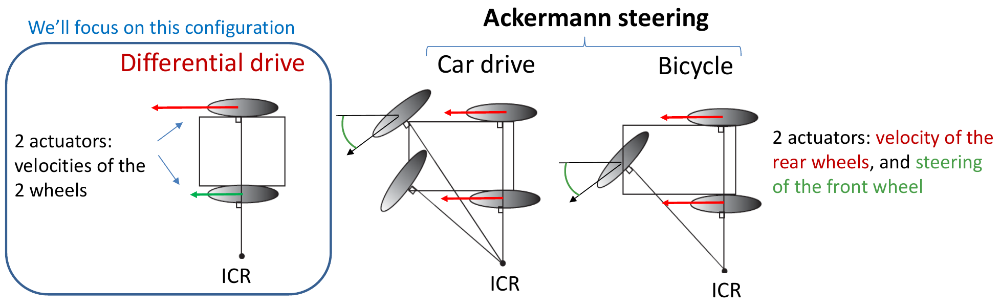

- El **ICR** (*Instantaneous Center of Rotation*, centro instantáneo de rotación) es la **intersección de las prolongaciones de los ejes de las ruedas**.
- Todos estos vehículos son **no holonómicos**:
  - 3 componentes de pose: $\mathbf{x} = [x, y, \theta]^T$.
  - Solo **2 variables de control independientes** (actuaciones).

> **Aclaración:** que haya 3 componentes de pose pero solo 2 controles es justamente lo que hace al vehículo no holonómico: no se puede controlar cada componente de la pose por separado en cada instante.

### 1.4. Movimiento de sólido rígido alrededor del ICR

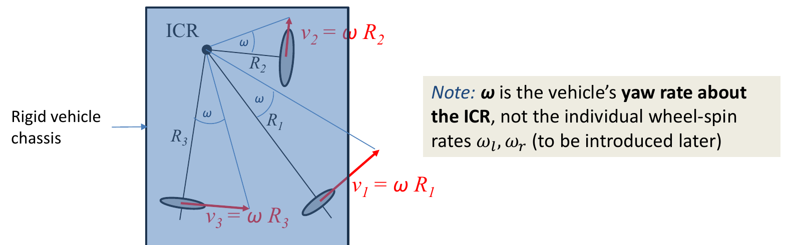

- Con un único ICR y 3 ruedas, el vehículo se mueve rodando las 3 ruedas (**sin deslizamiento**) y girando alrededor del ICR con velocidad angular $\omega$ (*yaw rate*, velocidad de guiñada).
- Un chasis rígido tiene **un solo ICR y un solo $\omega$** (si no fuera así, las ruedas deslizarían).
- La rueda $i$ describe una circunferencia de radio $R_i$.
- La velocidad del centro de la rueda $i$ es:

$$
v_i = \omega R_i
$$

> **Importante:** $\omega$ es la velocidad angular **del vehículo alrededor del ICR**, no la velocidad de giro de cada rueda sobre su eje ($\omega_l, \omega_r$, que aparecen más adelante).

### 1.5. ¿Cómo sigue el robot trayectorias arbitrarias?

Si el movimiento instantáneo es siempre circular (alrededor del ICR), ¿cómo puede el robot recorrer una trayectoria cualquiera?

**Respuesta:** **el ICR se mueve**. La trayectoria es la **composición de una secuencia de movimientos circulares** con un ICR que va cambiando de posición. Si se amplía un tramo pequeño de la trayectoria, se ve que es un arco de circunferencia.

En las diapositivas se muestra además una animación (vista global) en la que se representan la trayectoria, el eje de las ruedas, la velocidad del robot y la posición del ICR moviéndose con el tiempo.

### 1.6. Tracción diferencial: componentes y maniobras

Un robot de tracción diferencial tiene **dos motores** (uno por rueda) y una **rueda loca** (*free turning wheel*, o *caster*) que solo sirve de apoyo.

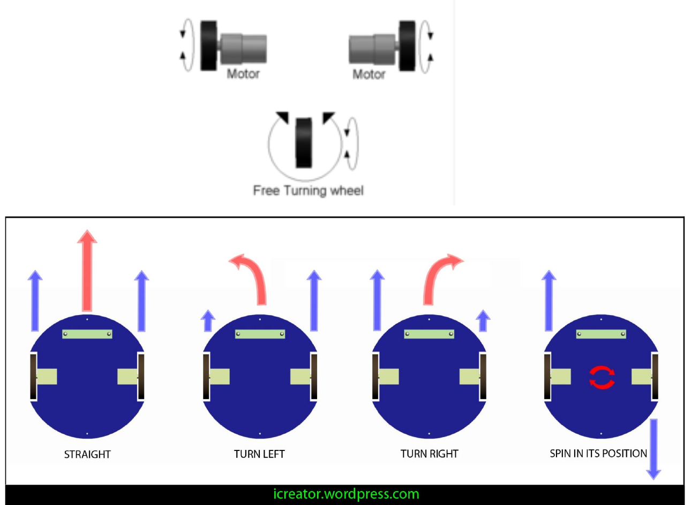

| Maniobra | Velocidades de las ruedas |
|---|---|
| Recto | Ambas ruedas a la misma velocidad |
| Girar a la izquierda | La rueda derecha más rápida que la izquierda |
| Girar a la derecha | La rueda izquierda más rápida que la derecha |
| Girar sobre sí mismo | Ruedas a la misma velocidad en sentidos opuestos |

### 1.7. Cinemática del robot diferencial

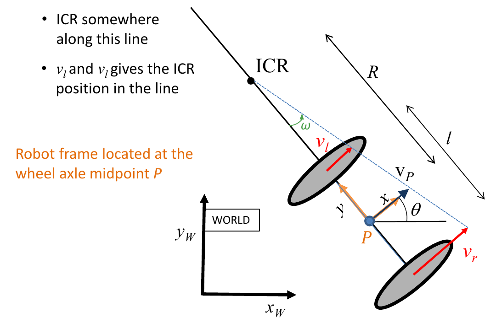

- El ICR está en algún punto de la **recta que contiene el eje de las ruedas**.
- Las velocidades $v_l$ y $v_r$ determinan la posición del ICR en esa recta.
- El **sistema de referencia del robot** se sitúa en el **punto medio del eje de las ruedas** ($P$).
- $l$ es la distancia entre las dos ruedas.

A partir de las velocidades lineales de los centros de las ruedas $v_l, v_r$:

$$
R = \frac{l}{2}\,\frac{v_l + v_r}{v_r - v_l}
\qquad\qquad
\omega = \frac{v_r - v_l}{l}
$$

$$
v_P = \omega R = \frac{v_l + v_r}{2}
$$

> **Aclaración (de dónde salen):** cada rueda gira alrededor del ICR con el mismo $\omega$. La rueda derecha está a distancia $R + l/2$ y la izquierda a $R - l/2$, así que $v_r = \omega (R + l/2)$ y $v_l = \omega (R - l/2)$. Restando: $v_r - v_l = \omega l$; sumando: $v_r + v_l = 2\omega R$. De ahí salen las tres fórmulas.
>
> **Casos particulares:**
> - $v_r = v_l$ → $\omega = 0$ y $R \to \infty$: movimiento recto (ICR en el infinito).
> - $v_r = -v_l$ → $R = 0$: giro sobre sí mismo (el ICR está en $P$).
> - $v_r > v_l$ → $\omega > 0$: gira a la izquierda.

**Relación con la velocidad de giro de las ruedas** (radio de rueda $r_r$, $r_l$):

$$
\omega_r = \frac{v_r}{r_r} \qquad \omega_l = \frac{v_l}{r_l}
$$

**¿Cómo se comanda el robot?** Se pueden enviar:

- $\langle \omega_l, \omega_r \rangle$: velocidades angulares de las ruedas, o
- $\langle v_P, \omega \rangle$: velocidad lineal y angular del robot.

Las conversiones siguen la cadena $\langle \omega_l, \omega_r \rangle \rightarrow \langle v_l, v_r \rangle \rightarrow \langle v_P, \omega \rangle$.

### 1.8. Incremento de pose durante un intervalo $\Delta t$

Suponiendo que **$\omega$ y $R$ son constantes durante $\Delta t$** (el robot recorre un arco de circunferencia):

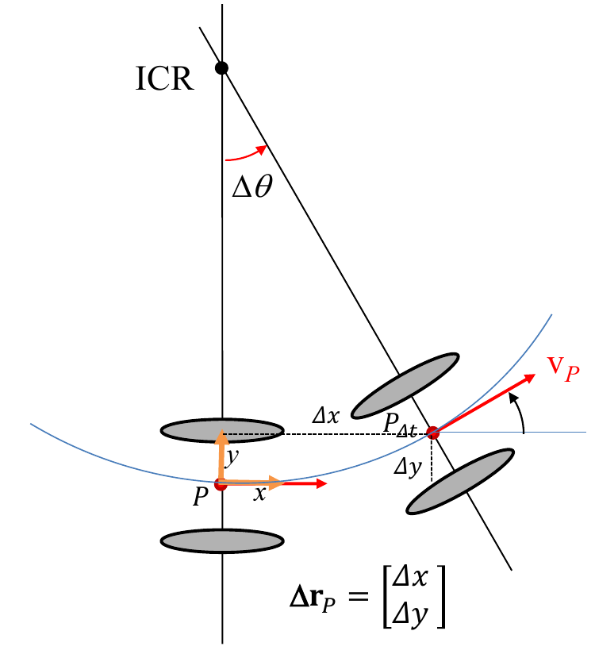

$$
\Delta x = \int_0^{\Delta t} v_P \cos(\Delta\theta(t))\,dt = \frac{v_P}{\omega}\sin(\omega\Delta t) = R\sin(\omega\Delta t)
$$

$$
\Delta y = \int_0^{\Delta t} v_P \sin(\Delta\theta(t))\,dt = \frac{v_P}{\omega}\left[1 - \cos(\omega\Delta t)\right] = R\left[1 - \cos(\omega\Delta t)\right]
$$

$$
\Delta\theta = \int_0^{\Delta t} \omega\,dt = \omega\Delta t
$$

**Movimiento recto** ($\omega = 0$, es decir, $v_r = v_l = v_P$; el ICR está en el infinito):

$$
\Delta x = v_P\,\Delta t \qquad \Delta y = 0 \qquad \Delta\theta = 0
$$

> **Muy importante:** el incremento $\Delta\mathbf{x} = [\Delta x, \Delta y, \Delta\theta]^T$ está expresado en el **sistema de referencia local del robot** (situado en $P$ al inicio del intervalo), no en el sistema global.
>
> **Aclaración geométrica:** el robot gira un ángulo $\Delta\theta = \omega \Delta t$ sobre una circunferencia de radio $R$. Con el ICR en $(0, R)$ en coordenadas locales, el punto final del arco está en $(R\sin\Delta\theta,\; R - R\cos\Delta\theta)$, que es exactamente $(\Delta x, \Delta y)$.

### 1.9. Resumen de la tracción diferencial

La entrada de la cinemática del robot puede ser $\mathbf{u} = [\omega_l, \omega_r]^T$ o, alternativamente, $\mathbf{u} = [v_P, \omega]^T$:

$$
v_r = \omega_r r_r \qquad v_l = \omega_l r_l
$$

$$
\omega = \frac{v_r - v_l}{l} = \frac{r_r\omega_r - r_l\omega_l}{l}
\qquad\qquad
v_P = \frac{v_l + v_r}{2} = \frac{r_r\omega_r + r_l\omega_l}{2}
$$

> **Nota:** en la diapositiva aparece $v_P = \frac{r_r\omega_r + r_r\omega_r}{2}$, que es una errata; lo correcto es $\frac{r_r\omega_r + r_l\omega_l}{2}$.

Y la salida es el incremento de pose **en el sistema local del robot**:

$$
\Delta\mathbf{x} = \begin{bmatrix} \Delta x \\ \Delta y \\ \Delta\theta \end{bmatrix} =
\begin{bmatrix} \frac{v_P}{\omega}\sin(\omega\Delta t) \\[4pt] \frac{v_P}{\omega}\left(1 - \cos(\omega\Delta t)\right) \\[4pt] \omega\Delta t \end{bmatrix}
$$

**¿Y si queremos la trayectoria recorrida por el robot?** Los incrementos de pose deben **componerse con la pose anterior en un sistema de coordenadas global**. Para eso se necesita la siguiente sección.

---

## 2. Poses planas y transformaciones

### 2.1. Composición de poses

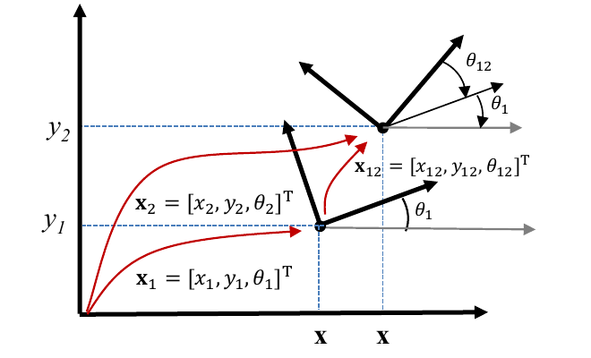

Si conocemos la pose $\mathbf{x}_1$ de un sistema 1 respecto al origen y la pose $\mathbf{x}_{12}$ del sistema 2 respecto al sistema 1, la pose del sistema 2 respecto al origen es la **composición**:

$$
\mathbf{x}_2 = \mathbf{x}_1 \oplus \mathbf{x}_{12}
$$

Se lee: "primero me muevo según $\mathbf{x}_1$ y, desde ahí y con esa orientación, me muevo según $\mathbf{x}_{12}$".

### 2.2. Transformación rígida de un punto

Un punto con coordenadas $\mathbf{r}_{12}$ en el sistema 1 tiene, en el sistema 0, coordenadas:

$$
\mathbf{r}_2 = R_{\theta_1}\,\mathbf{r}_{12} + \mathbf{r}_1
\qquad \text{(rotación + traslación)}
$$

con la **matriz de rotación** (¡hay que recordarla!):

$$
R_{\theta} = \begin{bmatrix} \cos\theta & -\sin\theta \\ \sin\theta & \cos\theta \end{bmatrix}
$$

Si no hay rotación ($\theta_1 = 0$), simplemente $\mathbf{r}_2 = \mathbf{r}_{12} + \mathbf{r}_1$.

### 2.3. Coordenadas homogéneas y equivalencia pose ↔ transformación

Usando coordenadas homogéneas, la rotación y la traslación se agrupan en una **única matriz** $3\times3$:

$$
\tilde{\mathbf{r}}_2 = \begin{bmatrix} \mathbf{r}_2 \\ 1 \end{bmatrix} =
\begin{bmatrix} R_{\theta_1} & \mathbf{r}_1 \\ \mathbf{0}^T & 1 \end{bmatrix}
\begin{bmatrix} \mathbf{r}_{12} \\ 1 \end{bmatrix} = {}^{0}T_{1}\,\tilde{\mathbf{r}}_{12}
$$

- ${}^{0}T_{1}$ transforma las coordenadas de un punto expresadas en el sistema 1 en coordenadas del sistema 0.
- **Equivalencia:** la pose $\mathbf{x}_{01} = \mathbf{x}_1 = [x_1, y_1, \theta_1]^T$ y la matriz $T(\mathbf{x}_{01}) = {}^{0}T_{1}$ representan **lo mismo** (la misma pose) con **objetos matemáticos distintos**.

> **Aclaración:** el truco de las coordenadas homogéneas es añadir un 1 al final del vector de posición, $\tilde{\mathbf{r}} = [x, y, 1]^T$. Así la traslación, que era una suma, pasa a ser parte de un producto de matrices, y encadenar transformaciones se reduce a multiplicar matrices.

### 2.4. Composición de poses como producto de matrices

La composición $\mathbf{x}_2 = \mathbf{x}_1 \oplus \mathbf{x}_{12}$ desarrollada es:

$$
\mathbf{x}_2 = \mathbf{x}_1 \oplus \mathbf{x}_{12} =
\begin{bmatrix}
x_1 + x_{12}\cos\theta_1 - y_{12}\sin\theta_1 \\
y_1 + x_{12}\sin\theta_1 + y_{12}\cos\theta_1 \\
\theta_1 + \theta_{12}
\end{bmatrix}
$$

Las dos primeras componentes son exactamente las dos primeras filas de ${}^{0}T_{1}\,\tilde{\mathbf{r}}_{12}$; la orientación simplemente se suma.

### 2.5. ¿Por qué es útil representar poses como transformaciones? (1) Inversa de una pose

La **pose inversa** $\ominus\mathbf{x}_1$ es la pose del origen visto desde el sistema 1. Se corresponde con la **matriz inversa** de la transformación:

$$
{}^{1}T_{0} = \left({}^{0}T_{1}\right)^{-1} = T(\ominus\mathbf{x}_1) =
\begin{bmatrix} R_{\theta_1} & \mathbf{r}_1 \\ \mathbf{0}^T & 1 \end{bmatrix}^{-1} =
\begin{bmatrix} R_{\theta_1}^{-1} & -R_{\theta_1}^{-1}\mathbf{r}_1 \\ \mathbf{0}^T & 1 \end{bmatrix} =
\begin{bmatrix} R_{\theta_1}^{T} & -R_{\theta_1}^{T}\mathbf{r}_1 \\ \mathbf{0}^T & 1 \end{bmatrix}
$$

${}^{1}T_{0}$ transforma coordenadas expresadas en el sistema 0 en coordenadas del sistema 1.

> **Aclaración:** $R_\theta^{-1} = R_\theta^T$ porque las matrices de rotación son ortogonales. Esto hace que la inversa sea muy barata de calcular.

**Ejemplo 1 — origen $O$ visto desde el sistema 1.** Con $\tilde{\mathbf{r}}_{O_0} = [0, 0, 1]^T$:

$$
{}^{1}\tilde{\mathbf{r}}_{O} = {}^{1}T_{0}\,\tilde{\mathbf{r}}_{O_0} =
\begin{bmatrix} -x_1\cos\theta_1 - y_1\sin\theta_1 \\ x_1\sin\theta_1 - y_1\cos\theta_1 \\ 1 \end{bmatrix}
$$

> **Nota:** en la diapositiva la segunda componente aparece como $x_1 c\theta_1 - y_1 s\theta_1$; lo correcto es $x_1\sin\theta_1 - y_1\cos\theta_1$ (se comprueba con el ejemplo 2).

**Ejemplo 2.** La pose del robot B respecto al robot A es $\mathbf{x}_{AB} = [2,\; 3,\; 45^\circ]^T$. ¿Cuál es la pose de A respecto a B?

$$
\mathbf{x}_{BA} = \ominus\mathbf{x}_{AB} = \left[-\tfrac{5\sqrt{2}}{2},\; -\tfrac{\sqrt{2}}{2},\; -45^\circ\right]^T
$$

> **Comprobación:** $-2\cos 45^\circ - 3\sin 45^\circ = -5\frac{\sqrt2}{2}$; $\;2\sin 45^\circ - 3\cos 45^\circ = -\frac{\sqrt2}{2}$; $\;-\theta = -45^\circ$.

### 2.6. Caso de uso: pose relativa entre dos poses

Si conocemos $\mathbf{x}_1$ y $\mathbf{x}_2$ en el sistema global, el incremento (pose de 2 vista desde 1) es:

$$
\Delta\mathbf{x} = (\ominus\mathbf{x}_1) \oplus \mathbf{x}_2 =
\begin{bmatrix}
(x_2 - x_1)\cos\theta_1 + (y_2 - y_1)\sin\theta_1 \\
-(x_2 - x_1)\sin\theta_1 + (y_2 - y_1)\cos\theta_1 \\
\theta_2 - \theta_1
\end{bmatrix}
$$

con

$$
\ominus\mathbf{x}_1 = \begin{bmatrix} -x_1\cos\theta_1 - y_1\sin\theta_1 \\ x_1\sin\theta_1 - y_1\cos\theta_1 \\ -\theta_1 \end{bmatrix}
$$

> **Las diapositivas insisten: ¡no memorizar estas ecuaciones!** Basta con saber que se obtienen operando con las matrices de transformación (inversa + producto). Esta operación es la que se usa después para calcular el incremento de odometría.

### 2.7. (2) Concatenación sencilla de poses

La composición y la inversa de poses equivalen al producto y la inversa de matrices:

| Con poses | Con matrices de transformación |
|---|---|
| $\mathbf{x}_{02} = \mathbf{x}_{01} \oplus \mathbf{x}_{12}$ | ${}^{0}T_{2} = {}^{0}T_{1}\,{}^{1}T_{2}$ |
| $\mathbf{x}_{21} = \ominus\mathbf{x}_{12} = \mathbf{x}_{23} \oplus (\ominus\mathbf{x}_{13})$ | ${}^{1}T_{2}^{-1} = {}^{2}T_{1} = {}^{2}T_{3}\,{}^{3}T_{1} = {}^{2}T_{3}\,{}^{1}T_{3}^{-1}$ |
| $\mathbf{x}_2 = \mathbf{x}_1 \oplus \mathbf{x}_{13} \oplus (\ominus\mathbf{x}_{23})$ | ${}^{0}T_{2} = {}^{0}T_{1}\,{}^{1}T_{3}\,{}^{3}T_{2}$ |

> **Truco:** con la notación ${}^{a}T_{b}$, los índices "interiores" se cancelan en cadena: ${}^{0}T_{1}\,{}^{1}T_{3}\,{}^{3}T_{2} = {}^{0}T_{2}$. Así es fácil comprobar si una concatenación está bien escrita.

### 2.8. El grupo SE(2)

Las poses planas con la operación $\oplus$ forman el grupo **SE(2)** (*Special Euclidean group* en 2D), que cumple:

1. **Clausura:** la composición de dos poses es otra pose.
2. **Asociatividad:** $(\mathbf{x}_A \oplus \mathbf{x}_B) \oplus \mathbf{x}_C = \mathbf{x}_A \oplus (\mathbf{x}_B \oplus \mathbf{x}_C)$.
3. **Elemento identidad:** la pose nula $\mathbf{0} = [0, 0, 0]^T$.
4. **Inversa:** $\ominus\mathbf{x}_{AB} = \mathbf{x}_{BA}$, de modo que $(\ominus\mathbf{x}_A) \oplus \mathbf{x}_A = \mathbf{0}$ y $\mathbf{x}_A \oplus (\ominus\mathbf{x}_A) = \mathbf{0}$.
5. **No es conmutativa:** en general, $\mathbf{x}_A \oplus \mathbf{x}_B \neq \mathbf{x}_B \oplus \mathbf{x}_A$.

> **Aclaración (no conmutatividad):** no es lo mismo "avanzar 1 m y luego girar 90°" que "girar 90° y luego avanzar 1 m": se acaba en sitios distintos. Por eso el orden de composición importa.

---

## 3. Modelos de movimiento deterministas

### 3.1. Definición y tipos

Un **modelo de movimiento** predice la pose del robot en el instante $t$ a partir de la **pose anterior** y de la **entrada de movimiento** aplicada durante el intervalo $[t-1, t]$.

| Modelo | Entrada | Componentes | Ecuación |
|---|---|---|---|
| **Entrada de velocidad** (*velocity motion model*) | $\mathbf{u}_t = [v_t, \omega_t]^T$ | 2 | $\mathbf{x}_t = \mathbf{g}_v(\mathbf{x}_{t-1}, \mathbf{u}_t, \Delta t)$ |
| **Entrada de odometría** (*odometry motion model*) | $\Delta\mathbf{x}_t^{odo} = (\ominus\mathbf{x}_{t-1}^{odo}) \oplus \mathbf{x}_t^{odo} = [\Delta x_t, \Delta y_t, \Delta\theta_t]^T$ | 3 | $\mathbf{x}_t = \mathbf{g}_o(\mathbf{x}_{t-1}, \Delta\mathbf{x}_t^{odo})$ |

### 3.2. Modelo con entrada de velocidad

Suponiendo $v_t$ y $\omega_t$ **constantes durante $\Delta t$**:

$$
\mathbf{x}_t = \mathbf{x}_{t-1} \oplus \Delta\mathbf{x}_t(\mathbf{u}_t, \Delta t)
$$

donde el incremento (en el sistema local del robot) es el de la sección 1.8:

- Si $\omega_t \neq 0$:

$$
\Delta x_t = \frac{v_t}{\omega_t}\sin(\omega_t\Delta t) \qquad
\Delta y_t = \frac{v_t}{\omega_t}\left(1 - \cos(\omega_t\Delta t)\right) \qquad
\Delta\theta_t = \omega_t\Delta t
$$

- Si $\omega_t = 0$:

$$
\Delta x_t = v_t\Delta t \qquad \Delta y_t = 0 \qquad \Delta\theta_t = 0
$$

Desarrollando la composición $\oplus$ (sección 2.4), la pose resultante en coordenadas globales es:

$$
\mathbf{x}_t = \mathbf{g}(\mathbf{x}_{t-1}, \Delta\mathbf{x}_t) =
\begin{bmatrix} x_t \\ y_t \\ \theta_t \end{bmatrix} =
\begin{bmatrix}
x_{t-1} + \Delta x_t\cos\theta_{t-1} - \Delta y_t\sin\theta_{t-1} \\
y_{t-1} + \Delta x_t\sin\theta_{t-1} + \Delta y_t\cos\theta_{t-1} \\
\theta_{t-1} + \Delta\theta_t
\end{bmatrix}
$$

**¿De dónde sale $\mathbf{u}_t$?**

- Puede ser el **comando enviado** al robot, o
- puede **estimarse a partir de sensores** (IMU, odometría visual…).

**Usos:** seguimiento y planificación de trayectorias, simulación, y predicción de pose (por ejemplo, en el EKF).

### 3.3. Trayectorias como secuencia de comandos de velocidad

Una secuencia de entradas de velocidad $\{\mathbf{u}_i\}$, cada una constante durante $\Delta t$, genera una trayectoria formada por **tramos de curvatura constante** (arcos):

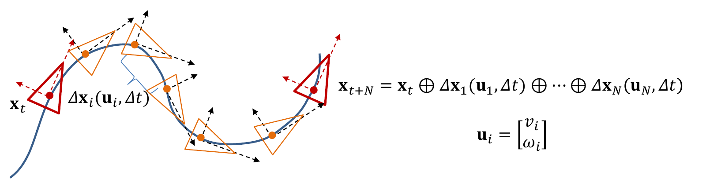

$$
\mathbf{x}_{t+N} = \mathbf{x}_t \oplus \Delta\mathbf{x}_1(\mathbf{u}_1, \Delta t) \oplus \cdots \oplus \Delta\mathbf{x}_N(\mathbf{u}_N, \Delta t),
\qquad \mathbf{u}_i = \begin{bmatrix} v_i \\ \omega_i \end{bmatrix}
$$

La trayectoria resulta de **componer pequeños incrementos de pose**.

### 3.4. Modelo con entrada de odometría

$$
\Delta\mathbf{x}_t^{odo} = (\ominus\mathbf{x}_{t-1}^{odo}) \oplus \mathbf{x}_t^{odo}
\qquad\longrightarrow\qquad
\mathbf{x}_t = \mathbf{g}_o(\mathbf{x}_{t-1}, \Delta\mathbf{x}_t^{odo}) = \mathbf{x}_{t-1} \oplus \Delta\mathbf{x}_t^{odo}
$$

- $\Delta\mathbf{x}_t^{odo} = [\Delta x_t, \Delta y_t, \Delta\theta_t]^T$ es el incremento de pose entre $\mathbf{x}_{t-1}^{odo}$ y $\mathbf{x}_t^{odo}$, proporcionado por el **módulo de odometría** del robot.
- $\Delta\mathbf{x}_t^{odo}$ está expresado en el **sistema local de odometría en $t-1$**.

> **Aclaración:** la odometría da poses $\mathbf{x}^{odo}$ en su propio sistema de referencia, que va acumulando error (deriva). Por eso no se usan esas poses directamente, sino solo el **incremento relativo** entre dos lecturas consecutivas (sección 2.6), que luego se compone con nuestra estimación de la pose $\mathbf{x}_{t-1}$.

### 3.5. Encoders de rueda

Los **encoders incrementales** (ópticos o magnéticos) miden los **incrementos de ángulo de las ruedas**.

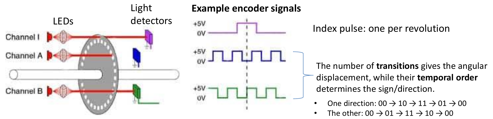

**Encoder óptico incremental:**

- Un disco con ranuras gira con la rueda entre una fuente de luz y unos detectores.
- Los detectores generan **pulsos** a medida que gira el disco; se usan varios canales para detectar la rotación.
- **Canal I (índice):** un pulso por revolución.
- **Canales A y B:** miden el desplazamiento angular y el **sentido de giro**:
  - El **número de transiciones** da el **desplazamiento angular**.
  - El **orden temporal** de las transiciones da el **signo (sentido de giro)**. Leyendo el estado de los dos canales como un par de bits $AB$:
    - En un sentido: $00 \to 10 \to 11 \to 01 \to 00$.
    - En el otro: $00 \to 01 \to 11 \to 10 \to 00$.
- **Resolución:** los encoders baratos tienen entre **2000 y 5000 cuentas por revolución**.

> **Aclaración:** los canales A y B están desfasados entre sí, así que en cada transición solo cambia uno de los dos bits. Según el orden en que se recorren los estados, se sabe en qué sentido gira la rueda, y contando transiciones se obtiene el ángulo girado. Por ejemplo, con 2000 cuentas/rev y una rueda de radio $r = 5$ cm, cada cuenta corresponde a $2\pi r/2000 \approx 0{,}157$ mm de avance de la rueda.

### 3.6. Cálculo de la odometría en el controlador de ruedas

Pasos que realiza el controlador:

1. Los encoders proporcionan los incrementos de ángulo de cada rueda $\Delta\varphi_R$ y $\Delta\varphi_L$ a intervalos $\delta t$.
2. Se convierten en distancias recorridas por cada rueda:

$$
\Delta s_R = r_R\,\Delta\varphi_R \qquad \Delta s_L = r_L\,\Delta\varphi_L
$$

3. Suponiendo **curvatura constante** durante $\delta t$, el desplazamiento del punto medio del eje y el giro del robot son:

$$
\Delta s = \frac{\Delta s_R + \Delta s_L}{2} \qquad \Delta\theta = \frac{\Delta s_R - \Delta s_L}{l}
$$

4. El incremento de pose (en el sistema local), con $R = \Delta s / \Delta\theta$:

$$
\Delta\mathbf{x} = \begin{bmatrix} \frac{\Delta s}{\Delta\theta}\sin\Delta\theta \\[4pt] \frac{\Delta s}{\Delta\theta}\left(1 - \cos\Delta\theta\right) \\[4pt] \Delta\theta \end{bmatrix}
$$

> **Aclaración:** son las mismas fórmulas de la cinemática diferencial (secciones 1.7–1.8), pero en lugar de velocidades se usan distancias recorridas: $\Delta s = v_P\,\delta t$ y $\Delta\theta = \omega\,\delta t$.

### 3.7. Composición de incrementos y frecuencias de trabajo

Entre $t-1$ y $t$ se producen $N_t$ actualizaciones de los encoders a alta frecuencia, que se componen:

$$
\mathbf{x}_t^{odo} = \mathbf{x}_{t-1}^{odo} \oplus \Delta\mathbf{x}_{t,1}^{odo} \oplus \cdots \oplus \Delta\mathbf{x}_{t,N_t}^{odo}
$$

- El **firmware del microcontrolador** compone los incrementos a alta frecuencia, por ejemplo **100 Hz** ($\delta t = 10$ ms).
- Las poses de odometría se publican al **módulo de navegación** a menor frecuencia, por ejemplo **10 Hz** ($\Delta t = 100$ ms).

> **Aclaración:** hay dos escalas de tiempo: $\delta t$ (pequeño, el del microcontrolador) y $\Delta t$ (grande, el del software de navegación). Componer a alta frecuencia hace válida la hipótesis de curvatura constante en cada tramo.

---

## 4. Modelos de movimiento probabilísticos

### 4.1. Motivación: la información de movimiento es imperfecta

- Las velocidades comandadas **no se ejecutan exactamente**.
- Los incrementos de odometría **no coinciden exactamente** con el desplazamiento real del robot.

Hay dos tipos de errores:

| Tipo | Características | Causas |
|---|---|---|
| **Sistemático** | Introduce un **sesgo repetible**; puede modelarse o reducirse mediante **calibración** | Radios de rueda incorrectos o distintos, distancia entre ruedas incorrecta, sesgo de los actuadores, sesgo del modelo cinemático |
| **Aleatorio** | **Varía de forma impredecible** entre ejecuciones repetidas; se representa mediante una **distribución de probabilidad** | Deslizamiento de ruedas, irregularidades del terreno, cuantización del encoder, perturbaciones externas |

**Es el error aleatorio el que se modela a continuación.**

### 4.2. Representación determinista frente a probabilística

- **Determinista** (sin error en $\mathbf{u}_t$) → predicción **exacta** de $\mathbf{x}_t$:

$$
\mathbf{x}_t = \mathbf{g}(\mathbf{x}_{t-1}, \mathbf{u}_t)
$$

- **Probabilística** (con error en $\mathbf{u}_t$) → predicción **aleatoria** de $\mathbf{x}_t$:

$$
p(\mathbf{x}_t \mid \mathbf{x}_{t-1}, \mathbf{u}_t)
$$

Es la distribución de la pose en $t$, dadas la pose en $t-1$ y la entrada de movimiento en $[t-1, t]$. Se aplica a ambos modelos:

- Modelo de velocidad: $\mathbf{u}_t = [v_t, \omega_t]^T$.
- Modelo de odometría: $\mathbf{u}_t = \Delta\mathbf{x}_t^{odo} = [\Delta x_t^{odo}, \Delta y_t^{odo}, \Delta\theta_t^{odo}]^T$.

---

## 5. Repaso de fundamentos de probabilidad

### 5.1. Variable aleatoria y función de densidad

- Una **variable aleatoria (RV)** $X$ representa una magnitud incierta; $x$ es una **realización** (un valor concreto) de $X$.
- **Función de densidad de probabilidad (PDF)** $p_X(x)$:
  - $p_X(x) \geq 0$.
  - $\int_{-\infty}^{\infty} p_X(x)\,dx = 1$.
  - $P(a < X \leq b) = \int_a^b p_X(x)\,dx$.
- **Función de distribución acumulada (CDF):** $F_X(x) = P(X \leq x)$.
- Para un intervalo pequeño: $P(x_0 < X < x_0 + \delta x) \approx p(x_0)\,\delta x$.
- Para una variable continua, $P(X = x) = 0$, aunque $p(x)$ no sea cero.

> **Aclaración:** la PDF **no es una probabilidad**, es una densidad; solo su integral sobre un intervalo da una probabilidad. Por eso la probabilidad de un valor exacto es 0.

### 5.2. Vectores aleatorios y notación

- Un **vector aleatorio** $\mathbf{X} = [X, Y, \Theta]^T$ toma valores concretos $\mathbf{x} = [x, y, \theta]^T$.
- **Notación simplificada:** se escribe en minúsculas. Por ejemplo:

$$
p_{\mathbf{X}_t \mid \mathbf{X}_{t-1}, \mathbf{U}_t}(\mathbf{x}_t \mid \mathbf{X}_{t-1} = \mathbf{x}_{t-1}, \mathbf{U}_t = \mathbf{u}_t)
\;\;\longrightarrow\;\;
p(\mathbf{x}_t \mid \mathbf{x}_{t-1}, \mathbf{u}_t)
$$

  Aquí las realizaciones de $\mathbf{X}_{t-1}$ y $\mathbf{U}_t$ son **conocidas**.

### 5.3. Probabilidad conjunta y condicionada

- **Conjunta:** $p(x, y)$.
- **Regla del producto:**

$$
p(x, y) = p(x \mid y)\,p(y) = p(y \mid x)\,p(x)
$$

- **Condicionada:**

$$
p(y \mid x) = \frac{p(x, y)}{p(x)}
$$

### 5.4. Marginalización y probabilidad total

- **Marginal (regla de la suma):**

$$
p(x) = \int p(x, y)\,dy
$$

- **Probabilidad total** (aplicando la regla del producto dentro de la integral):

$$
p(x) = \int p(x \mid y)\,p(y)\,dy
$$

### 5.5. Independencia e independencia condicional

- **Independencia** ($X \perp Y$):

$$
p(x, y) = p(x)\,p(y) \quad\Leftrightarrow\quad p(x \mid y) = p(x)
$$

- **Independencia condicional** ($X \perp Y \mid Z$), requiere al menos 3 variables:

$$
p(x, y \mid z) = p(x \mid z)\,p(y \mid z)
\quad\Leftrightarrow\quad
p(x \mid z) = p(x \mid z, y), \;\; p(y \mid z) = p(y \mid z, x)
$$

> **Aclaración:** $X$ e $Y$ pueden estar relacionadas, pero una vez conocida $Z$, saber $Y$ no aporta nada más sobre $X$.

### 5.6. Hipótesis de Markov en el modelo de movimiento

$$
p(\mathbf{x}_t \mid \mathbf{x}_1, \ldots, \mathbf{x}_{t-1}, \mathbf{u}_1, \ldots, \mathbf{u}_t) =
p(\mathbf{x}_t \mid \mathbf{x}_{1:t-1}, \mathbf{u}_{1:t}) =
p(\mathbf{x}_t \mid \mathbf{x}_{t-1}, \mathbf{u}_t)
$$

Esto se debe a dos independencias condicionales:

- $\mathbf{X}_t \perp \mathbf{X}_{1:t-2} \mid \mathbf{x}_{t-1}, \mathbf{u}_t$
- $\mathbf{X}_t \perp \mathbf{U}_{1:t-1} \mid \mathbf{x}_{t-1}, \mathbf{u}_t$

Es la **hipótesis de Markov**.

> **Aclaración:** si conozco dónde estaba el robot justo antes ($\mathbf{x}_{t-1}$) y qué movimiento se aplicó ($\mathbf{u}_t$), el resto del pasado (poses y comandos anteriores) no aporta información adicional para predecir $\mathbf{x}_t$. La pose anterior "resume" toda la historia.

---

## 6. Representación gaussiana

### 6.1. Distribución normal multivariante

$$
N(\mathbf{x}; \boldsymbol{\mu}, \Sigma) = \frac{1}{\sqrt{(2\pi)^n |\Sigma|}}\exp\!\left(-\frac{1}{2}(\mathbf{x} - \boldsymbol{\mu})^T \Sigma^{-1} (\mathbf{x} - \boldsymbol{\mu})\right)
$$

- La **constante de normalización** determina la altura.
- La **forma cuadrática** del exponente determina la posición ($\boldsymbol{\mu}$) y la forma ($\Sigma$).
- **La media y la covarianza caracterizan completamente la distribución.**

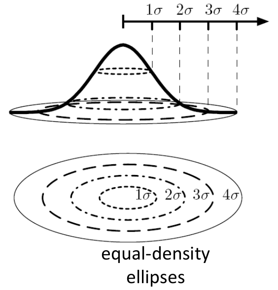

Las curvas de igual densidad son **elipses** ($1\sigma$, $2\sigma$, $3\sigma$, $4\sigma$…).

**Media de la pose:**

$$
\boldsymbol{\mu} = E[\mathbf{x}] = \begin{bmatrix} \mu_x \\ \mu_y \\ \mu_\theta \end{bmatrix} = \begin{bmatrix} \boldsymbol{\mu}_r \\ \mu_\theta \end{bmatrix}
$$

**Covarianza de la pose** ($3\times3$):

$$
\Sigma = E\left[(\mathbf{x} - \boldsymbol{\mu})(\mathbf{x} - \boldsymbol{\mu})^T\right] =
\begin{bmatrix}
\sigma_x^2 & \sigma_{xy} & \sigma_{x\theta} \\
\sigma_{xy} & \sigma_y^2 & \sigma_{y\theta} \\
\sigma_{x\theta} & \sigma_{y\theta} & \sigma_\theta^2
\end{bmatrix} =
\begin{bmatrix} \Sigma_r & \Sigma_{r\theta} \\ \Sigma_{r\theta}^T & \Sigma_\theta \end{bmatrix}
$$

- La **diagonal** contiene las varianzas de cada componente.
- Los elementos **fuera de la diagonal** son **covarianzas cruzadas**; si son distintos de cero, indican **dependencia lineal** entre componentes.

### 6.2. Tipos de covarianza y forma de las elipses

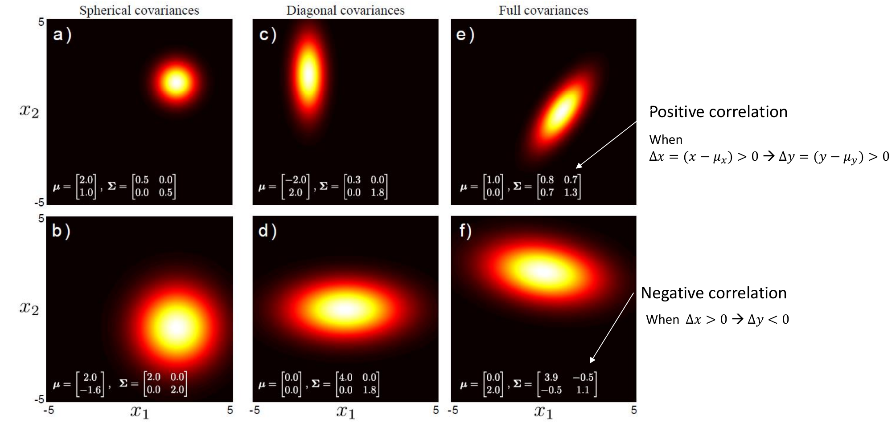

| Tipo | Matriz | Forma |
|---|---|---|
| **Esférica** | Diagonal con varianzas iguales | Círculos |
| **Diagonal** | Diagonal con varianzas distintas | Elipses alineadas con los ejes |
| **Completa** | Con términos fuera de la diagonal | Elipses inclinadas |

- **Correlación positiva** (figura e, covarianza cruzada $\sigma_{12} = 0{,}7 > 0$): cuando $\Delta x = (x - \mu_x) > 0$ tiende a ocurrir $\Delta y = (y - \mu_y) > 0$. La elipse sube hacia la derecha.
- **Correlación negativa** (figura f, $\sigma_{12} = -0{,}5 < 0$): cuando $\Delta x > 0$ tiende a ocurrir $\Delta y < 0$. La elipse baja hacia la derecha.

> **Aclaración:** el **signo** de la covarianza cruzada indica el tipo de correlación. Los valores 0,7 y −0,5 que aparecen en v6 son covarianzas, no coeficientes de correlación. El coeficiente sería $\rho = \sigma_{12}/(\sigma_1\sigma_2)$, que en la figura e vale $0{,}7/\sqrt{0{,}8\cdot1{,}3} \approx 0{,}69$ y en la f vale $-0{,}5/\sqrt{3{,}9\cdot1{,}1} \approx -0{,}24$.

**La covarianza determina la forma, el tamaño y la orientación de las elipses.**

---

## 7. Formas de representar la pose probabilística

### 7.1. Representación analítica vs. por muestras

- **Analítica:** normalmente una gaussiana:

$$
\mathbf{x}_t \sim p(\mathbf{x}_t \mid \mathbf{x}_{t-1}, \mathbf{u}_t) \approx N(\mathbf{x}_t; \bar{\mathbf{x}}_t, \Sigma_{x_t})
$$

  ("$\sim$" se lee "distribuido según"; $\bar{\mathbf{x}}_t$ es el vector de medias y $\Sigma_{x_t}$ la matriz de covarianza).

- **Por muestras:**

$$
\{\mathbf{x}_t^{[i]}\}_{i=1}^{N} \sim p(\mathbf{x}_t \mid \mathbf{x}_{t-1}, \mathbf{u}_t)
$$

  ("$\sim$" se lee aquí "es una muestra extraída de"). Cada muestra $\mathbf{x}_{t-1}^{[i]}$ se mueve con su propia entrada $\mathbf{u}_t^{[i]}$.

> **Aclaración:** la gaussiana resume la incertidumbre con solo dos parámetros (media y covarianza), pero obliga a que la forma sea una elipse. Las muestras (una "nube" de poses posibles) pueden representar cualquier forma, a costa de necesitar muchas muestras.

### 7.2. Las cuatro posibilidades

Combinando el modelo (velocidad u odometría) con la representación (gaussiana o muestras):

| | **Entrada de velocidad** $\mathbf{u}_t = [v_t, \omega_t]^T$ | **Entrada de odometría** |
|---|---|---|
| **Forma gaussiana** $\mathbf{x}_t \sim N(\bar{\mathbf{x}}_t, \Sigma_{x_t})$ | $\mathbf{x}_t = \mathbf{x}_{t-1} \oplus \Delta\mathbf{x}_t(\mathbf{u}_t)$, con $\mathbf{u}_t = [v_t, \omega_t]^T$ | $\mathbf{x}_t = \mathbf{x}_{t-1} \oplus \Delta\mathbf{x}_t^{odo}$, con $\mathbf{u}_t = [\Delta x_t^{odo}, \Delta y_t^{odo}, \Delta\theta_t^{odo}]^T$ |
| **Forma de muestras** $\{\mathbf{x}_{t-1}^{[i]}\}_{i=1}^N$ | $\tilde{\mathbf{u}}_t^{[i]} \sim N(\mathbf{u}_t, \Sigma_{\tilde{u}_t})$ | $\tilde{\mathbf{u}}_t^{odo,[i]} = [\theta_1^{[i]}, d^{[i]}, \theta_2^{[i]}]^T$ |

Se presentan los 4 casos a continuación (secciones 8 y 9). En v6, cada diapositiva de estos casos lleva esta tabla en la cabecera con la casilla correspondiente resaltada. El orden es: velocidad/muestras → velocidad/gaussiana → odometría/gaussiana → odometría/muestras.

---

## 8. Modelo probabilístico con entrada de velocidad

### 8.1. Velocidad / pose por muestras

Cada muestra se mueve con una velocidad aleatoria extraída de la distribución del ruido:

$$
\tilde{\mathbf{u}}_t^{[i]} = [\tilde{v}_t^{[i]}, \tilde{\omega}_t^{[i]}]^T \sim N(\mathbf{u}_t, M_t)
$$

$$
\mathbf{x}_t^{[i]} = \mathbf{x}_{t-1} \oplus \Delta\mathbf{x}_t(\tilde{\mathbf{u}}_t^{[i]}, \Delta t),
\qquad
\Delta\mathbf{x}_t^{[i]} =
\begin{bmatrix}
\frac{\tilde{v}_t^{[i]}}{\tilde{\omega}_t^{[i]}}\sin(\tilde{\omega}_t^{[i]}\Delta t) \\[4pt]
\frac{\tilde{v}_t^{[i]}}{\tilde{\omega}_t^{[i]}}\left(1 - \cos(\tilde{\omega}_t^{[i]}\Delta t)\right) \\[4pt]
\tilde{\omega}_t^{[i]}\Delta t
\end{bmatrix}
$$

**Ejemplo de las diapositivas:** se generan 4 muestras $\tilde{\mathbf{u}}_t^{[i]} \sim N(\mathbf{u}_t, M_t)$ del comando de velocidad y se aplica el modelo de movimiento a cada una.

- $\mathbf{u}_t = [1.00,\; 0.35]^T$ (m/s, rad/s), $\;M_t = \mathrm{diag}(0.07^2,\; 0.045^2)$, $\;\Delta t = 2.0$ s, $\;\mathbf{x}_{t-1} = [0,\; 0,\; 10^\circ]^T$.

| $i$ | $\tilde{\mathbf{u}}_t^{[i]} = [\tilde v, \tilde\omega]$ | $\mathbf{x}_t^{[i]} = [x, y, \theta]$ |
|---|---|---|
| 1 | $[0.9995,\; 0.3971]$ | $[1.6374,\; 1.0533,\; 55.50^\circ]$ |
| 2 | $[1.0519,\; 0.3826]$ | $[1.7425,\; 1.0854,\; 53.84^\circ]$ |
| 3 | $[1.1133,\; 0.2957]$ | $[1.9561,\; 0.9943,\; 43.89^\circ]$ |
| 4 | $[0.9561,\; 0.2906]$ | $[1.6852,\; 0.8456,\; 43.30^\circ]$ |

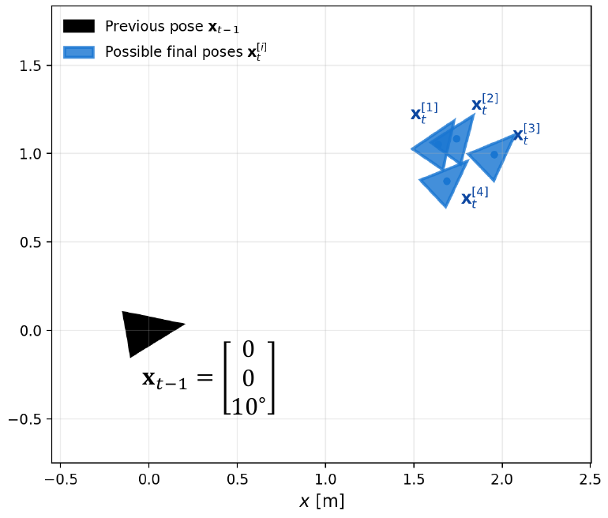

**Conclusión:** la ejecución repetida del **mismo comando** de velocidad $\mathbf{u}_t$ produce **poses finales distintas**.

> **Comprobación rápida (muestra 1):** $\Delta\theta = 0.3971 \cdot 2.0 = 0.794$ rad $\approx 45.5^\circ$, y $10^\circ + 45.5^\circ = 55.5^\circ$. ✔

### 8.2. Velocidad / pose gaussiana: modelo de ruido de la entrada

El comando de velocidad $\mathbf{u}_t$ no se ejecuta exactamente, sino con un **error no sesgado**:

$$
\boldsymbol{\xi}_t \sim N(\mathbf{0}, M_t), \qquad M_t = \mathrm{Cov}(\boldsymbol{\xi}_t)
$$

**Velocidad realmente ejecutada:**

$$
\tilde{\mathbf{u}}_t = \mathbf{u}_t + \boldsymbol{\xi}_t
\quad\rightarrow\quad
p(\tilde{\mathbf{u}}_t \mid \mathbf{u}_t) = N(\tilde{\mathbf{u}}_t; \mathbf{u}_t, M_t)
$$

Como $\tilde{\mathbf{u}}_t$ es aleatoria, la pose resultante también lo es:

$$
\mathbf{x}_t = \mathbf{x}_{t-1} \oplus \Delta\mathbf{x}_t(\tilde{\mathbf{u}}_t, \Delta t),
\qquad
\mathbf{x}_t \sim p(\mathbf{x}_t \mid \mathbf{x}_{t-1}, \mathbf{u}_t)
$$

**¿Cuál es la distribución de $\mathbf{x}_t \mid \mathbf{x}_{t-1}, \mathbf{u}_t$?**

$$
p(\mathbf{x}_t \mid \mathbf{x}_{t-1}, \mathbf{u}_t)
\underset{\text{marginalización}}{=} \int p(\mathbf{x}_t, \tilde{\mathbf{u}}_t \mid \mathbf{x}_{t-1}, \mathbf{u}_t)\,d\tilde{\mathbf{u}}_t
\underset{\text{prob. total}}{=} \int p(\mathbf{x}_t \mid \mathbf{x}_{t-1}, \tilde{\mathbf{u}}_t)\,p(\tilde{\mathbf{u}}_t \mid \mathbf{u}_t)\,d\tilde{\mathbf{u}}_t
$$

- Aquí $\mathbf{x}_{t-1}$ se trata como **exacta (conocida)**; la incertidumbre proviene solo de $\tilde{\mathbf{u}}_t$.
- $p(\mathbf{x}_t \mid \mathbf{x}_{t-1}, \mathbf{u}_t)$ se **aproximará por una pdf gaussiana** (apartados siguientes). La integral no suele tener solución cerrada porque el modelo es no lineal, así que se aproxima propagando la **media y la covarianza**.

### 8.3. Ejemplo 1-D: robot en un pasillo

*(Diapositiva nueva en v6.)* Explica, en el caso más simple, de dónde sale la integral de probabilidad total de 9.2. El robot se mueve en una sola dimensión (un pasillo) y la nueva posición es simplemente $x_t = x_{t-1} + \tilde u_t$.

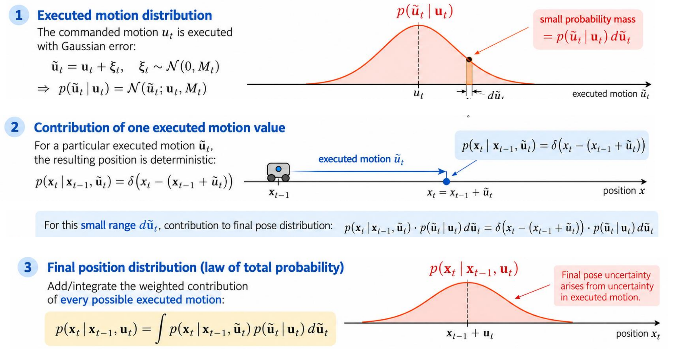

1. **Distribución del movimiento ejecutado.** El movimiento comandado $u_t$ se ejecuta con error gaussiano:

$$
\tilde u_t = u_t + \xi_t,\quad \xi_t \sim N(0, M_t)
\quad\Rightarrow\quad
p(\tilde u_t \mid u_t) = N(\tilde u_t; u_t, M_t)
$$

   Un intervalo pequeño $d\tilde u_t$ tiene una **pequeña masa de probabilidad** $p(\tilde u_t \mid u_t)\,d\tilde u_t$.

2. **Contribución de un valor concreto del movimiento ejecutado.** Para un $\tilde u_t$ concreto, la posición resultante es **determinista**, así que su "pdf" es una delta de Dirac:

$$
p(x_t \mid x_{t-1}, \tilde u_t) = \delta\big(x_t - (x_{t-1} + \tilde u_t)\big)
$$

   La contribución de ese intervalo $d\tilde u_t$ a la distribución final es $\delta\big(x_t - (x_{t-1} + \tilde u_t)\big)\cdot p(\tilde u_t \mid u_t)\,d\tilde u_t$.

3. **Distribución final (ley de la probabilidad total).** Se suman (integran) las contribuciones ponderadas de **todos los movimientos ejecutados posibles**:

$$
p(x_t \mid x_{t-1}, u_t) = \int p(x_t \mid x_{t-1}, \tilde u_t)\,p(\tilde u_t \mid u_t)\,d\tilde u_t
$$

   El resultado es una campana centrada en $x_{t-1} + u_t$. **La incertidumbre de la pose final viene de la incertidumbre del movimiento ejecutado.**

> **Aclaración:** la delta "selecciona" el único $\tilde u_t$ que lleva a $x_t$, que es $\tilde u_t = x_t - x_{t-1}$. Por eso $p(x_t \mid x_{t-1}, u_t) = p(\tilde u_t = x_t - x_{t-1} \mid u_t) = N(x_t;\; x_{t-1} + u_t,\; M_t)$. En este caso 1-D el modelo es **lineal** y el resultado es una gaussiana exacta, con la misma varianza que el ruido del movimiento. En 2D, la composición $\oplus$ es **no lineal** y el resultado ya no es exactamente gaussiano, así que se aproxima linealizando (9.4–9.7).

### 8.4. Propagación de incertidumbre de primer orden (una variable)

Sea $\mathbf{z} = \mathbf{f}(\mathbf{a})$ con $\mathbf{a} \sim N(\bar{\mathbf{a}}, \Sigma_a)$. Como $\mathbf{f}$ puede ser no lineal, se **linealiza alrededor de la media** de la entrada:

$$
\mathbf{z} \approx \mathbf{f}(\bar{\mathbf{a}}) + F_a(\mathbf{a} - \bar{\mathbf{a}}),
\qquad
F_a = \left.\frac{\partial\mathbf{f}}{\partial\mathbf{a}}\right|_{\bar{\mathbf{a}}} \;\text{(matriz jacobiana de } \mathbf{f}\text{)}
$$

Entonces:

$$
\bar{\mathbf{z}} \approx \mathbf{f}(\bar{\mathbf{a}}) \quad\text{(media de } \mathbf{z}\text{)}
\qquad\qquad
\Sigma_z \approx F_a\,\Sigma_a\,F_a^T \quad\text{(covarianza de } \mathbf{z}\text{)}
$$

**Interpretación esencial:**

- El jacobiano $F_a$ **transforma pequeños errores de entrada** ($\Delta\mathbf{a}$) **en errores de salida** ($\Delta\mathbf{f}$).
- La covarianza de entrada $\Sigma_a$ se **transforma al espacio de salida** como $F_a\Sigma_aF_a^T$.

> **Aclaración:** es la generalización del caso escalar: si $z = f(a)$ y $a$ tiene varianza $\sigma_a^2$, entonces $\sigma_z^2 \approx f'(\bar a)^2\,\sigma_a^2$. En el caso vectorial la derivada es el jacobiano y "al cuadrado" se convierte en $F\,\Sigma\,F^T$.

### 8.5. Velocidad / pose gaussiana con $\mathbf{x}_{t-1}$ conocida

Aproximación gaussiana de la pose predicha cuando **$\mathbf{x}_{t-1}$ es exacta** (no es variable aleatoria):

$$
\tilde{\mathbf{u}}_t \sim N(\tilde{\mathbf{u}}_t; \mathbf{u}_t, M_t),
\qquad
M_t = \mathrm{Cov}(\tilde{\mathbf{u}}_t) = \mathrm{Cov}(\boldsymbol{\xi}_t) =
\begin{bmatrix} \sigma_v^2 & \sigma_{v\omega} \\ \sigma_{v\omega} & \sigma_\omega^2 \end{bmatrix}
$$

($M_t$ es la covarianza de la incertidumbre de velocidad; también se denota $\Sigma_{\tilde{u}_t}$.)

La nueva pose es una función **no lineal** de $\tilde{\mathbf{u}}_t$:

$$
\mathbf{x}_t = \mathbf{g}_v(\mathbf{x}_{t-1}, \tilde{\mathbf{u}}_t) = \mathbf{x}_{t-1} \oplus \Delta\mathbf{x}_t(\tilde{\mathbf{u}}_t) \sim N(\bar{\mathbf{x}}_t, \Sigma_{x_t})
$$

Aplicando la propagación de primer orden:

$$
\bar{\mathbf{x}}_t \approx \mathbf{g}_v(\mathbf{x}_{t-1}, \mathbf{u}_t) = \mathbf{x}_{t-1} \oplus \Delta\mathbf{x}_t(\mathbf{u}_t) \quad\text{(media predicha)}
$$

$$
\Sigma_{x_t} \approx V_t\,M_t\,V_t^T \quad\text{(covarianza predicha: incertidumbre del movimiento expresada en el espacio de la pose)}
$$

con el jacobiano

$$
V_t = \left.\frac{\partial\mathbf{g}_v}{\partial\tilde{\mathbf{u}}_t}\right|_{\mathbf{u}_t} \qquad (\text{dimensión } 3\times2)
$$

> **Aclaración:** $V_t$ es $3\times2$ porque la salida es la pose (3 componentes) y la entrada es la velocidad (2 componentes). $V_t M_t V_t^T$ "traduce" la incertidumbre en $(v, \omega)$ a incertidumbre en $(x, y, \theta)$.

### 8.6. Propagación de primer orden con dos variables independientes

Sea $\mathbf{z} = \mathbf{f}(\mathbf{a}, \mathbf{b})$ con $\mathbf{a} \sim N(\bar{\mathbf{a}}, \Sigma_a)$ y $\mathbf{b} \sim N(\bar{\mathbf{b}}, \Sigma_b)$ **independientes**. Linealizando alrededor de las medias:

$$
\mathbf{z} \approx \mathbf{f}(\bar{\mathbf{a}}, \bar{\mathbf{b}}) + F_a(\mathbf{a} - \bar{\mathbf{a}}) + F_b(\mathbf{b} - \bar{\mathbf{b}}),
\qquad
F_a = \left.\frac{\partial\mathbf{f}}{\partial\mathbf{a}}\right|_{\bar{\mathbf{a}}, \bar{\mathbf{b}}},\;
F_b = \left.\frac{\partial\mathbf{f}}{\partial\mathbf{b}}\right|_{\bar{\mathbf{a}}, \bar{\mathbf{b}}}
$$

Entonces:

$$
\bar{\mathbf{z}} \approx \mathbf{f}(\bar{\mathbf{a}}, \bar{\mathbf{b}})
\qquad\qquad
\Sigma_z \approx F_a\,\Sigma_a\,F_a^T + F_b\,\Sigma_b\,F_b^T
$$

**Las contribuciones de incertidumbre independientes se suman.**

> **Nota (v6):** esta diapositiva ya no aparece en v6. El resultado se sigue usando directamente en 9.7, 10.1 y en el ejemplo resuelto de 10.2, donde se dice que, como se supone que las dos fuentes de incertidumbre son **independientes**, sus contribuciones a la covarianza **se suman**.

### 8.7. Velocidad / pose gaussiana con $\mathbf{x}_{t-1}$ incierta

Ahora **tanto la pose anterior como la entrada son inciertas**:

$$
\mathbf{x}_{t-1} \sim N(\bar{\mathbf{x}}_{t-1}, \Sigma_{x_{t-1}}),
\qquad
\tilde{\mathbf{u}}_t \sim N(\mathbf{u}_t, M_t)
$$

Aplicando el resultado de la sección 8.6 con $\mathbf{a} = \mathbf{x}_{t-1}$ y $\mathbf{b} = \tilde{\mathbf{u}}_t$:

$$
\bar{\mathbf{x}}_t \approx \mathbf{g}_v(\bar{\mathbf{x}}_{t-1}, \mathbf{u}_t)
$$

$$
\Sigma_{x_t} \approx
\underbrace{G_t\,\Sigma_{x_{t-1}}\,G_t^T}_{\substack{\text{incertidumbre de la pose anterior}\\\text{en el espacio de la pose}}}
+
\underbrace{V_t\,M_t\,V_t^T}_{\substack{\text{incertidumbre del movimiento}\\\text{en el espacio de la pose}}}
$$

con los jacobianos

$$
G_t = \left.\frac{\partial\mathbf{g}_v}{\partial\mathbf{x}_{t-1}}\right|_{\bar{\mathbf{x}}_{t-1}, \mathbf{u}_t}
\qquad\qquad
V_t = \left.\frac{\partial\mathbf{g}_v}{\partial\tilde{\mathbf{u}}_t}\right|_{\bar{\mathbf{x}}_{t-1}, \mathbf{u}_t}
$$

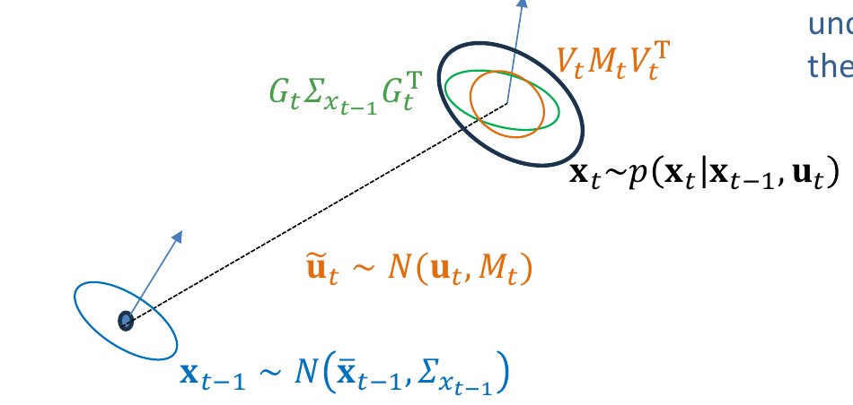

> **Aclaración:** la incertidumbre **crece en cada paso**: a la incertidumbre que ya se tenía (transformada por $G_t$) se le suma la que introduce el nuevo movimiento. Por eso, si el robot solo usa su modelo de movimiento, la elipse se hace cada vez más grande.

---

## 9. Modelo probabilístico con entrada de odometría

### 9.1. Odometría / pose gaussiana

Se tienen las lecturas $\mathbf{x}_{t-1}^{odo}$ y $\mathbf{x}_t^{odo}$ y se calcula el incremento:

$$
\Delta\bar{\mathbf{x}}_t^{odo} = (\ominus\mathbf{x}_{t-1}^{odo}) \oplus \mathbf{x}_t^{odo}
$$

Suponiendo $\mathrm{Cov}(\mathbf{x}_{t-1}, \Delta\mathbf{x}_t^{odo}) = 0$ (**sin correlación**), la pose gaussiana $\mathbf{x}_t \sim N(\bar{\mathbf{x}}_t, \Sigma_{x_t})$ se calcula así:

**Media:**

$$
\bar{\mathbf{x}}_t = \mathbf{g}_o(\bar{\mathbf{x}}_{t-1}, \Delta\bar{\mathbf{x}}_t^{odo}) = \bar{\mathbf{x}}_{t-1} \oplus \Delta\bar{\mathbf{x}}_t^{odo}
$$

**Covarianza:**

$$
\Sigma_{x_t} \approx
\frac{\partial\mathbf{g}_o}{\partial\mathbf{x}_{t-1}}\,\Sigma_{x_{t-1}}\,\frac{\partial\mathbf{g}_o}{\partial\mathbf{x}_{t-1}}^T
+
\frac{\partial\mathbf{g}_o}{\partial\Delta\mathbf{x}_t^{odo}}\,\Sigma_{\Delta x_t^{odo}}\,\frac{\partial\mathbf{g}_o}{\partial\Delta\mathbf{x}_t^{odo}}^T
$$

con la covarianza del incremento de odometría (sin correlación entre componentes):

$$
\Sigma_{\Delta x_t^{odo}} = \begin{bmatrix} \sigma_{\Delta x}^2 & 0 & 0 \\ 0 & \sigma_{\Delta y}^2 & 0 \\ 0 & 0 & \sigma_{\Delta\theta}^2 \end{bmatrix}
$$

**Jacobianos** (derivando la composición $\oplus$ de la sección 3.2):

$$
\frac{\partial\mathbf{g}_o}{\partial\mathbf{x}_{t-1}} =
\begin{bmatrix}
1 & 0 & -\Delta x_t\sin\theta_{t-1} - \Delta y_t\cos\theta_{t-1} \\
0 & 1 & \Delta x_t\cos\theta_{t-1} - \Delta y_t\sin\theta_{t-1} \\
0 & 0 & 1
\end{bmatrix}
\qquad
\frac{\partial\mathbf{g}_o}{\partial\Delta\mathbf{x}_t^{odo}} =
\begin{bmatrix}
\cos\theta_{t-1} & -\sin\theta_{t-1} & 0 \\
\sin\theta_{t-1} & \cos\theta_{t-1} & 0 \\
0 & 0 & 1
\end{bmatrix}
$$

> **Aclaración:** es exactamente la misma estructura que en la sección 8.7 ($G\Sigma G^T + V M V^T$), pero ahora la entrada es el incremento de odometría (3 componentes) en lugar de la velocidad (2 componentes). Fíjate en que el segundo jacobiano es simplemente la matriz de rotación $R_{\theta_{t-1}}$ ampliada a $3\times3$: rota la incertidumbre del incremento (expresada en el sistema local) al sistema global.

### 9.2. Ejemplo resuelto: propagación gaussiana con entrada de odometría

*(Diapositiva nueva en v6.)*

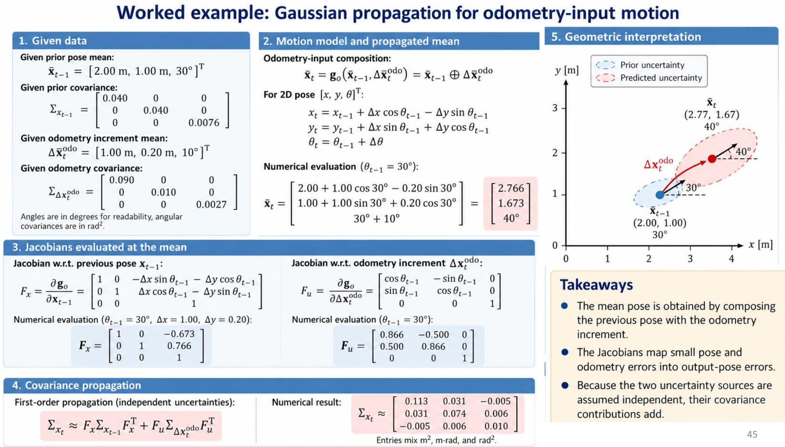

**1. Datos.** Los ángulos se dan en grados para que sea más legible, pero las covarianzas angulares están en rad².

$$
\bar{\mathbf{x}}_{t-1} = [2{,}00 \text{ m},\; 1{,}00 \text{ m},\; 30^\circ]^T
\qquad
\Sigma_{x_{t-1}} = \mathrm{diag}(0{,}040;\; 0{,}040;\; 0{,}0076)
$$

$$
\Delta\bar{\mathbf{x}}_t^{odo} = [1{,}00 \text{ m},\; 0{,}20 \text{ m},\; 10^\circ]^T
\qquad
\Sigma_{\Delta x_t^{odo}} = \mathrm{diag}(0{,}090;\; 0{,}010;\; 0{,}0027)
$$

**2. Media propagada** (composición $\oplus$ con $\theta_{t-1} = 30^\circ$):

$$
\bar{\mathbf{x}}_t =
\begin{bmatrix}
2{,}00 + 1{,}00\cos30^\circ - 0{,}20\sin30^\circ \\
1{,}00 + 1{,}00\sin30^\circ + 0{,}20\cos30^\circ \\
30^\circ + 10^\circ
\end{bmatrix}
=
\begin{bmatrix} 2{,}766 \\ 1{,}673 \\ 40^\circ \end{bmatrix}
$$

**3. Jacobianos evaluados en la media** ($\theta_{t-1} = 30^\circ$, $\Delta x = 1{,}00$, $\Delta y = 0{,}20$):

$$
F_x = \frac{\partial\mathbf{g}_o}{\partial\mathbf{x}_{t-1}} =
\begin{bmatrix} 1 & 0 & -0{,}673 \\ 0 & 1 & 0{,}766 \\ 0 & 0 & 1 \end{bmatrix}
\qquad
F_u = \frac{\partial\mathbf{g}_o}{\partial\Delta\mathbf{x}_t^{odo}} =
\begin{bmatrix} 0{,}866 & -0{,}500 & 0 \\ 0{,}500 & 0{,}866 & 0 \\ 0 & 0 & 1 \end{bmatrix}
$$

($-0{,}673 = -1\cdot\sin30^\circ - 0{,}2\cos30^\circ$ y $0{,}766 = 1\cdot\cos30^\circ - 0{,}2\sin30^\circ$.)

**4. Propagación de la covarianza** (incertidumbres independientes):

$$
\Sigma_{x_t} \approx F_x\Sigma_{x_{t-1}}F_x^T + F_u\Sigma_{\Delta x_t^{odo}}F_u^T \approx
\begin{bmatrix}
0{,}113 & 0{,}031 & -0{,}005 \\
0{,}031 & 0{,}074 & 0{,}006 \\
-0{,}005 & 0{,}006 & 0{,}010
\end{bmatrix}
$$

Las unidades de los elementos se mezclan: m², m·rad y rad².

**5. Interpretación geométrica:** la elipse predicha (roja) es **más grande** que la previa (azul), y además **está inclinada**, porque aparecen covarianzas cruzadas que antes eran cero.

**Conclusiones de la diapositiva:**

- La pose media se obtiene **componiendo** la pose anterior con el incremento de odometría.
- Los jacobianos convierten los pequeños errores de pose y de odometría en errores de la pose de salida.
- Como se supone que las dos fuentes de incertidumbre son **independientes**, sus contribuciones a la covarianza **se suman**.

> **Aclaración:** desglosando la suma, el término de la pose anterior da $\sigma_\theta^2 = 0{,}0076$ y el de la odometría da $0{,}0027$, en total $\approx 0{,}0103$ rad². Fíjate en de dónde salen las correlaciones: $F_x$ "contagia" la incertidumbre de $\theta_{t-1}$ a $x$ e $y$ (un error de orientación desplaza el punto final), y $F_u$ rota la incertidumbre del incremento, que es mayor en el eje de avance local, hacia la dirección de $30^\circ$. Por ejemplo, solo con el término de odometría saldría $\sigma_x^2 = 0{,}09\cos^2 30^\circ + 0{,}01\sin^2 30^\circ = 0{,}07$, $\sigma_y^2 = 0{,}03$ y $\sigma_{xy} \approx 0{,}035$. Por cierto, $0{,}0076 \approx (5^\circ)^2$ y $0{,}0027 \approx (3^\circ)^2$ en rad².

### 9.3. Odometría / pose por muestras: descomposición rotación–traslación–rotación

De nuevo se tienen las lecturas $\mathbf{x}_{t-1}^{odo}$, $\mathbf{x}_t^{odo}$, pero ahora el desplazamiento se expresa como $\mathbf{u}_t = [\bar\theta_1, \bar d, \bar\theta_2]^T$: el incremento de odometría se representa por una **rotación** $\theta_1$ equivalente, una **traslación** $d$ y otra **rotación** $\theta_2$.

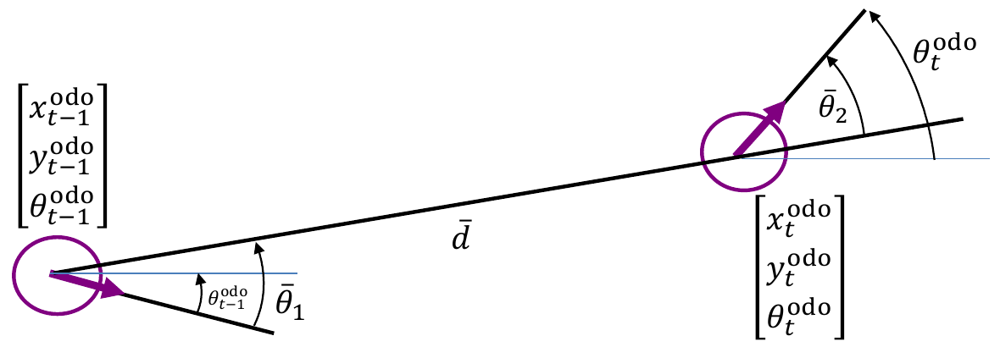

- **Rotación en $t-1$:**

$$
\bar\theta_1 = \mathrm{atan2}\!\left(y_t^{odo} - y_{t-1}^{odo},\; x_t^{odo} - x_{t-1}^{odo}\right) - \theta_{t-1}^{odo}
$$

- **Movimiento recto desde $t-1$:**

$$
\bar d = \sqrt{(x_t^{odo} - x_{t-1}^{odo})^2 + (y_t^{odo} - y_{t-1}^{odo})^2}
$$

- **Rotación en $t$:**

$$
\bar\theta_2 = \theta_t^{odo} - \theta_{t-1}^{odo} - \bar\theta_1
$$

> **Aclaración:** cualquier incremento plano puede reproducirse con "girar para apuntar hacia el destino → avanzar en línea recta → girar hasta la orientación final". $\bar\theta_1$ es el ángulo entre la orientación inicial y la dirección hacia el destino; $\bar\theta_2$ es lo que falta girar al llegar.

### 9.4. Movimiento aleatorio de cada muestra

Cada muestra $\mathbf{x}_{t-1}^{[i]}$ se mueve con un movimiento aleatorio:

$$
\tilde{\mathbf{u}}_t^{odo,[i]} = [\theta_1^{[i]}, d^{[i]}, \theta_2^{[i]}]^T \sim N(\mathbf{u}_t^{odo}, \Sigma_{\tilde{u}_t^{odo}}),
\qquad
\Sigma_{\tilde{u}_t^{odo}} = \begin{bmatrix} \sigma_{\theta_1}^2 & 0 & 0 \\ 0 & \sigma_d^2 & 0 \\ 0 & 0 & \sigma_{\theta_2}^2 \end{bmatrix}
$$

Es decir (omitiendo el superíndice $[i]$ por claridad):

$$
\theta_1 \sim N(\bar\theta_1, \sigma_{\theta_1}^2) \qquad d \sim N(\bar d, \sigma_d^2) \qquad \theta_2 \sim N(\bar\theta_2, \sigma_{\theta_2}^2)
$$

**Modelo de movimiento por odometría aplicado a cada muestra**, $\{\mathbf{x}_{t-1}^{[i]}\}_{i=1}^N \rightarrow \{\mathbf{x}_t^{[i]}\}_{i=1}^N$:

$$
\begin{aligned}
x_t^{[i]} &= x_{t-1}^{[i]} + d^{[i]}\cos(\theta_{t-1}^{[i]} + \theta_1^{[i]}) \\
y_t^{[i]} &= y_{t-1}^{[i]} + d^{[i]}\sin(\theta_{t-1}^{[i]} + \theta_1^{[i]}) \\
\theta_t^{[i]} &= \theta_{t-1}^{[i]} + \theta_1^{[i]} + \theta_2^{[i]}
\end{aligned}
$$

**Efecto de los parámetros** (figura de *Probabilistic Robotics*, Thrun et al. 2005; solo se muestran las componentes de posición):

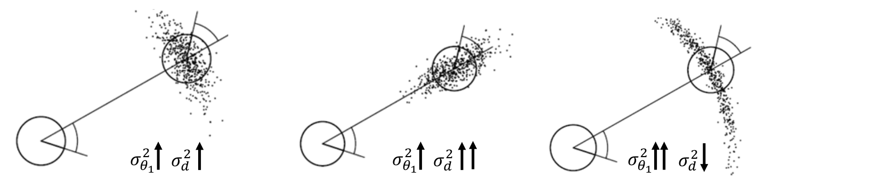

| Figura | $\sigma_{\theta_1}^2$ | $\sigma_d^2$ | Resultado |
|---|---|---|---|
| Izquierda | ↑ | ↑ | Nube moderada en torno a la pose final |
| Centro | ↑ | ↑↑ | Nube **alargada en la dirección del movimiento** |
| Derecha | ↑↑ | ↓ | Nube **curvada en forma de arco** ("plátano") |

> **Aclaración:** el ruido en la distancia ($\sigma_d$) dispersa las muestras a lo largo de la dirección de avance; el ruido en el giro ($\sigma_{\theta_1}$) las dispersa en un arco alrededor del punto de partida. Esta forma de "plátano" **no puede representarse bien con una elipse gaussiana**, y es una ventaja de la representación por muestras.

---

## 10. Resumen

### 10.1. Cinemática y composición de poses

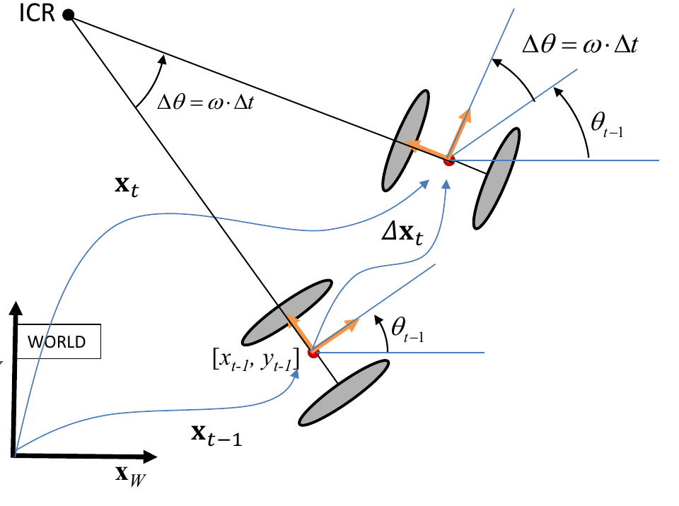

- **Cinemática del vehículo:** la entrada es $\mathbf{u} = [v_P, \omega]^T$ o $\mathbf{u} = [\omega_l, \omega_r]^T$ y se obtiene el incremento local:

$$
\Delta x = \frac{v_P}{\omega}\sin(\omega\Delta t) \qquad
\Delta y = \frac{v_P}{\omega}\left(1 - \cos(\omega\Delta t)\right) \qquad
\Delta\theta = \omega\Delta t
$$

- **Composición de poses** para obtener la pose global:

$$
\mathbf{x}_t = \mathbf{g}(\mathbf{x}_{t-1}, \Delta\mathbf{x}_t) = \mathbf{x}_{t-1} \oplus \Delta\mathbf{x}_t =
\begin{bmatrix}
x_{t-1} + \Delta x_t\cos\theta_{t-1} - \Delta y_t\sin\theta_{t-1} \\
y_{t-1} + \Delta x_t\sin\theta_{t-1} + \Delta y_t\cos\theta_{t-1} \\
\theta_{t-1} + \Delta\theta_t
\end{bmatrix}
$$

### 10.2. Representaciones determinista y probabilística

- **Determinista** (sin error en $\mathbf{u}_t$) → predicción exacta: $\mathbf{x}_t = \mathbf{g}(\mathbf{x}_{t-1}, \mathbf{u}_t)$.
- **Probabilística** (con error en $\mathbf{u}_t$) → predicción aleatoria: $p(\mathbf{x}_t \mid \mathbf{x}_{t-1}, \mathbf{u}_t)$.

| Modelo | Entrada | Entrada: pose en $t-1$ | Salida: pose en $t$ |
|---|---|---|---|
| **Velocidad** | $\mathbf{u}_t = [v_t, \omega_t]^T$ | Gaussiana $N(\bar{\mathbf{x}}_{t-1}, \Sigma_{x_{t-1}})$ o muestras $\{\mathbf{x}_{t-1}^{[i]}\}_{i=1}^N$ | Gaussiana: $\mathbf{x}_t = \mathbf{x}_{t-1} \oplus \Delta\mathbf{x}_t(\mathbf{u}_t) \sim N(\bar{\mathbf{x}}_t, \Sigma_{x_t})$; o muestras $\{\mathbf{x}_t^{[i]}\}_{i=1}^N$ |
| **Odometría** | $\mathbf{u}_t = \Delta\mathbf{x}_t^{odo}$ | Gaussiana $N(\bar{\mathbf{x}}_{t-1}, \Sigma_{x_{t-1}})$ o muestras $\{\mathbf{x}_{t-1}^{[i]}\}_{i=1}^N$ | Gaussiana: $\mathbf{x}_t = \mathbf{x}_{t-1} \oplus \Delta\mathbf{x}_t^{odo} \sim N(\bar{\mathbf{x}}_t, \Sigma_{x_t})$; o muestras $\{\mathbf{x}_t^{[i]}\}_{i=1}^N$ |

### 10.3. Fórmulas clave para repasar

| Concepto | Fórmula |
|---|---|
| Velocidad angular del diferencial | $\omega = (v_r - v_l)/l$ |
| Velocidad lineal del diferencial | $v_P = (v_l + v_r)/2$ |
| Radio de giro | $R = \frac{l}{2}\frac{v_l + v_r}{v_r - v_l} = v_P/\omega$ |
| Incremento local ($\omega \neq 0$) | $\Delta\mathbf{x} = [R\sin(\omega\Delta t),\; R(1 - \cos(\omega\Delta t)),\; \omega\Delta t]^T$ |
| Matriz de rotación | $R_\theta = \begin{bmatrix} \cos\theta & -\sin\theta \\ \sin\theta & \cos\theta \end{bmatrix}$ |
| Transformación homogénea | ${}^{0}T_{1} = \begin{bmatrix} R_{\theta_1} & \mathbf{r}_1 \\ \mathbf{0}^T & 1 \end{bmatrix}$ |
| Inversa | ${}^{1}T_{0} = \begin{bmatrix} R_{\theta_1}^T & -R_{\theta_1}^T\mathbf{r}_1 \\ \mathbf{0}^T & 1 \end{bmatrix}$ |
| Incremento de odometría | $\Delta\mathbf{x}_t^{odo} = (\ominus\mathbf{x}_{t-1}^{odo}) \oplus \mathbf{x}_t^{odo}$ |
| Propagación de covarianza | $\Sigma_z \approx F_a\Sigma_aF_a^T\; (+\, F_b\Sigma_bF_b^T)$ |
| Predicción gaussiana | $\Sigma_{x_t} \approx G_t\Sigma_{x_{t-1}}G_t^T + V_tM_tV_t^T$ |
