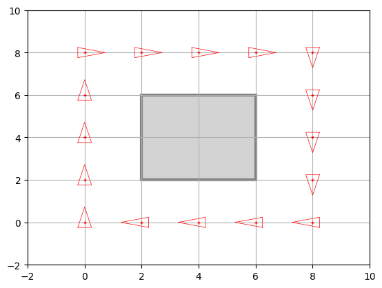
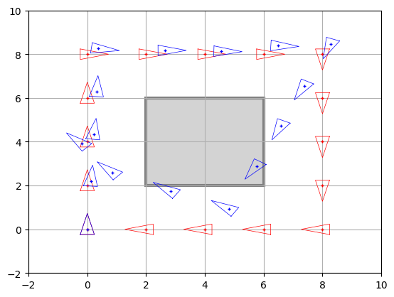
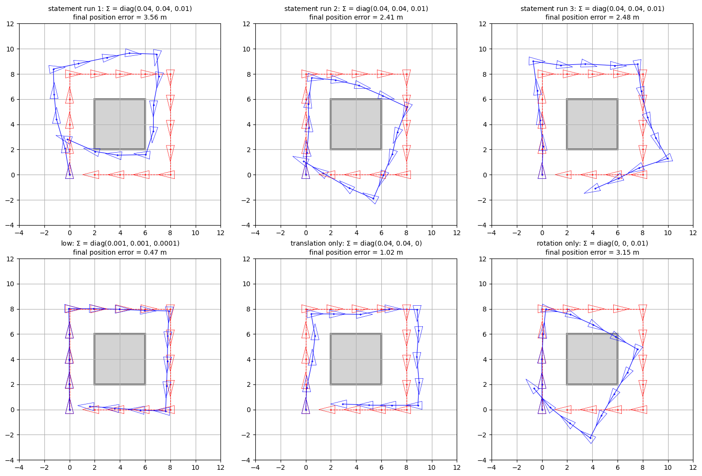
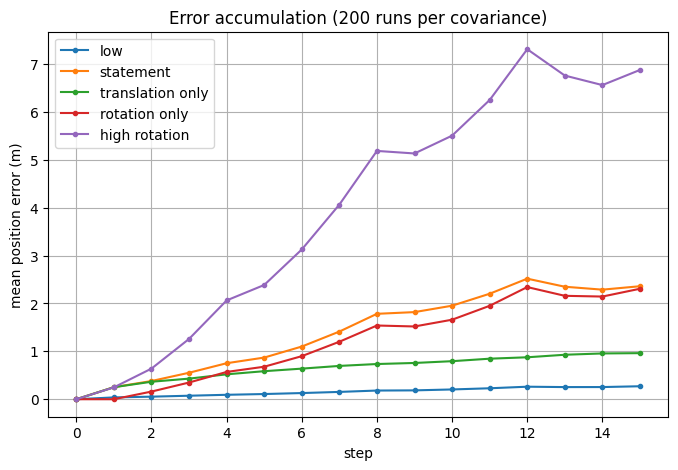
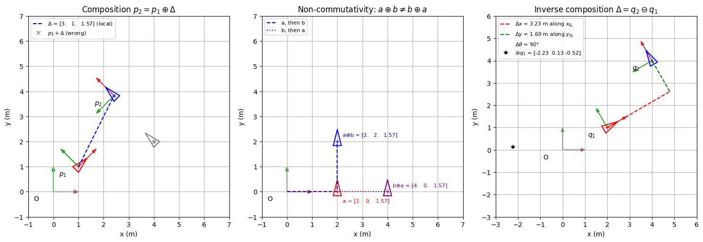

# Práctica 3.1 · Motion through pose composition — resolución y guía de entrega

Este documento explica qué pedía el notebook [3.1 Motion through pose composition](3.1%20Motion%20through%20pose%20composition.ipynb), cómo se ha resuelto cada apartado y por qué, y lo poco que queda por tu parte. La teoría de fondo está en la guía [3.1 Motion through pose composition.md](../../../../Guias_practicas/P3.1_Composicion_poses.md).

## Índice

1. [Qué había que hacer y estado](#1-qué-había-que-hacer-y-estado)
2. [Archivos generados](#2-archivos-generados)
3. [Cómo se ha resuelto y por qué](#3-cómo-se-ha-resuelto-y-por-qué)
4. [Cómo se ha verificado](#4-cómo-se-ha-verificado)
5. [Qué falta por tu parte](#5-qué-falta-por-tu-parte)

## 1. Qué había que hacer y estado

Todo está hecho. Las celdas se numeran desde 0.

| Apartado | Qué se pide | Dónde |
| --- | --- | --- |
| OPTIONAL · Differential drive / ICR | Explicar la tracción diferencial y dibujar el ICR | Celdas 4–5 (ya estaban hechas antes, en inglés) |
| OPTIONAL · Composición e inversa | Funciones propias de composición y composición inversa, con ejemplos y gráficas | Celdas 10–12 |
| ASSIGNMENT 1 | Completar `main()` para recorrer un cuadrado de 8 × 8 m | Celda 16 |
| ASSIGNMENT 2 | Matriz de covarianza de las 20 medidas del Giraff | Celda 22 |
| ASSIGNMENT 3 | Completar `NoisyRobot` | Celda 25 |
| Experimento del Assignment 3 | «Run the cell several times… Try also with different values of the covariance matrix» | Celdas 27–30 |
| Thinking about it (1) | Responder 3 preguntas | Celda 31 |
| AI Appendix | Uso de IA (A.1) y revisión hecha por una IA (A.2) | Celda 32 |

## 2. Archivos generados

Todo está en `Chapter 03. Robot Motion/`:

| Archivo | Contenido |
| --- | --- |
| `3.1 Motion through pose composition.ipynb` | Notebook resuelto y **ejecutado**, con todas las salidas y figuras guardadas |
| `3.1 Motion through pose composition.html` | Exportación HTML (nbconvert), como en la 2.1 |
| `3.1 Motion through pose composition.pdf` | PDF listo para entregar: HTML impreso con Chrome (como tu 2.1), con fórmulas renderizadas y el código largo ajustado a la página |
| `img/captura_*.png` | Una imagen por figura (las «capturas») |
| `3.1 Resolución y guía de entrega.md` | Este documento |

Capturas generadas en `img/`:

| Archivo | Qué muestra |
| --- | --- |
| `captura_assignment1_cuadrado.png` | Recorrido cuadrado (igual que la Fig. 2) |
| `captura_assignment2_covarianza.png` | Las 20 poses medidas del Giraff |
| `captura_assignment3_ruido.png` | Poses esperadas (rojo) y reales (azul) |
| `captura_experimento_ejecuciones_covarianzas.png` | 3 ejecuciones con la Σ del enunciado + 3 covarianzas distintas |
| `captura_experimento_montecarlo.png` | Error medio frente a número de pasos para 5 covarianzas |
| `captura_opcional_composicion_inversa.png` | Composición, no conmutatividad y composición inversa |
| `captura_opcional_ICR.png` | Movimiento diferencial y su ICR |

## 3. Cómo se ha resuelto y por qué

### 3.1. ASSIGNMENT 1: cuadrado de 8 × 8 m

```python
if step % turning == 0:
    u[2] = angle_inc      # -pi/2: giro a la derecha
else:
    u[2] = 0
```

- La orden es siempre el incremento **local** $[2, 0, \Delta\theta]^T$, es decir, avanzar 2 m hacia delante del robot. `tcomp` lo rota según la orientación actual; por eso el mismo `u` mueve al robot hacia el norte, el este, el sur o el oeste según hacia dónde mire.
- Cada lado necesita $8/2 = 4$ pasos. `step % 4 == 0` se cumple en los pasos 4, 8 y 12, que son las esquinas, y en ellos se gira $-\pi/2$ (sentido horario, ángulo negativo).
- En `tcomp` la traslación usa la orientación **anterior** y después se suma el giro: el robot llega a la esquina y queda mirando hacia el siguiente lado.
- Hay que volver a poner `u[2] = 0` en los pasos sin giro, porque `u` es el mismo array en todo el bucle. Si no, el robot seguiría girando en todos los pasos tras la primera esquina.
- **`num_steps = 15`** se mantiene como venía. Se dibujan 16 poses y la figura coincide con la Fig. 2. El robot termina en $(2, 0)$ mirando al oeste; el paso 16 lo dejaría en $(0, 0)$ mirando al norte, justo encima de la pose inicial.



### 3.2. ASSIGNMENT 2: matriz de covarianza

```python
cov_x = np.var(data[:, 0])
cov_y = np.var(data[:, 1])
cov_theta = np.var(data[:, 2])
covariance_matrix = np.diag([cov_x, cov_y, cov_theta])
```

- Cada columna de `data` es una componente ($x, y, \theta$) y `np.var` calcula su varianza.
- Como no hay correlación entre componentes, la matriz es diagonal y se construye con `np.diag`.
- `np.var` usa por defecto la varianza poblacional (divide entre $N$), que es la que reproduce exactamente el resultado esperado: `diag(0.02342594, 0.03246639, 0.00212976)`.
- **Significado de la diagonal:** las desviaciones típicas son $\sigma_x \approx 0{,}15$ m, $\sigma_y \approx 0{,}18$ m y $\sigma_\theta \approx 2{,}6^\circ$. Si aumentan, las poses quedan más dispersas (el robot es menos preciso); si disminuyen, se concentran alrededor de la orden $(2, 1, \pi/2)$.

### 3.3. ASSIGNMENT 3: `NoisyRobot`

```python
def step(self, step_increment):
    super().step(step_increment)
    true_step = np.vstack(stats.multivariate_normal.rvs(mean=step_increment.ravel(), cov=self.covariance))
    self.true_pose = tcomp(self.true_pose, true_step)

def draw(self, fig, ax):
    super().draw(fig, ax)
    DrawRobot(fig, ax, self.true_pose, color='blue')
```

- **Muestreo:** `multivariate_normal.rvs` genera una muestra de $N(\Delta\mathbf{x}_{given}, \Sigma_{\Delta x})$. Pide la media como vector 1D, de ahí el `ravel()`.
- **Forma de la muestra:** se devuelve como `(3,)`, y `np.vstack` la convierte en el vector columna `(3, 1)` que espera `tcomp`.
- **Pose esperada:** `super().step(...)` reutiliza el método de `Robot` para actualizarla (herencia).
- **Pose real:** el incremento ruidoso se compone sobre la pose **real** anterior. Por eso el error se acumula, igual que en un robot que navega a estima sin corregirse.
- **Dónde se suma el ruido:** en el marco local, es decir, en el incremento. Representa que el robot «avanza o gira más o menos» respecto a sí mismo.



### 3.4. Experimento con varias ejecuciones y covarianzas

El enunciado pide ejecutar varias veces y probar otras covarianzas, así que se añadieron dos celdas de código que reutilizan `NoisyRobot` con una semilla fija, para que los resultados sean reproducibles:

1. **Rejilla de 6 figuras:**
   - fila superior: 3 ejecuciones con la Σ del enunciado (cada una es distinta);
   - fila inferior: poco ruido, solo ruido de traslación y solo ruido de rotación.
2. **Monte Carlo:** 200 ejecuciones por cada una de las 5 covarianzas, midiendo el error medio de posición tras cada paso.

| Covarianza | Error medio tras 4 / 8 / 15 pasos |
| --- | --- |
| Poco ruido `diag(0.001, 0.001, 0.0001)` | 0,09 / 0,18 / 0,27 m |
| Enunciado `diag(0.04, 0.04, 0.01)` | 0,75 / 1,78 / 2,36 m |
| Solo traslación `diag(0.04, 0.04, 0)` | 0,52 / 0,73 / 0,96 m |
| Solo rotación `diag(0, 0, 0.01)` | 0,57 / 1,54 / 2,31 m |
| Mucha rotación `diag(0.04, 0.04, 0.1)` | 2,06 / 5,18 / 6,87 m |

**Conclusiones** (escritas también en la celda 30):

- El error se acumula con los pasos.
- A mayor varianza, mayor dispersión.
- **El ruido angular domina**: solo con él se obtiene casi el mismo error que con la Σ completa, más del doble que solo con traslación. Un error de orientación desvía todos los avances posteriores; uno de traslación solo desplaza al robot una vez.

Estos datos respaldan la tercera respuesta de *Thinking about it*.




### 3.5. Thinking about it (1)

Las respuestas están en español, con el estilo `color:#2DD4BF` de tu 2.1:

1. **Por qué difieren las poses:** la esperada compone el incremento nominal y la real uno muestreado con ruido. El error se acumula porque nada lo corrige, y el angular desvía los avances siguientes.
2. **Cuándo coincidirían:** solo con $\Sigma_{\Delta x} = \mathbf{0}$, y en el instante inicial. Con ruido, en un robot real solo podrían acercarse corrigiendo con sensores.
3. **Efecto de Σ:** cada varianza es un error en el marco local (longitudinal, lateral y angular). Valores mayores dan más dispersión, y el término angular es el más crítico.

### 3.6. OPTIONAL: composición e inversa propias

- **Celda 10:** fórmulas de la inversa $\ominus\mathbf{x}$ y de la composición inversa $\mathbf{x}_2 \ominus \mathbf{x}_1 = (\ominus\mathbf{x}_1) \oplus \mathbf{x}_2$.
- **Celda 11:** `compose`, `inverse`, `inverse_compose` y `wrap_angle`. Se comprueban sobre 1000 poses aleatorias contra `tcomp`, `inv_tcomp` y `tinv` de `utils`, y además se verifica que:
  - $\mathbf{p} \oplus (\ominus\mathbf{p}) = \mathbf{0}$;
  - $\mathbf{p}_1 \oplus (\mathbf{p}_2 \ominus \mathbf{p}_1) = \mathbf{p}_2$;
  - $\oplus$ es asociativa.
- **Celda 12:** tres gráficas:
  - composición frente a la suma ingenua, que es incorrecta;
  - no conmutatividad: $a \oplus b \neq b \oplus a$;
  - composición inversa entre dos poses globales.



### 3.7. AI Appendix

- **A.1:** redactado de forma general:
  - herramienta: «un asistente de programación basado en IA generativa», sin nombrarlo;
  - tres puntos genéricos sobre para qué se usó;
  - como *best prompt*, un resumen de tu petición real;
  - qué se mantuvo tras revisarlo.
- **A.2:** contiene los 5 puntos de la revisión con el prompt del enunciado: dos de teoría, dos de práctica y uno de mejora (la Σ fija por paso no escala con la distancia). Como IA revisora figura «an AI coding assistant». La opinión final está redactada en primera persona.

### 3.8. Cambio de `%matplotlib widget` a `%matplotlib inline`

En la celda 2 se cambió el backend de Matplotlib. Con `widget`, las figuras son interactivas, pero no quedan guardadas en el `.ipynb` ni salen en el HTML/PDF. Con `inline` quedan como imágenes dentro del notebook y de la exportación. La animación de `main()` sigue funcionando: se ve la figura actualizándose y al final queda la imagen definitiva.

## 4. Cómo se ha verificado

- Se ejecutó el notebook completo de principio a fin (equivalente a *Restart → Run All*) sin ningún error.
- La matriz de covarianza coincide exactamente con la esperada.
- La figura del Assignment 1 es idéntica a la Fig. 2 y la del Assignment 3 tiene el aspecto de la Fig. 3.
- Pasan todas las comprobaciones de la parte opcional.
- Se revisó visualmente el PDF: fórmulas renderizadas, respuestas visibles y código sin cortar.

## 5. Qué falta por tu parte

Solo lo que no puedo hacer yo:

1. **Leer y validar las respuestas y el AI Appendix.** Están escritas como si fueran tuyas, sobre todo la opinión final del A.2. Si no estás de acuerdo con algo, cámbialo. Si el profesor exige que la revisión del A.2 la haga **otra** IA distinta (ChatGPT, Gemini…), pégale el prompt del notebook y sustituye los 5 puntos.
2. **Metadato `autograder`.** Los metadatos del `.ipynb` incluyen `"autograder": {"status": "pending", "directive": "...update 'status' to 'completed'"}`. No lo he cambiado porque es una instrucción incrustada en el archivo, no una petición tuya. Si el profesor lo pide, cámbialo tú: en VS Code, *Reopen Editor With… → Text Editor*, busca `"status": "pending"` y escribe `"completed"`.
3. **Entregar** el `.pdf` o el `.ipynb` (o ambos), según lo que pida el campus virtual.

**Si modificas algo del notebook**, vuelve a ejecutarlo (*Restart → Run All*) y regenera el HTML y el PDF. Desde la carpeta `Chapter 03. Robot Motion`:

```bash
JUPYTER_PATH=/opt/homebrew/share/jupyter jupyter nbconvert --to html "3.1 Motion through pose composition.ipynb"
```

Después, abre el `.html` en Chrome → `Cmd + P` → *Guardar como PDF*. También puedes pedírmelo y lo regenero yo.
