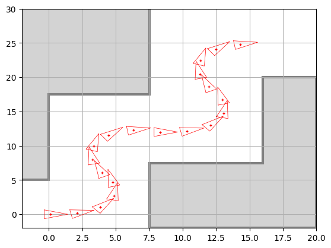

# Práctica 3.2 · Velocity-based motion model — resolución y guía de entrega

Este documento explica qué pedía el notebook [3.2 Velocity-based motion model](3.2%20Velocity-based%20motion%20model.ipynb), cómo se ha resuelto cada apartado y por qué, y lo poco que queda por tu parte. La teoría de fondo está en la guía [3.2 Velocity-based motion model.md](../../../../Guias_practicas/P3.2_Modelo_velocidad.md).

## Índice

1. [Qué había que hacer y estado](#1-qué-había-que-hacer-y-estado)
2. [Archivos generados](#2-archivos-generados)
3. [Cómo se ha resuelto y por qué](#3-cómo-se-ha-resuelto-y-por-qué)
4. [Cómo se ha verificado](#4-cómo-se-ha-verificado)
5. [Qué falta por tu parte](#5-qué-falta-por-tu-parte)

## 1. Qué había que hacer y estado

Todo está hecho. Las celdas se numeran desde 0.

| Apartado | Qué se pide | Dónde |
| --- | --- | --- |
| ASSIGNMENT 1 | Completar `next_pose()` (casos ω = 0 y ω ≠ 0) | Celda 4 |
| ASSIGNMENT 1 | Llamar correctamente a `next_pose()` desde `VelocityRobot.step()` | Celda 5 |
| Thinking about it (1) | Responder 2 preguntas | Celda 9 |
| AI Appendix | Uso de IA (A.1) y revisión hecha por una IA (A.2) | Celda 10 |

## 2. Archivos generados

Todo está en `Chapter 03. Robot Motion/3.2 Velocity-based motion model/`:

| Archivo | Contenido |
| --- | --- |
| `3.2 Velocity-based motion model.ipynb` | Notebook resuelto y **ejecutado**, con las salidas y la figura guardadas |
| `3.2 Velocity-based motion model.html` | Exportación HTML (nbconvert) |
| `3.2 Velocity-based motion model.pdf` | PDF listo para entregar: el HTML impreso con Chrome, con las fórmulas renderizadas y el código largo ajustado a la página |
| `3.2 Velocity-based motion model.md` | Guía teórica en profundidad |
| `img/captura_assignment1_trayectoria.png` | Trayectoria del robot (igual que la Fig. 2) |
| `3.2 Resolución y guía de entrega.md` | Este documento |

## 3. Cómo se ha resuelto y por qué

### 3.1. ASSIGNMENT 1: `next_pose()`

```python
if u[1] == 0: #linear motion w=0
    next_x = np.vstack([x[0] + u[0]*dt*np.cos(x[2]),
                   x[1] + u[0]*dt*np.sin(x[2]),
                   x[2]])
else: #Non-linear motion w=!0
    R = u[0]/u[1] #v/w=r is the curvature radius
    next_x = np.vstack([x[0] - R*np.sin(x[2]) + R*np.sin(x[2] + u[1]*dt),
                   x[1] + R*np.cos(x[2]) - R*np.cos(x[2] + u[1]*dt),
                   x[2] + u[1]*dt])
```

- Es una traducción directa de las dos ecuaciones de la celda 1, con `x = [x, y, θ]ᵀ`, `u = [v, ω]ᵀ` y Δθ = ω·Δt.
- **Caso ω = 0:** el robot avanza `v·dt` en la dirección de su orientación θ y no gira.
- **Caso ω ≠ 0:** el robot recorre un arco de radio R = v/ω alrededor del ICR, y su orientación aumenta en ω·Δt.
- Se usa la forma «cerrada» `R·sin(θ+Δθ) − R·sin θ` en lugar de calcular Δx, Δy en el marco local y luego rotarlos. Las dos son equivalentes (es la misma igualdad que aparece en la celda 1), pero esta es más corta.
- `x[0]`, `u[0]`, etc. son arrays de forma `(1,)`, así que `np.vstack` devuelve una columna `(3, 1)`, que es la forma que espera `DrawRobot`.
- No se ha tocado el `cov=None` ni el `if cov is not None:`, como pide el enunciado.

### 3.2. ASSIGNMENT 1: `VelocityRobot.step()`

```python
def step(self, u):
    self.pose = next_pose(self.pose, u, self.dt)
```

La pose nueva se calcula a partir de la pose actual del robot, la orden recibida y el Δt guardado en el objeto. No se pasa `cov`, porque este robot es determinista.



### 3.3. Thinking about it (1)

Las respuestas están en español, con el mismo estilo `color:#2DD4BF` que en la 3.1:

1. **Por qué hay dos casos:** con ω = 0 el radio R = v/ω no está definido (división por cero). Geométricamente, el arco se convierte en una recta. La fórmula lineal es el límite de la general cuando ω → 0, así que el modelo es continuo.
2. **Parámetros de u:** dos, v y ω, que se suponen constantes durante Δt. Δt no forma parte de la orden. Se compara con los 3 parámetros del modelo de odometría.

### 3.4. AI Appendix

- **A.1:** con el mismo formato que dejaste en la 3.1. Como *best prompt*, tu petición real («Resuelve la práctica 3.2»).
- **A.2:** contiene los 5 puntos de la revisión hecha con el prompt del enunciado:
  - dos de teoría: el arco de radio v/ω y el caso límite ω = 0;
  - dos de práctica: encapsulación y arrays de NumPy;
  - uno de mejora: comparar `ω == 0` de forma exacta es frágil, y conviene usar un umbral y normalizar θ.

  La opinión final está redactada en primera persona.

### 3.5. Cambios fuera de los ejercicios (celda 2)

- **`%matplotlib widget` → `%matplotlib inline`:** lo mismo que en la 3.1. Así la figura queda guardada en el `.ipynb` y sale en el HTML/PDF.
- **`sys.path.append("../..")`:** al mover cada práctica a su propia subcarpeta, `".."` apunta a `Chapter 03. Robot Motion/`, que no contiene `utils`. Sin este cambio, `from utils.DrawRobot import DrawRobot` falla. Se ha mantenido la línea original para que el notebook siga funcionando si vuelve a la ubicación de antes.
  - **Ojo:** la 3.1 tiene el mismo problema si la vuelves a ejecutar desde su subcarpeta. No la he modificado.

## 4. Cómo se ha verificado

- Se ejecutó el notebook completo de principio a fin (equivalente a *Restart → Run All*) sin ningún error.
- La figura obtenida es idéntica a la Fig. 2 del enunciado. El robot termina en (16.2, 25.0) con θ ≈ 0.
- Se comprobó por separado el caso ω = 0: desde (1, 2, π/2) con v = 2 y Δt = 0.5 el robot llega a (1, 3, π/2). Con ω = 10⁻⁹ el resultado es prácticamente el mismo, lo que confirma que los dos casos son coherentes.
- Se revisó visualmente el PDF: fórmulas renderizadas, respuestas visibles y código sin cortar.

## 5. Qué falta por tu parte

1. **Leer y validar las respuestas y el AI Appendix.** Están escritas como si fueran tuyas, sobre todo la opinión final del A.2. Si el profesor exige que la revisión del A.2 la haga **otra** IA distinta, pégale el prompt del notebook y sustituye los 5 puntos.
2. **Metadato `autograder`.** Igual que en la 3.1, el `.ipynb` incluye `"autograder": {"status": "pending", ...}`. No lo he cambiado porque es una instrucción incrustada en el archivo, no una petición tuya. Si el profesor lo pide, cámbialo tú.
3. **Entregar** el `.pdf` o el `.ipynb` (o ambos), según lo que pida el campus virtual.

**Si modificas algo del notebook**, vuelve a ejecutarlo y regenera el HTML desde esta carpeta:

```bash
JUPYTER_PATH=/opt/homebrew/share/jupyter jupyter nbconvert --to html "3.2 Velocity-based motion model.ipynb"
```

Después, abre el `.html` en Chrome → `Cmd + P` → *Guardar como PDF*. También puedes pedírmelo y lo regenero yo.
