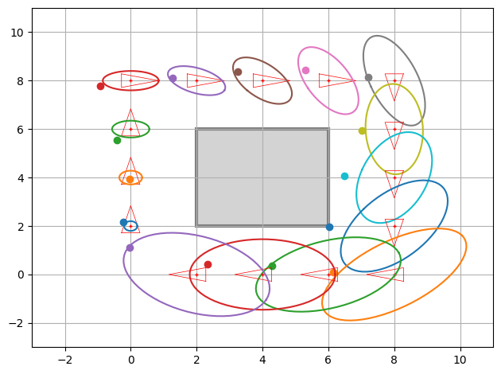
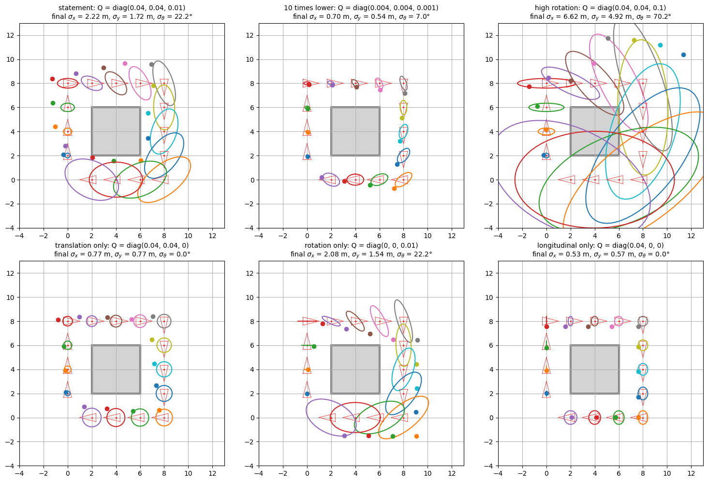
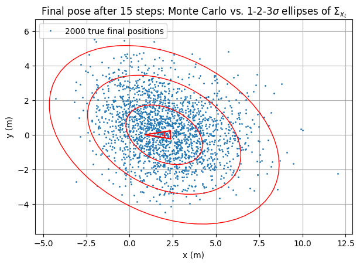
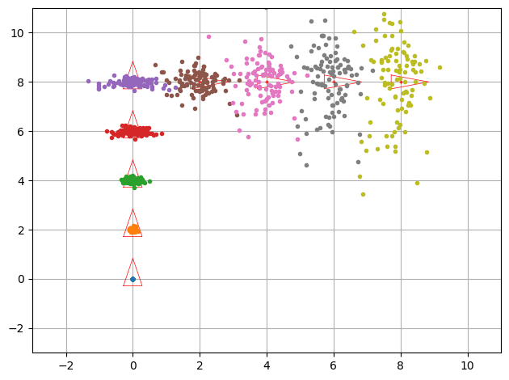
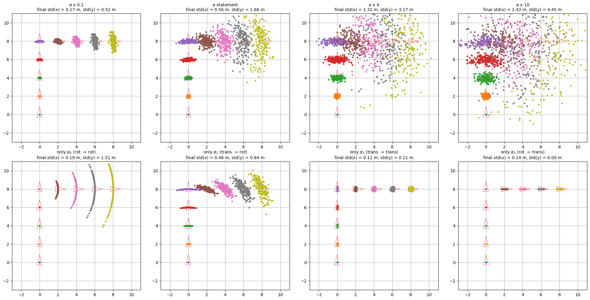
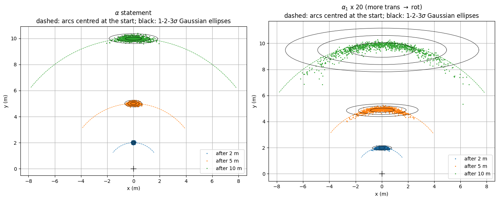
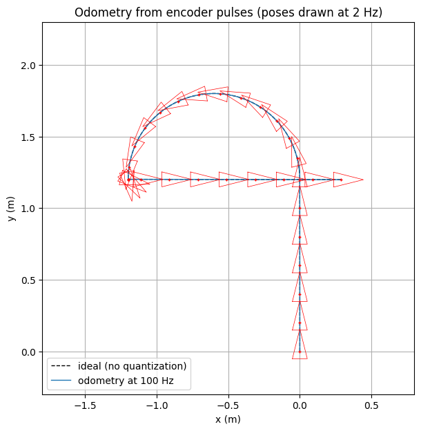

# Práctica 3.3 · Odometry-based motion model — resolución y guía de entrega

Este documento explica qué pedía el notebook [3.3 Odometry-based motion model](3.3%20Odometry-based%20motion%20model.ipynb), cómo se ha resuelto cada apartado y por qué, y lo poco que queda por tu parte. La teoría de fondo está en la guía [3.3 Odometry-based motion model.md](3.3%20Odometry-based%20motion%20model.md).

## Índice

1. [Qué había que hacer y estado](#1-qué-había-que-hacer-y-estado)
2. [Archivos generados](#2-archivos-generados)
3. [Cómo se ha resuelto y por qué](#3-cómo-se-ha-resuelto-y-por-qué)
4. [Cómo se ha verificado](#4-cómo-se-ha-verificado)
5. [Qué falta por tu parte](#5-qué-falta-por-tu-parte)

## 1. Qué había que hacer y estado

Todo está hecho. Las celdas se numeran desde 0, sobre el notebook final (ya con las celdas añadidas).

| Apartado | Qué se pide | Dónde |
| --- | --- | --- |
| OPTIONAL · Odometría desde encoders | 3 funciones: pulsos → ruedas → incremento → poses compuestas | Celdas 7–11 |
| ASSIGNMENT 1 | Completar `Robot.step()` y `Robot.draw()` (forma analítica) | Celda 16 |
| Experimento del Assignment 1 | «Try different values [of Σ] and discuss the results» + validación de Monte Carlo | Celdas 20–23 |
| Thinking about it (1) | Responder 4 preguntas | Celda 24 |
| ASSIGNMENT 2 (1) | Completar `generate_move()` | Celda 27 |
| ASSIGNMENT 2 (2) | Completar `SampledRobot.step()` y `draw()` (forma de muestreo) | Celda 32 |
| Experimento del Assignment 2 | «Play a bit with different values of `a`» + forma de la distribución | Celdas 36–39 |
| Thinking about it (2) | Responder 3 preguntas | Celda 40 |
| AI Appendix | Uso de IA (A.1) y revisión hecha por una IA (A.2) | Celda 41 |

## 2. Archivos generados

Todo está en `Chapter 03. Robot Motion/3.3 Odometry-based motion model/`:

| Archivo | Contenido |
| --- | --- |
| `3.3 Odometry-based motion model.ipynb` | Notebook resuelto y **ejecutado**, con todas las salidas y figuras guardadas |
| `3.3 Odometry-based motion model.html` | Exportación HTML (nbconvert) |
| `3.3 Odometry-based motion model.pdf` | PDF listo para entregar, con las fórmulas renderizadas y el código ajustado a la página |
| `3.3 Odometry-based motion model.md` | Guía teórica en profundidad |
| `img/captura_*.png` | Una imagen por figura |
| `3.3 Resolución y guía de entrega.md` | Este documento |

Capturas en `img/`:

| Archivo | Qué muestra |
| --- | --- |
| `captura_opcional_odometria_encoders.png` | Trayectoria reconstruida a partir de los pulsos de los encoders |
| `captura_assignment1_forma_analitica.png` | Recorrido cuadrado con elipses de incertidumbre y poses reales (como la Fig. 3) |
| `captura_experimento_covarianzas_Q.png` | El mismo recorrido con 6 matrices `Q` distintas |
| `captura_experimento_montecarlo.png` | 2000 poses reales finales frente a las elipses de 1, 2 y 3 σ |
| `captura_assignment2_forma_muestreo.png` | Nubes de partículas de la forma de muestreo (como la Fig. 5) |
| `captura_experimento_alphas.png` | El mismo recorrido con 8 combinaciones de `a` |
| `captura_experimento_forma_banana.png` | Forma de la nube tras 10 m en línea recta: la «banana» |

## 3. Cómo se ha resuelto y por qué

### 3.1. ASSIGNMENT 1: forma analítica (`Robot`)

```python
def step(self, u):
    prev_pose = self.pose
    self.pose = tcomp(prev_pose, u)

    noisy_u = np.vstack(stats.multivariate_normal.rvs(mean=u.ravel(), cov=self.Q))
    self.true_pose = tcomp(self.true_pose, noisy_u)

    JacF_x = J1(prev_pose, u)
    JacF_u = J2(prev_pose, u)
    self.P = (JacF_x @ self.P @ JacF_x.T) + (JacF_u @ self.Q @ JacF_u.T)

def draw(self, fig, ax):
    DrawRobot(fig, ax, self.pose)
    el = PlotEllipse(fig, ax, self.pose, self.P)
    ax.plot(self.true_pose[0, 0], self.true_pose[1, 0], 'o', color=el[0].get_color())
```

- **Media:** $\bar{\mathbf{x}}_t = \bar{\mathbf{x}}_{t-1} \oplus \Delta\mathbf{x}_t^{\mathrm{odo}}$, que es `tcomp`.
- **Pose real:** se muestrea un incremento ruidoso $\sim\mathcal{N}(\mathbf{u}, Q)$ y se compone sobre la pose **real** anterior. Por eso el error se acumula. Es lo mismo que el `NoisyRobot` de la 3.1:
  - `ravel()` porque `multivariate_normal` quiere la media en 1D;
  - `np.vstack` para devolver la columna `(3, 1)`.
- **Covarianza:** $\Sigma_t = J_x\Sigma_{t-1}J_x^T + J_u Q J_u^T$, con los jacobianos de `utils.Jacobians` (`J1` = $\partial g_o/\partial\mathbf{x}_{t-1}$, `J2` = $\partial g_o/\partial\Delta\mathbf{x}$).
- **Punto clave:** los jacobianos se evalúan en la pose **anterior**, `prev_pose`, que es el punto alrededor del cual se linealiza $g_o$. Por eso el esqueleto guarda `prev_pose` antes de actualizar `self.pose`. Si se evaluaran en la pose nueva, la covarianza saldría mal tras cada giro.
- **`draw()`:** la elipse se dibuja con la media y la covarianza (`PlotEllipse` solo usa el bloque $x$–$y$). La pose real se dibuja como un punto del mismo color que su elipse (`el[0].get_color()`), para emparejar cada elipse con su punto.
- **Por qué no falla con `P` inicial nula:** `PlotEllipse` no dibuja nada si la diagonal tiene ceros, pero `draw()` siempre se llama después de `step()`, y tras el primer paso $P = J_u Q J_u^T$ ya no es nula.



### 3.2. Experimento con distintas `Q` y validación de Monte Carlo

El enunciado pide probar distintos valores de Σ y discutir los resultados (cuarta pregunta de *Thinking about it (1)*). Se añadieron dos celdas que reutilizan `Robot` con una semilla fija:

1. **Rejilla de 6 figuras** con distintas `Q`:

| `Q` | σx, σy finales | σθ final |
| --- | --- | --- |
| Enunciado `diag(0.04, 0.04, 0.01)` | 2.22 / 1.72 m | 22.2° |
| 10 veces menor | 0.70 / 0.54 m | 7.0° |
| Mucha rotación `diag(0.04, 0.04, 0.1)` | 6.62 / 4.92 m | 70.2° |
| Solo traslación `diag(0.04, 0.04, 0)` | 0.77 / 0.77 m | 0° |
| Solo rotación `diag(0, 0, 0.01)` | 2.08 / 1.54 m | 22.2° |
| Solo longitudinal `diag(0.04, 0, 0)` | 0.53 / 0.57 m | 0° |

2. **Monte Carlo:** 2000 recorridos con la `Q` del enunciado, para comprobar si la covarianza propagada con los jacobianos es correcta.
   - La covarianza muestral es muy parecida a la propagada: 4.73 frente a 4.92 m² en $x$ y 2.95 frente a 2.96 m² en $y$.
   - Dentro de las elipses de 1, 2 y 3 σ caen el 39.2 %, 85.9 % y 98.2 % de las poses, frente al 39.3 %, 86.5 % y 98.9 % de una gaussiana.

**Conclusiones** (también en la celda 23):

- La incertidumbre solo crece, porque no hay ningún sensor que la corrija.
- Σx es proporcional a `Q`: dividir `Q` entre 10 divide los σ entre √10.
- **El ruido angular domina**, y por él las elipses se alargan perpendicularmente a la marcha.
- Con σθ grande, la linealización deja de valer.




### 3.3. ASSIGNMENT 2 (1): `generate_move()`

```python
diff = pose_now - pose_old
theta1 = np.arctan2(diff[1], diff[0]) - pose_old[2]
d = np.sqrt(diff[0]**2 + diff[1]**2)
theta2 = diff[2] - theta1
```

- Es la traducción directa de las tres fórmulas del enunciado:
  - $\bar\theta_1$: dirección global hacia el destino menos la orientación inicial;
  - $\bar d$: distancia euclídea;
  - $\bar\theta_2$: el giro total que falta.
- `arctan2(y, x)` (no `arctan(y/x)`) da el ángulo en el cuadrante correcto y no falla si $\Delta x = 0$.
- Reproduce exactamente la salida esperada: `[-3.92699082, 1.41421356, 2.35619449]`.
- **Ojo:** el resultado no se normaliza a $(-\pi, \pi]$, porque la salida esperada tampoco lo está ($-3.93$ rad equivale a $+2.36$ rad). Esto se comenta como mejora en el A.2 y en la guía teórica.

### 3.4. ASSIGNMENT 2 (2): `SampledRobot`

```python
# expected pose: turn theta1, advance d, turn theta2
ang = self.pose[2, 0] + u[0, 0]
self.pose[0, 0] += u[1, 0]*np.cos(ang)
self.pose[1, 0] += u[1, 0]*np.sin(ang)
self.pose[2, 0] = ang + u[2, 0]

# variances that depend on the amount of motion
noisy_u = u + np.vstack((
    sample(self.a[0]*u2[0] + self.a[1]*u2[1]),
    sample(self.a[2]*u2[1] + self.a[3]*(u2[0] + u2[2])),
    sample(self.a[0]*u2[2] + self.a[1]*u2[1])
))

# all the particles at once (each column is one particle)
ang = self.samples[2, :] + noisy_u[0, :]
self.samples[0, :] += noisy_u[1, :]*np.cos(ang)
self.samples[1, :] += noisy_u[1, :]*np.sin(ang)
self.samples[2, :] = ang + noisy_u[2, :]
```

- **Varianzas:** son las del enunciado, con `u2 = u**2` = $[\bar\theta_1^2, \bar d^2, \bar\theta_2^2]$. Por ejemplo, $\sigma_{\theta_1}^2 = \alpha_0\bar\theta_1^2 + \alpha_1\bar d^2$.
- **Una muestra distinta por partícula:** `sample(b2)` devuelve un vector con una muestra por partícula, de tamaño `self.samples.shape[1]`. Así `noisy_u` es una matriz `3 × N`, donde cada columna es una realización distinta de la misma orden.
- **Actualización vectorizada:** cada partícula gira $\theta_1^{[i]}$ desde **su propia** orientación, avanza $d^{[i]}$ y gira $\theta_2^{[i]}$. Todas se actualizan a la vez con operaciones de NumPy, sin bucles.
- **`draw()`:** dibuja la pose esperada y la nube de partículas (`'.'`), sin orientación, como pide el enunciado.



### 3.5. Experimento con distintos `a` y forma de la distribución

El enunciado pide jugar con distintos valores de `a`, y *Thinking about it (2)* pregunta qué forma toma la nube. Se añadieron dos celdas con semilla fija:

1. **Rejilla de 8 figuras:**
   - fila superior: `a` del enunciado multiplicado por 0.1, 1, 4 y 10;
   - fila inferior: cada $\alpha_i$ por separado, con los demás «desactivados» ($10^{-10}$, porque `stats.norm` necesita σ > 0).
2. **Forma de la distribución:** 1000 partículas avanzan 10 m en línea recta, con el `a` del enunciado y con $\alpha_1 \times 20$. Se dibujan los arcos centrados en el origen y las elipses gaussianas con la misma media y covarianza.

| `a` | Dispersión final σ(x), σ(y) |
| --- | --- |
| × 0.1 / × 1 / × 4 / × 10 | 0.17, 0.52 / 0.56, 1.66 / 1.32, 3.17 / 2.43, 4.45 m |
| solo $\alpha_0$ (giro → giro) | 0.19, 1.51 m (arcos perfectos tras la esquina) |
| solo $\alpha_1$ (traslación → giro) | 0.46, 0.84 m |
| solo $\alpha_2$ (traslación → traslación) | 0.11, 0.11 m |
| solo $\alpha_3$ (giro → traslación) | 0.14, 0.00 m |

**Conclusiones** (en la celda 39):

- La dispersión crece aproximadamente con √α.
- Los parámetros que producen error angular ($\alpha_0$, $\alpha_1$) dominan.
- La nube toma forma de **banana**: tras 10 m con $\alpha_1 \times 20$, la dispersión lateral es de 2.5 m y la radial de 0.2 m, y la elipse gaussiana encaja mal.




### 3.6. OPTIONAL: odometría a partir de los encoders

- **Celda 8:** las tres funciones pedidas.
  - `wheel_increments()`: pulsos → $\Delta\varphi$ → $\Delta s$.
  - `pose_increment()`: $\Delta s$, $\Delta\theta$ → incremento local. El caso recto se trata con una tolerancia de $10^{-9}$ rad.
  - `odometry()`: compone los incrementos con `tcomp` y devuelve todas las poses y la final.

  Se comprueban tres casos con solución conocida:
  - avance recto;
  - giro sobre sí mismo;
  - 10 arcos iguales = 1 arco con todos los pulsos.
- **Celda 10:** simulación del firmware durante 15 s (recto, media vuelta, giro en el sitio, recto).
  - Los pulsos se generan como en un encoder real, contando las marcas cruzadas, $\lfloor\varphi/\alpha\rfloor$, así que no hay sesgo acumulado.
  - Se componen 1500 incrementos a 100 Hz y se publican poses a 10 Hz.
  - Entre poses publicadas se calcula $\Delta\mathbf{x}^{\mathrm{odo}} = (\ominus\mathbf{x}_{t-1})\oplus\mathbf{x}_t$ con `inv_tcomp`.
  - El error por cuantización frente a la trayectoria ideal es de 0.2 mm y 0.03°.
- **Celda 11:** observaciones.



### 3.7. Thinking about it (1) y (2)

Las respuestas están en español, con el estilo `color:#2DD4BF` de las prácticas anteriores, y se apoyan en los números de los experimentos.

**Thinking about it (1)**

1. **$g_o$ frente a $g_v$:** las dos componen con ⊕. En $g_v$ el incremento se **calcula** a partir de una orden $(v, \omega, \Delta t)$, suponiendo un arco. En $g_o$ es una **medida** que ya viene dada, $(\ominus\mathbf{x}_{t-1}^{\mathrm{odo}})\oplus\mathbf{x}_t^{\mathrm{odo}}$.
2. **Número de parámetros:** tres ($\Delta x, \Delta y, \Delta\theta$).
3. **Papel de los jacobianos:** linealizar $g_o$ para propagar la covarianza. $J_x$ incluye el efecto palanca del error angular y $J_u$ es la rotación local → global.
4. **Efecto de Σ:** resume el experimento de las 6 `Q`.

**Thinking about it (2)**

1. **Efecto de α:** más α, más dispersión, y cada $\alpha_i$ tiene su papel.
2. **Componentes de la orden:** tres ($\bar\theta_1, \bar d, \bar\theta_2$).
3. **Forma de la nube:** una banana o media luna, no una gaussiana.

### 3.8. AI Appendix

- **A.1:** con el mismo formato que en la 3.1 y la 3.2. Como *best prompt*, tu petición real.
- **A.2:** cinco puntos:
  - teoría: los jacobianos validados con Monte Carlo y la banana;
  - práctica: vectorización con NumPy y semillas fijas;
  - mejora: `generate_move()` no normaliza ángulos.

  La opinión final está en primera persona y explica por qué no se normaliza: la salida esperada del enunciado no está normalizada.

### 3.9. Cambios fuera de los ejercicios (celda 5)

Son los mismos que en la 3.2:

- `%matplotlib widget` → `inline`, para que las figuras queden en el `.ipynb`, el HTML y el PDF;
- `sys.path.append("../..")`, porque la práctica está ahora en una subcarpeta y `".."` no llega a `utils`.

## 4. Cómo se ha verificado

- Se ejecutó el notebook completo de principio a fin (equivalente a *Restart → Run All*) sin ningún error.
- `generate_move()` reproduce exactamente la salida esperada.
- La figura del Assignment 1 coincide con la Fig. 3: las mismas elipses y la misma orientación. Los puntos reales son distintos porque son aleatorios.
- La del Assignment 2 tiene el aspecto de la Fig. 5.
- La covarianza del Assignment 1 se validó con Monte Carlo (2000 recorridos): las fracciones dentro de 1, 2 y 3 σ son prácticamente las teóricas.
- Las tres comprobaciones del opcional pasan (son `assert`).
- Se revisó visualmente el PDF: fórmulas renderizadas, respuestas visibles y código sin cortar.

## 5. Qué falta por tu parte

1. **Leer y validar las respuestas y el AI Appendix.** Están escritas como si fueran tuyas. Si el profesor exige que la revisión del A.2 la haga otra IA distinta, pégale el prompt del notebook y sustituye los 5 puntos.
2. **Metadato `autograder`.** Igual que en la 3.1 y la 3.2, el `.ipynb` incluye `"autograder": {"status": "pending", ...}`. No lo he cambiado porque es una instrucción incrustada en el archivo, no una petición tuya.
3. **Entregar** el `.pdf` o el `.ipynb` (o ambos), según lo que pida el campus virtual.

**Si modificas algo del notebook**, vuelve a ejecutarlo y regenera el HTML desde esta carpeta:

```bash
JUPYTER_PATH=/opt/homebrew/share/jupyter jupyter nbconvert --to html "3.3 Odometry-based motion model.ipynb"
```

Después, abre el `.html` en Chrome → `Cmd + P` → *Guardar como PDF*. También puedes pedírmelo y lo regenero yo.
