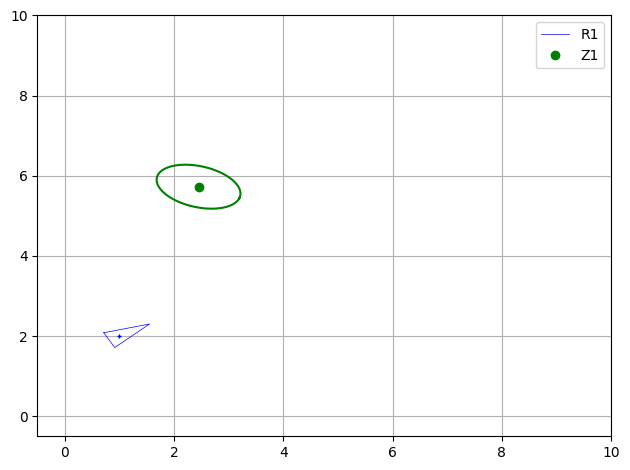
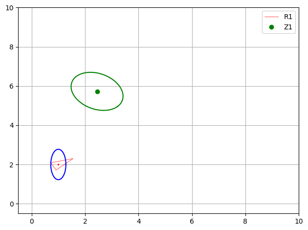
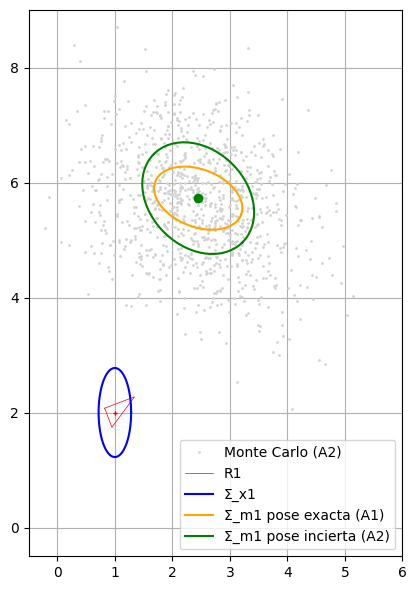
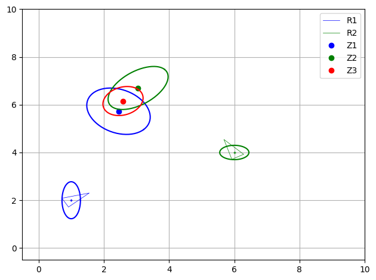
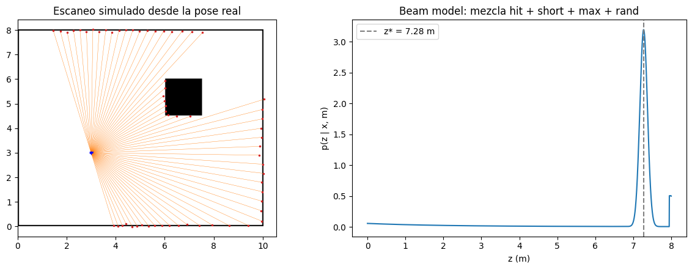
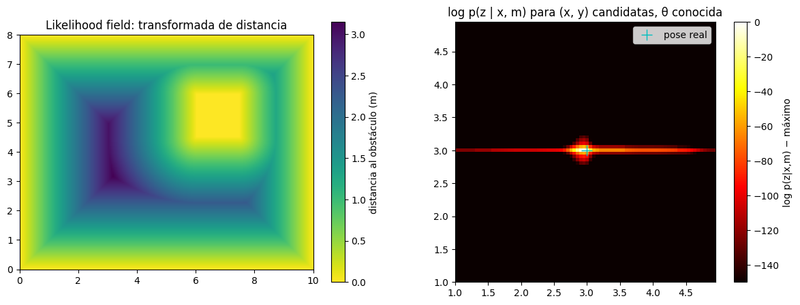
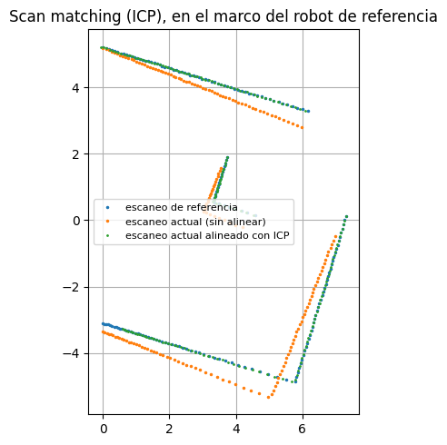

# Práctica 4.1 · Landmark-based models — resolución y guía de entrega

Este documento explica qué pedía el notebook [4.1 Landmark-based models](4.1%20Landmark-based%20models.ipynb), cómo se ha resuelto cada apartado y por qué, y lo poco que queda por tu parte. La teoría de fondo y el recorrido del código línea a línea están en la guía [P4.1_Landmarks.md](../../../Teoria/Parcial-2/Guias_practicas/P4.1_Landmarks.md).

## Índice

1. [Qué había que hacer y estado](#1-qué-había-que-hacer-y-estado)
2. [Archivos generados](#2-archivos-generados)
3. [Cómo se ha resuelto y por qué](#3-cómo-se-ha-resuelto-y-por-qué)
4. [Cómo se ha verificado](#4-cómo-se-ha-verificado)
5. [Qué falta por tu parte](#5-qué-falta-por-tu-parte)

## 1. Qué había que hacer y estado

Todo está hecho, incluidas las partes opcionales. Las celdas se numeran desde 0, sobre el notebook final (ya con las celdas añadidas).

| Apartado | Qué se pide | Dónde |
| --- | --- | --- |
| ASSIGNMENT 1 | Completar `to_world_frame()` y dibujar la elipse del landmark | Celdas 7–8 |
| ASSIGNMENT 2 | Añadir incertidumbre a la pose del robot, dibujar ambas elipses y **comparar** con el caso anterior | Celdas 11, 13–15 |
| ASSIGNMENT 3 | Observar el landmark desde R2, completar `combine_pdfs()` y dibujar la fusión | Celdas 17–18, 20–21 |
| Thinking about it (1) | Responder 3 preguntas | Celda 22 |
| AI Appendix | Uso de IA (A.1) y revisión hecha por una IA (A.2) | Celda 23 |
| OPTIONAL · Pose relativa | Completar `inverse_composition1()` | Celdas 26–28 |
| OPTIONAL · Observación predicha | Completar `predicted_obs_from_pov()` | Celdas 32–33 |
| Thinking about it (2) | Responder 1 pregunta | Celda 35 |
| OPTIONAL · Sensores | Describir los sensores de la lista | Celda 38 |
| OPTIONAL · Scan observation models | Explicar *beam model*, *likelihood field* y *scan matching* con código | Celdas 41–45 |

## 2. Archivos generados

Todo está en `Chapter 04.Robot sensing/`:

| Archivo | Contenido |
| --- | --- |
| `4.1 Landmark-based models.ipynb` | Notebook resuelto y **ejecutado**, con todas las salidas y figuras guardadas |
| `4.1 Landmark-based models.html` | Exportación HTML (nbconvert) |
| `4.1 Landmark-based models.pdf` | PDF listo para entregar (35 páginas), con las fórmulas renderizadas y el código ajustado a la página |
| `img/4.1_captura_*.png` | Una imagen por figura |
| `4.1 Resolución y guía de entrega.md` | Este documento |

La guía de estudio está en `Teoria/Parcial-2/Guias_practicas/P4.1_Landmarks.md`.

Capturas en `img/`:

| Archivo | Qué muestra |
| --- | --- |
| `4.1_captura_assignment1_landmark.png` | R1 sin incertidumbre y el landmark con su elipse (como la Fig. 5) |
| `4.1_captura_assignment2_incertidumbre_robot.png` | R1 con su elipse y el landmark con la elipse ampliada (como la Fig. 6) |
| `4.1_captura_comparacion_covarianzas_montecarlo.png` | Elipses de los Assignments 1 y 2 superpuestas y 20 000 muestras de Monte Carlo |
| `4.1_captura_assignment3_fusion.png` | R1, R2, las dos observaciones y su fusión (como la Fig. 7) |
| `4.1_captura_opcional_beam_model.png` | Escaneo simulado en una habitación y la mezcla del *beam model* para un rayo |
| `4.1_captura_opcional_likelihood_field.png` | Transformada de distancia y log-verosimilitud del *likelihood field* |
| `4.1_captura_opcional_icp.png` | Dos escaneos antes y después de alinearlos con ICP |

## 3. Cómo se ha resuelto y por qué

### 3.1. ASSIGNMENT 1: `to_world_frame()`

```python
Jac_pol_car = np.array([
    [c, -r*s],
    [s,  r*c]
])

z1_car_rel = (
        np.vstack([r*c, r*s]),            # position
        Jac_pol_car@W1@Jac_pol_car.T      # uncertainty
        )

z1_w = tcomp(x1_w ,z1_ext)[0:2,[0]]
Wz1 = (Jac_ap @ Qx1_w @ Jac_ap.T
      + Jac_aa @ z1_car_rel[1] @ Jac_aa.T)
```

Son tres pasos:

1. **Polares → cartesianas (marco del robot):** $\mathbf{z}_c = [r\cos\alpha, r\sin\alpha]^T$, y su covarianza $\Sigma_{\mathbf{z}_c} = J\,\Sigma_{\mathbf{z}_p}J^T$ con $J = \partial\mathbf{z}_c/\partial\mathbf{z}_p = \begin{bmatrix}\cos\alpha & -r\sin\alpha\\ \sin\alpha & r\cos\alpha\end{bmatrix}$. La primera columna es la derivada respecto a $r$ y la segunda respecto a $\alpha$.
2. **Media en el mundo:** $\bar{\mathbf{m}}^1 = \bar{\mathbf{x}}_1 \oplus \bar{\mathbf{z}}_c$ con `tcomp`. Como `tcomp` trabaja con poses de 3 componentes, el landmark se amplía con un 0 (`z1_ext`) y del resultado se toman las dos primeras filas. `[0:2,[0]]` (con la lista `[0]`) mantiene la forma de columna `(2, 1)`.
3. **Covarianza en el mundo:** suma de dos términos, uno por la pose del robot y otro por la observación. Los jacobianos ya vienen dados: `J1(...)[0:2,:]` es $\partial\mathbf{m}/\partial\mathbf{x}$ (2×3) y `J2(...)[0:2,0:2]` es $\partial\mathbf{m}/\partial\mathbf{z}_c$ (2×2, una rotación de ángulo $\theta_1$).

Reproduce exactamente la salida esperada: `z1_w = [2.44943102 5.72815634]` y `Wz1_w = [[0.5888, -0.1317], [-0.1317, 0.3012]]`. En la demo solo faltaba pasar `z1_w, Wz1` a `PlotEllipse`.

Comprobación a mano: $\mathbf{z}_c = 4(\cos 0.7, \sin 0.7) = (3.059, 2.577)$; girado 0.5 rad y trasladado, $m_x = 1 + 3.059\cdot0.878 - 2.577\cdot0.479 = 2.449$ y $m_y = 2 + 3.059\cdot0.479 + 2.577\cdot0.878 = 5.728$.



### 3.2. ASSIGNMENT 2: pose incierta y comparación

- El código de `to_world_frame()` ya sirve: solo cambia `Qx1_w`. En la demo se dibujan `PlotEllipse(fig, ax, x1_w, Qx1_w, ...)` (robot, azul) y `PlotEllipse(fig, ax, z1_w, Wz1, ...)` (landmark, verde). La salida coincide con la esperada: `[[0.9468, -0.2398], [-0.2398, 0.9432]]`.
- **Punto 2 («Compare the covariance»):** se añadieron tres celdas (13–15) con una función que no toca las variables globales. Calcula los semiejes y el área de cada elipse, separa el término que aporta el robot y valida la linealización con Monte Carlo:

| Elipse de 1σ | Semiejes | Área |
| --- | --- | --- |
| Robot R1 (bloque $x$–$y$) | 0.775 / 0.283 m | 0.69 m² |
| Landmark, pose exacta (A1) | **0.800 / 0.500 m** | 1.26 m² |
| Landmark, pose incierta (A2) | 1.088 / 0.840 m | 2.87 m² |

- **A1:** los semiejes son exactamente $r\sigma_\alpha = 4\cdot0.2 = 0.8$ m (tangencial) y $\sigma_r = 0.5$ m (radial). Es un buen truco para el examen: con la pose exacta, la elipse del landmark tiene esos semiejes, y la rotación solo la orienta.
- **A2:** se suma $J_x\Sigma_{\mathbf{x}}J_x^T$, que es semidefinido positivo, así que la elipse solo puede crecer. Su traza es $\sigma_x^2 + \sigma_y^2 + \sigma_\theta^2 r^2 = 0.08 + 0.6 + 0.02\cdot16 = 1.0$ m²: el error angular del robot actúa como un brazo de palanca de 4 m.
- **Monte Carlo** (20 000 muestras): covarianza muestral `[[0.918, -0.225], [-0.225, 0.964]]` frente a la linealizada `[[0.947, -0.240], [-0.240, 0.943]]`. La media muestral queda unos 0.12 m más cerca del robot por la no linealidad: $E[\cos(\theta+\alpha)] = \cos(\bar\theta+\bar\alpha)\,e^{-\sigma^2/2}$, con $\sigma^2 = 0.06$.




### 3.3. ASSIGNMENT 3: `combine_pdfs()`

```python
inv_Wz1 = np.linalg.inv(Wz1_w)
inv_Wz2 = np.linalg.inv(Wz2_w)

W_z = np.linalg.inv(inv_Wz1 + inv_Wz2)
z = W_z @ (inv_Wz1 @ z1_w + inv_Wz2 @ z2_w)
```

- El producto de dos gaussianas $\mathcal{N}(\bar{\mathbf{m}}^1, \Sigma_1)\,\mathcal{N}(\bar{\mathbf{m}}^2, \Sigma_2)$ es, salvo una constante, otra gaussiana con
  $\Sigma = (\Sigma_1^{-1} + \Sigma_2^{-1})^{-1}$ y $\bar{\mathbf{m}} = \Sigma(\Sigma_1^{-1}\bar{\mathbf{m}}^1 + \Sigma_2^{-1}\bar{\mathbf{m}}^2)$.
  Se suman las **informaciones** (inversas de las covarianzas) y la media es el promedio ponderado por ellas.
- En la demo faltaban las poses de `DrawRobot` (`x1_w`, `x2_w`) y las coordenadas de los puntos Z1 y Z2.
- Reproduce exactamente las dos salidas esperadas: `z2_w = [3.0504, 6.7019]` y `z_w = [2.5876, 6.1553]`, `Wz_w = [[0.3797, 0.0777], [0.0777, 0.3700]]`.
- **Comprobaciones añadidas (celdas 20–21):**
  - la forma de Kalman, $K = \Sigma_1(\Sigma_1+\Sigma_2)^{-1}$, $\bar{\mathbf{m}} = \bar{\mathbf{m}}^1 + K(\bar{\mathbf{m}}^2-\bar{\mathbf{m}}^1)$, $\Sigma = (I-K)\Sigma_1$, da exactamente lo mismo;
  - distancia de Mahalanobis² entre las dos observaciones: 0.677, muy por debajo del umbral $\chi^2_2$ al 95 % (5.991), así que son compatibles con ser el mismo landmark;
  - el determinante baja de 0.836 y 0.501 a 0.134: la fusión es más precisa que cualquiera de las dos.



### 3.4. OPTIONAL: pose relativa (`inverse_composition1()`)

```python
x12_w = tcomp(inv_r1[0], x2_w)
Qx12_w = (
        jac_x12_inv@inv_r1[1]@jac_x12_inv.T
        + jac_x12_x2@Qx2_w@jac_x12_x2.T
    )
```

- `inv_r1` ya trae $\ominus\mathbf{x}_1$ y su covarianza $\Sigma_{\ominus\mathbf{x}_1} = J_\ominus\Sigma_{\mathbf{x}_1}J_\ominus^T$. Solo quedaba componer $\ominus\mathbf{x}_1 \oplus \mathbf{x}_2$ y propagar con `J1` y `J2` evaluados en $(\ominus\mathbf{x}_1, \mathbf{x}_2)$.
- Los dos métodos dan exactamente lo mismo y coinciden con la salida esperada: `x12 = [5.3468, -0.6420, 1.6]`.

### 3.5. OPTIONAL: observación predicha desde R2 (`predicted_obs_from_pov()`)

```python
z2_pr = np.vstack([
        np.sqrt((z1_w[0, 0]-x1_w[0, 0])**2 + (z1_w[1, 0]-x1_w[1, 0])**2), # distance
        np.arctan2(z1_w[1, 0]-x1_w[1, 0], z1_w[0, 0]-x1_w[0, 0]) - x1_w[2, 0] # angle
    ])
_, Wz1_r = inverse_composition1(x1_w, Qx1_w, z1_ext, Wz1_w_ext)
Jac_car_pol = np.array([
    [c, s],
    [-s/r, c/r]
])
W2_p = Jac_car_pol@W2_c@Jac_car_pol.T
```

- **Ojo con los nombres:** dentro de esta función, `x1_w` es la pose de **R2** (el robot desde el que se predice), y `z1_w` es el landmark $\bar{\mathbf{m}}^1$.
- La media es el modelo de rango y rumbo: $\hat r = \|\mathbf{m}-\mathbf{x}_2\|$, $\hat\alpha = \operatorname{atan2}(m_y-y_2, m_x-x_2) - \theta_2$.
- La covarianza en cartesianas del marco de R2 es la de $\ominus\mathbf{x}_2 \oplus \mathbf{m}^1$, que es exactamente `inverse_composition1` con el landmark ampliado a 3 componentes (`z1_ext`, y su covarianza con una fila y columna de ceros, `np.pad`).
- El jacobiano de cartesianas a polares es la **inversa** del del Assignment 1: $[[\cos\hat\alpha, \sin\hat\alpha], [-\sin\hat\alpha/\hat r, \cos\hat\alpha/\hat r]]$.
- Salida igual a la esperada: `z2p_r = [3.9488, 0.5886]`, `W2_p = [[1.3137, -0.0261], [-0.0261, 0.0856]]`.
- No se normaliza $\hat\alpha$ a $(-\pi, \pi]$ porque la salida esperada tampoco lo hace y aquí no hace falta. Se comenta como mejora en el A.2.

### 3.6. OPTIONAL: sensores y modelos de escaneo

- **Celda 38:** la lista de sensores se ha completado con una descripción breve de cada uno (principio de medida, fórmula si la hay, ventajas y problemas típicos): balizas, GPS, sonar, infrarrojos, LiDAR, cámaras y RGB-D.
- **Celda 41:** explicación de los tres modelos de escaneo (*beam model*, *likelihood field* y *scan matching*), con sus fórmulas.
- **Celdas 42–44:** implementación sobre un mapa de rejilla de 10 × 8 m con una caja. Se usa `scipy.ndimage` para la transformada de distancia, que no estaba en los imports del notebook.
  - **Beam model:** *ray casting* para obtener $z^*$ y la mezcla $z_{hit}p_{hit} + z_{short}p_{short} + z_{max}p_{max} + z_{rand}p_{rand}$ para un rayo.
  - **Likelihood field:** el máximo de la verosimilitud está a 5 cm de la pose real (el paso de la rejilla de candidatas), y desplazarse 25 cm la divide por $e^{66}$. En escala logarítmica aparece una banda a lo largo de $x$: las paredes de arriba y abajo fijan la $y$, pero la $x$ queda menos determinada.
  - **ICP:** recupera la pose relativa real `[0.331, 0.055, 0.080]` como `[0.328, 0.057, 0.077]`.
- **Celda 45:** conclusiones.





### 3.7. Thinking about it (1) y (2)

Las respuestas están en español, con el estilo `color:#2DD4BF` de las prácticas anteriores, y se apoyan en los números calculados.

**Thinking about it (1)**

1. **Por qué se ignora la orientación:** el landmark es un punto, sin orientación propia, y el sensor no la mide. Por eso se recortan los resultados a 2 componentes y los jacobianos a 2×3 y 2×2. Lo que se ignora es la orientación del **landmark**, no la del robot, que sigue siendo necesaria.
2. **Qué covarianza es mayor:** la del A2, porque suma un término semidefinido positivo. También es mayor que la del robot, porque acumula la incertidumbre del robot, la de su orientación multiplicada por la distancia y la del sensor.
3. **Dos pdfs del mismo landmark:** no es una contradicción, sino dos estimaciones compatibles (Mahalanobis² = 0.68). Se combinan con el producto de gaussianas, que reduce la incertidumbre. Es la corrección de un filtro de Kalman.

**Thinking about it (2)**

- **Para qué sirve el jacobiano de cartesianas a polares:** la predicción sale en cartesianas, pero el sensor mide en polares. Para comparar las dos (innovación, test de Mahalanobis), la covarianza tiene que estar en el espacio del sensor, y la transformación no es lineal.

### 3.8. AI Appendix

- **A.1:** con el mismo formato que en la 3.x. Como *best prompt*, tu petición real.
- **A.2:** la revisión la hizo el mismo asistente, y así se indica. Tiene cinco puntos:
  - teoría: la suma de los dos términos de covarianza y la fusión como Kalman;
  - práctica: álgebra matricial con vectores columna y reutilización de `tcomp`/`J1`/`J2`;
  - mejora: normalizar $\hat\alpha$ y evitar inversas explícitas.

  La opinión final está en primera persona y añade como alternativa la hipótesis de independencia de `combine_pdfs()`.

### 3.9. Cambios fuera de los ejercicios

Ninguno:

- La celda de imports ya usaba `%matplotlib inline` y `sys.path.append("..")`. Este notebook está directamente en `Chapter 04.Robot sensing/`, así que `".."` sí llega a `utils`, y no se ha tocado.
- No se ha modificado nada de `utils/`.

## 4. Cómo se ha verificado

- Se ejecutó el notebook completo de principio a fin (equivalente a *Restart → Run All*) sin ningún error.
- Las **seis** salidas esperadas del enunciado (A1, A2, A3 en sus dos partes, pose relativa y observación predicha) se reproducen exactamente, con todos los decimales.
- La media del A1 se comprobó a mano (apartado 3.1).
- La covarianza del A2 se validó con Monte Carlo (20 000 muestras).
- La fusión se comprobó con la forma de Kalman equivalente.
- Las figuras de los Assignments 1, 2 y 3 coinciden con las Fig. 5, 6 y 7 del enunciado.
- Se revisó visualmente el PDF: fórmulas renderizadas, figuras del enunciado cargadas, respuestas visibles y código sin cortar.

## 5. Qué falta por tu parte

1. **Leer y validar las respuestas y el AI Appendix.** Están escritas como si fueran tuyas. Si el profesor exige que la revisión del A.2 la haga otra IA distinta, pégale el prompt del notebook y sustituye los 5 puntos.
2. **Metadato `autograder`.** Igual que en las prácticas 3.x, el `.ipynb` incluye `"autograder": {"status": "pending", ...}`. No lo he cambiado porque es una instrucción incrustada en el archivo, no una petición tuya.
3. **Entregar** el `.pdf` o el `.ipynb` (o ambos), según lo que pida el campus virtual.

**Si modificas algo del notebook**, vuelve a ejecutarlo y regenera el HTML desde esta carpeta:

```bash
JUPYTER_PATH=/opt/homebrew/share/jupyter jupyter nbconvert --to html "4.1 Landmark-based models.ipynb"
```

Después, abre el `.html` en Chrome → `Cmd + P` → *Guardar como PDF*. También puedes pedírmelo y lo regenero yo.
