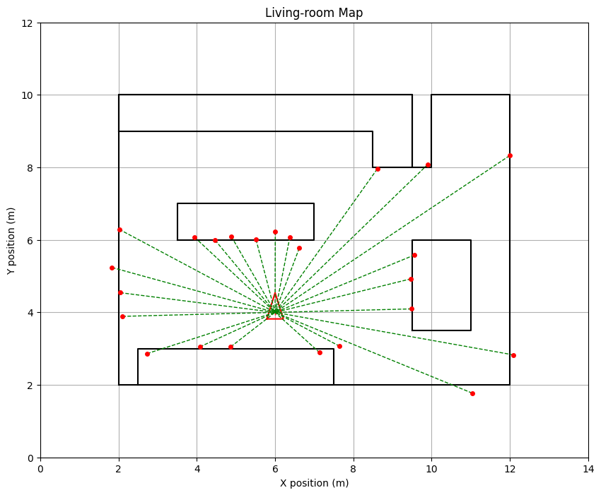
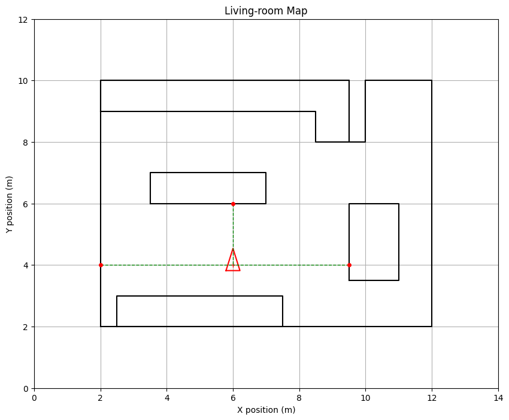
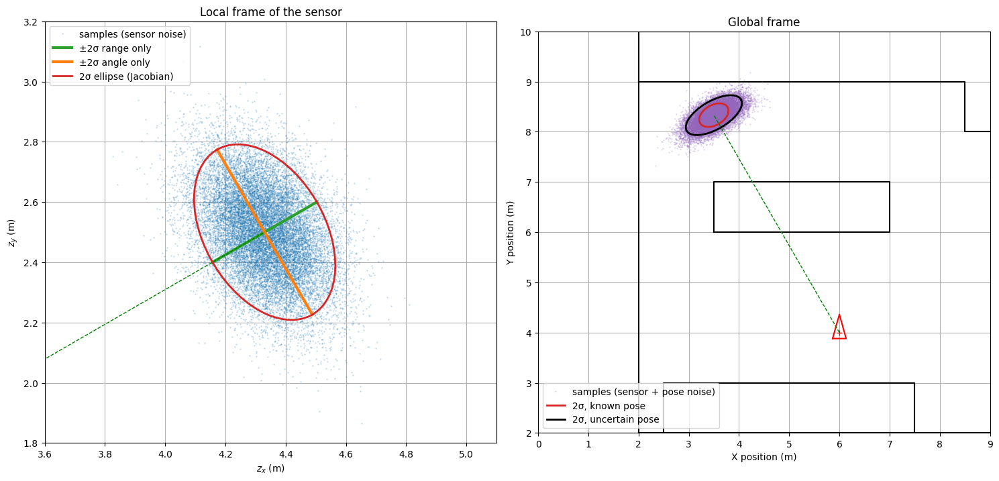
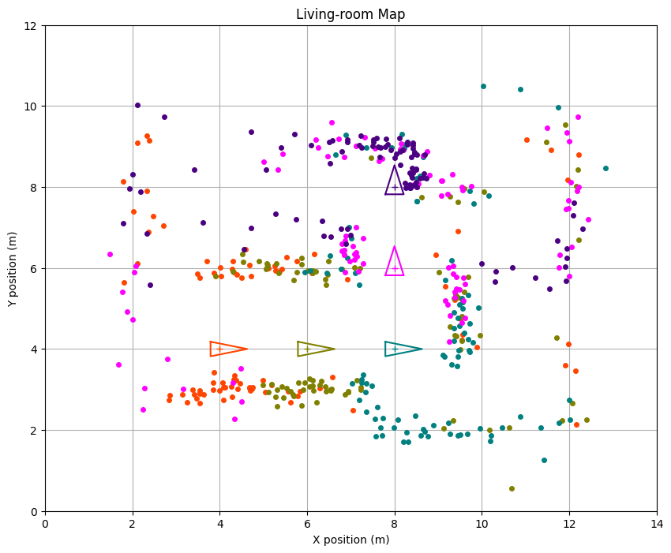

# Práctica 4.2 · Laser Scanner — resolución y guía de entrega

Este documento explica qué pedía el notebook [4.2 Laser Scanner](4.2%20Laser%20Scanner.ipynb), cómo se ha resuelto cada apartado y por qué, y lo poco que queda por tu parte. La teoría de fondo y el recorrido del código línea a línea están en la guía [P4.2 Laser scanner](../../../Teoria/Parcial-2/Guias_practicas/P4.2_Laser_scanner.md).

## Índice

1. [Qué había que hacer y estado](#1-qué-había-que-hacer-y-estado)
2. [Archivos generados](#2-archivos-generados)
3. [Cómo se ha resuelto y por qué](#3-cómo-se-ha-resuelto-y-por-qué)
4. [Cómo se ha verificado](#4-cómo-se-ha-verificado)
5. [Qué falta por tu parte](#5-qué-falta-por-tu-parte)

## 1. Qué había que hacer y estado

Todo está hecho. Las celdas se numeran desde 0, sobre el notebook final (ya con las celdas añadidas).

| Apartado | Qué se pide | Dónde |
| --- | --- | --- |
| ASSIGNMENT 1 | Completar `plot_observations()`: polares → cartesianas locales → globales con `tcomp` | Celda 9 |
| Prueba del Assignment 1 | Widget interactivo + ejecución estática con los valores por defecto | Celdas 11 y 13 |
| Comprobación (añadida) | Láser sin ruido con 3 haces de solución conocida | Celdas 14–15 |
| Experimento (añadido) | Incertidumbre de un punto: jacobianos frente a Monte Carlo | Celdas 16–18 |
| Thinking about it | Responder 3 preguntas | Celda 19 |
| ASSIGNMENT 2 | Lista de incrementos y bucle de `explore_environment()` | Celda 21 |
| Observaciones del Assignment 2 (añadidas) | Poses visitadas y efecto del ruido | Celda 23 |
| AI Appendix | Uso de IA (A.1) y revisión hecha por una IA (A.2) | Celda 25 |

## 2. Archivos generados

Todo está en `Chapter 04.Robot sensing/`. La práctica no tiene subcarpeta propia (a diferencia de las 3.x), así que el notebook sigue usando `sys.path.append("..")` sin cambios.

| Archivo | Contenido |
| --- | --- |
| `4.2 Laser Scanner.ipynb` | Notebook resuelto y **ejecutado**, con todas las salidas y figuras guardadas |
| `4.2 Laser Scanner.html` | Exportación HTML (nbconvert) |
| `4.2 Laser Scanner.pdf` | PDF listo para entregar (22 páginas), con las fórmulas renderizadas y el código ajustado a la página |
| `img/4.2_captura_*.png` | Una imagen por figura clave |
| `4.2 Resolución y guía de entrega.md` | Este documento |

Capturas en `img/`:

| Archivo | Qué muestra |
| --- | --- |
| `4.2_captura_assignment1_scan.png` | El scan desde $[6, 4, \pi/2]^T$ con los valores por defecto (como la Fig. 2) |
| `4.2_captura_comprobacion_sin_ruido.png` | Los 3 haces sin ruido: mesa, sofá y pared |
| `4.2_captura_experimento_incertidumbre_punto.png` | Nube y elipses de un punto en el marco del sensor y en el global |
| `4.2_captura_assignment2_exploracion.png` | Los 5 scans de la exploración, uno por color (como la Fig. 3) |

## 3. Cómo se ha resuelto y por qué

### 3.1. ASSIGNMENT 1: `plot_observations()`

```python
for i in range (z.shape[1]):
    distance = z[0, i]
    angle = z[1, i]

    x_local = distance*np.cos(angle)
    y_local = distance*np.sin(angle)

    pose_obs_global = tcomp(pose, np.vstack([x_local, y_local, 0]))
    x = pose_obs_global[0]
    y = pose_obs_global[1]

    if draw_lines:
        ax.plot([x, pose[0]], [y, pose[1]], 'g--', linewidth=1)
    ax.plot(x, y, 'o', markersize=4, color=point_color)
```

- **Formato de `z`:** `take_observation()` devuelve una matriz `2 × K`. La fila 0 son los alcances $r_k$ y la fila 1, los ángulos $\alpha_k$ **relativos al sensor** (no incluyen $\theta$ de la pose). Por eso cada columna `i` es una medida.
- **Polares → cartesianas:** $z_x = r\cos\alpha$, $z_y = r\sin\alpha$, en el marco del sensor.
- **Local → global:** se compone la pose con el punto, $\mathbf{x} \oplus \mathbf{z}_c$. `tcomp` exige dos vectores columna `(3, 1)`, así que el punto se completa con un ángulo 0 (`np.vstack([x_local, y_local, 0])`). El ángulo del resultado no se usa: solo interesan las dos primeras filas.
- **El orden importa:** `tcomp(pose, punto)`, no `tcomp(punto, pose)`. El primero gira el punto con la orientación del robot y lo traslada a su posición.
- El último `ax.plot` sustituye `None, None` por `x, y`, que es lo que se quería dibujar.



### 3.2. Ejecución estática del widget (celda 13)

`ipywidgets.interact` (celda 11) no deja la figura guardada en el HTML ni en el PDF, porque se dibuja dentro de un widget. Se añadió una celda que llama a `test_laser()` con los valores por defecto de los deslizadores y con semilla fija, para que la figura del Assignment 1 quede en el documento. El widget se ha mantenido para usarlo en Jupyter.

### 3.3. Comprobación con solución conocida (celdas 14–15)

Láser **sin ruido** con FOV $=\pi$ y resolución $\pi/2$, es decir, $\lfloor\pi/(\pi/2)\rfloor + 1 = 3$ haces a $-90°$, $0°$ y $+90°$, en $[6, 4, \pi/2]^T$:

| Haz (relativo) | Dirección global | Choca con | $r$ | Punto global |
| --- | --- | --- | --- | --- |
| $-90°$ | $0°$ ($+x$) | mesa, $x = 9.5$ | 3.5 m | $(9.5, 4)$ |
| $0°$ | $90°$ ($+y$) | sofá, $y = 6$ | 2 m | $(6, 6)$ |
| $+90°$ | $180°$ ($-x$) | pared, $x = 2$ | 4 m | $(2, 4)$ |

Los tres `assert` pasan. Además se comprueba con 50 lecturas aleatorias que `tcomp(pose, [r cos α, r sin α, 0])` da lo mismo que la fórmula directa $[x + r\cos(\alpha+\theta),\ y + r\sin(\alpha+\theta)]$, que es la que usa `Laser2D.draw_observation()`.



### 3.4. Experimento: incertidumbre de un punto (celdas 16–18)

Las tres preguntas de *Thinking about it* se apoyan en este experimento: un punto a $r = 5$ m y $\alpha = 30°$, con $Q = \mathrm{diag}(0.01, 0.001)$.

- **Polares → cartesianas:** $\Sigma_{\mathbf{z}_c} \approx J Q J^T$ con $J = \begin{bmatrix}\cos\alpha & -r\sin\alpha\\ \sin\alpha & r\cos\alpha\end{bmatrix}$. Da $[[0.0137, -0.0065], [-0.0065, 0.0213]]$ m², y Monte Carlo (20 000 muestras), $[[0.0139, -0.0065], [-0.0065, 0.0212]]$.
- **Contribuciones separadas:** a lo largo del haz $\sigma_r = 0.10$ m; perpendicular, $r\sigma_\alpha = 0.158$ m. Son iguales en $r^* = \sigma_r/\sigma_\alpha = 3.16$ m.
- **Con pose incierta**, $\Sigma_{\mathbf{x}} = \mathrm{diag}(0.01, 0.01, 0.0025)$: $\Sigma_{\mathbf{p}} \approx J_{\mathbf{x}}\Sigma_{\mathbf{x}}J_{\mathbf{x}}^T + J_{\mathbf{z}}\Sigma_{\mathbf{z}_c}J_{\mathbf{z}}^T$. Las desviaciones principales pasan de (0.158, 0.100) a (0.312, 0.141) m; Monte Carlo lo confirma.

| $r$ | σ a lo largo / perpendicular (solo sensor) | σ principales (sensor + pose) |
| --- | --- | --- |
| 1 m | 0.100 / 0.032 m | 0.141 / 0.116 m |
| 2 m | 0.100 / 0.063 m | 0.155 / 0.141 m |
| 5 m | 0.100 / 0.158 m | 0.312 / 0.141 m |
| 10 m | 0.100 / 0.316 m | 0.600 / 0.141 m |



### 3.5. ASSIGNMENT 2: `explore_environment()`

```python
pose_increments_list = [
    (np.vstack([0, 0, 0]), 'orangered'),
    (np.vstack([2, 0, 0]), 'olive'),
    (np.vstack([2, 0, 0]), 'teal'),
    (np.vstack([0, 2, np.pi/2]), 'magenta'),
    (np.vstack([2, 0, 0]), 'indigo'),
]
...
for step, color in pose_increments_list:
    current_pose = tcomp(current_pose, step)
    run_laser_and_plot(laser, current_pose, fig, ax, False, color)
```

- **Incrementos como columnas `(3, 1)`**, porque `tcomp` y `DrawRobot` indexan `pose[2, 0]`. Una lista `[2, 0, 0]` o un `np.array([2, 0, 0])` 1D fallarían.
- **Los incrementos son locales y se componen**, no se suman. Las poses resultantes son $[4,4,0]$, $[6,4,0]$, $[8,4,0]$, $[8,6,\pi/2]$ y $[8,8,\pi/2]$. Sumando se obtendría $[10, 6, \pi/2]$ al final.
- **`run_laser_and_plot(laser, current_pose, fig, ax, False, color)`:** el láser creado al principio de la función, la pose actual y `draw_lines=False`, para no llenar la figura de líneas con 95 haces por pose.
- Se añadió un `print` de cada pose y `np.random.seed(0)` antes de la llamada, para que la figura sea reproducible.



### 3.6. Thinking about it

Las respuestas están en español, con el estilo `color:#2DD4BF` de las prácticas anteriores, y se apoyan en los números del experimento.

1. **¿Rango o ángulo?** En cuanto a su efecto, el ángulo, porque se amplifica con la distancia ($r\sigma_\alpha$ frente a $\sigma_r$). En sensores reales, en cambio, la varianza mayor es la del rango: el ángulo lo fija el encoder del espejo giratorio y es muy preciso.
2. **Incertidumbre de cada punto:** linealizar polar → cartesiano con su jacobiano, $J Q J^T$, como con los landmarks.
3. **Pose incierta:** sumar las dos contribuciones linealizadas de $\mathbf{x} \oplus \mathbf{z}_c$, $J_{\mathbf{x}}\Sigma_{\mathbf{x}}J_{\mathbf{x}}^T + J_{\mathbf{z}}\Sigma_{\mathbf{z}_c}J_{\mathbf{z}}^T$. El error de pose es común a todo el scan y lo correlaciona: es el punto de partida de SLAM.

### 3.7. AI Appendix

- **A.1:** con el mismo formato que en las prácticas 3.x. El *best prompt* se deja vacío.
- **A.2:** cinco puntos:
  - teoría: el ruido angular crece con la distancia y la propagación con jacobianos;
  - práctica: asserts sobre casos conocidos, y semillas fijas con Monte Carlo vectorizado;
  - mejora: dibujar punto a punto es lento y no se filtran las lecturas a `max_distance`.

  La opinión final está en primera persona y añade otra mejora: `take_observation()` recorre haces y segmentos en Python, y su comprobación de dirección por signo es frágil cerca de 0 y ±π.

### 3.8. Cambio en `utils/laser/laser2D.py`

El notebook no se podía ejecutar con la NumPy instalada (2.4): `take_observation()` fallaba con `TypeError: only 0-dimensional arrays can be converted to Python scalars`. Como la pose es una columna `(3, 1)`, `self.pose[0]` es un array de un elemento, y NumPy 2.4 ya no lo convierte implícitamente en escalar.

Se cambiaron **dos líneas**, añadiendo `.item()`, sin alterar el algoritmo:

```python
phi_m = math.atan2(0-(x-self.pose[0]).item(),(y-self.pose[1]).item()-0)+90*np.pi/180
...
d = d_to_intersect.item()
```

`.item()` funciona igual en versiones antiguas de NumPy, así que el cambio es compatible con el entorno del profesor (`numpy==1.23.3` en `requirements.txt`).

Para ejecutar el notebook también hace falta `ipywidgets`, que no está en el Python del kernel. Se usó un entorno virtual temporal con `ipywidgets` y no se ha instalado nada en tu sistema. Si quieres usar el widget en tu Jupyter, instálalo tú: `pip install ipywidgets`.

## 4. Cómo se ha verificado

- Se ejecutó el notebook completo de principio a fin (equivalente a *Restart → Run All*) sin ningún error ni aviso.
- La comprobación sin ruido reproduce los alcances y puntos calculados a mano (3 `assert`). `tcomp` coincide con la fórmula directa en 50 lecturas aleatorias.
- El número de haces coincide con $\lfloor \mathrm{FOV}/\mathrm{res}\rfloor + 1$: 24 en el Assignment 1 y 95 en el 2.
- Las figuras de los dos assignments tienen el aspecto de las Figs. 2 y 3. Un punto que parece «atravesar» la pared inferior en la Fig. 2 se revisó a mano: es ruido de unas 2σ (el haz choca con la pared en $(10.93, 2)$ a 5.32 m).
- Las covarianzas del experimento se validaron con Monte Carlo.
- Se revisó visualmente el PDF: fórmulas renderizadas, respuestas visibles y código sin cortar.

## 5. Qué falta por tu parte

1. **Leer y validar las respuestas y el AI Appendix.** Están escritas como si fueran tuyas. La revisión del A.2 la ha hecho el mismo asistente (así se indica en el notebook). Si el profesor exige que la haga otra IA distinta, pégale el prompt del notebook y sustituye los 5 puntos.
2. **Entregar** el `.pdf` o el `.ipynb` (o ambos), según lo que pida el campus virtual.
3. **Si lo ejecutas tú**, instala antes `ipywidgets`.

**Si modificas algo del notebook**, vuelve a ejecutarlo y regenera el HTML desde esta carpeta:

```bash
JUPYTER_PATH=/opt/homebrew/share/jupyter jupyter nbconvert --to html "4.2 Laser Scanner.ipynb"
```

Después, abre el `.html` en Chrome → `Cmd + P` → *Guardar como PDF*. También puedes pedírmelo y lo regenero yo.
