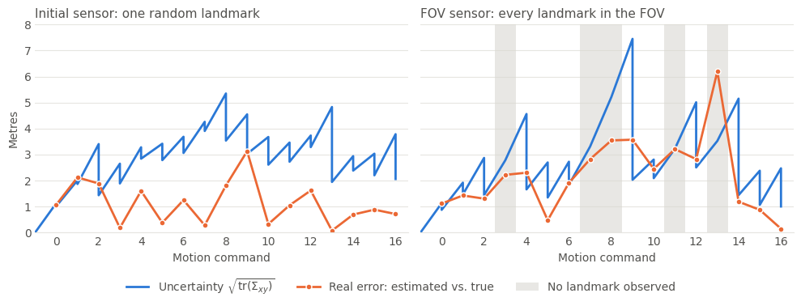

# Práctica 5.2 · EKF Localization — resolución y guía de entrega

Este documento explica qué pedía el notebook [5.2 EKF Localization](5.2%20EKF%20Localization.ipynb), cómo se ha resuelto cada apartado y por qué, y lo poco que queda por tu parte. El recorrido del código línea a línea y los cálculos resueltos están en la guía [P5.2 EKF Localization](../../../Teoria/Parcial-2/Guias_practicas/P5.2_EKF_Localization.md).

**Las otras dos prácticas del capítulo.** La 5.0 es solo lectura (su única tarea es una parte `OPTIONAL`) y la 5.1 es opcional. Ninguna se ha resuelto y sus notebooks siguen como los dio el profesor.

## Índice

1. [Qué había que hacer y estado](#1-qué-había-que-hacer-y-estado)
2. [Archivos generados](#2-archivos-generados)
3. [Cómo se ha resuelto y por qué](#3-cómo-se-ha-resuelto-y-por-qué)
4. [Resultados](#4-resultados)
5. [Rarezas del código del enunciado](#5-rarezas-del-código-del-enunciado)
6. [Cómo se ha verificado](#6-cómo-se-ha-verificado)
7. [Qué falta por tu parte](#7-qué-falta-por-tu-parte)

## 1. Qué había que hacer y estado

Todo está hecho. Las celdas se numeran desde 0, sobre el notebook final (ya con las celdas añadidas).

| Apartado | Qué se pide | Dónde |
| --- | --- | --- |
| ASSIGNMENT 1 | Completar `Sensor.observe()` y `random_observation()` | Celda 5 |
| ASSIGNMENT 2 | Completar `Robot.step()` | Celda 10 |
| ASSIGNMENT 3 | Jacobiano de la observación, `getObsJac()` | Celda 15 |
| ASSIGNMENT 4 | Predicción y corrección en `EKFLocalization()` | Celda 20 |
| Playing with EKF | Ejecutar con el sensor inicial | Celda 26 |
| ASSIGNMENT 5 | Completar `FOVSensor.observe_in_fov()` | Celda 28 |
| Playing with EKF y el nuevo sensor | Ejecutar con el sensor FOV | Celda 33 |
| Comprobaciones (añadidas) | Jacobiano numérico y normalización de la marcación | Celdas 34–35 |
| Experimento (añadido) | Error e incertidumbre paso a paso, y promedio con 200 semillas | Celdas 36–39 |
| Thinking about it | Responder 4 preguntas | Celda 40 |
| AI Appendix | Uso de IA (A.1) y revisión hecha por una IA (A.2) | Celda 41 |

## 2. Archivos generados

Todo está en `Chapter 05. Localization/`. El notebook sigue usando `sys.path.append("..")` sin cambios.

| Archivo | Contenido |
| --- | --- |
| `5.2 EKF Localization.ipynb` | Notebook resuelto y **ejecutado**, con todas las salidas y figuras guardadas |
| `5.2 EKF Localization.html` | Exportación HTML (nbconvert) |
| `5.2 EKF Localization.pdf` | PDF listo para entregar (31 páginas), con las fórmulas renderizadas y el código ajustado a la página |
| `img/5.2_captura_*.png` | Una imagen por figura clave |
| `5.2 Resolución y guía de entrega.md` | Este documento |

Capturas en `img/`:

| Archivo | Qué muestra |
| --- | --- |
| `5.2_captura_ekf_un_landmark.png` | Ejecución con el sensor inicial (como la Fig. 5) |
| `5.2_captura_assignment5_fov.png` | Prueba del FOV: 2 de los 4 landmarks quedan dentro |
| `5.2_captura_ekf_fov.png` | Ejecución con el sensor FOV (como la Fig. 6) |
| `5.2_captura_error_e_incertidumbre.png` | Error real e incertidumbre paso a paso, con los dos sensores |

## 3. Cómo se ha resuelto y por qué

### 3.1. ASSIGNMENT 1: `Sensor`

```python
z[0, :] = np.sqrt(delta[0, :]**2 + delta[1, :]**2)
z[1, :] = np.arctan2(delta[1, :], delta[0, :]) - from_pose[2, 0]
z[1, :] = AngleWrapList(z[1, :])

if noisy:
    z += np.sqrt(self.cov)@random.randn(2, world.shape[1])
```

```python
rand_idx = random.randint(0, n_landmarks)
world = world[:, [rand_idx]]
z = self.observe(from_pose, world, noisy)
```

- Es el modelo $\mathbf{h}$ del enunciado: `delta` tiene forma `(2, n)`, con una columna por landmark, así que cada línea calcula las `n` medidas de una vez.
- **Ruido:** `random.randn(2, n)` da números con $\sigma = 1$. Se multiplican por la raíz de la covarianza para que cada fila tenga su desviación $\sigma_d$ o $\sigma_\theta$.
- **`world[:, [rand_idx]]`** (con corchetes) conserva la forma `(2, 1)`, que es la que espera `observe()`.

### 3.2. ASSIGNMENT 2: `Robot.step()`

```python
noisy_u = u + noise
self.true_pose = tcomp(self.true_pose, noisy_u)
```

El ruido se aplica al comando, en el marco del robot, y el resultado se compone sobre la pose **real** anterior, de modo que el error se acumula. La pose ideal usa `u` sin ruido.

### 3.3. ASSIGNMENT 3: `getObsJac()`

```python
dx = Map[0, lm[i]] - xPred[0, 0]
dy = Map[1, lm[i]] - xPred[1, 0]
d = np.sqrt(dx**2 + dy**2)
d2 = d**2

jH[ii:ii+2,:] = [
    [-dx/d, -dy/d, 0],
    [dy/d2, -dx/d2, -1]
]
```

`lm[i]` es el índice del landmark en el mapa. `i` solo dice qué bloque de `jH` se está rellenando.

### 3.4. ASSIGNMENT 4: `EKFLocalization()`

```python
xPred = tcomp(robot.xEst, u)
G = J1(robot.xEst, u)
j2 = J2(robot.xEst, u)
PPred = G@robot.PEst@G.T + j2@robot.cov_move@j2.T

if landmark.shape[0] > 0:
    H = getObsJac(xPred, landmark, Map)
    Q_t = np.kron(np.eye(landmark.shape[0]), sensor.cov)
    K = PPred@H.T@linalg.inv(H@PPred@H.T + Q_t)

    innovation = z - sensor.observe(xPred, Map[:, landmark], noisy=False)
    innovation[1::2] = AngleWrapList(innovation[1::2])

    xEst = xPred + K@innovation
    PEst = (np.eye(3) - K@H)@PPred
```

- **La predicción parte de `robot.xEst`**, no de `pose` ni de `true_pose`: el filtro solo conoce su propia estimación y el comando sin ruido.
- **`Q_t`** es la matriz diagonal por bloques que describe el enunciado: una `sensor.cov` por landmark. `np.kron` la construye para cualquier número de landmarks.
- **`noisy=False`** en la medida predicha: $\mathbf{h}(\bar{\boldsymbol{\mu}}_t)$ es lo que se esperaría medir, sin ruido.
- **Dos líneas que la plantilla no traía:** `Q_t` y la innovación, para que esta se pueda normalizar. Una resta de marcaciones puede salirse de $[-\pi, \pi]$. La celda 35 lo demuestra con un landmark justo detrás del robot: sin normalizar la innovación es de $-6.27$ rad, cuando el error real es de $0.01$ rad.

### 3.5. ASSIGNMENT 5: `FOVSensor.observe_in_fov()`

```python
z = self.observe(from_pose, world, False, False)

angle_limit = self.fov/2
feats_idx = np.nonzero(np.asarray((z[0, :] < self.max_range) & (np.abs(z[1, :]) < angle_limit)))[0]

if noisy:
    z = self.observe(from_pose, world, True, False)

z = z[:, feats_idx]

if z.size>0:
    z = np.vstack(z.flatten('F'))
```

- **Se filtra con la medida sin ruido.** Qué landmarks están en el FOV depende de la geometría, no del ruido de esa lectura. El ruido se añade después.
- **`flatten('F')`** recorre por columnas y da $[d_1, \theta_1, d_2, \theta_2, \dots]$, el orden que espera el EKF.
- **`[0]`:** `np.nonzero` devuelve una tupla con un array por dimensión. Se queda el array, que es lo que después usa `landmark.shape[0]`.

## 4. Resultados

Ejecución del notebook, con la semilla 1 de `main()` y 17 movimientos. El error es la distancia a la pose real, y la incertidumbre se mide con $\sqrt{\mathrm{tr}(\Sigma_{xy})}$ tras corregir.

| | Sensor inicial | Sensor FOV |
| --- | --- | --- |
| Landmarks por paso | 1 siempre | de 0 a 4 |
| Pasos sin ningún landmark | 0 | 5 (pasos 3, 7, 8, 11 y 13) |
| Error de la pose estimada: medio / máximo | 1.12 / 3.13 m | 2.21 / 6.20 m |
| Incertidumbre tras corregir: mínima / máxima | 1.01 / 3.91 m | 0.87 / 5.21 m |
| Separación ideal-real al final | 39.24 m | 15.72 m |

Promedio con 200 semillas distintas:

| | Sensor inicial | Sensor FOV |
| --- | --- | --- |
| Separación ideal-real al final | 19.98 m | 19.67 m |
| Error de la pose estimada | 1.88 m | 2.86 m |
| Incertidumbre al final | 2.31 m | 3.05 m |
| Pasos sin landmarks | 0 % | 26 % |
| Pasos con error ≤ 2 veces la incertidumbre | 95 % | 93 % |

**Cómo leerlo.** La fila de la separación ideal-real muestra por qué hacía falta promediar: en la ejecución concreta parece que el sensor cambia mucho ese dato (39 frente a 16 m), y con 200 semillas la diferencia desaparece. Tiene que ser así, porque el sensor no afecta a cómo se mueve el robot.



Con un sensor de alcance 0, que nunca ve nada, la incertidumbre sube de 1.13 a 23.03 m y la estimación coincide exactamente con la pose ideal. Es la respuesta a la última pregunta de *Thinking about it*.

## 5. Rarezas del código del enunciado

No afectan a la solución y no se han cambiado, salvo la línea indicada en el segundo punto.

- **La prueba del Assignment 4 mide desde la pose inicial (celda 22).** Llama a `sensor.random_observation(true_pose, ...)` con la variable `true_pose` $= [2, 3, 0]$, no con `robot.true_pose` tras moverse. Un robot real mediría desde su pose actual, como hace `main()`. Se ha mantenido porque la salida esperada se obtiene así.
- **Figura en blanco y robots pequeños con `main()`.** `main()` llama a `plt.close(fig)` y después `DrawRobot()` usa `plt.axis()`, que abre una figura vacía de ejes $[0, 1]$. De ahí salen dos efectos: una figura en blanco al final de la celda 26, que se elimina con el `plt.close('all')` añadido a esa celda, y triángulos muy pequeños a partir del primer paso (en la Fig. 5 del enunciado son mayores). Esto segundo es solo estético: las posiciones y las elipses son correctas.
- **`R` en las celdas de ejecución es $\Sigma_{\mathbf{u}_t}$,** no $R_t$. Lo dice el comentario, pero el nombre confunde: $R_t$ es esa matriz ya girada al mundo, $J_2 \Sigma_{\mathbf{u}_t} J_2^T$.

## 6. Cómo se ha verificado

- Se ejecutó el notebook completo de principio a fin (equivalente a *Restart → Run All*) sin errores ni avisos.
- Las **cinco salidas esperadas** del enunciado (celdas 7, 12, 17, 22 y 30) coinciden con todos sus dígitos, comprobado por programa.
- El jacobiano de `getObsJac()` coincide con el calculado por diferencias numéricas (diferencia máxima de $2\cdot10^{-10}$; `assert` en la celda 35).
- La corrección nunca aumenta la incertidumbre en ningún paso de los dos sensores (`assert` en la celda 37).
- La figura con el sensor inicial se ha comparado con la Fig. 5 del enunciado: mismo mapa y trayectoria y elipses muy parecidas.
- Se revisó visualmente el PDF: fórmulas renderizadas, respuestas visibles y código sin cortar.

## 7. Qué falta por tu parte

1. **Leer y validar las respuestas y el AI Appendix.** Están escritas como si fueran tuyas. La revisión del A.2 la ha hecho el mismo asistente (así se indica en el notebook). Si el profesor exige que la haga otra IA distinta, pégale el prompt del notebook y sustituye los 5 puntos. El campo *Best prompt* está vacío, como en las prácticas anteriores.
2. **Entregar** el `.pdf` o el `.ipynb` (o ambos), según lo que pida el campus virtual.
3. **Si lo ejecutas tú**, instala antes `ipympl` e `ipywidgets`, porque el notebook usa `%matplotlib widget`:

   ```bash
   python3 -m pip install ipympl ipywidgets
   ```

**Si modificas algo del notebook**, vuelve a ejecutarlo y regenera el HTML desde esta carpeta:

```bash
JUPYTER_PATH=/opt/homebrew/share/jupyter jupyter nbconvert --to html "5.2 EKF Localization.ipynb"
```

Después, abre el `.html` en Chrome → `Cmd + P` → *Guardar como PDF*. También puedes pedírmelo y lo regenero yo.
