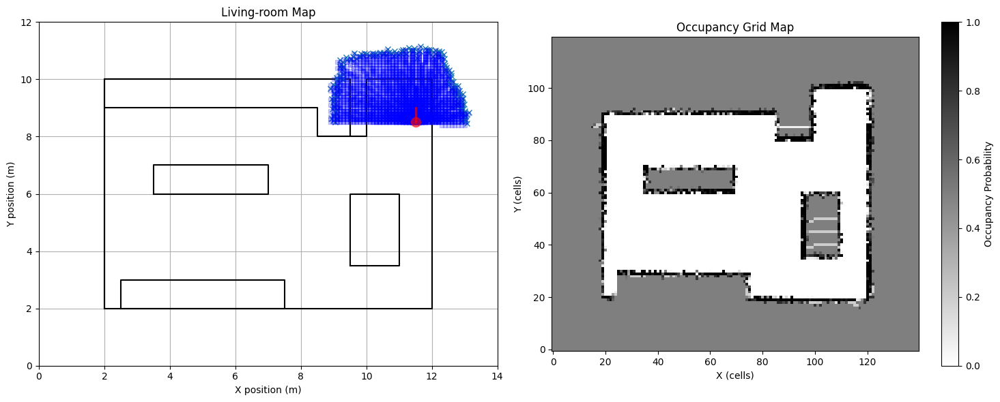
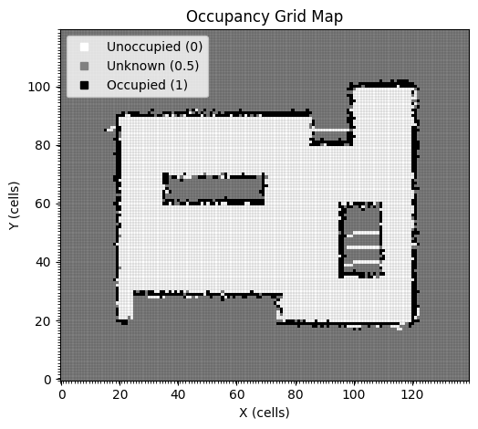

# Práctica 6.3 · Occupancy grid map building: resolución y guía de entrega

Este documento resume cómo se ha resuelto el notebook [6.3 Occupancy grid map building](6.3%20Occupancy%20grid%20map%20building.ipynb), qué resultados produce y qué te queda por hacer. La guía teórica es [P6.3 Occupancy grid mapping](../../../Teoria/Parcial-2/Guias_practicas/P6.3_Occupancy_grid_mapping.md).

El notebook **6.1 Introduction to mapping** es de lectura; su única tarea es una parte `OPTIONAL`, que también está hecha (celda 2): los retos del mapeado según Thrun, una tabla comparativa de los cuatro tipos de mapa, el origen de las rejillas de ocupación (Elfes), OctoMap para 3D y cómo se guardan los mapas en ROS 2 / Nav2, con referencias. Está exportado a `6.1 Introduction to mapping.html` y `.pdf`.

## Índice

1. [Qué había que hacer y estado](#1-qué-había-que-hacer-y-estado)
2. [Archivos generados](#2-archivos-generados)
3. [Cómo se ha resuelto y por qué](#3-cómo-se-ha-resuelto-y-por-qué)
4. [Resultados](#4-resultados)
5. [Rarezas del código y del entorno](#5-rarezas-del-código-y-del-entorno)
6. [Cómo se ha verificado](#6-cómo-se-ha-verificado)
7. [Qué falta por tu parte](#7-qué-falta-por-tu-parte)

## 1. Qué había que hacer y estado

Todo está resuelto y el notebook se ejecutó de principio a fin sin errores. Los índices de la tabla son los del notebook final, contando desde 0.

| Apartado | Qué se pide | Dónde |
| --- | --- | --- |
| ASSIGNMENT 1 | Constructor de `OccupancyGridMap` (`map`, `log_odds`, `probabilities`) | Celda 18 |
| Configuración del mapa | Crear la rejilla de 14 × 12 m con resolución 0,1 m | Celda 20 |
| ASSIGNMENT 2 | `beams_endpoints()`: extremos de los haces en coordenadas del mundo | Celda 24 |
| ASSIGNMENT 3 | `get_cells_to_update()`: paso a celdas y Bresenham | Celda 32 |
| ASSIGNMENT 4 | `inverse_beam_sensor_model()` | Celda 40 |
| ASSIGNMENT 5 | `l_0`, `update_log_odds()` y `update_probabilities()` | Celdas 46 y 52 |
| ASSIGNMENT 6 | `process_new_observation()` y `move_robot()` | Celda 57 |
| Recorrido sin botones (añadido) | Secuencia fija de 83 movimientos, para que el mapa quede en el PDF | Celdas 60–61 |
| Notas / key takeaways | Análisis del mapa obtenido | Celda 66 |
| AI Appendix | Uso de IA | Celda 68 |

## 2. Archivos generados

Todo está junto al notebook, en `Chapter 06. Mapping/`. La estructura del repositorio del profesor no cambia.

| Archivo | Contenido |
| --- | --- |
| `6.3 Occupancy grid map building.ipynb` | Notebook resuelto y ejecutado, con salidas y figuras |
| `6.3 Occupancy grid map building.html` | Exportación HTML con nbconvert |
| `6.3 Occupancy grid map building.pdf` | Exportación PDF (38 páginas) |
| `6.3 Resolución y guía de entrega.md` | Esta guía |
| `img/6.3_captura_*.png` | Capturas de las cinco figuras principales |

| Captura | Qué muestra |
| --- | --- |
| `6.3_captura_observacion_laser.png` | Salón virtual y scan de 181 haces desde (5, 4, π/4) |
| `6.3_captura_assignment2_endpoints.png` | Extremos de los 10 haces de prueba, prolongados 1 m |
| `6.3_captura_assignment3_ray_tracing.png` | Celdas que recorre cada haz de prueba (Bresenham) |
| `6.3_captura_assignment6_recorrido.png` | Estado final del recorrido: robot, haces y probabilidades |
| `6.3_captura_mapa_final.png` | Mapa final con los umbrales 0,3 / 0,7 |

## 3. Cómo se ha resuelto y por qué

### 3.1. ASSIGNMENT 1: la rejilla

```python
rows, cols = int(round(height / resolution)), int(round(width / resolution))
self.map = np.ones((rows, cols))
self.log_odds = np.zeros((rows, cols))
self.probabilities = np.full((rows, cols), 0.5)
```

La altura da el número de **filas** y la anchura el de **columnas**: 12 / 0,1 = 120 filas y 14 / 0,1 = 140 columnas. Se usa `round` antes de `int` por seguridad: `int()` trunca, y una división como `0.7 / 0.1 = 6.999…` perdería una fila. Con log odds 0 se parte de P = 0,5 en todas las celdas.

### 3.2. ASSIGNMENT 2: extremos de los haces

```python
theta_robot = robot_pose[2, 0]
x_robot, y_robot = robot_pose[0, 0], robot_pose[1, 0]
theta_i = theta_robot + beam_angle
x = x_robot + (beam_distance + adjusted_d) * np.cos(theta_i)
y = y_robot + (beam_distance + adjusted_d) * np.sin(theta_i)
```

El ángulo de cada haz es relativo al robot, así que se suma la orientación. Se alarga el haz `adjusted_d` metros más allá del obstáculo para actualizar también las celdas de detrás. Si el extremo se sale del mapa, el bucle del profesor reduce `adjusted_d` en pasos de 0,1 m.

### 3.3. ASSIGNMENT 3: celdas recorridas

```python
robot_cell_indices = [int(robot_pose[0, 0] / resolution), int(robot_pose[1, 0] / resolution)]
beam_endpoint_cell_indices = [int(beam_endpoint[0] / resolution), int(beam_endpoint[1] / resolution)]
cells_indices = list(ray_tracing(robot_cell_indices[0], robot_cell_indices[1],
                                 beam_endpoint_cell_indices[0], beam_endpoint_cell_indices[1]))
cells_to_update.append(valid_cells_indices)
```

Hay que **truncar con `int()`** antes de llamar a `ray_tracing()`. Si se pasan los flotantes, la función los redondea con `round()` y el primer haz acaba en (67, 23) en lugar de (66, 23): 66,52 se trunca a 66, pero se redondea a 67. Con `int()` las longitudes coinciden con las esperadas: `[18, 30, 56, 54, 79, 29, 30, 30, 30, 40]`.

### 3.4. ASSIGNMENT 4: modelo inverso del sensor

```python
sigma, l_th = 0.4, 0.2
x, y = robot_pose[0, 0] / resolution, robot_pose[1, 0] / resolution
d_i = z[0, beam_index] / resolution
rho = np.sqrt((cell[0] - x)**2 + (cell[1] - y)**2)
f = 1 / np.sqrt(2 * np.pi * sigma**2) * np.exp(-0.5 * (rho - d_i)**2 / sigma**2)
if rho < d_i and f < l_th:   -> l_th (0.2, libre)
elif rho > d_i and f < 0.5:  -> 0.5 (desconocido, detrás del obstáculo)
else:                        -> min(f, 0.8) (ocupado)
```

ρ y d se miden **en celdas** (se divide por la resolución), como pide el comentario del código. Con esa convención salen exactamente las probabilidades esperadas.

### 3.5. ASSIGNMENT 5: log odds y probabilidades

```python
p_occupied, p_free = 0.5, 0.5
l_0 = -np.log(p_occupied / p_free)          # = 0
tau_t = np.log(p_occupied / (1 - p_occupied))
grid_map.log_odds[traversed_cell[1]][traversed_cell[0]] += tau_t + l_0
grid_map.probabilities = 1 - 1 / (1 + np.exp(grid_map.log_odds))
```

Las celdas vienen como `(x, y)`, pero la matriz se indexa `[fila][columna]` = `[y][x]`. El notebook ya incluye el signo menos dentro de `l_0`, así que la actualización es `+= tau_t + l_0`. La probabilidad se recupera con la sigmoide, aplicada a toda la matriz de una vez.

### 3.6. ASSIGNMENT 6: unirlo todo

```python
z_endpoints = beams_endpoints(robot_pose, z, grid_map)
cells_to_update = get_cells_to_update(robot_pose, z_endpoints, grid_map.resolution, grid_map.map.shape)
p_cells_occupied = inverse_beam_sensor_model(robot_pose, z, cells_to_update, grid_map.resolution)
update_log_odds(grid_map, cells_to_update, p_cells_occupied, l_0)
update_probabilities(grid_map)

u = np.vstack([dx, dy, dtheta])
robot_pose = tcomp(robot_pose, u)
laser.set_pose(robot_pose)
z = laser.take_observation(virtual_map)
process_new_observation(grid_map, robot_pose, z)
```

El movimiento es un incremento en el marco del robot, así que se compone con `tcomp`. Después se mueve el láser a la nueva pose, se toma el scan y se procesa.

### 3.7. Recorrido sin botones (celdas 60–61, añadidas)

Los botones dibujan en un widget `Output`, que no se guarda en el HTML ni en el PDF. Por eso se añadió una celda que llama a `move_robot()` con 83 movimientos fijos (`F` avanza 0,5 m; `L`/`R` giran ±π/4), lo mismo que pulsar los botones. Mientras se ejecuta, `output` se cambia por `contextlib.nullcontext()` para que `plot_state()` dibuje en la propia celda, y luego se restaura. Los botones de la celda 59 siguen funcionando en Jupyter. Antes de añadirlo se comprobó que ninguna pose queda a menos de 0,5 m de un obstáculo.

## 4. Resultados

| Salida | Esperada | Obtenida |
| --- | --- | --- |
| `grid_map.map shape` | `(120, 140)` | `(120, 140)` |
| `toy_z_endpoints` | 10 extremos, p. ej. `(6.6518, 2.3219)` | Idénticos |
| Longitudes de `toy_cells_to_update` | `[18, 30, 56, 54, 79, 29, 30, 30, 30, 40]` | Idénticas |
| Celdas de los dos primeros haces | `(50, 40) … (66, 23)` y `(50, 40) … (79, 25)` | Idénticas |
| `toy_p_cells_occupied` (2 haces) | 10 × 0,2, 0,8, 7 × 0,5 / 21 × 0,2, 9 × 0,5 | Idénticas |
| `log_odds[55:60, 40:45]` | Diagonal de −1,38629436 | Idéntica |

Todas las salidas numéricas coinciden exactamente. El mapa final de 84 observaciones (la inicial y 83 movimientos) reproduce paredes, sofá, mueble de TV, mesa y cocina; se parece a la figura esperada del notebook.





## 5. Rarezas del código y del entorno

- **Fallo de `Laser2D` con φ = π.** El haz cuyo ángulo absoluto es exactamente π atraviesa los obstáculos. Desde (11,5, 4,5, π/2), el haz 179 mide 0,50 m (llega a la mesa) y el 180 mide 2,0 m (la atraviesa). Pasa porque la comprobación `np.sign(phi) == np.sign(phi_m)` falla cuando uno vale π y el otro −π. Por eso hay **rayas blancas dentro de la mesa y del bloque de la cocina**. Es un fallo del simulador del profesor y no se ha tocado.
- **σ = 0,4 en celdas.** Como ρ y d van en celdas, σ = 0,4 celdas equivale a 4 cm. La gaussiana solo supera 0,5 si |ρ − d| < 0,47 celdas, y algunos haces no tienen ninguna celda en esa franja. El segundo haz de prueba, por ejemplo, no tiene ningún 0,8. Por eso salen paredes con algún hueco. La salida esperada obliga a esta convención.
- **El primer `z` del recorrido** es el de la celda 12 (pose inicial), tal como lo usa la celda 59 del profesor.
- **`ipywidgets`** no está en el Python del kernel. Para ejecutar se instaló temporalmente `ipywidgets==8.1.5` (con `widgetsnbextension`, `jupyterlab_widgets` y `comm`) en `/tmp/robotica-6.3-deps`. No se modificó `requirements.txt` ni el sistema.

## 6. Cómo se ha verificado

Antes de editar el notebook, cada función se probó en un script aparte con los datos de prueba (`toy_z`) y se comparó con la «Expected output». Después se ejecutó el notebook en su carpeta:

```bash
PYTHONPATH=/tmp/robotica-6.3-deps \
JUPYTER_PATH=/opt/homebrew/share/jupyter \
jupyter nbconvert --to notebook --execute --inplace \
  --ExecutePreprocessor.timeout=600 \
  "6.3 Occupancy grid map building.ipynb"
```

Terminó sin errores en unos 20 s, con Python 3.13.7 y NumPy 2.4.3. Las capturas se extrajeron de las salidas PNG de las propias celdas y se compararon a ojo con las figuras esperadas. El fallo de `Laser2D` se confirmó con un scan sin ruido desde (11,5, 4,5, π/2).

## 7. Qué falta por tu parte

1. **Leer y validar** las soluciones, las notas de la celda 66 y el AI Appendix, que está en primera persona.
2. Si quieres, **mueve tú el robot con los botones** en Jupyter (hace falta `pip install ipywidgets`). El mapa parte del estado que deja el recorrido fijo.
3. Entregar el `.pdf`, el `.ipynb` o ambos, según pida el campus virtual.

Si modificas el notebook, vuelve a ejecutarlo y regenera las exportaciones desde esta carpeta:

```bash
python3 -m pip install --target /tmp/robotica-6.3-deps --no-deps \
  ipywidgets==8.1.5 widgetsnbextension==4.0.13 jupyterlab_widgets==3.0.13 comm==0.2.2
PYTHONPATH=/tmp/robotica-6.3-deps JUPYTER_PATH=/opt/homebrew/share/jupyter \
  jupyter nbconvert --to notebook --execute --inplace "6.3 Occupancy grid map building.ipynb"
jupyter nbconvert --to html "6.3 Occupancy grid map building.ipynb"
"/Applications/Google Chrome.app/Contents/MacOS/Google Chrome" \
  --headless=new --disable-gpu --no-pdf-header-footer --virtual-time-budget=10000 \
  --print-to-pdf="6.3 Occupancy grid map building.pdf" \
  "file://$(pwd)/6.3 Occupancy grid map building.html"
```
