# L4 — Percepción del robot (Robot sensing)

**Bibliografía de referencia:**

- *Probabilistic Robotics*. S. Thrun, W. Burgard, D. Fox. MIT Press, 2005 (la diapositiva pone 2001).
- *Simultaneous Localization and Mapping for Mobile Robots: Introduction and Methods*. J. A. Fernández-Madrigal y J. L. Blanco Claraco. IGI-Global, 2013.

> **Notación usada en estos apuntes:** las negritas son vectores. $\mathbf{x} = [x, y, \theta]^T$ es la pose del robot (o del sensor); $\mathbf{m}$ es el mapa (o un landmark $\mathbf{m}_i = [x_i, y_i]^T$); $\mathbf{z}$ es una observación; $\hat{\ }$ indica valor **predicho**; $\oplus$ es la composición de poses (L3); $\mathcal{N}(\mu, \sigma^2)$ es una gaussiana. Las diapositivas usan para el ángulo medido (*bearing*) tanto $\theta_i$ como $\alpha$: aquí se usa **$\alpha$ para el bearing** y $\theta$ **solo para la orientación del robot**, para no confundirlos.

> **Cómo estudiar este tema para el examen:** el parcial pide **pequeños cálculos aplicando las fórmulas** (distancia por tiempo de vuelo, rango y bearing predichos, posición global de un landmark, propagar una covarianza con jacobianos, evaluar una gaussiana o una mezcla del *beam model*...). Cada fórmula importante va acompañada de un **ejemplo resuelto paso a paso**, siempre con la misma estructura: **enunciado** → **qué buscamos y por qué** → **fórmula** (qué es cada símbolo) → **pasos** con todas las sustituciones → **resultado e interpretación**. Si en el examen te bloqueas, sigue ese mismo orden. Al final están la **chuleta de fórmulas** (sección 9) y los **errores típicos** (sección 10).

---

## Contenidos de la lección

1. **Tipos de sensores para robótica:**
   - Clasificación.
   - GPS.
   - Sonares.
   - Lidars (escáneres láser).
   - Cámaras.
2. **Modelos probabilísticos de sensores:**
   - Modelos de sensores de landmarks.
   - Modelos de sensores basados en *scans*.

---

## 1. Clasificación de los sensores

### 1.1. Propioceptivos frente a exteroceptivos

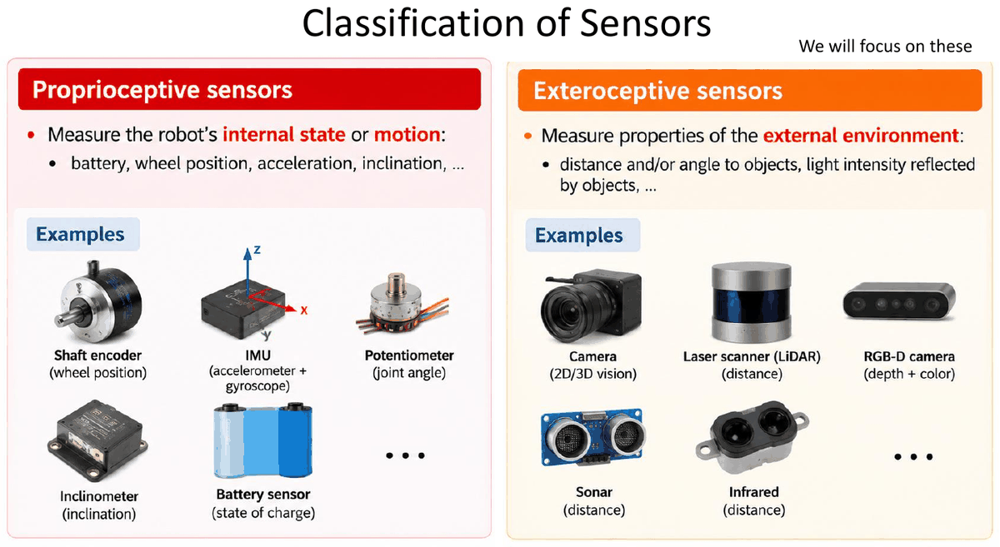

| Tipo | Qué miden | Ejemplos |
|---|---|---|
| **Propioceptivos** | El **estado interno** del robot o su **movimiento**: batería, posición de las ruedas, aceleración, inclinación... | Encoder de eje (posición de rueda), **IMU** (acelerómetro + giróscopo), potenciómetro (ángulo de articulación), inclinómetro, sensor de batería |
| **Exteroceptivos** — **los que estudiaremos** | Propiedades del **entorno exterior**: distancia y/o ángulo a objetos, intensidad de luz reflejada... | Cámara (visión 2D/3D), escáner láser (LiDAR), cámara RGB-D (profundidad + color), sonar, infrarrojos |

> **Aclaración:** los encoders de L3 (odometría) son **propioceptivos**: miden cuánto han girado las ruedas, no nada del entorno. Por eso acumulan deriva y hace falta un sensor exteroceptivo para corregir la pose.

### 1.2. Sensores exteroceptivos pasivos frente a activos

| Tipo | Energía | Ejemplos | Ventajas / inconvenientes |
|---|---|---|---|
| **Pasivos** | Usan energía que **viene del entorno** (luz ambiente, señales de satélite) | Cámaras, receptor GNSS/GPS | No emiten nada; dependen de las condiciones del entorno (luz...) |
| **Activos** | **Emiten su propia energía** (luz, radio, sonido) y miden lo que vuelve | LiDAR (pulsos láser), sonar, cámara RGB-D | **Mejor rendimiento con luz cambiante**, pero **más consumo** |

> **Ojo:** el GPS es **pasivo**: el receptor solo escucha las señales de los satélites, no emite nada.

### 1.3. Landmarks y balizas

- **Landmark:** un **elemento o característica reconocible** del entorno cuya observación se puede **asociar a un elemento de un mapa**. Ejemplos: un edificio, una montaña (elemento natural), puntos clave 3D distintivos de una imagen.
  - **Ventajas:** **no requieren instalación** (se reutilizan elementos existentes) y son **flexibles y adaptables** a entornos cambiantes.
- **Baliza (*beacon*, landmark artificial):** un landmark **instalado o designado a propósito** para facilitar la detección, identificación y localización. Ejemplos: satélite GPS (posición conocida), patrón visual (QR, datamatrix), reflector, antena de radio/WiFi.
  - **Ventajas:** dan **posicionamiento absoluto** (respecto a las coordenadas conocidas de las balizas) y permiten **algoritmos sencillos y eficientes**.

### 1.4. Medidas geométricas en robótica

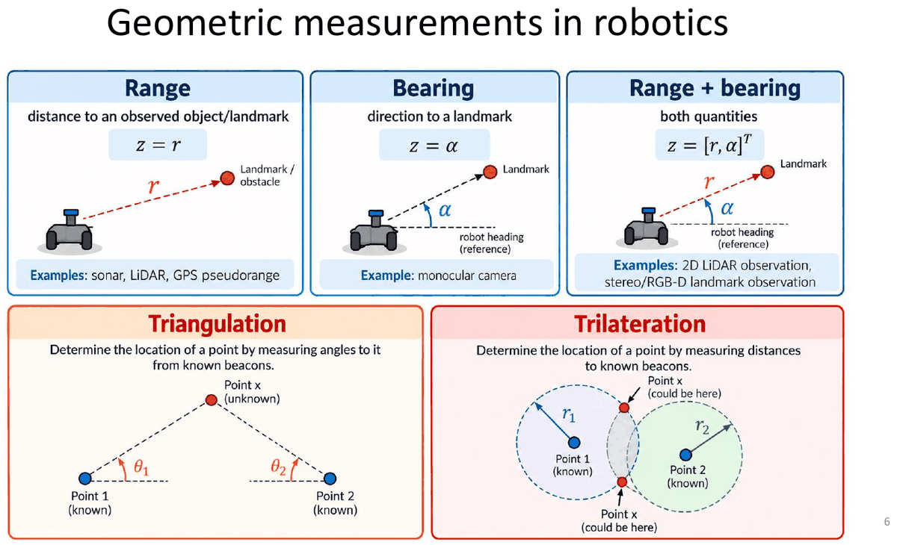

| Medida | Qué da | Fórmula | Ejemplos de sensor |
|---|---|---|---|
| **Rango** (*range*) | Distancia a un objeto/landmark | $z = r$ | Sonar, LiDAR, pseudorango GPS |
| **Bearing** (marcación, dirección) | Ángulo al landmark respecto a la orientación del robot | $z = \alpha$ | Cámara monocular |
| **Rango + bearing** | Ambas | $\mathbf{z} = [r, \alpha]^T$ | Observación de LiDAR 2D, landmark con estéreo/RGB-D |

Con varias balizas **conocidas** se puede calcular la posición de un punto desconocido:

- **Triangulación:** se miden **ángulos** al punto desde balizas conocidas; el punto está en el cruce de las rectas.
- **Trilateración:** se miden **distancias** a balizas conocidas; el punto está en la **intersección de circunferencias** (esferas en 3D). Con **dos** circunferencias en 2D hay en general **dos** soluciones posibles (las dos intersecciones).

> **Ejemplo resuelto (trilateración 2D).**
>
> **Enunciado.** Hay dos balizas de posición conocida: $\mathbf{b}_1 = (0, 0)$ y $\mathbf{b}_2 = (6, 0)$ m. El robot mide que está a $r_1 = 5$ m de la primera y a $r_2 = 5$ m de la segunda. ¿Dónde está?
>
> **Idea.** Estar a 5 m de $\mathbf{b}_1$ significa estar **en una circunferencia** de radio 5 centrada en $\mathbf{b}_1$. Lo mismo con $\mathbf{b}_2$. El robot está donde se **cortan** las dos circunferencias.
>
> **Paso 1. Escribir las dos circunferencias** (ecuación $(x - x_b)^2 + (y - y_b)^2 = r^2$):
> $x^2 + y^2 = 25$ y $(x - 6)^2 + y^2 = 25$.
>
> **Paso 2. Restarlas para eliminar $y$.** $x^2 - (x - 6)^2 = 0$, es decir, $x^2 - (x^2 - 12x + 36) = 12x - 36 = 0$, de donde $x = 3$.
> En general, con $\mathbf{b}_1$ en el origen y $\mathbf{b}_2 = (d, 0)$: $x = \dfrac{r_1^2 - r_2^2 + d^2}{2d} = \dfrac{25 - 25 + 36}{12} = 3$.
>
> **Paso 3. Sustituir para hallar $y$.** $y^2 = 25 - 3^2 = 16$, así que $y = \pm 4$.
>
> **Resultado e interpretación.** Hay dos soluciones, $(3, 4)$ y $(3, -4)$: las dos circunferencias se cortan en dos puntos. Para elegir hace falta una **tercera baliza** o saber en qué lado está el robot. Es la misma idea que el GPS en 3D (sección 2.1).

---

## 2. Sistema de posicionamiento global (GPS)

### 2.1. Principio de funcionamiento

Se usa mucho para **posicionar robots en exteriores**.

1. Los **satélites actúan como balizas artificiales móviles**: transmiten señales con marca de tiempo y su posición es conocida.
2. Orbitan a unos **20 200 km** de altitud, con un periodo orbital de unas **12 horas** (seis planos orbitales).
3. El posicionamiento se basa en **trilateración**: la posición se obtiene a partir de medidas de distancia (**pseudorangos**) a varios satélites.
4. Hacen falta **al menos cuatro satélites** para estimar la **posición 3D y el desfase del reloj del receptor**.

**Trilateración con satélites:** 1 satélite → la posición está en una **esfera**; 2 satélites → en la **circunferencia** intersección de dos esferas; 3 satélites → en un **punto** (caso ideal).

> **¿Por qué 4 y no 3?** Hay **4 incógnitas**: $x, y, z$ y el **error del reloj del receptor** $\delta t$. El receptor no lleva un reloj atómico, así que la distancia que mide está sesgada por $c\,\delta t$ (por eso se llama **pseudo**rango). Cuatro ecuaciones para cuatro incógnitas.

> **Ejemplo resuelto (por qué importa tanto el reloj).**
>
> **Qué queremos ver.** Cuánto error de distancia produce un error pequeño en el reloj del receptor.
>
> **Fórmula.** El GPS convierte tiempo en distancia con $r = c\,\Delta t$, donde $c \approx 3 \times 10^8$ m/s es la velocidad de la luz. Un error de reloj $\delta t$ produce un error de distancia $\Delta r = c\,\delta t$. Aquí no se divide entre 2 porque la señal solo viaja **de ida**, del satélite al receptor.
>
> - Error de reloj de $1\ \mu\text{s} = 10^{-6}$ s: $\Delta r = 3 \times 10^8 \cdot 10^{-6} = 300$ m.
> - Error de reloj de $10\ \text{ns} = 10^{-8}$ s: $\Delta r = 3 \times 10^8 \cdot 10^{-8} = 3$ m.
>
> **Interpretación.** Una millonésima de segundo de error son 300 m. Como el receptor no tiene un reloj atómico, su desfase se trata como **una incógnita más**. Por eso hacen falta 4 satélites y no 3.

### 2.2. Señal de los satélites y segmento de control

- Cada satélite **difunde ondas de radio codificadas** (en varias frecuencias) que contienen:
  - La **identidad y la posición** del satélite.
  - La **fecha y hora** de envío de la señal (reloj atómico preciso).
- **Segmento de control:** red mundial de **instalaciones en tierra** que vigilan los satélites y les envían correcciones y órdenes:
  1. **Estaciones de monitorización:** siguen los satélites y vigilan sus señales.
  2. **Estación de control maestra (MCS):** calcula correcciones y genera órdenes.
  3. **Subida a los satélites:** las antenas de tierra envían correcciones y órdenes a los satélites.

### 2.3. Fuentes de error y precisión típica

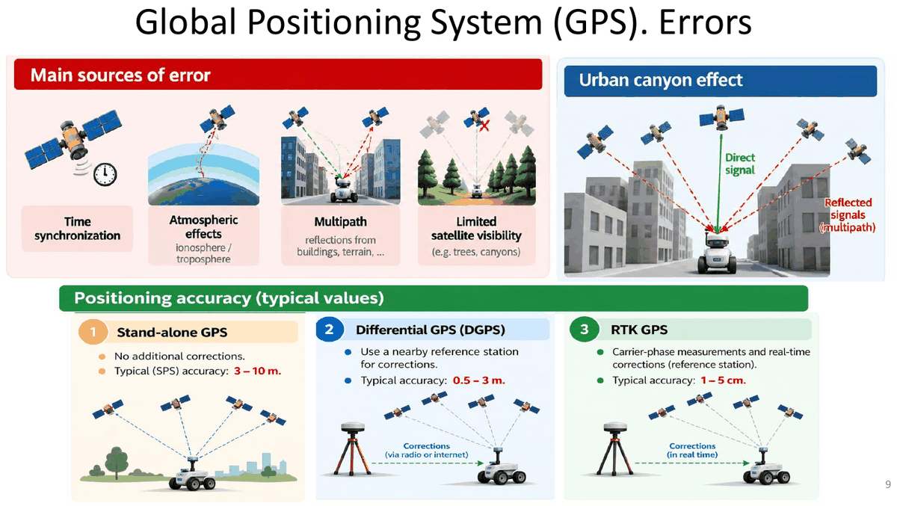

**Principales fuentes de error:**

- **Sincronización de tiempos** (relojes).
- **Efectos atmosféricos** (ionosfera / troposfera).
- **Multitrayecto** (*multipath*): reflexiones en edificios, terreno...
- **Visibilidad limitada de satélites** (árboles, cañones urbanos).

**Efecto cañón urbano:** entre edificios altos llegan pocas señales directas y muchas **reflejadas** (multitrayecto), que recorren más distancia y falsean el pseudorango.

| Modalidad | Cómo funciona | Precisión típica |
|---|---|---|
| **GPS autónomo** (*stand-alone*, SPS) | Sin correcciones adicionales | **3–10 m** |
| **GPS diferencial (DGPS)** | Usa una **estación de referencia cercana** que envía correcciones (radio o internet) | **0,5–3 m** |
| **RTK GPS** | Medidas de **fase de la portadora** + correcciones **en tiempo real** de una estación de referencia | **1–5 cm** |

---

## 3. Sensores de rango

### 3.1. Sonar: principio de medida (tiempo de vuelo)

Los primeros sistemas de medida por ultrasonidos los usó **Polaroid** para el autoenfoque de sus cámaras (años 70, p. ej. la SX-70).

**Funcionamiento:**

1. El emisor envía un **pulso ultrasónico** corto (**> 20 kHz**).
2. El pulso se **refleja** en un obstáculo y lo detecta el receptor.
3. Se mide el **tiempo de ida y vuelta** $\Delta t$ para estimar la distancia (**tiempo de vuelo, ToF**).

$$
\boxed{\,r = \frac{c_s\,\Delta t}{2}\,}
$$

| Símbolo | Significado | Unidades |
|---|---|---|
| $r$ | Distancia al obstáculo | m |
| $c_s$ | Velocidad del sonido en el aire ($\approx 343$ m/s a 20 °C) | m/s |
| $\Delta t$ | Tiempo de **ida y vuelta** | s |

> **El 2 del denominador:** el sonido recorre la distancia **dos veces** (ida y vuelta). Olvidarlo duplica la distancia.

> **Ejemplo resuelto (distancia con un sonar).**
>
> **Enunciado.** Un sonar recibe el eco $\Delta t = 10$ ms después de emitir el pulso. ¿A qué distancia está el obstáculo?
>
> **Fórmula.** $r = \dfrac{c_s\,\Delta t}{2}$, con $c_s = 343$ m/s. Se divide entre 2 porque en ese tiempo el sonido va hasta el obstáculo **y vuelve**.
>
> **Paso 1. Unidades.** $\Delta t = 10\ \text{ms} = 0{,}010$ s.
>
> **Paso 2. Distancia recorrida por el sonido.** $c_s\,\Delta t = 343 \cdot 0{,}010 = 3{,}43$ m (ida + vuelta).
>
> **Paso 3. Dividir entre 2.** $r = 3{,}43 / 2 = 1{,}715$ m.
>
> **Al revés (tiempo a partir de la distancia).** Si el obstáculo está a $r = 2$ m, el sonido recorre $2r = 4$ m y tarda $\Delta t = \dfrac{2r}{c_s} = \dfrac{4}{343} = 0{,}01166$ s $\approx 11{,}66$ ms.

### 3.2. Sonar: haz, situaciones típicas, ventajas y limitaciones

- El **ancho de haz efectivo es de unos 30°** (lóbulo principal), pero hay **lóbulos secundarios**. En el **modelo simplificado** el haz es un cono de apertura $\beta \approx 30°$ y se ignoran los lóbulos secundarios.

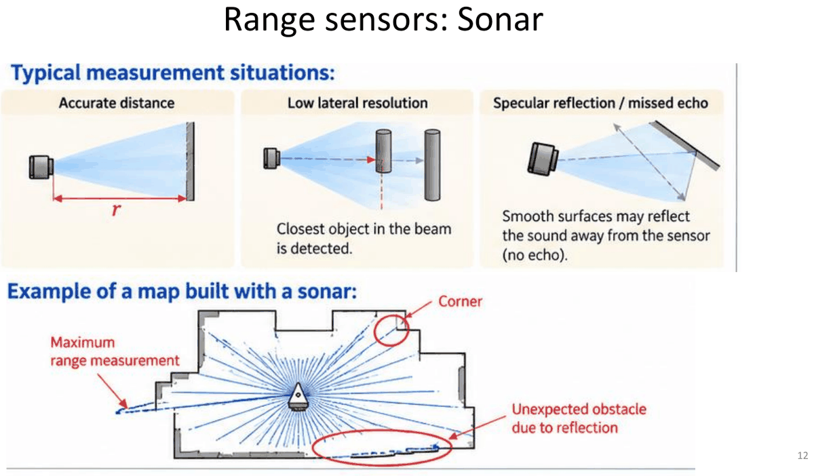

**Situaciones típicas de medida:**

| Situación | Qué ocurre |
|---|---|
| **Distancia precisa** | Pared perpendicular al haz: se mide bien $r$ |
| **Baja resolución lateral** | Se detecta el **objeto más cercano dentro del haz**, sin saber en qué punto del cono está |
| **Reflexión especular / eco perdido** | Las superficies lisas pueden reflejar el sonido **lejos del sensor** → no hay eco |

En un **mapa construido con sonar** aparecen: medidas de **rango máximo** (no volvió el eco), **esquinas** mal medidas y **obstáculos inexistentes** por reflexiones.

| Características clave | Limitaciones |
|---|---|
| **Bajo coste**, muy disponible | **Mala resolución angular** (haz ≈ 30°): dos objetos a la misma distancia separados lateralmente no se distinguen |
| **Compacto**, fácil de integrar | **Sensible al tipo de superficie:** las superficies especulares desvían el sonido → eco débil o ninguno |
| **Bajo consumo** | **Las esquinas se pueden perder:** las esquinas abiertas no devuelven suficiente sonido |
| **Alcance corto/medio:** típicamente **2–4 m** | **Reflexiones múltiples:** el sonido rebota en varias superficies → ecos espurios y distancias erróneas |
| Útil para **detección de obstáculos** y evitar colisiones | |

> **Ejemplo resuelto (resolución lateral del sonar).**
>
> **Enunciado.** Un sonar tiene un haz en forma de cono de apertura $\beta = 30°$. ¿Qué anchura cubre el haz a $r = 2$ m?
>
> **Idea.** El sonar solo dice «hay algo a 2 m dentro del cono», no en qué punto del cono. Cuanto más ancho es el cono a esa distancia, peor se sabe **dónde** está el objeto lateralmente.
>
> **Fórmula (trigonometría).** Medio cono forma un triángulo rectángulo con ángulo $\beta/2$, así que media anchura es $r\tan(\beta/2)$. La anchura total es $2\,r\tan(\beta/2)$.
>
> **Cálculo.** $2 \cdot 2 \cdot \tan 15° = 4 \cdot 0{,}268 = 1{,}07$ m.
>
> **Interpretación.** Cualquier objeto en una franja de más de 1 m de ancho da la misma lectura: la resolución lateral del sonar es mala. Compáralo con el LiDAR en el ejemplo de la sección 3.4.

### 3.3. Infrarrojos (triangulación de luz)

- Se basan en la **triangulación de luz**: un **emisor IR** ilumina el objeto y un **array de detectores IR** (tras una lente) recibe el rayo reflejado. La posición en el array da el **ángulo detectado** $\alpha$ y, conocida la separación entre emisor y detector (**línea base** $b$), **la distancia se calcula a partir del ángulo**.
- **Características:** pequeños, baratos y de bajo consumo; **alcance de unos 2 m**; **buena resolución angular** (haz más estrecho que el sonar).
- **Limitaciones:** sensibles a objetos **transparentes, brillantes y negros**, y a la **luz solar**.

> **Aclaración geométrica (no viene en las diapositivas):** si el emisor lanza el rayo perpendicular a la línea base y el rayo reflejado llega al detector formando un ángulo $\alpha$ con la línea base, el triángulo rectángulo da $r = b\tan\alpha$. Por ejemplo, con $b = 2$ cm y $\alpha = 80°$: $r = 0{,}02 \cdot \tan 80° \approx 0{,}113$ m; con $\alpha = 85°$: $r \approx 0{,}229$ m. Cuanto más lejos está el objeto, más se acerca $\alpha$ a 90° y un mismo error de ángulo produce más error de distancia: por eso su alcance es corto.

### 3.4. Escáner láser (LiDAR)

**Componentes:** fuente láser, **espejo giratorio** (escáner), receptor (**fotodiodo**). El espejo barre el haz por el entorno (p. ej. 360°) y el resultado es una **nube de puntos 2D/3D**.

**Medida de distancia (tiempo de vuelo):**

$$
\boxed{\,r = \frac{c\,\Delta t}{2}\,}
\qquad c \approx 3 \times 10^8\ \text{m/s (velocidad de la luz)}, \quad \Delta t:\ \text{tiempo de ida y vuelta}
$$

El pulso láser es **infrarrojo cercano** (no visible).

**Prestaciones:**

| Característica | Valor típico |
|---|---|
| **Alcance** | De unos pocos metros a **200 m o más**, según el sensor y la reflectividad del objetivo |
| **Precisión en distancia** | Centimétrica (**~1–5 cm**) |
| **Resolución angular** | Haz estrecho (**0,1°–1°**): medidas espaciales detalladas |
| **Coste** | Más caro que los ultrasonidos, pero bajando rápido (industria del automóvil, producción en masa) |

**Comparación con los ultrasonidos:**

| LiDAR (típico) | Ultrasonidos (típico) |
|---|---|
| Haz estrecho (0,1°–1°) | Haz ancho (≈ 30°) |
| Alta resolución angular | Mala resolución angular |
| Nubes de puntos 2D/3D detalladas | Solo distancia dentro del haz |
| Largo alcance (hasta 200 m o más) | Alcance corto/medio (≤ 4 m) |
| Precisión centimétrica | Menor coste |

**Limitaciones del LiDAR:**

- **Condiciones ambientales:** lluvia, niebla, polvo o humo degradan el rendimiento (dispersión y atenuación del haz).
- **Superficies poco reflectantes:** objetos oscuros o absorbentes (moqueta negra, cristal) devuelven señal débil o ninguna.
- **Reflexiones especulares:** superficies brillantes (espejos, metal pulido) desvían el haz.
- **Objetos en movimiento:** el movimiento durante el barrido distorsiona la nube de puntos.

> **Ejemplo resuelto (resolución angular del LiDAR).**
>
> **Enunciado.** Un LiDAR tiene un campo de visión (FOV) de 270° y una resolución angular de $\Delta\alpha = 0{,}25°$. (a) ¿Cuántos haces da por barrido? (b) ¿Qué separación hay entre los puntos de dos haces contiguos a $r = 10$ m?
>
> **(a) Número de haces.** Dividir el FOV entre el paso da el número de **intervalos**: $270 / 0{,}25 = 1080$. Hay **un haz más** que intervalos, porque se cuentan los dos extremos (como los postes de una valla): $1080 + 1 = 1081$ haces.
>
> **(b) Separación entre puntos.** Dos haces separados un ángulo pequeño $\Delta\alpha$ llegan a puntos separados aproximadamente un arco $s \approx r\,\Delta\alpha$, con el ángulo **en radianes**:
>
> - $\Delta\alpha = 0{,}25° \cdot \frac{\pi}{180} = 0{,}004363$ rad.
> - $s \approx 10 \cdot 0{,}004363 = 0{,}044$ m $= 4{,}4$ cm.
>
> **Interpretación.** A 10 m, el LiDAR distingue detalles de unos 4 cm. El sonar, a solo 2 m, tenía una «mancha» de más de 1 m (sección 3.2). Esa es la diferencia de resolución angular.

### 3.5. Técnicas de medida del LiDAR: ToF pulsado y desplazamiento de fase

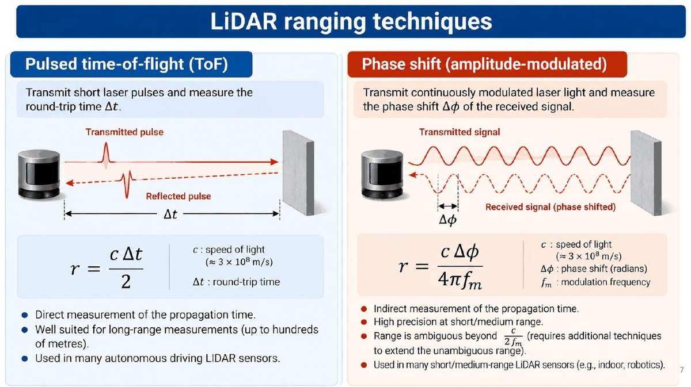

| | **Tiempo de vuelo pulsado (ToF)** | **Desplazamiento de fase (modulación en amplitud)** |
|---|---|---|
| Qué se emite | **Pulsos** láser cortos | Luz láser **modulada de forma continua** |
| Qué se mide | El tiempo de ida y vuelta $\Delta t$ | El **desfase** $\Delta\phi$ de la señal recibida |
| Fórmula | $r = \dfrac{c\,\Delta t}{2}$ | $r = \dfrac{c\,\Delta\phi}{4\pi f_m}$ |
| Características | Medida **directa** del tiempo de propagación; apto para **largo alcance** (cientos de metros) | Medida **indirecta** del tiempo; **alta precisión** a corto/medio alcance; **el rango es ambiguo** más allá de $\dfrac{c}{2 f_m}$ |
| Uso típico | Muchos LiDAR de **conducción autónoma** | LiDAR de corto/medio alcance (interiores, robótica) |

Símbolos de la fórmula de fase: $c$ velocidad de la luz (m/s), $\Delta\phi$ desfase **en radianes**, $f_m$ frecuencia de modulación (Hz).

> **De dónde sale la fórmula de fase:** un desfase $\Delta\phi$ equivale a un retraso $\Delta t = \dfrac{\Delta\phi}{2\pi f_m}$. Sustituyendo en $r = c\,\Delta t / 2$: $r = \dfrac{c\,\Delta\phi}{4\pi f_m}$. Como la fase solo se mide entre $0$ y $2\pi$, el rango máximo sin ambigüedad es $r_{max} = \dfrac{c \cdot 2\pi}{4\pi f_m} = \dfrac{c}{2 f_m}$.

> **Ejemplo resuelto (LiDAR por tiempo de vuelo).**
>
> **Enunciado.** Un LiDAR mide un tiempo de ida y vuelta $\Delta t = 66{,}7$ ns. ¿A qué distancia está el objeto?
>
> **Fórmula.** $r = \dfrac{c\,\Delta t}{2}$, la misma que la del sonar, pero con la velocidad de la luz, $c = 3 \times 10^8$ m/s.
>
> **Paso 1. Unidades.** $66{,}7\ \text{ns} = 66{,}7 \times 10^{-9}$ s.
>
> **Paso 2. Ida y vuelta.** $c\,\Delta t = 3 \times 10^8 \cdot 66{,}7 \times 10^{-9} = 20{,}01$ m.
>
> **Paso 3. Dividir entre 2.** $r = 20{,}01 / 2 \approx 10{,}0$ m.
>
> **Al revés.** Un objeto a 15 m produce $\Delta t = \dfrac{2 \cdot 15}{3 \times 10^8} = 10^{-7}$ s $= 100$ ns.
>
> **Interpretación.** Hay que medir tiempos de nanosegundos: un error de 1 ns son $3 \times 10^8 \cdot 10^{-9} / 2 = 0{,}15$ m, es decir, 15 cm.

> **Ejemplo resuelto (LiDAR por desplazamiento de fase).**
>
> **Enunciado.** Un LiDAR modula su luz a $f_m = 10$ MHz y mide un desfase $\Delta\phi = \pi/2$ rad entre la señal emitida y la recibida. (a) ¿A qué distancia está el objeto? (b) ¿Hasta qué distancia mide sin ambigüedad?
>
> **Fórmulas.** $r = \dfrac{c\,\Delta\phi}{4\pi f_m}$ y $r_{max} = \dfrac{c}{2 f_m}$, con $\Delta\phi$ en **radianes** y $f_m$ en Hz ($10\ \text{MHz} = 10^7$ Hz).
>
> **(a) Distancia.** $r = \dfrac{3 \times 10^8 \cdot \pi/2}{4\pi \cdot 10^7}$. Los $\pi$ se simplifican: $\dfrac{\pi/2}{4\pi} = \dfrac{1}{8}$. Por tanto, $r = \dfrac{3 \times 10^8}{8 \times 10^7} = 3{,}75$ m.
>
> **(b) Rango sin ambigüedad.** $r_{max} = \dfrac{3 \times 10^8}{2 \cdot 10^7} = 15$ m.
>
> **Interpretación de la ambigüedad.** La fase solo se mide entre 0 y $2\pi$: es como un reloj que no dice cuántas vueltas ha dado. Un objeto a $3{,}75 + 15 = 18{,}75$ m produce un desfase de $\pi/2 + 2\pi$, que el sensor ve igual que $\pi/2$, y leería 3,75 m.

### 3.6. Ejemplos de LiDAR

**LiDAR 2D para robots móviles: Hokuyo UTM-30LX.** Un diodo láser IR emite el haz, un **espejo giratorio** lo barre en el **plano horizontal** y un fotodetector recibe el reflejo.

| Especificación | Valor |
|---|---|
| Alcance de detección | **30 m** (típico, máx.) |
| Campo de visión (FOV) | **270°** (quedan **90° de zona ciega** detrás) |
| Entorno | Apto para exteriores |
| Tamaño / peso | 60 × 60 × 87 mm / 370 g |

El resultado de un barrido es un conjunto de puntos $(r_k, \alpha_k)$ que, pasados a cartesianas (sección 6.6), dibujan las paredes y objetos que rodean al robot.

**LiDAR 3D:** cada vez más populares en coches autónomos (p. ej. el **Waymo**: LiDAR de 360° en el techo con alcance de más de 300 m y cuatro LiDAR perimetrales de corto alcance) y en robots (humanoides y cuadrúpedos de Unitree). Ejemplo: Ouster OS1. Cada vez más baratos.

**LiDAR 4D (p. ej. Unitree L1/L2):** cada medida da la **posición 3D** y un atributo adicional, la **reflectividad** (intensidad) de la señal devuelta:

$$
p_i = (x_i, y_i, z_i, g_i)
$$

- La cuarta dimensión **no es una coordenada espacial**: es la intensidad (escala de grises, 0–255).
- La reflectividad ayuda a distinguir superficies de geometría parecida.
- Ejemplo Unitree L2: FOV horizontal 360°, vertical 96°, alcance ~120 m, ~1,2 millones de puntos por segundo.

> **Ejemplo resuelto (ángulo de cada haz de un scan).**
>
> **Enunciado.** Un barrido de 270° empieza en $\alpha_{min} = -135°$ y avanza $\Delta\alpha = 0{,}25°$ por haz. ¿Hacia dónde apuntan los haces $k = 540$ y $k = 180$?
>
> **Fórmula.** $\alpha_k = \alpha_{min} + k\,\Delta\alpha$, contando el primer haz como $k = 0$. Es lo que hace un mensaje `LaserScan` de ROS (práctica 4.3).
>
> - **Haz 540:** $\alpha = -135° + 540 \cdot 0{,}25° = -135° + 135° = 0°$. Apunta **justo de frente**.
> - **Haz 180:** $\alpha = -135° + 180 \cdot 0{,}25° = -135° + 45° = -90°$. Apunta **a la derecha** del robot (los ángulos negativos van hacia la derecha).

---

## 4. Cámaras

### 4.1. Cámara monocular y cámaras estéreo

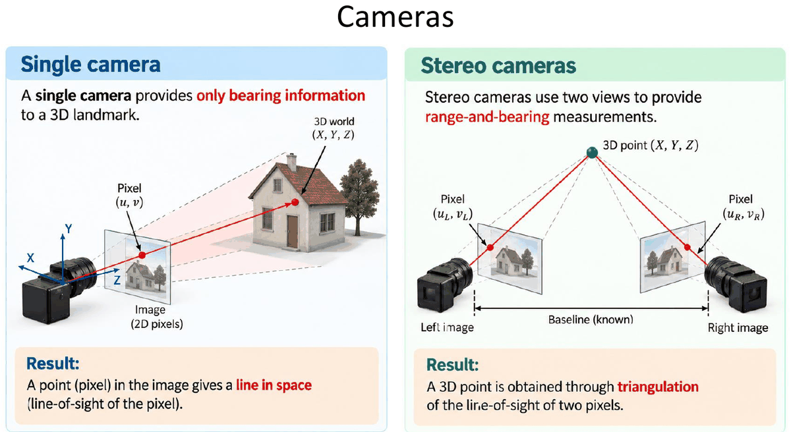

| | **Cámara monocular** | **Cámaras estéreo** |
|---|---|---|
| Qué da | **Solo bearing** a un landmark 3D | **Rango y bearing** |
| Por qué | Un píxel $(u, v)$ define una **recta en el espacio** (la línea de visión del píxel): el punto puede estar a cualquier profundidad sobre ella | Dos vistas separadas por una **línea base conocida**: el punto 3D se obtiene **triangulando** las líneas de visión de los dos píxeles $(u_L, v_L)$ y $(u_R, v_R)$ |

Uso en robótica móvil (investigación del grupo MAPIR, UMA): localización 3D de personas con una cámara orientable para la interacción persona-robot.

### 4.2. Cámaras RGB-D

- Dan una **imagen en color RGB** y una **imagen de profundidad** (un valor de distancia **por píxel**). Ejemplo: Intel RealSense D455.
- Frente a los escáneres láser 3D:
  - **Sin partes móviles** (sensor de estado sólido, sin espejos giratorios).
  - **Mapa de profundidad denso** (imagen completa).
  - Alcance **más corto** (típicamente **~0,2–4 m**, uso en interiores).
- Cada píxel aporta **apariencia (color) y distancia**: combinando ambas se obtiene una **nube de puntos 3D coloreada**.
- Uso: localización y mapeado (**SLAM**) en interiores (investigación MAPIR).

---

## 5. Modelos probabilísticos de sensores

### 5.1. Medida = verdad + error

Los **sensores reales no dan la verdad exacta** de lo que miden, sino una versión perturbada: **verdad + error**.

1. **Distancia verdadera:** la distancia real (desconocida) a un obstáculo es $v$.
2. **Medidas repetidas:** si repetimos la medida obtenemos valores distintos: $z_1, z_2, z_3, \ldots$
3. **Modelo probabilístico:** esas medidas son **realizaciones de una variable aleatoria**:

$$
Z \sim p(z \mid v)
$$

**Modelo de medida gaussiano** (el error del sensor se suele modelar como gaussiano):

$$
\boxed{\,p(z \mid v) = \mathcal{N}(z;\, v,\, \sigma^2) = \frac{1}{\sigma\sqrt{2\pi}}\exp\!\left(-\frac{(z - v)^2}{2\sigma^2}\right)\,}
$$

| Símbolo | Significado |
|---|---|
| $Z$ | Variable aleatoria (la medida) |
| $z$ | Una medida concreta (realización) |
| $v$ | Valor verdadero (desconocido) |
| $\sigma^2$ | Varianza de la medida ($\sigma$ en las unidades de la medida) |

> **Ejemplo resuelto (evaluar una gaussiana).**
>
> **Enunciado.** Un sensor mide distancias con un ruido de $\sigma = 0{,}3$ m. La distancia verdadera es $v = 5$ m. ¿Cuánto vale la densidad $p(z \mid v)$ para la medida $z = 5{,}3$ m?
>
> **Qué significa el resultado.** Lo «típico» que es medir 5,3 m cuando la verdad es 5 m. Cuanto más alto el valor, más habitual es esa medida.
>
> **Fórmula.** $p(z \mid v) = \underbrace{\dfrac{1}{\sigma\sqrt{2\pi}}}_{\text{altura máxima}} \cdot \underbrace{\exp\!\left(-\dfrac{(z - v)^2}{2\sigma^2}\right)}_{\text{cuánto baja al alejarse de } v}$.
>
> **Paso 1. Altura máxima de la campana** (el valor en $z = v$): $\dfrac{1}{0{,}3 \cdot \sqrt{2\pi}} = \dfrac{1}{0{,}3 \cdot 2{,}5066} = \dfrac{1}{0{,}752} = 1{,}330$.
>
> **Paso 2. Exponente.** El error es $z - v = 0{,}3$ m, así que $-\dfrac{0{,}3^2}{2 \cdot 0{,}3^2} = -\dfrac{0{,}09}{0{,}18} = -0{,}5$.
>
> **Paso 3. Multiplicar.** $p(5{,}3 \mid 5) = 1{,}330 \cdot e^{-0{,}5} = 1{,}330 \cdot 0{,}607 = 0{,}807$ m$^{-1}$.
>
> **Truco para el examen.** Fíjate en que el error (0,3) era justo $1\sigma$. A $1\sigma$ de la media la densidad vale siempre el **60,7 %** del máximo ($e^{-1/2}$); a $2\sigma$, el 13,5 % ($e^{-2}$); a $3\sigma$, el 1,1 % ($e^{-4{,}5}$). Recuerda que es una **densidad**: puede ser mayor que 1 si $\sigma$ es pequeña.

### 5.2. Ejemplos de sensores con error gaussiano en 1D

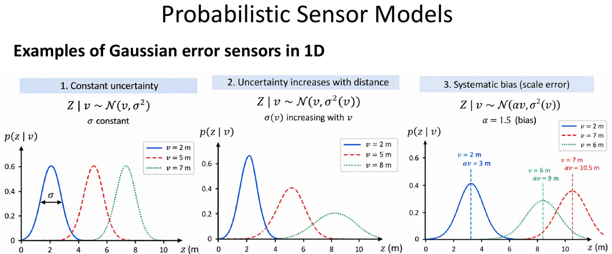

| Caso | Modelo | Qué significa |
|---|---|---|
| **1. Incertidumbre constante** | $Z \mid v \sim \mathcal{N}(v, \sigma^2)$, $\sigma$ constante | Mismo ancho de campana a cualquier distancia |
| **2. La incertidumbre crece con la distancia** | $Z \mid v \sim \mathcal{N}(v, \sigma^2(v))$, $\sigma(v)$ creciente con $v$ | Lejos se mide peor: campanas cada vez más anchas y bajas |
| **3. Sesgo sistemático (error de escala)** | $Z \mid v \sim \mathcal{N}(\alpha v, \sigma^2(v))$, p. ej. $\alpha = 1{,}5$ | La media **no** es la verdad: el sensor mide de más, y el error crece con $v$ |

> **Ejemplo resuelto (sesgo de escala).**
>
> **Enunciado.** Un sensor tiene un error de escala $\alpha = 1{,}5$, es decir, mide de media $\alpha$ veces la distancia real. Si la distancia verdadera es $v = 4$ m, ¿cuánto mide de media y qué error comete?
>
> **Cálculo.** Media de las medidas: $\alpha v = 1{,}5 \cdot 4 = 6$ m. Error sistemático: $6 - 4 = 2$ m. (En la diapositiva: $v = 2 \to 3$ m, $v = 6 \to 9$ m, $v = 7 \to 10{,}5$ m.)
>
> **Interpretación.** Es un error **sistemático**: aunque se promedien muchas medidas, la media sigue siendo 6 m y no 4. Además crece con la distancia. Si se conoce $\alpha$, se corrige dividiendo: $\hat{v} = z/\alpha = 6 / 1{,}5 = 4$ m.

### 5.3. Modelo ideal, modelo probabilístico y modelo gaussiano

**1. Modelo de medida ideal** (sin ruido): el vector de medida ideal $\mathbf{v}$ depende de la **pose del sensor** $\mathbf{x}$ y del **entorno (mapa)** $\mathbf{m}$:

$$
\mathbf{v} = \mathbf{h}(\mathbf{x}, \mathbf{m})
$$

Ejemplo: rango a un landmark $\mathbf{m} = (m_x, m_y)$ desde el robot $\mathbf{x} = (x, y, \theta)$:

$$
v = h(\mathbf{x}, \mathbf{m}) = r = \sqrt{(m_x - x)^2 + (m_y - y)^2}
$$

**2. Modelo probabilístico del sensor:** el sensor no da el valor ideal $v$, sino una medida aleatoria $\mathbf{Z}$ por el ruido:

$$
p(\mathbf{z} \mid \mathbf{x}, \mathbf{m}) = p(\mathbf{z} \mid \mathbf{v} = \mathbf{h}(\mathbf{x}, \mathbf{m}))
$$

donde $\mathbf{z}$ es la observación real (realización de $\mathbf{Z}$), $\mathbf{x}$ la pose del sensor y $\mathbf{m}$ el mapa.

**3. Modelo de medida gaussiano:** la medida es el valor ideal más ruido gaussiano:

$$
\boxed{\,\mathbf{Z} = \mathbf{h}(\mathbf{x}, \mathbf{m}) + \mathbf{W}, \quad \mathbf{W} \sim \mathcal{N}(\mathbf{0}, Q) \;\Longrightarrow\; p(\mathbf{z} \mid \mathbf{x}, \mathbf{m}) = \mathcal{N}(\mathbf{z};\, \mathbf{h}(\mathbf{x}, \mathbf{m}),\, Q)\,}
$$

Ejemplo (rango): $Z = r + W$, $W \sim \mathcal{N}(0, \sigma_r^2)$: la campana está centrada en el rango ideal $r$ con anchura $\sigma_r$.

> **Idea clave:** $\mathbf{h}$ es la **predicción** («qué debería medir si el robot estuviera en $\mathbf{x}$»); el modelo probabilístico dice **cuánto se puede separar la medida real de esa predicción**.

### 5.4. Una observación = muchas medidas: independencia condicional

- Una observación $\mathbf{z}$ suele contener **varias medidas**: $\mathbf{z} = [z_1, z_2, \ldots, z_K]^T$ ($K$ medidas), de un mismo dispositivo o de varios sensores.
- **Ejemplo: un scan láser** da muchas medidas de rango $z_k$ en un solo barrido.
- **Hipótesis de independencia condicional:** dadas la pose $\mathbf{x}$ y el mapa $\mathbf{m}$, las medidas individuales se suponen **condicionalmente independientes**:

$$
\boxed{\,p(\mathbf{z} \mid \mathbf{x}, \mathbf{m}) = \prod_{k=1}^{K} p(z_k \mid \mathbf{x}, \mathbf{m})\,}
$$

Recuerda (L3): $z_1$ y $z_2$ son condicionalmente independientes dados $\mathbf{x}, \mathbf{m}$ si $p(z_1, z_2 \mid \mathbf{x}, \mathbf{m}) = p(z_1 \mid \mathbf{x}, \mathbf{m})\,p(z_2 \mid \mathbf{x}, \mathbf{m})$. La verosimilitud conjunta se aproxima como el **producto** de las verosimilitudes individuales.

> **Ejemplo resuelto (verosimilitud de un scan como producto).**
>
> **Enunciado.** Un scan tiene tres haces. Para una pose candidata, sus verosimilitudes individuales son $p(z_1 \mid \mathbf{x}, \mathbf{m}) = 1{,}2$, $p(z_2 \mid \mathbf{x}, \mathbf{m}) = 0{,}8$ y $p(z_3 \mid \mathbf{x}, \mathbf{m}) = 0{,}05$. ¿Cuánto vale la verosimilitud del scan completo?
>
> **Fórmula.** Por la independencia condicional, se **multiplican**: $p(\mathbf{z} \mid \mathbf{x}, \mathbf{m}) = \prod_k p(z_k \mid \mathbf{x}, \mathbf{m})$.
>
> **Cálculo.** $1{,}2 \cdot 0{,}8 \cdot 0{,}05 = 0{,}96 \cdot 0{,}05 = 0{,}048$.
>
> **Interpretación.** Un solo haz poco compatible (0,05) hunde el producto entero. Con cientos de haces el producto se vuelve diminuto y el ordenador lo redondea a 0, así que en la práctica se suman **logaritmos**: $\log p = \sum_k \log p(z_k \mid \mathbf{x}, \mathbf{m})$.

### 5.5. Para un modelo de sensor hace falta un mapa

- Un **mapa geométrico** $\mathcal{M}$ es una representación de la **estructura espacial del entorno**. Para usar $p(\mathbf{z} \mid \mathbf{x}, \mathbf{m})$ se toma $\mathbf{m} = \mathcal{M}$.
- **Usos del mapa:**
  - **Localización:** estimar la pose con las observaciones y el mapa. El mapa permite **predecir la medida** en una pose candidata, $\hat{\mathbf{z}} = h(\mathbf{x}, \mathcal{M})$, y evaluar su **verosimilitud** $p(\mathbf{z} \mid \mathbf{x}, \mathcal{M}) = p(\mathbf{z} \mid h(\mathbf{x}, \mathcal{M}))$.
  - **Navegación y planificación:** usar el mapa para planificar caminos sin colisiones hacia un objetivo: $\pi = \text{plan}(\mathbf{x}_{start}, \mathcal{M})$ (evitar obstáculos, llegar a la meta, optimizar un criterio como longitud o seguridad).

**Dos representaciones de mapa habituales:**

| | **Mapa de landmarks** | **Mapa de rejilla de ocupación** (*occupancy grid*) |
|---|---|---|
| Representación | $\mathcal{M} = \{\mathbf{m}_1, \mathbf{m}_2, \ldots, \mathbf{m}_N\}$ | $\mathcal{M} = \{m_{ij}\}$ |
| Contenido | Cada landmark $\mathbf{m}_i$ tiene una **posición** $(x, y)$ y un **descriptor** (p. ej. características visuales) | Cada celda $m_{ij}$ guarda una **probabilidad de ocupación** $p(m_{ij}) = P(\text{ocupada})$ (0 = libre, 1 = ocupada) |
| Sensores típicos | Detecciones de landmarks con cámaras, balizas... | Escáneres LiDAR y sensores de profundidad |
| Modelos de sensor | Bearing, rango, rango y bearing (sección 6) | **Beam model** y **likelihood field** (sección 7) |

### 5.6. Verosimilitud frente a probabilidad condicionada

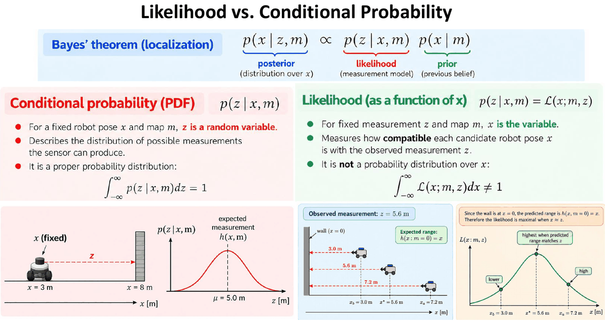

**Teorema de Bayes (localización):**

$$
\underbrace{p(\mathbf{x} \mid \mathbf{z}, \mathbf{m})}_{\text{posterior}} \;\propto\; \underbrace{p(\mathbf{z} \mid \mathbf{x}, \mathbf{m})}_{\text{verosimilitud (modelo de medida)}}\;\underbrace{p(\mathbf{x} \mid \mathbf{m})}_{\text{prior (creencia previa)}}
$$

La **misma expresión** $p(z \mid x, m)$ se lee de dos formas:

| | **Probabilidad condicionada (PDF)** | **Verosimilitud** (*likelihood*, como función de $x$) |
|---|---|---|
| Notación | $p(z \mid x, m)$ | $p(z \mid x, m) = \mathcal{L}(x; m, z)$ |
| Qué está fijo | La pose $x$ y el mapa $m$ | La medida $z$ y el mapa $m$ |
| Qué varía | $z$ (es la **variable aleatoria**) | $x$ (es la **variable**) |
| Qué describe | La distribución de las medidas **posibles** que puede dar el sensor | Lo **compatible** que es cada pose candidata $x$ con la medida observada $z$ |
| ¿Integra 1? | **Sí**: $\int p(z \mid x, m)\,dz = 1$ | **No**: $\int \mathcal{L}(x; m, z)\,dx \neq 1$; **no es una distribución sobre $x$** |

> **Ejemplo de la diapositiva (PDF):** robot fijo en $x = 3$ m y pared en $x = 8$ m: la medida esperada es $h(x, m) = 5$ m y $p(z \mid x, m)$ es una campana en $z$ centrada en $\mu = 5$ m.

> **Ejemplo resuelto (verosimilitud en 1D: pared en $x = 0$).**
>
> **Enunciado.** Un robot se mueve por una recta y mira hacia una pared que está en $x = 0$. Si el robot está en la posición $x$, el sensor debería medir $h(x) = x$ (su distancia a la pared). El sensor mide $z = 5{,}6$ m, con $\sigma = 0{,}5$ m. ¿Cómo de compatibles son con esa medida las posiciones $x_b = 3{,}0$, $x^* = 5{,}6$ y $x_a = 7{,}2$ m?
>
> **Qué hacemos.** Ahora la medida $z$ está **fija** y vamos probando **posiciones** $x$: eso es la verosimilitud $\mathcal{L}(x) \propto \exp\!\left(-\dfrac{(z - h(x))^2}{2\sigma^2}\right)$. Quitamos la constante porque solo queremos comparar.
>
> **Pasos para cada pose.** (1) Predecir la medida: $h(x) = x$. (2) Error: $z - h(x)$. (3) Exponente: $-\text{error}^2 / (2\sigma^2)$, con $2\sigma^2 = 2 \cdot 0{,}25 = 0{,}5$. (4) Exponencial.
>
> | Pose $x$ | Medida predicha $h(x)$ | Error $z - h(x)$ | Exponente | $\mathcal{L}$ (sin normalizar) |
> |---|---|---|---|---|
> | $3{,}0$ | $3{,}0$ | $2{,}6$ | $-6{,}76/0{,}5 = -13{,}52$ | $e^{-13{,}52} = 1{,}3 \times 10^{-6}$ |
> | $5{,}6$ | $5{,}6$ | $0$ | $0$ | $e^0 = 1$ (**máximo**) |
> | $7{,}2$ | $7{,}2$ | $-1{,}6$ | $-2{,}56/0{,}5 = -5{,}12$ | $e^{-5{,}12} = 0{,}006$ |
>
> **Interpretación.** La pose más compatible es aquella cuya **medida predicha coincide con la real** ($x = 5{,}6$). Las otras dos son muy improbables. Las tres cifras **no** suman 1: la verosimilitud no es una distribución sobre $x$. Para obtener probabilidades hay que aplicar Bayes, como en el ejemplo siguiente.

> **Ejemplo resuelto (Bayes discreto con esas tres poses).**
>
> **Enunciado.** Supón que el robot solo puede estar en una de esas tres poses y que, antes de medir, todas son igual de probables (prior uniforme, $1/3$ cada una). ¿Qué probabilidad tiene cada pose después de la medida?
>
> **Fórmula (Bayes).** posterior $\propto$ verosimilitud $\times$ prior. Después se **normaliza**: se divide entre la suma para que las probabilidades sumen 1.
>
> **Paso 1. Multiplicar** cada verosimilitud por su prior: $\tfrac13 \cdot 1{,}3 \times 10^{-6}$; $\tfrac13 \cdot 1$; $\tfrac13 \cdot 0{,}006$.
>
> **Paso 2. Sumar.** $\tfrac13 \cdot (1{,}3 \times 10^{-6} + 1 + 0{,}006) \approx \tfrac13 \cdot 1{,}006$.
>
> **Paso 3. Normalizar.** Al dividir, el $\tfrac13$ se va: $\dfrac{1}{1{,}006} = 0{,}994$ y $\dfrac{0{,}006}{1{,}006} = 0{,}006$. Posterior $\approx (0{,}000;\ 0{,}994;\ 0{,}006)$.
>
> **Con un prior no uniforme**, $(0{,}2;\ 0{,}3;\ 0{,}5)$: productos $(2{,}7 \times 10^{-7};\ 0{,}3;\ 0{,}003)$, de suma $0{,}303$. Posterior $\approx (0{,}000;\ 0{,}990;\ 0{,}010)$.
>
> **Interpretación.** Aunque a priori la pose más probable era la tercera (0,5), una medida precisa **domina sobre el prior**.

### 5.7. Ejemplo: sensor de rango a un landmark en 2D

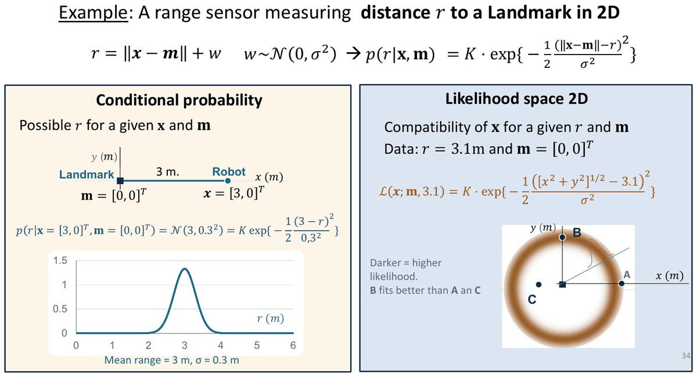

Modelo:

$$
r = \lVert \mathbf{x} - \mathbf{m} \rVert + w, \quad w \sim \mathcal{N}(0, \sigma^2) \;\Longrightarrow\; p(r \mid \mathbf{x}, \mathbf{m}) = K \exp\!\left\{-\frac{1}{2}\frac{(\lVert \mathbf{x} - \mathbf{m} \rVert - r)^2}{\sigma^2}\right\}
$$

- **Como probabilidad condicionada** (fijos $\mathbf{x} = [3, 0]^T$ y $\mathbf{m} = [0, 0]^T$): $p(r \mid \mathbf{x}, \mathbf{m}) = \mathcal{N}(3,\, 0{,}3^2)$, campana en $r$ centrada en 3 m con $\sigma = 0{,}3$ m.
- **Como verosimilitud en 2D** (fijos $r = 3{,}1$ m y $\mathbf{m} = [0, 0]^T$):

$$
\mathcal{L}(\mathbf{x}; \mathbf{m}, 3{,}1) = K \exp\!\left\{-\frac{1}{2}\frac{\left([x^2 + y^2]^{1/2} - 3{,}1\right)^2}{\sigma^2}\right\}
$$

  Es un **anillo** de radio 3,1 m alrededor del landmark: todas las posiciones a esa distancia son igual de compatibles. **Un solo rango no fija la posición** (ni la orientación).

> **Ejemplo resuelto (puntos A, B y C).**
>
> **Enunciado.** Hay un landmark en el origen y el sensor mide un rango $r = 3{,}1$ m, con $\sigma = 0{,}3$ m. ¿Cómo de compatibles son con esa medida las posiciones $A = (3, 0)$, $B = (0, 3{,}1)$ y $C = (-1, -0{,}5)$?
>
> **Qué hacemos.** Para cada punto: (1) calculamos a qué distancia estaría del landmark, que es el **rango predicho**, $\sqrt{x^2 + y^2}$; (2) la restamos de la medida; (3) evaluamos la gaussiana sin la constante: $\exp\{-\tfrac12(\text{error}/\sigma)^2\}$.
>
> | Punto | Rango predicho | Error (predicho − 3,1) | Error en $\sigma$ | $\exp\{-\tfrac12(\cdot)^2\}$ |
> |---|---|---|---|---|
> | $A$ | $\sqrt{9 + 0} = 3$ | $-0{,}1$ | $0{,}33\sigma$ | $e^{-0{,}056} = 0{,}946$ |
> | $B$ | $\sqrt{0 + 9{,}61} = 3{,}1$ | $0$ | $0$ | $1$ |
> | $C$ | $\sqrt{1 + 0{,}25} = 1{,}118$ | $-1{,}98$ | $6{,}6\sigma$ | $\approx 3 \times 10^{-10}$ |
>
> **Interpretación.** B encaja perfectamente (está justo en el anillo), A casi (a solo un tercio de $\sigma$) y C queda prácticamente descartado (a más de 6$\sigma$), como dice la diapositiva.

---

## 6. Modelos de observación de landmarks

**De qué va esta sección.** Un *landmark* es un punto del mapa cuya posición conocemos (una baliza, una esquina, un poste...). El robot lo «ve» con su sensor y obtiene una medida. Aquí aprenderemos a hacer tres cosas, que son justo los cálculos que caen en el examen:

1. **Predecir** qué debería medir el robot si estuviera en una pose $\mathbf{x}$ (sección 6.3). Sirve para comprobar si una pose es compatible con lo que se ha medido (localización).
2. **Situar** en el mapa un landmark que el robot acaba de medir (sección 6.4). Sirve para construir mapas.
3. **Calcular la incertidumbre** de esa posición, porque ni la pose del robot ni la medida son exactas (secciones 6.5–6.7).

### 6.1. Rango, bearing, rango y bearing

- **Mapa:** colección de landmarks $\mathcal{M} = \{\mathbf{m}_i\}_{i = 1, \ldots, N}$. El sensor da medidas a los landmarks.
- Cada modelo **predice la medida esperada** a partir de la pose $\mathbf{x}$ y el landmark $\mathbf{m}$, **más el ruido** $\mathbf{w}_i$:

| Tipo | Modelo | Ejemplos |
|---|---|---|
| **Rango** (distancia) | $z_i = d_i = h_i(\mathbf{x}, \mathbf{m}) + w_i$ | WiFi, GPS, balizas de rango |
| **Bearing** (dirección; en mundo plano) | $z_i = \alpha_i = h_i(\mathbf{x}, \mathbf{m}) + w_i$ | Cámara monocular |
| **Rango + bearing** | $\mathbf{z}_i = [d_i, \alpha_i]^T = \mathbf{h}_i(\mathbf{x}, \mathbf{m}) + \mathbf{w}_i$ (vectores 2D) | Visión estéreo, características de nubes de puntos |

> **Qué es el *bearing*:** el **ángulo con el que el robot ve el landmark, medido desde hacia donde mira el robot**. Si el landmark está justo delante, $\alpha = 0$; a la izquierda, $\alpha > 0$; a la derecha, $\alpha < 0$. No es un ángulo «del mapa», es un ángulo **relativo al robot**.

### 6.2. El problema de la asociación de datos

- **Problema:** decidir **qué landmark** $\mathbf{m}_j$ ha generado una observación $\mathbf{z}_i$. Se necesita la **correspondencia** $\mathbf{z}_i \leftrightarrow \mathbf{m}_j$ **antes** de aplicar el modelo de observación $\mathbf{z}_i = \mathbf{h}(\mathbf{x}, \mathbf{m}_j) + \mathbf{w}_i$.
- **Cómo se resuelve:**
  1. **Descriptor:** comparar la apariencia o el identificador (ID) de lo observado con el de los landmarks del mapa.
  2. **Geometría:** comparar la medida observada con la predicha: $\mathbf{z}_i = [d_i, \alpha_i]^T$ frente a $\hat{\mathbf{z}}_j = \mathbf{h}(\mathbf{x}, \mathbf{m}_j)$.
  3. Elegir el **landmark más compatible** con la observación.
- **Las asociaciones erróneas** pueden llevar a una localización o un mapeado incorrectos. Ayudas típicas: **descriptores de landmarks + tests de compatibilidad geométrica**.

> **Ejemplo resuelto (asociación geométrica).**
>
> **Enunciado.** El robot está en $\mathbf{x} = (0, 0, 0°)$: en el origen, mirando hacia el eje $x$. Mide un landmark a $5{,}1$ m con bearing $36°$, es decir, $\mathbf{z} = [5{,}1\ \text{m},\ 36°]$. En el mapa hay dos candidatos: $\mathbf{m}_1 = (4, 3)$ y $\mathbf{m}_2 = (3, 4)$. ¿Cuál ha visto?
>
> **Qué hacemos y por qué.** Para cada candidato **predecimos** qué habría medido el robot si hubiera visto ese landmark, y nos quedamos con el que más se parezca a la medida real. La predicción se hace con la función de medida de la sección 6.3: rango $\hat{d} = \sqrt{\Delta x^2 + \Delta y^2}$ y bearing $\hat{\alpha} = \operatorname{atan2}(\Delta y, \Delta x) - \theta$. Aquí $\theta = 0$, así que el bearing es directamente el ángulo de $\operatorname{atan2}$.
>
> **Paso 1. Predicción para $\mathbf{m}_1 = (4, 3)$.** $\Delta x = 4 - 0 = 4$ y $\Delta y = 3 - 0 = 3$.
> Rango: $\hat{d}_1 = \sqrt{4^2 + 3^2} = \sqrt{25} = 5$ m. Bearing: $\hat{\alpha}_1 = \operatorname{atan2}(3, 4) - 0° = 36{,}87°$.
>
> **Paso 2. Predicción para $\mathbf{m}_2 = (3, 4)$.** $\Delta x = 3$ y $\Delta y = 4$.
> Rango: $\hat{d}_2 = \sqrt{9 + 16} = 5$ m. Bearing: $\hat{\alpha}_2 = \operatorname{atan2}(4, 3) = 53{,}13°$.
>
> **Paso 3. Comparar con la medida.**
>
> | Candidato | Rango predicho | Diferencia de rango | Bearing predicho | Diferencia de bearing |
> |---|---|---|---|---|
> | $\mathbf{m}_1$ | 5 m | $5{,}1 - 5 = 0{,}1$ m | $36{,}87°$ | $\lvert 36 - 36{,}87 \rvert = 0{,}87°$ |
> | $\mathbf{m}_2$ | 5 m | $0{,}1$ m | $53{,}13°$ | $\lvert 36 - 53{,}13 \rvert = 17{,}13°$ |
>
> **Resultado e interpretación.** Los dos landmarks están a la misma distancia, así que **el rango no sirve para distinguirlos**. El bearing sí: con $\mathbf{m}_1$ la diferencia es menor de 1°, y con $\mathbf{m}_2$ es de 17°. Se asocia $\mathbf{z} \leftrightarrow \mathbf{m}_1$.

### 6.3. Modelo de distancia y bearing en 2D

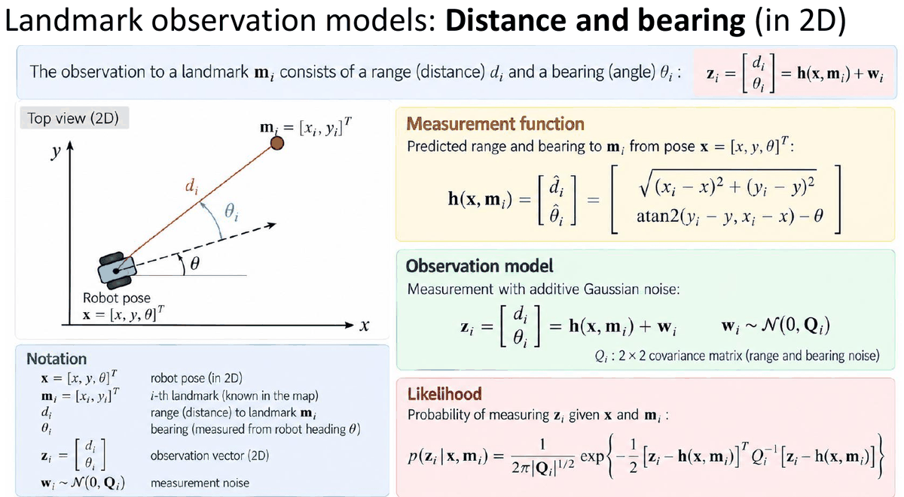

**Intuición.** Si sé dónde está el robot y dónde está el landmark, puedo calcular con geometría qué debería medir el sensor:

- la **distancia** es la longitud del segmento robot → landmark (Pitágoras);
- el **bearing** es el ángulo de ese segmento **visto desde el robot**: primero calculo el ángulo del segmento en el mapa con $\operatorname{atan2}(\Delta y, \Delta x)$ y después le **resto la orientación del robot** $\theta$, porque el sensor mide los ángulos desde hacia donde mira el robot.

Llamamos $\mathbf{m}_i = [x_i, y_i]^T$ al landmark (conocido en el mapa), $\mathbf{x} = [x, y, \theta]^T$ a la pose del robot y $\Delta x = x_i - x$, $\Delta y = y_i - y$ a las diferencias de coordenadas.

**Función de medida (predicción):**

$$
\boxed{\,\mathbf{h}(\mathbf{x}, \mathbf{m}_i) = \begin{bmatrix} \hat{d}_i \\ \hat{\alpha}_i \end{bmatrix} = \begin{bmatrix} \sqrt{(x_i - x)^2 + (y_i - y)^2} \\ \operatorname{atan2}(y_i - y,\ x_i - x) - \theta \end{bmatrix}\,}
$$

**Modelo de observación.** Lo que mide el sensor de verdad es esa predicción más un ruido gaussiano:

$$
\mathbf{z}_i = \begin{bmatrix} d_i \\ \alpha_i \end{bmatrix} = \mathbf{h}(\mathbf{x}, \mathbf{m}_i) + \mathbf{w}_i, \qquad \mathbf{w}_i \sim \mathcal{N}(\mathbf{0}, Q_i)
$$

$Q_i$ es la **matriz de covarianza 2×2** del ruido. Si el error de distancia y el de ángulo son independientes, es diagonal: $Q_i = \operatorname{diag}(\sigma_d^2, \sigma_\alpha^2)$. Fíjate en que lleva **varianzas** ($\sigma^2$), no desviaciones típicas.

**Verosimilitud.** Responde a la pregunta «si el robot estuviera en $\mathbf{x}$, ¿cómo de probable sería haber medido $\mathbf{z}_i$?». Es una gaussiana 2D evaluada en la medida:

$$
\boxed{\,p(\mathbf{z}_i \mid \mathbf{x}, \mathbf{m}_i) = \frac{1}{2\pi\,|Q_i|^{1/2}}\exp\!\left\{-\frac{1}{2}\big[\mathbf{z}_i - \mathbf{h}(\mathbf{x}, \mathbf{m}_i)\big]^T Q_i^{-1}\big[\mathbf{z}_i - \mathbf{h}(\mathbf{x}, \mathbf{m}_i)\big]\right\}\,}
$$

Cómo leerla por partes:

| Parte | Qué es |
|---|---|
| $\mathbf{e} = \mathbf{z}_i - \mathbf{h}(\mathbf{x}, \mathbf{m}_i)$ | **Error** (o *innovación*): lo medido menos lo predicho |
| $\mathbf{e}^T Q_i^{-1} \mathbf{e}$ | **Distancia de Mahalanobis al cuadrado**: el error medido «en desviaciones típicas». Si $Q$ es diagonal, es simplemente $\left(\frac{e_d}{\sigma_d}\right)^2 + \left(\frac{e_\alpha}{\sigma_\alpha}\right)^2$ |
| $\frac{1}{2\pi\lvert Q_i\rvert^{1/2}}$ | Constante de normalización (el valor máximo de la campana). El $2\pi$ aparece porque la medida tiene 2 componentes |

Cuanto más pequeño es el error comparado con el ruido del sensor, más grande es la verosimilitud.

> **Aclaraciones:**
>
> - Usa **atan2** (no atan): tiene en cuenta el cuadrante. Y **resta $\theta$**: el bearing es relativo a hacia dónde mira el robot.
> - Normaliza el ángulo resultante a $(-180°, 180°]$ y, al restar $\alpha_i - \hat{\alpha}_i$, normaliza también la diferencia (no es lo mismo una diferencia de 358° que de −2°).

> **Ejemplo resuelto (predicción de rango y bearing).**
>
> **Enunciado.** El robot está en $\mathbf{x} = [1\ \text{m},\ 2\ \text{m},\ 30°]^T$ y en el mapa hay un landmark en $\mathbf{m} = [4, 6]^T$ m. ¿Qué rango y qué bearing debería medir?
>
> **Qué buscamos.** La medida predicha $\hat{\mathbf{z}} = [\hat{d}, \hat{\alpha}]^T$, aplicando la función de medida $\mathbf{h}$.
>
> **Datos.** $x = 1$, $y = 2$, $\theta = 30°$; $x_i = 4$, $y_i = 6$.
>
> **Paso 1. Vector del robot al landmark.** $\Delta x = x_i - x = 4 - 1 = 3$ m y $\Delta y = y_i - y = 6 - 2 = 4$ m. Es decir, el landmark está 3 m «a la derecha» y 4 m «hacia arriba» en el mapa.
>
> **Paso 2. Rango (Pitágoras).** $\hat{d} = \sqrt{\Delta x^2 + \Delta y^2} = \sqrt{3^2 + 4^2} = \sqrt{25} = 5$ m.
>
> **Paso 3. Ángulo del segmento en el mapa.** $\operatorname{atan2}(\Delta y, \Delta x) = \operatorname{atan2}(4, 3) = 53{,}13°$. Es el ángulo que forma la línea robot → landmark con el eje $x$ **del mapa**.
>
> **Paso 4. Pasarlo al punto de vista del robot.** El robot mira a $30°$, así que el landmark le queda $53{,}13° - 30° = 23{,}13°$ a su izquierda: $\hat{\alpha} = 23{,}13°$.
>
> **Resultado.** $\hat{\mathbf{z}} = [5\ \text{m},\ 23{,}13°]^T$. Si el robot está donde creemos, el sensor debería medir el landmark a 5 m y unos 23° a su izquierda.

> **Ejemplo resuelto (verosimilitud de una observación).**
>
> **Enunciado.** En la situación anterior el sensor mide realmente $\mathbf{z} = [5{,}2\ \text{m},\ 26{,}13°]^T$. El sensor tiene $\sigma_d = 0{,}2$ m y $\sigma_\alpha = 3°$. ¿Cuánto vale la verosimilitud $p(\mathbf{z} \mid \mathbf{x}, \mathbf{m})$?
>
> **Qué buscamos y para qué.** Un número que diga lo compatible que es la pose $\mathbf{x}$ con lo medido. En localización se calcula para muchas poses candidatas y se prefieren las de mayor verosimilitud.
>
> **Fórmula.** La gaussiana 2D de arriba, con $\mathbf{e} = \mathbf{z} - \hat{\mathbf{z}}$ y $Q = \operatorname{diag}(\sigma_d^2, \sigma_\alpha^2)$.
>
> **Paso 1. Pasar todo a las mismas unidades.** El ángulo del error y $\sigma_\alpha$ tienen que ir **en radianes**: $\sigma_\alpha = 3° \cdot \frac{\pi}{180} = 0{,}05236$ rad. Por tanto, $Q = \operatorname{diag}(0{,}2^2,\ 0{,}05236^2) = \operatorname{diag}(0{,}04,\ 0{,}002742)$.
>
> **Paso 2. Error entre lo medido y lo predicho.** $e_d = 5{,}2 - 5 = 0{,}2$ m y $e_\alpha = 26{,}13° - 23{,}13° = 3° = 0{,}05236$ rad.
>
> **Paso 3. Distancia de Mahalanobis.** Como $Q$ es diagonal, cada componente se divide por su desviación típica y se eleva al cuadrado:
> $\mathbf{e}^T Q^{-1} \mathbf{e} = \left(\dfrac{0{,}2}{0{,}2}\right)^2 + \left(\dfrac{0{,}05236}{0{,}05236}\right)^2 = 1 + 1 = 2$.
> Las dos componentes se han desviado exactamente $1\sigma$ de lo esperado.
>
> **Paso 4. Constante de normalización.** $\lvert Q\rvert = 0{,}04 \cdot 0{,}002742 = 1{,}097 \times 10^{-4}$, así que $\lvert Q\rvert^{1/2} = 0{,}01047$ y la constante vale $\dfrac{1}{2\pi \cdot 0{,}01047} = 15{,}20$.
>
> **Paso 5. Juntar.** $p = 15{,}20 \cdot e^{-\frac{1}{2} \cdot 2} = 15{,}20 \cdot e^{-1} = 15{,}20 \cdot 0{,}368 = 5{,}59$.
>
> **Resultado e interpretación.** $p(\mathbf{z} \mid \mathbf{x}, \mathbf{m}) \approx 5{,}59$. Es mayor que 1 porque es una **densidad**, no una probabilidad. Lo útil es compararla: si la medida coincidiera exactamente con la predicción, valdría el máximo, $15{,}20$. Con errores de $1\sigma$ en cada componente baja al $e^{-1} \approx 37\%$ del máximo.

### 6.4. Posición de un landmark observado (modelo inverso)

**Intuición.** Ahora el problema es el contrario: el robot **sabe dónde está** y **mide** un landmark que no está en el mapa. ¿Dónde está ese landmark? Basta con «caminar» desde el robot una distancia $r$ en la dirección en la que se ha visto el landmark.

Esa dirección, en el mapa, es la orientación del robot **más** el bearing medido: $\phi = \theta + \alpha$. Aquí se **suma**, al revés que en la predicción, donde se restaba: allí pasábamos del mapa al robot, y aquí del robot al mapa.

$$
\boxed{\,\mathbf{m} = f(\mathbf{x}, \mathbf{z}) = \begin{bmatrix} x + r\cos(\theta + \alpha) \\ y + r\sin(\theta + \alpha) \end{bmatrix}\,}
\qquad \phi = \theta + \alpha \ \text{(dirección del landmark en el mapa)}
$$

Es la composición $\mathbf{m} = \mathbf{x} \oplus \mathbf{z}_c$ de L3, con la observación pasada a cartesianas en el marco del robot: $\mathbf{z}_c = [r\cos\alpha,\ r\sin\alpha]^T$ (sección 6.6). El ejemplo del punto del scan comprueba que las dos formas dan lo mismo.

> **Ejemplo resuelto I (diapositiva).**
>
> **Enunciado.** Robot en $\mathbf{x} = [2\ \text{m},\ 1\ \text{m},\ 45°]^T$. Mide un landmark a $r = 3$ m con bearing $\alpha = 45°$. ¿Dónde está el landmark en el mapa?
>
> **Fórmula.** $\mathbf{m} = [x + r\cos\phi,\ y + r\sin\phi]^T$ con $\phi = \theta + \alpha$.
>
> **Paso 1. Dirección en el mapa.** El robot mira a 45° y ve el landmark otros 45° a su izquierda: $\phi = 45° + 45° = 90°$. El landmark está justo «hacia arriba» del robot en el mapa.
>
> **Paso 2. Desplazamiento desde el robot.** $r\cos\phi = 3\cos 90° = 3 \cdot 0 = 0$ y $r\sin\phi = 3\sin 90° = 3 \cdot 1 = 3$.
>
> **Paso 3. Sumar a la posición del robot.** $\mathbf{m} = [2 + 0,\ 1 + 3]^T = [2,\ 4]^T$ m.
>
> **Comprobación rápida.** Si el landmark está justo encima del robot, deben coincidir las $x$ ($2 = 2$ ✓) y la $y$ debe aumentar en $r = 3$ ($1 + 3 = 4$ ✓).

> **Ejemplo resuelto II (diapositiva).**
>
> **Enunciado.** Robot en $\mathbf{x} = [2\ \text{m},\ 1\ \text{m},\ 30°]^T$; mide $\mathbf{z} = [3\ \text{m},\ 15°]^T$. ¿Dónde está el landmark?
>
> **Paso 1. Dirección en el mapa.** $\phi = 30° + 15° = 45°$.
>
> **Paso 2. Desplazamiento.** $r\cos 45° = 3 \cdot 0{,}7071 = 2{,}1213$ y $r\sin 45° = 2{,}1213$. Como el ángulo es de 45°, el landmark se desplaza lo mismo en $x$ que en $y$.
>
> **Paso 3. Sumar.** $\mathbf{m} = [2 + 2{,}1213,\ 1 + 2{,}1213]^T \approx [4{,}1213,\ 3{,}1213]^T$ m.

> **Ejemplo resuelto (punto de un scan en el marco global).**
>
> **Enunciado.** Robot en $\mathbf{x} = [2, 1, 30°]^T$. Un haz del LiDAR mide $r = 2{,}5$ m a $\alpha = -30°$, es decir, 30° a la derecha del robot. ¿En qué punto del mapa ha chocado el haz?
>
> **Por qué interesa.** Pasar cada haz al mapa es lo que se hace para dibujar el scan sobre el mapa. Es exactamente la práctica 4.2 y el *likelihood field* de la sección 7.7.
>
> **Forma 1, con la fórmula directa.** $\phi = 30° + (-30°) = 0°$, así que el punto está justo «a la derecha» del robot en el mapa: $\mathbf{m} = [2 + 2{,}5\cos 0°,\ 1 + 2{,}5\sin 0°] = [4{,}5,\ 1]$ m.
>
> **Forma 2, en dos pasos, como se programa con `tcomp`.**
>
> 1. **Polares a cartesianas en el marco del robot:** $\mathbf{z}_c = [r\cos\alpha,\ r\sin\alpha] = [2{,}5\cos(-30°),\ 2{,}5\sin(-30°)] = [2{,}165,\ -1{,}25]$ m. Es decir, 2,165 m por delante del robot y 1,25 m a su derecha.
> 2. **Componer con la pose (girar $\theta = 30°$ y trasladar):**
>    $m_x = x + z_x\cos\theta - z_y\sin\theta = 2 + 2{,}165 \cdot 0{,}866 - (-1{,}25) \cdot 0{,}5 = 2 + 1{,}875 + 0{,}625 = 4{,}5$ m.
>    $m_y = y + z_x\sin\theta + z_y\cos\theta = 1 + 2{,}165 \cdot 0{,}5 + (-1{,}25) \cdot 0{,}866 = 1 + 1{,}083 - 1{,}083 = 1$ m.
>
> **Resultado.** Las dos formas dan $\mathbf{m} = [4{,}5,\ 1]$ m.

### 6.5. De la incertidumbre de la medida a la del landmark (coordenadas cartesianas)

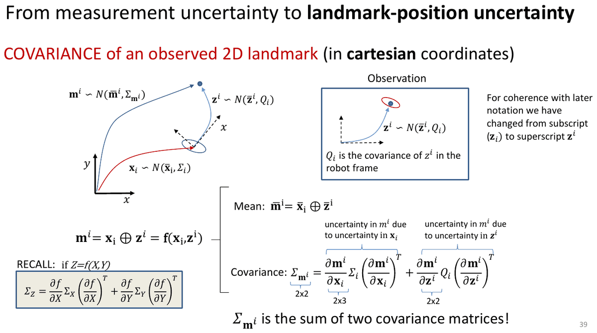

**Intuición.** En la sección anterior la pose del robot y la medida eran exactas. En la realidad, **las dos tienen error**:

- si el robot está unos centímetros desplazado o un poco girado respecto a lo que cree, el landmark se coloca mal;
- si el sensor mide la distancia o el ángulo con error, también.

La pregunta es: **¿cuánta incertidumbre tiene la posición calculada del landmark?** La respuesta es una matriz de covarianza 2×2, $\Sigma_{\mathbf{m}}$, que se dibuja como una elipse alrededor del landmark.

**Cómo se calcula: propagación lineal de la incertidumbre (la misma idea que en L3).** La función $\mathbf{m} = f(\mathbf{x}, \mathbf{z})$ no es lineal (tiene senos y cosenos), así que se **aproxima por una recta** alrededor de los valores medios. Las pendientes de esa recta son las derivadas parciales, que se agrupan en las **matrices jacobianas**. Para una función lineal $\mathbf{y} = J\mathbf{x}$, la covarianza se transforma como $\Sigma_y = J\,\Sigma_x\,J^T$. Si hay dos fuentes de error independientes, **se suman sus contribuciones**.

Planteamiento (pose y observación gaussianas e independientes):

$$
\mathbf{x}_i \sim \mathcal{N}(\bar{\mathbf{x}}_i, \Sigma_i), \qquad \mathbf{z}^i \sim \mathcal{N}(\bar{\mathbf{z}}^i, Q_i), \qquad \mathbf{m}^i = \mathbf{x}_i \oplus \mathbf{z}^i = \mathbf{f}(\mathbf{x}_i, \mathbf{z}^i)
$$

($Q_i$ es la covarianza de $\mathbf{z}^i$ **en el marco del robot**; las diapositivas pasan aquí de subíndice $\mathbf{z}_i$ a superíndice $\mathbf{z}^i$ por coherencia con la notación posterior.)

- **Media:** $\bar{\mathbf{m}}^i = \bar{\mathbf{x}}_i \oplus \bar{\mathbf{z}}^i$. Se aplica la fórmula de la sección 6.4 a los valores medios.
- **Covarianza** (aproximación de primer orden):

$$
\boxed{\,\Sigma_{\mathbf{m}^i} = \underbrace{\frac{\partial \mathbf{m}^i}{\partial \mathbf{x}_i}\,\Sigma_i\,\left(\frac{\partial \mathbf{m}^i}{\partial \mathbf{x}_i}\right)^T}_{\text{por la incertidumbre de la pose}} + \underbrace{\frac{\partial \mathbf{m}^i}{\partial \mathbf{z}^i}\,Q_i\,\left(\frac{\partial \mathbf{m}^i}{\partial \mathbf{z}^i}\right)^T}_{\text{por la incertidumbre de la medida}}\,}
$$

| Matriz | Tamaño | Por qué |
|---|---|---|
| $\Sigma_{\mathbf{m}^i}$ | 2×2 | El landmark tiene 2 coordenadas ($m_x, m_y$) |
| $\partial \mathbf{m}^i / \partial \mathbf{x}_i$ | **2×3** | Filas = salidas ($m_x, m_y$); columnas = entradas ($x, y, \theta$) |
| $\Sigma_i$ | 3×3 | La pose tiene 3 componentes |
| $\partial \mathbf{m}^i / \partial \mathbf{z}^i$ | 2×2 | 2 salidas; 2 entradas ($r, \alpha$) |
| $Q_i$ | 2×2 | La medida tiene 2 componentes |

> **$\Sigma_{\mathbf{m}^i}$ es la suma de dos matrices de covarianza:** aunque el sensor fuera perfecto ($Q_i = 0$), el landmark seguiría siendo incierto por la incertidumbre de la pose, y al revés.

### 6.6. Observación en coordenadas polares: regla de la cadena

**El problema.** El sensor mide en **polares**: una distancia y un ángulo, $\mathbf{z}_p = [r, \alpha]^T$, con incertidumbre $\Sigma_{\mathbf{z}_p} = \operatorname{diag}(\sigma_r^2, \sigma_\alpha^2)$. Pero la composición de poses trabaja en **cartesianas**: un punto $(z_x, z_y)$ en el marco del robot. Hay que traducir también la incertidumbre de polares a cartesianas.

$$
\mathbf{z}_c = \begin{bmatrix} z_x \\ z_y \end{bmatrix} = \begin{bmatrix} r\cos\alpha \\ r\sin\alpha \end{bmatrix} = \mathbf{f}(\mathbf{z}_p),
\qquad
\mathbf{m} = \mathbf{x} \oplus \mathbf{z}_c = \begin{bmatrix} x + z_x\cos\theta - z_y\sin\theta \\ y + z_x\sin\theta + z_y\cos\theta \end{bmatrix}
$$

$$
\Sigma_{\mathbf{m}} = \frac{\partial \mathbf{m}}{\partial \mathbf{x}}\Sigma_{\mathbf{x}}\frac{\partial \mathbf{m}}{\partial \mathbf{x}}^T + \frac{\partial \mathbf{m}}{\partial \mathbf{z}_c}\Sigma_{\mathbf{z}_c}\frac{\partial \mathbf{m}}{\partial \mathbf{z}_c}^T
$$

**Covarianza de la observación en cartesianas.** Se propaga con el jacobiano de la conversión polares → cartesianas. Cada columna es la derivada de $(z_x, z_y)$ respecto a una de las entradas: la primera respecto a $r$ y la segunda respecto a $\alpha$.

$$
\boxed{\,\Sigma_{\mathbf{z}_c} = \frac{\partial \mathbf{z}_c}{\partial \mathbf{z}_p}\,\Sigma_{\mathbf{z}_p}\,\frac{\partial \mathbf{z}_c}{\partial \mathbf{z}_p}^T, \qquad \frac{\partial \mathbf{z}_c}{\partial \mathbf{z}_p} = \begin{bmatrix} \partial z_x/\partial r & \partial z_x/\partial \alpha \\ \partial z_y/\partial r & \partial z_y/\partial \alpha \end{bmatrix} = \begin{bmatrix} \cos\alpha & -r\sin\alpha \\ \sin\alpha & r\cos\alpha \end{bmatrix}\,}
$$

> **Por qué aparece $r$ en la segunda columna:** un error de ángulo $\delta\alpha$ desplaza el punto un arco de longitud $r\,\delta\alpha$. Cuanto más lejos está el punto, más se mueve con el mismo error de ángulo; igual que una linterna, cuya mancha de luz se desplaza más cuanto más lejos está la pared.

Por la **regla de la cadena**, el segundo término de $\Sigma_{\mathbf{m}}$ se puede calcular de dos formas que dan el mismo resultado:

$$
\frac{\partial \mathbf{m}}{\partial \mathbf{z}_c}\left[\frac{\partial \mathbf{z}_c}{\partial \mathbf{z}_p}\Sigma_{\mathbf{z}_p}\frac{\partial \mathbf{z}_c}{\partial \mathbf{z}_p}^T\right]\frac{\partial \mathbf{m}}{\partial \mathbf{z}_c}^T = \frac{\partial \mathbf{m}}{\partial \mathbf{z}_p}\Sigma_{\mathbf{z}_p}\frac{\partial \mathbf{m}}{\partial \mathbf{z}_p}^T
$$

- **Forma A (en dos pasos, como en la práctica 4.1):** primero se pasa la covarianza a cartesianas en el marco del robot, y después se gira con la orientación del robot.
- **Forma B (directa, como en las diapositivas):** se deriva $\mathbf{m}$ directamente respecto a $(r, \alpha)$.

> **Aclaración:** $\dfrac{\partial \mathbf{m}}{\partial \mathbf{z}_c} = R_\theta = \begin{bmatrix} \cos\theta & -\sin\theta \\ \sin\theta & \cos\theta \end{bmatrix}$; esta parte solo gira. Por eso $\dfrac{\partial \mathbf{m}}{\partial \mathbf{z}_p} = R_\theta\dfrac{\partial \mathbf{z}_c}{\partial \mathbf{z}_p}$ es la misma matriz con $\alpha$ sustituido por $\phi = \theta + \alpha$: es la $\mathbf{J}_z$ de la sección 6.7.

> **Truco para calcular $J\,\Sigma\,J^T$ a mano cuando $\Sigma$ es diagonal.** Si $\Sigma = \operatorname{diag}(\sigma_1^2, \sigma_2^2, \ldots)$, cada elemento del resultado es
>
> $$(J\Sigma J^T)_{ij} = \sum_k J_{ik}\,J_{jk}\,\sigma_k^2,$$
>
> es decir: **se cogen la fila $i$ y la fila $j$ de $J$, se multiplican elemento a elemento, cada producto se pondera con la varianza de su columna, y se suma.** En particular:
>
> - **Diagonal** ($i = j$): $\sum_k J_{ik}^2\,\sigma_k^2$, la suma de los cuadrados de la fila ponderados con las varianzas.
> - **Fuera de la diagonal:** $\sum_k J_{1k}\,J_{2k}\,\sigma_k^2$. La matriz resultante es simétrica, así que basta con calcularlo una vez.
>
> Así se evita multiplicar matrices completas en el examen.

> **Ejemplo resuelto (polares → cartesianas, caso sencillo $\alpha = 0$).**
>
> **Enunciado.** El sensor ve un punto justo delante, a $r = 2$ m ($\alpha = 0$). Sus errores son $\sigma_r = 0{,}1$ m y $\sigma_\alpha = 0{,}05$ rad. ¿Qué incertidumbre tiene el punto en cartesianas, en el marco del robot?
>
> **Fórmula.** $\Sigma_{\mathbf{z}_c} = J\,\Sigma_{\mathbf{z}_p}\,J^T$, con $J = \begin{bmatrix} \cos\alpha & -r\sin\alpha \\ \sin\alpha & r\cos\alpha \end{bmatrix}$ y $\Sigma_{\mathbf{z}_p} = \operatorname{diag}(\sigma_r^2, \sigma_\alpha^2) = \operatorname{diag}(0{,}01,\ 0{,}0025)$.
>
> **Paso 1. Jacobiano.** Con $\alpha = 0$: $\cos 0 = 1$ y $\sin 0 = 0$, así que $J = \begin{bmatrix} 1 & -2 \cdot 0 \\ 0 & 2 \cdot 1 \end{bmatrix} = \begin{bmatrix} 1 & 0 \\ 0 & 2 \end{bmatrix}$.
>
> **Paso 2. Aplicar el truco** (filas de $J$: $(1, 0)$ y $(0, 2)$; varianzas: $0{,}01$ y $0{,}0025$).
>
> - $(1,1) = 1^2 \cdot 0{,}01 + 0^2 \cdot 0{,}0025 = 0{,}01$.
> - $(2,2) = 0^2 \cdot 0{,}01 + 2^2 \cdot 0{,}0025 = 0{,}01$.
> - $(1,2) = 1 \cdot 0 \cdot 0{,}01 + 0 \cdot 2 \cdot 0{,}0025 = 0$.
>
> **Resultado.** $\Sigma_{\mathbf{z}_c} = \begin{bmatrix} 0{,}01 & 0 \\ 0 & 0{,}01 \end{bmatrix}$ m².
>
> **Interpretación.** En la dirección del haz (eje $x$ del robot) la desviación es $\sqrt{0{,}01} = 0{,}1$ m, que es $\sigma_r$. En la dirección **lateral** (eje $y$) es $r\,\sigma_\alpha = 2 \cdot 0{,}05 = 0{,}1$ m. **El error lateral crece con la distancia**: el mismo sensor a 20 m tendría 1 m de error lateral.

> **Ejemplo resuelto (polares → cartesianas con $\alpha \neq 0$ y comprobación de la regla de la cadena).**
>
> **Enunciado.** Es la medida del ejemplo II de la sección 6.4: $r = 3$ m y $\alpha = 15°$, con $\sigma_r = 0{,}2$ m y $\sigma_\alpha = 3°$, es decir, $\Sigma_{\mathbf{z}_p} = \operatorname{diag}(0{,}04,\ 0{,}002742)$. El robot mira a $\theta = 30°$. Vamos a calcular la contribución del sensor a la incertidumbre del landmark por la **forma A** y comprobar que coincide con la **forma B** de la sección 6.7.
>
> **Paso 1. Punto en cartesianas (marco del robot).** $\mathbf{z}_c = [3\cos 15°,\ 3\sin 15°] = [2{,}898,\ 0{,}776]$ m.
>
> **Paso 2. Jacobiano de la conversión** con $\cos 15° = 0{,}9659$ y $\sin 15° = 0{,}2588$:
> $J = \begin{bmatrix} 0{,}9659 & -3 \cdot 0{,}2588 \\ 0{,}2588 & 3 \cdot 0{,}9659 \end{bmatrix} = \begin{bmatrix} 0{,}9659 & -0{,}7765 \\ 0{,}2588 & 2{,}8978 \end{bmatrix}$.
>
> **Paso 3. Covarianza en el marco del robot**, con el truco y las varianzas $0{,}04$ y $0{,}002742$:
>
> - $(1,1) = 0{,}9659^2 \cdot 0{,}04 + 0{,}7765^2 \cdot 0{,}002742 = 0{,}03732 + 0{,}00165 = 0{,}03897$.
> - $(2,2) = 0{,}2588^2 \cdot 0{,}04 + 2{,}8978^2 \cdot 0{,}002742 = 0{,}00268 + 0{,}02302 = 0{,}02570$.
> - $(1,2) = 0{,}9659 \cdot 0{,}2588 \cdot 0{,}04 + (-0{,}7765) \cdot 2{,}8978 \cdot 0{,}002742 = 0{,}01000 - 0{,}00617 = 0{,}00383$.
>
> $\Sigma_{\mathbf{z}_c} = \begin{bmatrix} 0{,}03897 & 0{,}00383 \\ 0{,}00383 & 0{,}02570 \end{bmatrix}$ m².
>
> **Paso 4. Girar al marco del mapa** con $R_{30°}$: $R_{30°}\,\Sigma_{\mathbf{z}_c}\,R_{30°}^T = \begin{bmatrix} 0{,}03234 & 0{,}00766 \\ 0{,}00766 & 0{,}03234 \end{bmatrix}$ m².
>
> **Resultado.** Es exactamente el término $\mathbf{J}_z\Sigma_z\mathbf{J}_z^T$ que sale por la forma B en el ejemplo II de la sección 6.7. Las dos formas son equivalentes; usa la que te resulte más cómoda.

### 6.7. Ejemplos resueltos: incertidumbre de la posición estimada del landmark

**Planteamiento general.** Juntamos todo lo anterior. Tenemos la pose del robot $\mathbf{x} \sim \mathcal{N}(\bar{\mathbf{x}}, \Sigma_x)$ y la medida $\mathbf{z} = [r, \alpha]^T \sim \mathcal{N}(\bar{\mathbf{z}}, \Sigma_z)$, independientes. Calculamos el landmark con $\mathbf{m} = f(\mathbf{x}, \mathbf{z}) = [x + r\cos\phi,\ y + r\sin\phi]^T$ (sección 6.4), y su covarianza con la aproximación de primer orden:

$$
\boxed{\,\Sigma_m \approx \underbrace{\mathbf{J}_x\Sigma_x\mathbf{J}_x^T}_{\text{error de la pose}} + \underbrace{\mathbf{J}_z\Sigma_z\mathbf{J}_z^T}_{\text{error del sensor}}\,}
$$

$$
\boxed{\,\mathbf{J}_x = \frac{\partial f}{\partial \mathbf{x}} = \begin{bmatrix} 1 & 0 & -r\sin\phi \\ 0 & 1 & r\cos\phi \end{bmatrix}, \qquad
\mathbf{J}_z = \frac{\partial f}{\partial \mathbf{z}} = \begin{bmatrix} \cos\phi & -r\sin\phi \\ \sin\phi & r\cos\phi \end{bmatrix}, \qquad \phi = \theta + \alpha\,}
$$

> **Cómo reconstruir los jacobianos sin memorizarlos.** Deriva cada fila de $f$, $m_x = x + r\cos\phi$ y $m_y = y + r\sin\phi$, respecto a cada entrada (una columna por entrada):
>
> | Derivada respecto a… | de $m_x = x + r\cos\phi$ | de $m_y = y + r\sin\phi$ | Columna de… |
> |---|---|---|---|
> | $x$ | 1 | 0 | $\mathbf{J}_x$, columna 1 |
> | $y$ | 0 | 1 | $\mathbf{J}_x$, columna 2 |
> | $\theta$ | $-r\sin\phi$ | $r\cos\phi$ | $\mathbf{J}_x$, columna 3 |
> | $r$ | $\cos\phi$ | $\sin\phi$ | $\mathbf{J}_z$, columna 1 |
> | $\alpha$ | $-r\sin\phi$ | $r\cos\phi$ | $\mathbf{J}_z$, columna 2 |
>
> $\theta$ y $\alpha$ dan la misma derivada porque los dos entran en la fórmula sumados, como $\phi = \theta + \alpha$.

**Receta para el examen** (los tres ejemplos siguen estos pasos):

1. Calcular $\phi = \theta + \alpha$ y la posición del landmark.
2. Escribir las covarianzas con **varianzas** y ángulos **en radianes**.
3. Sustituir $r$, $\cos\phi$ y $\sin\phi$ en $\mathbf{J}_x$ y $\mathbf{J}_z$.
4. Calcular $\mathbf{J}_x\Sigma_x\mathbf{J}_x^T$ y $\mathbf{J}_z\Sigma_z\mathbf{J}_z^T$ con el truco de la sección 6.6.
5. Sumar las dos matrices e interpretar el resultado.

**Datos de incertidumbre comunes a los ejemplos I y II** (en desviaciones típicas): $\sigma_x = \sigma_y = 0{,}10$ m; $\sigma_\theta = 5°$; $\sigma_r = 0{,}20$ m; $\sigma_\alpha = 3°$.

Pasados a varianzas y radianes:

- $\sigma_x^2 = \sigma_y^2 = 0{,}10^2 = 0{,}01$ m².
- $\sigma_\theta = 5° \cdot \frac{\pi}{180} = 0{,}0873$ rad, así que $\sigma_\theta^2 = 0{,}0873^2 = 0{,}007615$ rad².
- $\sigma_r^2 = 0{,}2^2 = 0{,}04$ m².
- $\sigma_\alpha = 3° \cdot \frac{\pi}{180} = 0{,}05236$ rad, así que $\sigma_\alpha^2 = 0{,}002742$ rad².

$$
\Sigma_x = \begin{bmatrix} 0{,}01 & 0 & 0 \\ 0 & 0{,}01 & 0 \\ 0 & 0 & 0{,}007615 \end{bmatrix}, \qquad
\Sigma_z = \begin{bmatrix} 0{,}04 & 0 \\ 0 & 0{,}002742 \end{bmatrix}
$$

> **Ejemplo resuelto I (diapositiva).**
>
> **Enunciado.** Robot en $\bar{\mathbf{x}} = [2\ \text{m}, 1\ \text{m}, 45°]^T$; medida $\bar{\mathbf{z}} = [3\ \text{m}, 45°]^T$; incertidumbres las de arriba. ¿Dónde está el landmark y con qué covarianza?
>
> **Paso 1. Dirección y posición.** $\phi = 45° + 45° = 90°$. Por el ejemplo I de la sección 6.4, $\bar{\mathbf{m}} = [2, 4]^T$ m.
>
> **Paso 2. Jacobianos.** Sustituimos $r = 3$, $\sin 90° = 1$ y $\cos 90° = 0$:
>
> - $\mathbf{J}_x = \begin{bmatrix} 1 & 0 & -3 \cdot 1 \\ 0 & 1 & 3 \cdot 0 \end{bmatrix} = \begin{bmatrix} 1 & 0 & -3 \\ 0 & 1 & 0 \end{bmatrix}$.
> - $\mathbf{J}_z = \begin{bmatrix} 0 & -3 \cdot 1 \\ 1 & 3 \cdot 0 \end{bmatrix} = \begin{bmatrix} 0 & -3 \\ 1 & 0 \end{bmatrix}$.
>
> **Paso 3. Contribución de la pose**, $\mathbf{J}_x\Sigma_x\mathbf{J}_x^T$. Filas de $\mathbf{J}_x$: $(1, 0, -3)$ y $(0, 1, 0)$; varianzas: $(0{,}01;\ 0{,}01;\ 0{,}007615)$.
>
> - $(1,1) = 1^2 \cdot 0{,}01 + 0^2 \cdot 0{,}01 + (-3)^2 \cdot 0{,}007615 = 0{,}01 + 0{,}0685 = 0{,}0785$.
> - $(2,2) = 0^2 \cdot 0{,}01 + 1^2 \cdot 0{,}01 + 0^2 \cdot 0{,}007615 = 0{,}01$.
> - $(1,2) = 1 \cdot 0 \cdot 0{,}01 + 0 \cdot 1 \cdot 0{,}01 + (-3) \cdot 0 \cdot 0{,}007615 = 0$.
>
> **Paso 4. Contribución del sensor**, $\mathbf{J}_z\Sigma_z\mathbf{J}_z^T$. Filas de $\mathbf{J}_z$: $(0, -3)$ y $(1, 0)$; varianzas: $(0{,}04;\ 0{,}002742)$.
>
> - $(1,1) = 0^2 \cdot 0{,}04 + (-3)^2 \cdot 0{,}002742 = 0{,}0247$.
> - $(2,2) = 1^2 \cdot 0{,}04 + 0^2 \cdot 0{,}002742 = 0{,}04$.
> - $(1,2) = 0 \cdot 1 \cdot 0{,}04 + (-3) \cdot 0 \cdot 0{,}002742 = 0$.
>
> **Paso 5. Sumar.** $\Sigma_m \approx \begin{bmatrix} 0{,}0785 + 0{,}0247 & 0 \\ 0 & 0{,}01 + 0{,}04 \end{bmatrix} = \begin{bmatrix} 0{,}1032 & 0 \\ 0 & 0{,}0500 \end{bmatrix}$ m².
>
> **Interpretación.** El landmark está justo encima del robot ($\phi = 90°$), así que la línea de visión es el eje $y$.
>
> - **En $y$** (a lo largo de la línea de visión) influyen el error de distancia del sensor ($0{,}04$) y la incertidumbre de la $y$ del robot ($0{,}01$). Desviación típica: $\sqrt{0{,}05} = 0{,}22$ m.
> - **En $x$** (perpendicular a la línea de visión) influyen los errores de **ángulo**, del robot ($\theta$) y del sensor ($\alpha$), **multiplicados por $r^2 = 9$**, más la incertidumbre de la $x$ del robot. Desviación típica: $\sqrt{0{,}1032} = 0{,}32$ m.
> - Por eso la elipse es **más ancha en $x$**: los errores de ángulo pesan más que el error de distancia a 3 m. La elipse de $2\sigma$ tiene semiejes $2 \cdot 0{,}32 = 0{,}64$ m en $x$ y $2 \cdot 0{,}22 = 0{,}45$ m en $y$.
>
> (Con los valores redondeados de la diapositiva, $0{,}0076$ y $0{,}0027$, sale $0{,}1027$; el $0{,}1032$ sale con $0{,}007615$ y $0{,}002742$.)

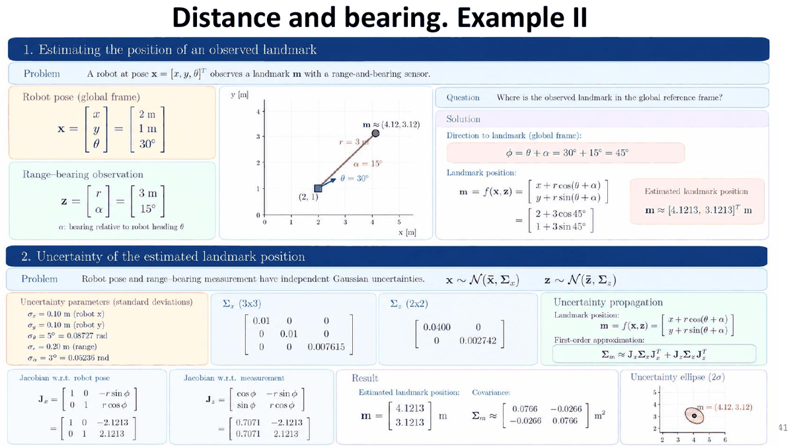

> **Ejemplo resuelto II (diapositiva).**
>
> **Enunciado.** Robot en $\bar{\mathbf{x}} = [2, 1, 30°]^T$; medida $\bar{\mathbf{z}} = [3\ \text{m}, 15°]^T$; mismas incertidumbres.
>
> **Paso 1. Dirección y posición.** $\phi = 30° + 15° = 45°$. Por el ejemplo II de la sección 6.4, $\bar{\mathbf{m}} \approx [4{,}1213,\ 3{,}1213]^T$ m.
>
> **Paso 2. Jacobianos.** $\cos 45° = \sin 45° = 0{,}7071$, así que $r\sin\phi = r\cos\phi = 3 \cdot 0{,}7071 = 2{,}1213$:
>
> - $\mathbf{J}_x = \begin{bmatrix} 1 & 0 & -2{,}1213 \\ 0 & 1 & 2{,}1213 \end{bmatrix}$.
> - $\mathbf{J}_z = \begin{bmatrix} 0{,}7071 & -2{,}1213 \\ 0{,}7071 & 2{,}1213 \end{bmatrix}$.
>
> **Paso 3. Contribución de la pose.** Filas: $(1, 0, -2{,}1213)$ y $(0, 1, 2{,}1213)$. Útil: $2{,}1213^2 = 4{,}5$.
>
> - $(1,1) = 1 \cdot 0{,}01 + 0 + 4{,}5 \cdot 0{,}007615 = 0{,}01 + 0{,}0343 = 0{,}0443$.
> - $(2,2) = 0 + 1 \cdot 0{,}01 + 4{,}5 \cdot 0{,}007615 = 0{,}0443$.
> - $(1,2) = 1 \cdot 0 \cdot 0{,}01 + 0 \cdot 1 \cdot 0{,}01 + (-2{,}1213)(2{,}1213) \cdot 0{,}007615 = -4{,}5 \cdot 0{,}007615 = -0{,}0343$.
>
> **Paso 4. Contribución del sensor.** Filas: $(0{,}7071, -2{,}1213)$ y $(0{,}7071, 2{,}1213)$. Útil: $0{,}7071^2 = 0{,}5$.
>
> - $(1,1) = 0{,}5 \cdot 0{,}04 + 4{,}5 \cdot 0{,}002742 = 0{,}0200 + 0{,}0123 = 0{,}0323$.
> - $(2,2) = 0{,}5 \cdot 0{,}04 + 4{,}5 \cdot 0{,}002742 = 0{,}0323$.
> - $(1,2) = 0{,}7071 \cdot 0{,}7071 \cdot 0{,}04 + (-2{,}1213)(2{,}1213) \cdot 0{,}002742 = 0{,}0200 - 0{,}0123 = 0{,}0077$.
>
> **Paso 5. Sumar.** $\Sigma_m \approx \begin{bmatrix} 0{,}0443 + 0{,}0323 & -0{,}0343 + 0{,}0077 \\ \cdot & 0{,}0443 + 0{,}0323 \end{bmatrix} = \begin{bmatrix} 0{,}0766 & -0{,}0266 \\ -0{,}0266 & 0{,}0766 \end{bmatrix}$ m².
>
> **Interpretación.**
>
> - Ahora la línea de visión va a 45°, así que la incertidumbre ya no está alineada con los ejes y aparece **covarianza cruzada** (el $-0{,}0266$).
> - Que sea **negativa** significa que cuando el error en $x$ es positivo, el de $y$ tiende a ser negativo: la elipse se alarga en la dirección perpendicular a la línea de visión ($-45°$).
> - Los valores propios de esta matriz son $0{,}1032$ y $0{,}05$, **los mismos que en el ejemplo I**: es la misma elipse, solo girada. Tiene sentido, porque la geometría relativa ($r = 3$ m) y las incertidumbres son iguales; solo cambia hacia dónde mira el robot.

> **Ejemplo resuelto III (para practicar, con términos cruzados en las dos contribuciones).**
>
> **Enunciado.** Robot en $\bar{\mathbf{x}} = [1, 2, 90°]^T$; medida $\bar{\mathbf{z}} = [2\ \text{m},\ -30°]^T$; incertidumbres $\sigma_x = \sigma_y = 0{,}05$ m, $\sigma_\theta = 2°$, $\sigma_r = 0{,}1$ m y $\sigma_\alpha = 2°$.
>
> **Paso 1. Dirección y posición.** $\phi = 90° + (-30°) = 60°$, con $\cos 60° = 0{,}5$ y $\sin 60° = 0{,}866$.
> $\bar{\mathbf{m}} = [1 + 2 \cdot 0{,}5,\ 2 + 2 \cdot 0{,}866] = [2,\ 3{,}732]$ m.
>
> **Paso 2. Covarianzas.**
>
> - $2° = 0{,}0349$ rad, así que $\sigma_\theta^2 = \sigma_\alpha^2 = 0{,}0349^2 = 0{,}001218$ rad².
> - $\Sigma_x = \operatorname{diag}(0{,}0025;\ 0{,}0025;\ 0{,}001218)$ y $\Sigma_z = \operatorname{diag}(0{,}01;\ 0{,}001218)$.
>
> **Paso 3. Jacobianos.** $r\sin\phi = 2 \cdot 0{,}866 = 1{,}732$ y $r\cos\phi = 2 \cdot 0{,}5 = 1$:
> $\mathbf{J}_x = \begin{bmatrix} 1 & 0 & -1{,}732 \\ 0 & 1 & 1 \end{bmatrix}$ y $\mathbf{J}_z = \begin{bmatrix} 0{,}5 & -1{,}732 \\ 0{,}866 & 1 \end{bmatrix}$.
>
> **Paso 4. Contribución de la pose.** Útil: $1{,}732^2 = 3$.
>
> - $(1,1) = 0{,}0025 + 3 \cdot 0{,}001218 = 0{,}00616$.
> - $(2,2) = 0{,}0025 + 1 \cdot 0{,}001218 = 0{,}00372$.
> - $(1,2) = (-1{,}732) \cdot 1 \cdot 0{,}001218 = -0{,}00211$.
>
> **Paso 5. Contribución del sensor.**
>
> - $(1,1) = 0{,}5^2 \cdot 0{,}01 + 1{,}732^2 \cdot 0{,}001218 = 0{,}0025 + 0{,}00365 = 0{,}00616$.
> - $(2,2) = 0{,}866^2 \cdot 0{,}01 + 1^2 \cdot 0{,}001218 = 0{,}0075 + 0{,}00122 = 0{,}00872$.
> - $(1,2) = 0{,}5 \cdot 0{,}866 \cdot 0{,}01 + (-1{,}732) \cdot 1 \cdot 0{,}001218 = 0{,}00433 - 0{,}00211 = 0{,}00222$.
>
> **Paso 6. Sumar.** $\Sigma_m \approx \begin{bmatrix} 0{,}00616 + 0{,}00616 & -0{,}00211 + 0{,}00222 \\ \cdot & 0{,}00372 + 0{,}00872 \end{bmatrix} = \begin{bmatrix} 0{,}01231 & 0{,}00011 \\ 0{,}00011 & 0{,}01244 \end{bmatrix}$ m².
>
> **Interpretación.** Las dos covarianzas cruzadas tienen signos opuestos y casi se anulan. El resultado es una elipse **casi circular**, con $\sigma \approx \sqrt{0{,}0123} \approx 0{,}11$ m en cada eje. Las contribuciones se suman como matrices, así que **pueden compensarse**: no basta con sumar las desviaciones típicas.

---

## 7. Modelos de observación de scans

### 7.1. Representación del mapa y aplicaciones

- **Representaciones de mapa** para scans: **mapa de segmentos** (paredes como segmentos) y **mapa de rejilla** (cada celda con $P(\text{ocupada})$ entre 0 y 1).
- **Modelo de sensor $p(\mathbf{z} \mid \mathbf{x}, \mathbf{m})$:** ¿cómo de probable es un **scan** $\mathbf{z} = [z_1, \ldots, z_K]^T$ ($K$ haces) dada la pose $\mathbf{x}$ y el mapa $\mathbf{m}$?
- **Dos modelos de observación habituales:**
  - **Beam model** (modelo de haz): compara cada rango medido $z_k$ con el rango **esperado** $\hat{r}$ a lo largo del haz.
  - **Likelihood field** (campo de verosimilitud): mira la **distancia del extremo del haz al obstáculo más cercano**.
- **Aplicaciones:** se usan sobre todo para **localización con filtros de partículas**. Por ejemplo, **AMCL en ROS 2** admite los dos modelos: cada partícula (hipótesis de pose) se **repondera** con $p(\mathbf{z} \mid \mathbf{x}, \mathbf{m})$.

### 7.2. Beam model: idea

**Intuición.** Un scan son muchos haces. Para saber si una pose candidata es buena, nos ponemos en esa pose **sobre el mapa** y, para cada haz, calculamos hasta dónde **debería** llegar antes de chocar con una pared. Eso es el *ray casting*, que da el rango esperado. Después comparamos con lo que el haz **ha medido de verdad**. Si en casi todos los haces lo medido se parece a lo esperado, la pose es buena.

La parte delicada es **cómo comparar**. Una gaussiana alrededor del rango esperado no basta, porque en la realidad pasan más cosas: a veces se cruza una persona (el haz mide menos), a veces el sensor da un valor absurdo y a veces no vuelve el eco. El *beam model* incluye una componente para cada una de esas causas (sección 7.3).

**Ejemplo con 3 sensores de rango (scan láser)** a −90°, 0° y 90°: para una pose candidata $\mathbf{x}$ y el mapa $\mathbf{m}$, cada haz tiene un **rango predicho** $\hat{d}_i = h_i(\mathbf{x}, \mathbf{m})$. La verosimilitud $p(d_i \mid \mathbf{x}, \mathbf{m})$ es el valor de la gaussiana (centrada en $\hat{d}_i$) **en la medida observada** $d_i$:

$$
p(d_1, d_2, d_3 \mid \mathbf{x}, \mathbf{m}) = \prod_{k=1}^{3} p(d_k \mid \mathbf{x}, \mathbf{m})
$$

### 7.3. Las cuatro componentes del beam model

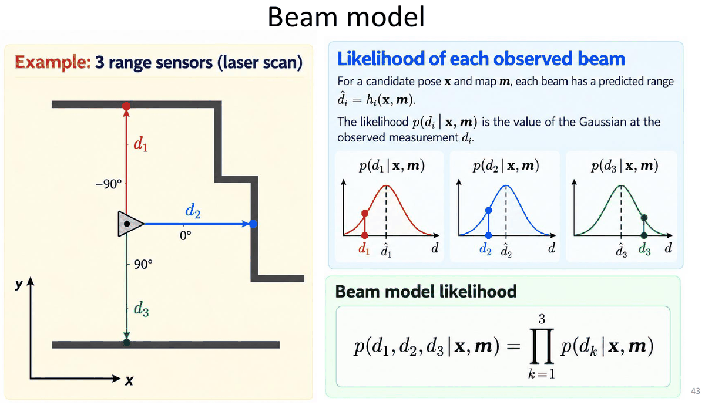

$z_{exp}$ (el rango esperado) se obtiene por **ray casting** (trazado de rayos) sobre el mapa conocido $\mathbf{m}$ desde la pose $\mathbf{x}$. $z_{max}$ es el rango máximo del sensor.

**1. Hit: medida alrededor del rango esperado** (ruido de medida)

$$
p_{hit}(z \mid \mathbf{x}, \mathbf{m}) = \eta_{hit}\,\frac{1}{\sigma\sqrt{2\pi}}\exp\!\left(-\frac{(z - z_{exp})^2}{2\sigma^2}\right), \qquad 0 \le z \le z_{max}
$$

$\eta_{hit}$ normaliza la gaussiana **truncada** a $[0, z_{max}]$ (si $z_{exp}$ está lejos de 0 y de $z_{max}$, $\eta_{hit} \approx 1$).

**2. Unexpected: obstáculo antes del rango esperado** (personas, objetos que no están en el mapa)

$$
p_{unexp}(z \mid \mathbf{x}, \mathbf{m}) = \begin{cases} \eta_{unexp}\,\lambda e^{-\lambda z} & 0 \le z < z_{exp} \\ 0 & \text{en otro caso} \end{cases}
\qquad \eta_{unexp} = \frac{1}{1 - e^{-\lambda z_{exp}}}
$$

Es una exponencial **decreciente**: un obstáculo inesperado es **más probable cerca del sensor** (si hay varios, el haz se queda con el primero). $\eta_{unexp}$ normaliza la exponencial truncada a $[0, z_{exp}]$.

**3. Random: medida aleatoria** (espurias: interferencias, multitrayecto, errores del sensor)

$$
p_{rand}(z \mid \mathbf{x}, \mathbf{m}) = \begin{cases} \dfrac{1}{z_{max}} & 0 \le z < z_{max} \\ 0 & \text{en otro caso} \end{cases}
$$

Cualquier distancia es igual de probable (uniforme).

**4. Max range: no se recibe eco**

$$
p_{max}(z \mid \mathbf{x}, \mathbf{m}) = \begin{cases} 1 & z = z_{max} \\ 0 & \text{en otro caso} \end{cases}
$$

No se detecta ningún obstáculo dentro del alcance (superficies especulares, negras, cristal...) y el sensor devuelve $z_{max}$.

> **Aclaración:** $p_{max}$ no es una densidad «normal», sino un pico concentrado en $z_{max}$ (una masa de probabilidad puntual). En la práctica se implementa como un intervalo muy estrecho alrededor de $z_{max}$.

### 7.4. Beam model combinado: modelo de mezcla

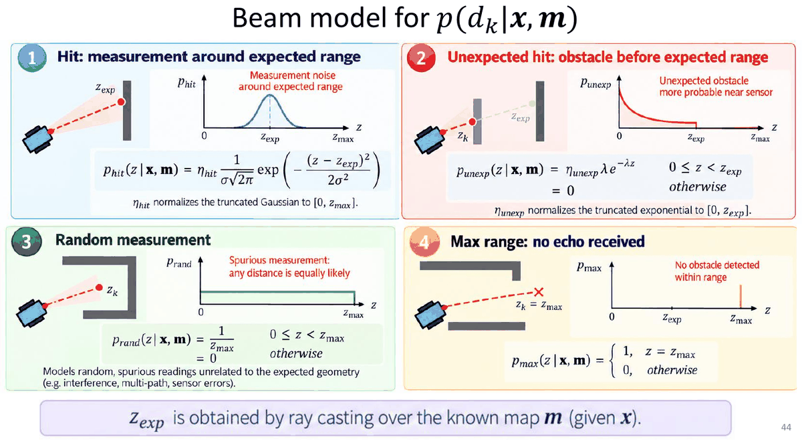

$$
\boxed{\,p(z \mid \mathbf{x}, \mathbf{m}) = \alpha_{hit}\,p_{hit}(z \mid \mathbf{x}, \mathbf{m}) + \alpha_{unexp}\,p_{unexp}(z \mid \mathbf{x}, \mathbf{m}) + \alpha_{rand}\,p_{rand}(z \mid \mathbf{x}, \mathbf{m}) + \alpha_{max}\,p_{max}(z \mid \mathbf{x}, \mathbf{m}), \qquad \sum_i \alpha_i = 1\,}
$$

- Como los pesos suman 1 y cada componente integra 1, la mezcla es una densidad válida: $\int_0^\infty p(z \mid \mathbf{x}, \mathbf{m})\,dz = 1$.
- Forma: decreciente cerca de 0 (unexpected) + campana en $z_{exp}$ (hit) + fondo plano (random) + pico en $z_{max}$ (max).
- **Calcular $p(z \mid \mathbf{x}, \mathbf{m})$ para un haz:** (1) ray casting desde $\mathbf{x}$ en el mapa $\mathbf{m}$; (2) obtener $z_{exp}$; (3) evaluar la mezcla. Esto es **costoso para escáneres láser** (muchos rayos).
- **El beam model es un modelo de sensor multimodal y no gaussiano.**

> **Ejemplo resuelto (evaluar la mezcla de un haz).**
>
> **Enunciado.** Un haz de un LiDAR, para una pose candidata, debería chocar con una pared a $z_{exp} = 4$ m (lo dice el ray casting sobre el mapa). Parámetros del modelo: $z_{max} = 10$ m, $\sigma = 0{,}2$ m, $\lambda = 0{,}5$ m$^{-1}$, $\alpha_{hit} = 0{,}7$, $\alpha_{unexp} = \alpha_{rand} = \alpha_{max} = 0{,}1$. Calcula la verosimilitud $p(z \mid \mathbf{x}, \mathbf{m})$ si el haz mide (a) 4,1 m, (b) 2 m, (c) 6 m y (d) 10 m.
>
> **Cómo se hace.** Se calcula cada una de las cuatro componentes en la $z$ medida, se multiplica cada una por su peso $\alpha$ y se suman:
> $p = 0{,}7\,p_{hit} + 0{,}1\,p_{unexp} + 0{,}1\,p_{rand} + 0{,}1\,p_{max}$.
>
> **Paso previo: constantes que no dependen de $z$.**
>
> - $\eta_{hit} \approx 1$: $z_{exp} = 4$ está a $4/0{,}2 = 20\sigma$ de 0 y a $30\sigma$ de 10, así que la campana no se «corta» por los extremos.
> - $\eta_{unexp} = \dfrac{1}{1 - e^{-\lambda z_{exp}}} = \dfrac{1}{1 - e^{-0{,}5 \cdot 4}} = \dfrac{1}{1 - 0{,}1353} = 1{,}1565$.
> - $p_{rand} = 1/z_{max} = 1/10 = 0{,}1$ para cualquier $z < 10$.
> - Altura de la campana de $p_{hit}$: $\dfrac{1}{\sigma\sqrt{2\pi}} = \dfrac{1}{0{,}2 \cdot 2{,}5066} = 1{,}995$.
>
> **Caso a) $z = 4{,}1$ m** (casi lo esperado):
>
> - $p_{hit} = 1{,}995 \cdot \exp\!\left(-\dfrac{(4{,}1 - 4)^2}{2 \cdot 0{,}2^2}\right) = 1{,}995 \cdot e^{-0{,}01/0{,}08} = 1{,}995 \cdot e^{-0{,}125} = 1{,}995 \cdot 0{,}8825 = 1{,}760$.
> - $p_{unexp} = 0$: solo vale para $z < z_{exp}$, y $4{,}1 > 4$.
> - $p_{rand} = 0{,}1$ y $p_{max} = 0$ (no es $z_{max}$).
> - **Mezcla:** $p = 0{,}7 \cdot 1{,}760 + 0{,}1 \cdot 0 + 0{,}1 \cdot 0{,}1 + 0{,}1 \cdot 0 = 1{,}232 + 0{,}010 = 1{,}242$.
>
> **Caso b) $z = 2$ m** (algo se cruzó antes de la pared, como una persona):
>
> - $p_{hit} \approx 0$: el error es de 2 m, que son $10\sigma$, y $e^{-50}$ es prácticamente 0.
> - $p_{unexp} = \eta_{unexp}\,\lambda\,e^{-\lambda z} = 1{,}1565 \cdot 0{,}5 \cdot e^{-0{,}5 \cdot 2} = 1{,}1565 \cdot 0{,}5 \cdot 0{,}3679 = 0{,}2127$.
> - $p_{rand} = 0{,}1$ y $p_{max} = 0$.
> - **Mezcla:** $p = 0{,}1 \cdot 0{,}2127 + 0{,}1 \cdot 0{,}1 = 0{,}0213 + 0{,}0100 = 0{,}0313$.
>
> **Caso c) $z = 6$ m** (más lejos que la pared, físicamente imposible salvo error del sensor):
>
> - $p_{hit} \approx 0$ ($10\sigma$); $p_{unexp} = 0$ ($z > z_{exp}$); $p_{max} = 0$.
> - **Mezcla:** $p = 0{,}1 \cdot 0{,}1 = 0{,}01$. Solo la componente aleatoria «explica» esta medida.
>
> **Caso d) $z = z_{max} = 10$ m** (no volvió el eco):
>
> - $p_{max} = 1$; $p_{rand} = 0$ (la uniforme solo vale para $z < z_{max}$); $p_{hit} \approx 0$ y $p_{unexp} = 0$.
> - **Mezcla:** $p = 0{,}1 \cdot 1 = 0{,}1$.
>
> **Conclusión.** Gracias a las componentes no gaussianas, **ninguna medida da verosimilitud cero**. Si el modelo solo tuviera $p_{hit}$, un único haz bloqueado por una persona daría $p \approx 0$ y, al multiplicar los haces, **descartaría la pose correcta**.

### 7.5. Aprendizaje de los parámetros de la mezcla

¿Cómo se estiman $\alpha_{hit}$, $\alpha_{unexp}$, $\alpha_{rand}$ y $\alpha_{max}$ con datos reales?

1. **Recoger datos de calibración:** colocar el robot/sensor a una **distancia conocida** en un mapa conocido (p. ej. frente a una pared), obtener por ray casting el rango esperado (p. ej. $z_{exp} = 300$ cm) y tomar **muchas medidas** $z$.
2. **Ajustar el modelo de mezcla** al histograma de las medidas: unexpected (exponencial), hit (gaussiana), random (uniforme), max (pico en $z_{max}$).
3. **Estimar los parámetros por máxima verosimilitud:**

$$
\Theta^* = \arg\max_{\Theta} \sum_i \log p\big(z^{(i)} \mid \mathbf{x}^{(i)}, \mathbf{m};\, \Theta\big), \qquad \Theta = \{\alpha_{hit}, \alpha_{unexp}, \alpha_{rand}, \alpha_{max}, \sigma_{hit}, \lambda_{unexp}\}
$$

**Solución típica: Expectation–Maximization (EM):** **inicializar** $\Theta$ → **paso E:** asignar a cada medida su «responsabilidad» en cada componente de la mezcla → **paso M:** actualizar los $\alpha$ y los parámetros de forma → repetir.

> **Conclusión de la diapositiva:** los pesos aprendidos indican **con qué frecuencia ocurre cada causa física**. En la práctica, con el **láser** la componente **hit** sale **más fuerte que con el sonar** (el sonar tiene más ecos perdidos y rebotes).

### 7.6. Verosimilitud de un scan completo con el beam model

**Para cada haz $k$ (con $\mathbf{x}$ y $\mathbf{m}$ conocidos):**

1. Trazar el rayo desde la pose del sensor $\mathbf{x}$ sobre el mapa $\mathbf{m}$ (**ray casting**).
2. El **primer impacto** da el **rango esperado** $z_k^{exp}$.

**Algoritmo `beam_range_finder_model(x, m)`:**

```text
1  q = 1
2  for k = 1 to K do
3      calcular z_k^exp con ray casting (primer impacto)
4      p = α_hit·p_hit(d_k | z_k^exp) + α_unexp·p_unexp(d_k) + α_rand·p_rand(d_k) + α_max·p_max(d_k)
5      q = q · p
6  end for
7  return q
```

$$
\boxed{\,p(\{d_1, \ldots, d_K\} \mid \mathbf{x}, \mathbf{m}) = \prod_{k=1}^{K} p(d_k \mid \mathbf{x}, \mathbf{m})\,}
$$

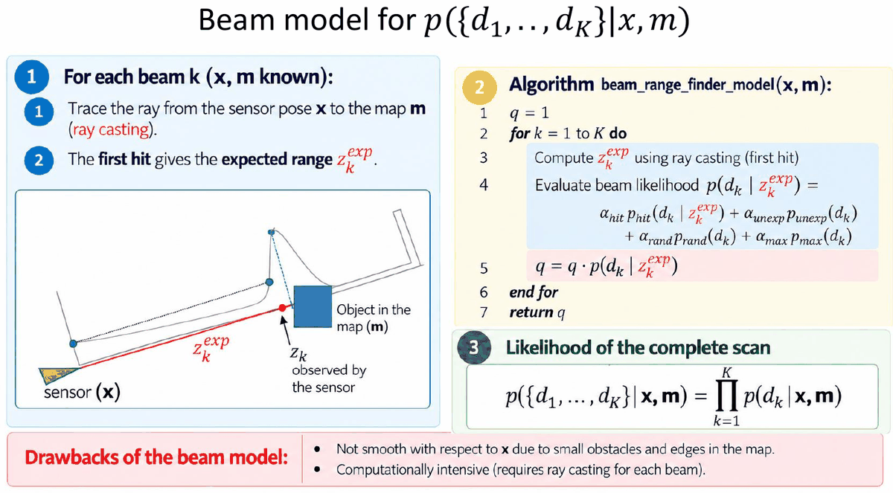

**Mapa de verosimilitud del scan sobre todas las poses:** para cada pose candidata se hace ray casting del scan esperado, se compara cada haz medido con el esperado y se multiplican las verosimilitudes. Las **zonas brillantes** son poses cuyo scan predicho coincide con el observado. Puede haber **varias zonas** compatibles (pasillos parecidos): la verosimilitud es **multimodal**.

> **Ejemplo resuelto (verosimilitud de un scan de 3 haces).**
>
> **Enunciado.** Con los parámetros del ejemplo anterior y $z_{exp} = 4$ m para los tres haces, el scan mide $d_1 = 4{,}1$, $d_2 = 2$ y $d_3 = 6$ m. ¿Cuál es la verosimilitud del scan?
>
> **Fórmula.** Se aplica el algoritmo de arriba: la mezcla para cada haz y después el **producto** (independencia condicional).
>
> **Paso 1. Verosimilitud de cada haz** (casos a, b y c del ejemplo anterior): $1{,}242$; $0{,}0313$; $0{,}0100$.
>
> **Paso 2. Producto.** $p(\mathbf{z} \mid \mathbf{x}, \mathbf{m}) = 1{,}242 \cdot 0{,}0313 \cdot 0{,}01 \approx 3{,}9 \times 10^{-4}$.
>
> **Paso 3. En logaritmos**, como se hace en la práctica para evitar números diminutos: $\ln 1{,}242 + \ln 0{,}0313 + \ln 0{,}01 = 0{,}217 - 3{,}465 - 4{,}605 = -7{,}853$.
>
> **Interpretación.** El número suelto no dice mucho. Sirve para **comparar poses candidatas**: se calcula lo mismo para cada pose y se prefiere la de mayor suma de logaritmos, la menos negativa.

**Inconvenientes del beam model:**

- **No es suave respecto a $\mathbf{x}$**: pequeños obstáculos y bordes del mapa hacen que un pequeño cambio de pose cambie mucho $z_{exp}$ (y la verosimilitud).
- **Computacionalmente costoso:** requiere ray casting para cada haz.

### 7.7. Likelihood field (modelo de campo de verosimilitud)

**Intuición.** El beam model es caro, porque obliga a hacer ray casting para cada haz y para cada pose candidata. El *likelihood field* simplifica la idea: **si la pose es buena, los extremos de los haces tienen que caer encima de las paredes del mapa**. Así que, para cada haz, solo calculamos **dónde cae su extremo** y miramos lo cerca que está de una pared. Esa cercanía se puede **precalcular una sola vez** para todas las celdas del mapa: es el «campo».

- **Idea:** en lugar de seguir el haz entero, **solo se comprueban los extremos (*end points*) del haz láser**. También se llama **modelo de extremo de haz** (*endpoint model*).
- Dado un mapa de rejilla $\mathbf{m}$, el campo de verosimilitud se calcula **sin ninguna suposición sobre dónde está el sensor**.
- Si el mapa es **estático**, el campo se calcula **una sola vez**.
- **Los extremos de un scan $\mathbf{z}$ sobre el mapa $\mathbf{m}$ deben caer en regiones de alta verosimilitud** (cerca de obstáculos).

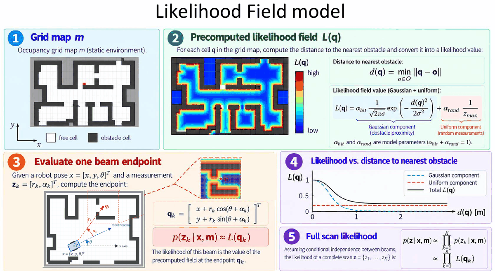

**1. Mapa de rejilla $\mathbf{m}$** (ocupación, entorno estático): celdas libres y celdas de obstáculo.

**2. Campo de verosimilitud precalculado $L(\mathbf{q})$:** para cada celda $\mathbf{q}$ se calcula la distancia al obstáculo más cercano y se convierte en un valor de verosimilitud:

$$
\boxed{\,d(\mathbf{q}) = \min_{\mathbf{o} \in O}\lVert \mathbf{q} - \mathbf{o} \rVert, \qquad
L(\mathbf{q}) = \alpha_{hit}\,\frac{1}{\sqrt{2\pi}\,\sigma}\exp\!\left(-\frac{d(\mathbf{q})^2}{2\sigma^2}\right) + \alpha_{rand}\,\frac{1}{z_{max}}\,}
\qquad (\alpha_{hit} + \alpha_{rand} = 1)
$$

Componente **gaussiana** (cercanía a un obstáculo) + componente **uniforme** (medidas aleatorias). $O$ es el conjunto de celdas ocupadas.

**3. Evaluar el extremo de un haz:** dada la pose $\mathbf{x} = [x, y, \theta]^T$ y la medida $\mathbf{z}_k = [r_k, \alpha_k]^T$:

$$
\boxed{\,\mathbf{q}_k = \begin{bmatrix} x + r_k\cos(\theta + \alpha_k) \\ y + r_k\sin(\theta + \alpha_k) \end{bmatrix}, \qquad p(\mathbf{z}_k \mid \mathbf{x}, \mathbf{m}) \approx L(\mathbf{q}_k)\,}
$$

La verosimilitud de ese haz es el valor del campo precalculado en el extremo $\mathbf{q}_k$ (¡la misma fórmula que la posición de un landmark, sección 6.4!).

**4. Verosimilitud frente a distancia al obstáculo:** $L$ es máxima a distancia 0 y cae como una gaussiana hasta quedarse en el **suelo** que pone la componente uniforme.

**5. Verosimilitud del scan completo** (independencia condicional entre haces):

$$
p(\mathbf{z} \mid \mathbf{x}, \mathbf{m}) \approx \prod_{k=1}^{K} p(\mathbf{z}_k \mid \mathbf{x}, \mathbf{m}) \approx \prod_{k=1}^{K} L(\mathbf{q}_k)
$$

> **Ejemplo resuelto (likelihood field).**
>
> **Enunciado.** Robot en $\mathbf{x} = [1, 1, 0°]^T$. Un haz mide $r_k = 3$ m con $\alpha_k = 90°$. Parámetros del campo: $\sigma = 0{,}2$ m, $\alpha_{hit} = 0{,}9$, $\alpha_{rand} = 0{,}1$, $z_{max} = 10$ m. ¿Cuánto vale la verosimilitud del haz según lo cerca que caiga su extremo de un obstáculo?
>
> **Qué hacemos.** El likelihood field **no** compara distancias a lo largo del haz. Mira **dónde cae el extremo** del haz en el mapa y consulta lo cerca que está ese punto del obstáculo más próximo. Si el extremo cae sobre una pared, la pose es buena.
>
> **Paso 1. Extremo del haz en el mapa** (la misma fórmula que la posición de un landmark, sección 6.4). $\phi = \theta + \alpha = 0° + 90° = 90°$, así que
> $\mathbf{q}_k = [1 + 3\cos 90°,\ 1 + 3\sin 90°] = [1 + 0,\ 1 + 3] = [1,\ 4]$ m.
>
> **Paso 2. Consultar $d(\mathbf{q}_k)$** en el campo precalculado: la distancia de $(1, 4)$ al obstáculo más cercano. Depende del mapa, así que probamos varios valores.
>
> **Paso 3. Evaluar $L$.** $L = \alpha_{hit}\,\dfrac{1}{\sigma\sqrt{2\pi}}\,e^{-d^2/(2\sigma^2)} + \dfrac{\alpha_{rand}}{z_{max}}$, con $0{,}9 \cdot 1{,}995 = 1{,}795$, $2\sigma^2 = 0{,}08$ y $0{,}1/10 = 0{,}01$:
>
> | $d(\mathbf{q}_k)$ | Parte gaussiana: $1{,}795\,e^{-d^2/0{,}08}$ | $+$ suelo | $L(\mathbf{q}_k)$ |
> |---|---|---|---|
> | $0$ m (cae justo en la pared) | $1{,}795 \cdot e^{0} = 1{,}795$ | $0{,}01$ | $1{,}805$ |
> | $0{,}1$ m | $1{,}795 \cdot e^{-0{,}125} = 1{,}584$ | $0{,}01$ | $1{,}594$ |
> | $0{,}3$ m | $1{,}795 \cdot e^{-1{,}125} = 0{,}583$ | $0{,}01$ | $0{,}593$ |
> | $1{,}0$ m | $1{,}795 \cdot e^{-12{,}5} \approx 0{,}000007$ | $0{,}01$ | $0{,}010$ |
>
> **Interpretación.** Cuanto más cerca del obstáculo cae el extremo, mayor es la verosimilitud. Lejos de todo obstáculo solo queda el «suelo» uniforme, $\alpha_{rand}/z_{max} = 0{,}01$, así que nunca vale 0.
>
> **Otro extremo para practicar.** Robot en $[2, 1, 30°]^T$, haz con $r = 4$ m y $\alpha = 60°$: $\phi = 30° + 60° = 90°$, así que $\mathbf{q} = [2 + 0,\ 1 + 4] = [2,\ 5]$ m.

> **Nota sobre la diapositiva:** la gráfica de $L$ frente a $d$ está dibujada con máximo 1 (normalizada), pero con la fórmula, si $\sigma$ es pequeña, el valor en $d = 0$ puede ser mayor que 1 (como en el ejemplo: 1,805). Lo que importa es la **forma**: máximo sobre los obstáculos, caída gaussiana y suelo uniforme.

### 7.8. Propiedades y usos del likelihood field

1. **Muy eficiente:** solo usa **tablas de consulta 2D** (el campo precalculado).
2. **Suave respecto a pequeños cambios de la pose:** la verosimilitud varía poco con movimientos pequeños (p. ej. $L(\mathbf{x}) = 0{,}72$ y $L(\mathbf{x} + \delta\mathbf{x}) = 0{,}68$).
3. **Ignora las propiedades físicas del haz:** no modela el camino completo del haz; en el modelo el haz puede **«atravesar» objetos** (solo importa dónde acaba), pero en la práctica funciona bastante bien.
4. **Usos principales:**
   - **Scan matching:** un scan define un campo de verosimilitud y se optimiza la verosimilitud del siguiente scan con un método basado en gradiente (p. ej. **Gauss–Newton**) para alinearlos.
   - **Localización con filtro de partículas:** se usa el campo para **ponderar las partículas** según la verosimilitud del scan observado.

**Comparación de los dos modelos de scan:**

| | **Beam model** | **Likelihood field** |
|---|---|---|
| Qué compara | Rango medido $z_k$ frente al rango esperado $z_k^{exp}$ a lo largo del haz | Distancia del **extremo** del haz al obstáculo más cercano |
| Necesita ray casting | **Sí**, para cada haz y cada pose | **No**; el campo se precalcula una vez (mapa estático) |
| Coste | Alto | Bajo (tablas 2D) |
| Suavidad respecto a $\mathbf{x}$ | No es suave (bordes, obstáculos pequeños) | Suave |
| Física del haz | La modela (obstáculos inesperados, max range...) | La ignora (el haz puede «atravesar» objetos) |
| Componentes | hit + unexpected + random + max | Gaussiana (hit) + uniforme (random) |

---

## 8. Resumen del tema

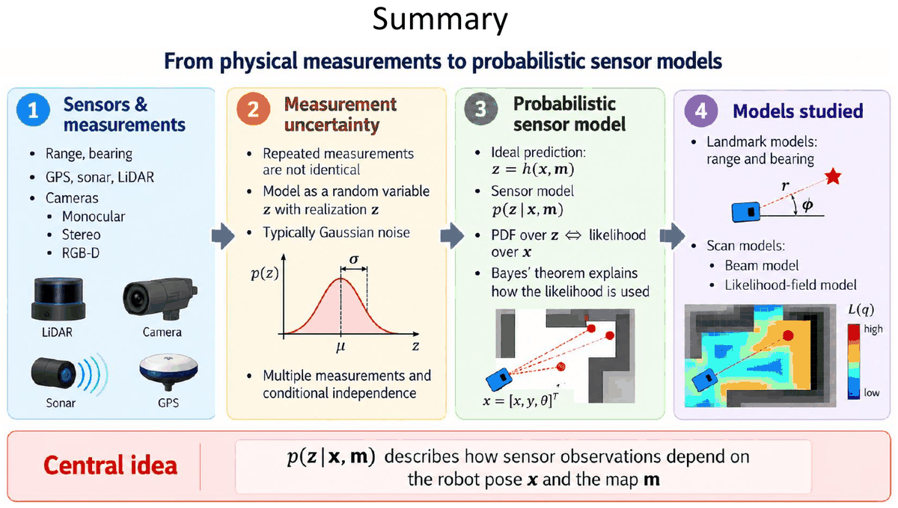

1. **Sensores y medidas:** rango, bearing; GPS, sonar, LiDAR; cámaras (monocular, estéreo, RGB-D).
2. **Incertidumbre de la medida:** las medidas repetidas no son idénticas; se modelan como una variable aleatoria $Z$ con realización $z$, normalmente con ruido gaussiano. Hay muchas medidas y se supone independencia condicional.
3. **Modelo probabilístico del sensor:** predicción ideal $\mathbf{z} = \mathbf{h}(\mathbf{x}, \mathbf{m})$; modelo $p(\mathbf{z} \mid \mathbf{x}, \mathbf{m})$; PDF sobre $z$ ⇔ verosimilitud sobre $x$; el teorema de Bayes explica cómo se usa la verosimilitud.
4. **Modelos estudiados:** modelos de landmarks (rango y bearing) y modelos de scan (**beam model** y **likelihood field**).

**Idea central:** $p(\mathbf{z} \mid \mathbf{x}, \mathbf{m})$ describe **cómo dependen las observaciones del sensor de la pose del robot $\mathbf{x}$ y del mapa $\mathbf{m}$**.

---

## 9. Fórmulas para el examen

| Concepto | Fórmula | Cuándo se usa / notas |
|---|---|---|
| Sonar (ToF) | $r = \dfrac{c_s\,\Delta t}{2}$, $c_s \approx 343$ m/s | $\Delta t$ de **ida y vuelta** |
| LiDAR ToF pulsado | $r = \dfrac{c\,\Delta t}{2}$, $c \approx 3 \times 10^8$ m/s | 1 ns ↔ 15 cm |
| LiDAR por fase | $r = \dfrac{c\,\Delta\phi}{4\pi f_m}$; ambigüedad $r_{max} = \dfrac{c}{2 f_m}$ | $\Delta\phi$ en **radianes** |
| Error de reloj (GPS) | $\Delta r = c\,\delta t$ | 4 satélites: $x, y, z, \delta t$ |
| Trilateración 2D | $x = \dfrac{r_1^2 - r_2^2 + d^2}{2d}$, $y = \pm\sqrt{r_1^2 - x^2}$ | Balizas en $(0,0)$ y $(d,0)$; 2 soluciones |
| Separación lateral | $s \approx r\,\Delta\alpha$ (rad); anchura de cono $2r\tan(\beta/2)$ | Resolución LiDAR / sonar |
| Ángulo del haz $k$ | $\alpha_k = \alpha_{min} + k\,\Delta\alpha$ | Scans láser |
| Gaussiana 1D | $\mathcal{N}(z; \mu, \sigma^2) = \dfrac{1}{\sigma\sqrt{2\pi}}e^{-\frac{(z-\mu)^2}{2\sigma^2}}$ | A $1\sigma$: 60,7 % del pico |
| Sesgo de escala | $Z \mid v \sim \mathcal{N}(\alpha v, \sigma^2(v))$ | Media $\neq$ verdad |
| Modelo gaussiano | $\mathbf{z} = \mathbf{h}(\mathbf{x}, \mathbf{m}) + \mathbf{w}$, $\mathbf{w} \sim \mathcal{N}(\mathbf{0}, Q)$ | $p(\mathbf{z} \mid \mathbf{x}, \mathbf{m}) = \mathcal{N}(\mathbf{z}; \mathbf{h}, Q)$ |
| Independencia condicional | $p(\mathbf{z} \mid \mathbf{x}, \mathbf{m}) = \prod_k p(z_k \mid \mathbf{x}, \mathbf{m})$ | Producto (o suma de logaritmos) |
| Bayes | $p(\mathbf{x} \mid \mathbf{z}, \mathbf{m}) \propto p(\mathbf{z} \mid \mathbf{x}, \mathbf{m})\,p(\mathbf{x} \mid \mathbf{m})$ | Posterior ∝ verosimilitud × prior; normalizar |
| Rango y bearing predichos | $\hat{d} = \sqrt{(x_i - x)^2 + (y_i - y)^2}$; $\hat{\alpha} = \operatorname{atan2}(y_i - y, x_i - x) - \theta$ | **atan2** y **restar $\theta$** |
| Verosimilitud 2D | $\dfrac{1}{2\pi\lvert Q\rvert^{1/2}}\exp\{-\tfrac12\mathbf{e}^TQ^{-1}\mathbf{e}\}$, $\mathbf{e} = \mathbf{z} - \mathbf{h}$ | $Q$ diagonal: $\mathbf{e}^TQ^{-1}\mathbf{e} = \sum (e_j/\sigma_j)^2$ |
| Posición del landmark | $\mathbf{m} = [x + r\cos\phi,\ y + r\sin\phi]^T$, $\phi = \theta + \alpha$ | También el extremo $\mathbf{q}_k$ de un haz |
| Polares → cartesianas | $\mathbf{z}_c = [r\cos\alpha,\ r\sin\alpha]^T$; $\dfrac{\partial \mathbf{z}_c}{\partial \mathbf{z}_p} = \begin{bmatrix} \cos\alpha & -r\sin\alpha \\ \sin\alpha & r\cos\alpha \end{bmatrix}$ | $\Sigma_{\mathbf{z}_c} = J\Sigma_{\mathbf{z}_p}J^T$ |
| Covarianza del landmark | $\Sigma_m \approx \mathbf{J}_x\Sigma_x\mathbf{J}_x^T + \mathbf{J}_z\Sigma_z\mathbf{J}_z^T$ | Suma de dos covarianzas |
| Jacobianos | $\mathbf{J}_x = \begin{bmatrix} 1 & 0 & -r\sin\phi \\ 0 & 1 & r\cos\phi \end{bmatrix}$; $\mathbf{J}_z = \begin{bmatrix} \cos\phi & -r\sin\phi \\ \sin\phi & r\cos\phi \end{bmatrix}$ | 2×3 y 2×2 |
| Beam: hit | $\eta_{hit}\dfrac{1}{\sigma\sqrt{2\pi}}e^{-\frac{(z - z_{exp})^2}{2\sigma^2}}$ en $[0, z_{max}]$ | $z_{exp}$ por **ray casting** |
| Beam: unexpected | $\eta_{unexp}\lambda e^{-\lambda z}$ en $[0, z_{exp})$; $\eta_{unexp} = \dfrac{1}{1 - e^{-\lambda z_{exp}}}$ | 0 si $z \ge z_{exp}$ |
| Beam: random | $1/z_{max}$ en $[0, z_{max})$ | Uniforme |
| Beam: max | $1$ si $z = z_{max}$ | Sin eco |
| Mezcla | $p = \alpha_{hit}p_{hit} + \alpha_{unexp}p_{unexp} + \alpha_{rand}p_{rand} + \alpha_{max}p_{max}$, $\sum\alpha_i = 1$ | Parámetros por máxima verosimilitud (EM) |
| Likelihood field | $L(\mathbf{q}) = \alpha_{hit}\dfrac{1}{\sqrt{2\pi}\sigma}e^{-\frac{d(\mathbf{q})^2}{2\sigma^2}} + \dfrac{\alpha_{rand}}{z_{max}}$; $p(\mathbf{z}_k \mid \mathbf{x}, \mathbf{m}) \approx L(\mathbf{q}_k)$ | $d(\mathbf{q})$ = distancia al obstáculo más cercano |

**Datos que conviene recordar:**

| Sensor | Dato |
|---|---|
| GPS | Satélites a ~20 200 km, órbita de ~12 h, 6 planos; ≥ 4 satélites; GPS 3–10 m, DGPS 0,5–3 m, RTK 1–5 cm |
| Sonar | > 20 kHz; haz ≈ 30°; alcance 2–4 m; barato y de bajo consumo |
| Infrarrojos | Triangulación; ~2 m; buena resolución angular; problemas con transparentes, brillantes, negros y luz solar |
| LiDAR | Haz 0,1°–1°; precisión ~1–5 cm; hasta 200 m o más; Hokuyo UTM-30LX: 30 m, FOV 270° |
| RGB-D | Color + profundidad por píxel; sin partes móviles; ~0,2–4 m (interiores) |
| Cámara | Monocular: solo bearing; estéreo: rango + bearing (triangulación) |

---

## 10. Errores típicos

1. **Olvidar el 2 en el tiempo de vuelo:** $\Delta t$ es de **ida y vuelta**, $r = c\,\Delta t/2$.
2. **Mezclar grados y radianes:** las varianzas angulares van en rad² ($\sigma_\theta = 5° \to 0{,}0873$ rad $\to 0{,}007615$ rad²), y $\Delta\phi$ en la fórmula de fase va en radianes. Los senos y cosenos dan igual, pero $s = r\,\Delta\alpha$ y los jacobianos multiplican por $r$ un ángulo en radianes.
3. **Poner $\sigma$ en lugar de $\sigma^2$ en la covarianza:** $\Sigma = \operatorname{diag}(\sigma_x^2, \ldots)$, no $\operatorname{diag}(\sigma_x, \ldots)$.
4. **Bearing sin restar la orientación del robot:** $\hat{\alpha} = \operatorname{atan2}(\Delta y, \Delta x) - \theta$. Y al pasar al global, **sumar**: $\phi = \theta + \alpha$.
5. **Usar atan en lugar de atan2:** atan pierde el cuadrante (p. ej. $\Delta x < 0$).
6. **No normalizar ángulos:** un error de bearing de 358° es en realidad −2°.
7. **Jacobiano con dimensiones mal:** $\partial \mathbf{m}/\partial \mathbf{x}$ es **2×3** (filas = salidas, columnas = entradas); $\partial \mathbf{m}/\partial \mathbf{z}$ es **2×2**.
8. **Olvidar uno de los dos términos de $\Sigma_m$:** la incertidumbre del landmark viene **de la pose y de la medida** (suma de dos covarianzas).
9. **Pensar que la verosimilitud es una distribución sobre $x$:** no integra 1 en $x$; para obtener la posterior hay que multiplicar por el prior y **normalizar**.
10. **Confundir PDF y verosimilitud:** misma expresión $p(z \mid x, m)$; en la PDF varía $z$ (con $x$ fijo), en la verosimilitud varía $x$ (con $z$ fijo).
11. **Creer que una densidad no puede pasar de 1:** $p(z)$ puede valer 1,76 o 5,59 si $\sigma$ es pequeña; lo que vale 1 es la **integral**.
12. **Beam model: aplicar $p_{unexp}$ más allá de $z_{exp}$** (vale 0 para $z \ge z_{exp}$) o **$p_{rand}$ en $z_{max}$** (vale 0 en $z = z_{max}$; ahí solo actúa $p_{max}$).
13. **Pesos de la mezcla que no suman 1:** $\alpha_{hit} + \alpha_{unexp} + \alpha_{rand} + \alpha_{max} = 1$ (en el likelihood field, $\alpha_{hit} + \alpha_{rand} = 1$).
14. **Likelihood field: medir la distancia desde el robot.** $d(\mathbf{q})$ es la distancia del **extremo del haz** al **obstáculo más cercano**, no la longitud del haz.
15. **Confundir qué modelo necesita ray casting:** el **beam model** sí (por haz y por pose); el **likelihood field** no (campo precalculado una vez).
16. **Pensar que el GPS necesita 3 satélites:** son **4** (posición 3D + desfase del reloj del receptor).
17. **Clasificar mal sensores:** encoder e IMU son **propioceptivos**; cámara y GPS son exteroceptivos **pasivos**; LiDAR, sonar y RGB-D son exteroceptivos **activos**.
18. **Monocular ≠ distancia:** una cámara monocular solo da **bearing**; para el rango hace falta estéreo, RGB-D o moverse y triangular.
