# L5 — Localización del robot (Robot localization)

**Bibliografía de referencia:**

- *Probabilistic Robotics*. S. Thrun, W. Burgard, D. Fox. MIT Press, 2005 (la diapositiva pone 2001).
- *Simultaneous Localization and Mapping for Mobile Robots: Introduction and Methods*. J. A. Fernández-Madrigal y J. L. Blanco Claraco. IGI-Global, 2013.

> **Notación usada en estos apuntes:** las negritas son vectores. $\mathbf{x} = [x, y, \theta]^T$ es la pose del robot y $\mathbf{r} = [x, y]^T$, solo su posición. $\mathbf{m}_i = [x_i, y_i]^T$ es un landmark de posición conocida, $\mathbf{z}$ una observación y $\mathbf{u}$ un movimiento. $\hat{\mathbf{x}}$ es una **estimación**; $\bar{\boldsymbol{\mu}}$ y $\bar\Sigma$ son los valores **predichos**, antes de corregir. $bel$ es la creencia (*belief*) y $\overline{bel}$, la creencia predicha. $\oplus$ es la composición de poses (L3). $\mathcal{N}(\mu, \sigma^2)$ es una gaussiana, con la **varianza** como segundo parámetro. Las diapositivas llaman $\theta_i$ a la marcación medida (*bearing*); aquí se usa **$\alpha_i$ para la marcación** y $\theta$ **solo para la orientación del robot**, igual que en L4.

> **Cómo estudiar este tema para el examen:** el parcial pide **pequeños cálculos aplicando las fórmulas**: un mínimos cuadrados, un jacobiano, un paso de Gauss-Newton, una tabla del filtro de rejilla, una ganancia de Kalman, los pesos de unas partículas... Cada fórmula importante va acompañada de un **ejemplo resuelto paso a paso**, siempre con la misma estructura: **enunciado** → **qué buscamos y por qué** → **fórmula** (qué es cada símbolo) → **pasos** con todas las sustituciones → **resultado e interpretación**. Si en el examen te bloqueas, sigue ese mismo orden. Al final están la **chuleta de fórmulas** (sección 10) y los **errores típicos** (sección 11).

> **Ruta de estudio recomendada:** lee las secciones en orden, porque cada método reutiliza el anterior. Rehaz sin mirar los ejemplos marcados como **imprescindible**: mínimos cuadrados con matrices (2.3) y ponderados (2.4), paso de Gauss-Newton (3.4), filtro de rejilla (5.4), Kalman en 1D (6.6), EKF en 1D (7.6), y pesos y remuestreo de partículas (8.4 y 8.5). Después practica con el [test de L5](../../../web/parcial2/index.html?lesson=L5#filters). La parte de programación del EKF está en la [guía de la práctica 5.2](../../../web/parcial2/P5.2_EKF_Localization.html).

---

## Contenidos de la lección

1. **Introducción:** el problema de la localización y sus tres variantes.
2. **Posicionamiento por mínimos cuadrados:**
   - Caso lineal y ponderado.
   - Equivalencia con máxima verosimilitud.
   - Caso no lineal: Gauss-Newton y multilateración.
3. **Registro de conjuntos de puntos:**
   - Puntos landmark (correspondencias conocidas).
   - Puntos de scan: ICP (correspondencias desconocidas).
4. **Filtrado bayesiano:**
   - Filtro de rejilla.
   - Filtro de Kalman.
   - Filtro de Kalman extendido.
   - Filtro de partículas.

El hilo conductor es este: primero se busca **una sola pose** que encaje con las medidas (secciones 2 a 4) y después se mantiene **una distribución de probabilidad** sobre todas las poses posibles, actualizada paso a paso (secciones 5 a 8).

---

## 1. El problema de la localización

### 1.1. Qué entra y qué sale

**Localizar** un robot es responder a «¿dónde estoy?» dentro de un mapa conocido. Es la pregunta básica para que un robot sea autónomo: sin saber dónde está, no puede planificar a dónde ir.

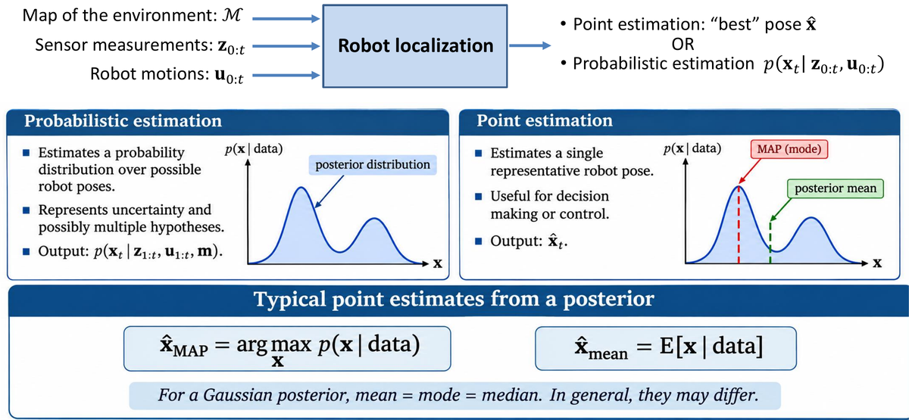

| Entradas | Símbolo | Ejemplo |
|---|---|---|
| Mapa del entorno | $\mathcal{M}$ | Posición de los landmarks, plano de obstáculos |
| Medidas del sensor | $\mathbf{z}_{0:t}$ | Distancias y marcaciones del LiDAR (L4) |
| Movimientos del robot | $\mathbf{u}_{0:t}$ | Comandos u odometría (L3) |

La salida puede ser de dos tipos:

| Salida | Qué da | Para qué sirve |
|---|---|---|
| **Estimación puntual** $\hat{\mathbf{x}}_t$ | **Una** pose «mejor» | Tomar decisiones y controlar el robot |
| **Estimación probabilística** $p(\mathbf{x}_t \mid \mathbf{z}_{0:t}, \mathbf{u}_{0:t})$ | Una **distribución** sobre todas las poses | Representar la incertidumbre y, si hace falta, **varias hipótesis** a la vez |

### 1.2. De la distribución a una sola pose: MAP y media

Si se tiene la distribución (la *posterior*), se puede resumir en una pose de dos formas típicas:

$$\hat{\mathbf{x}}_{\text{MAP}} = \arg\max_{\mathbf{x}} p(\mathbf{x} \mid \text{datos}) \qquad\qquad \hat{\mathbf{x}}_{\text{media}} = E[\mathbf{x} \mid \text{datos}]$$

- **MAP** (*maximum a posteriori*): la pose **más probable**, el punto más alto de la distribución (la moda).
- **Media:** el **promedio** de las poses, pesado por su probabilidad.

En una **gaussiana**, media, moda y mediana coinciden. En general, no.

> **Ejemplo resuelto (MAP y media pueden dar poses muy distintas).**
>
> **Enunciado.** Un robot está en un pasillo de 6 celdas ($x = 0, \ldots, 5$) con esta creencia: $p = [0{,}05;\ 0{,}40;\ 0{,}05;\ 0{,}05;\ 0{,}35;\ 0{,}10]$. Duda entre dos zonas: alrededor de la celda 1 y alrededor de la celda 4.
>
> **Qué buscamos y por qué.** Las dos estimaciones puntuales, para ver si significan lo mismo.
>
> **Fórmulas.** MAP = celda de mayor probabilidad. Media = $\sum_x x \cdot p(x)$.
>
> **Paso 1. MAP.** El valor máximo es $0{,}40$, en la celda 1: $\hat{x}_{\text{MAP}} = 1$.
>
> **Paso 2. Media.** $0 \cdot 0{,}05 + 1 \cdot 0{,}40 + 2 \cdot 0{,}05 + 3 \cdot 0{,}05 + 4 \cdot 0{,}35 + 5 \cdot 0{,}10 = 0 + 0{,}40 + 0{,}10 + 0{,}15 + 1{,}40 + 0{,}50 = 2{,}55$.
>
> **Resultado e interpretación.** MAP $= 1$ y media $= 2{,}55$. La media cae **entre las dos hipótesis**, en una zona donde casi seguro **no** está el robot (las celdas 2 y 3 valen 0,05). Con creencias de varios picos, la media puede ser engañosa.

### 1.3. Los tres problemas de localización

Se distinguen por **lo que el robot sabe de su pose**:

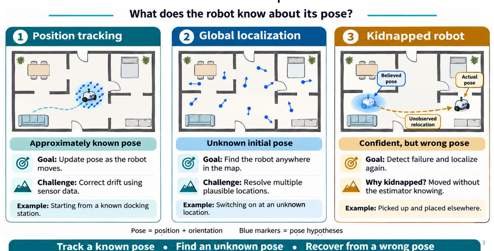

| Problema | Qué sabe el robot | Objetivo | Reto | Ejemplo |
|---|---|---|---|---|
| **Seguimiento de posición** (*position tracking*) | Su pose, **aproximadamente** | Actualizarla mientras se mueve | Corregir la **deriva** con los sensores | Sale de una estación de carga conocida |
| **Localización global** (*global localization*) | **Nada**: pose inicial desconocida | Encontrarse en cualquier parte del mapa | Resolver **varias ubicaciones plausibles** | Se enciende en un sitio desconocido |
| **Robot secuestrado** (*kidnapped robot*) | Está **seguro, pero se equivoca** | **Detectar el fallo** y volver a localizarse | Lo han movido sin que el estimador lo sepa | Alguien lo coge y lo deja en otro sitio |

> **Idea clave:** seguir una pose conocida, encontrar una pose desconocida y recuperarse de una pose equivocada son tres problemas distintos. Un método que sirve para uno puede no servir para otro (sección 9).

---

## 2. Posicionamiento por mínimos cuadrados: caso lineal

### 2.1. La idea

El robot mide varios landmarks de posición conocida. Cada medida impone una **restricción** sobre su pose. Como las medidas tienen ruido, casi nunca existe una pose que las cumpla todas exactamente. **Mínimos cuadrados** (*least squares*, LS) busca el mejor compromiso.

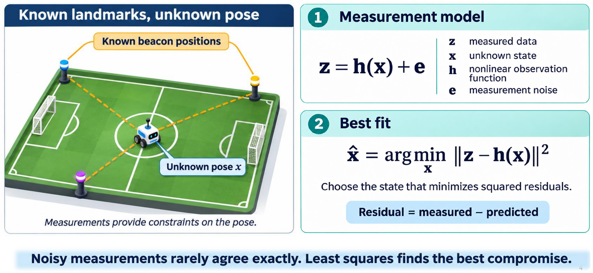

**Modelo de medida:** $\mathbf{z} = \mathbf{h}(\mathbf{x}) + \mathbf{e}$, donde $\mathbf{z}$ son los datos medidos, $\mathbf{x}$ el estado desconocido, $\mathbf{h}$ la función de observación y $\mathbf{e}$ el ruido.

**Mejor ajuste:** la pose que minimiza la suma de los **residuos al cuadrado**, siendo **residuo = medido − predicho**:

$$\hat{\mathbf{x}} = \arg\min_{\mathbf{x}} \lVert \mathbf{z} - \mathbf{h}(\mathbf{x}) \rVert^2$$

¿Por qué al cuadrado? Porque así los errores positivos y negativos no se cancelan, los errores grandes pesan más y la función es derivable, lo que permite resolverla con una fórmula cerrada en el caso lineal.

### 2.2. Caso lineal: ¿tiene solución?

Empezamos con un modelo lineal: $\mathbf{z} = H\mathbf{x} + \mathbf{e}$, con $H$ una matriz de $m \times n$.

- $n$: dimensión del estado (3 para una pose en el plano).
- $m$: número de restricciones (ecuaciones, una por medida escalar).

Lo que decide si hay solución es el **rango** de $H$: cuántas ecuaciones son realmente **independientes**.

| Caso | Rango | Qué ocurre | Solución |
|---|---|---|---|
| $m = n$, ecuaciones independientes | $\operatorname{rango}(H) = n$ | $H$ es cuadrada e invertible | Directa: $\hat{\mathbf{x}} = H^{-1}\mathbf{z}$ |
| $m < n$ | $\operatorname{rango}(H) < n$ | $H^T H$ **no es invertible**: la pose es **no observable** | Infinitas soluciones |
| $m > n$ con al menos $n$ independientes | $\operatorname{rango}(H) = n$ | $H^T H$ es invertible; por el ruido, en general **no hay solución exacta** | Mínimos cuadrados |

> **Ojo:** tener muchas medidas no basta. Lo que cuenta son las **independientes**.
>
> **Ejemplo.** Con $H = \begin{bmatrix} 1 & 1 \\ 2 & 2 \\ 3 & 3 \end{bmatrix}$ hay $m = 3 > n = 2$, pero todas las filas son múltiplos de la primera, así que el rango es 1. $H^T H = \begin{bmatrix} 14 & 14 \\ 14 & 14 \end{bmatrix}$ tiene determinante $14 \cdot 14 - 14 \cdot 14 = 0$: no se puede invertir. Las tres ecuaciones solo informan de $x + y$, nunca de $x$ e $y$ por separado.

### 2.3. La solución de mínimos cuadrados

Se minimiza el **error al cuadrado**:

$$\hat{\mathbf{x}} = \arg\min_{\mathbf{x}} \mathbf{e}^T\mathbf{e} = \arg\min_{\mathbf{x}} (\mathbf{z} - H\mathbf{x})^T(\mathbf{z} - H\mathbf{x})$$

**De dónde sale la fórmula.** En el mínimo, la derivada respecto a $\mathbf{x}$ vale cero: $-2H^T(\mathbf{z} - H\mathbf{x}) = \mathbf{0}$. Eso da $H^T H\,\mathbf{x} = H^T\mathbf{z}$ y, despejando:

$$\boxed{\hat{\mathbf{x}} = (H^T H)^{-1} H^T \mathbf{z}}$$

**Dimensiones:** $H^T H$ es $n \times n$, $H^T\mathbf{z}$ es $n \times 1$ y el resultado es $n \times 1$. Si $H$ es cuadrada e invertible, la fórmula se reduce a $H^{-1}\mathbf{z}$.

> **Ejemplo resuelto (medir lo mismo varias veces).**
>
> **Enunciado.** Un robot en un pasillo mide tres veces su distancia a una puerta: $z_1 = 3{,}1$, $z_2 = 2{,}9$ y $z_3 = 3{,}3$ m. ¿Cuál es la estimación de mínimos cuadrados?
>
> **Qué buscamos y por qué.** Un único valor $x$ que resuma tres medidas que no coinciden.
>
> **Fórmula.** Cada medida es $z_i = 1 \cdot x + e_i$, así que $H = [1, 1, 1]^T$, con $m = 3$ y $n = 1$.
>
> **Pasos.** $H^T H = 1 + 1 + 1 = 3$, que es un escalar y se invierte como $1/3$. $H^T\mathbf{z} = 3{,}1 + 2{,}9 + 3{,}3 = 9{,}3$. Por tanto, $\hat{x} = 9{,}3 / 3 = 3{,}1$ m.
>
> **Resultado e interpretación.** $\hat{x} = 3{,}1$ m, que es justo la **media aritmética**. Promediar medidas es el caso más sencillo de mínimos cuadrados.

> **Ejemplo resuelto (imprescindible: mínimos cuadrados con matrices).**
>
> **Enunciado.** Un sensor mide directamente $x$ ($z_1 = 2{,}1$), otro mide $y$ ($z_2 = 0{,}9$) y un tercero mide $x + y$ ($z_3 = 3{,}3$). Estima $\mathbf{x} = [x, y]^T$.
>
> **Qué buscamos y por qué.** Las tres medidas no son compatibles: $2{,}1 + 0{,}9 = 3{,}0 \neq 3{,}3$. Hay más ecuaciones que incógnitas, así que buscamos el mejor compromiso.
>
> **Fórmula.** $\hat{\mathbf{x}} = (H^T H)^{-1} H^T \mathbf{z}$. Cada fila de $H$ dice qué mide cada sensor: $H = \begin{bmatrix} 1 & 0 \\ 0 & 1 \\ 1 & 1 \end{bmatrix}$ y $\mathbf{z} = \begin{bmatrix} 2{,}1 \\ 0{,}9 \\ 3{,}3 \end{bmatrix}$.
>
> **Paso 1. $H^T H$:** $\begin{bmatrix} 1 \cdot 1 + 0 \cdot 0 + 1 \cdot 1 & 1 \cdot 0 + 0 \cdot 1 + 1 \cdot 1 \\ 0 \cdot 1 + 1 \cdot 0 + 1 \cdot 1 & 0 \cdot 0 + 1 \cdot 1 + 1 \cdot 1 \end{bmatrix} = \begin{bmatrix} 2 & 1 \\ 1 & 2 \end{bmatrix}$.
>
> **Paso 2. Invertirla.** Para una matriz de $2 \times 2$: $\begin{bmatrix} a & b \\ c & d \end{bmatrix}^{-1} = \dfrac{1}{ad - bc}\begin{bmatrix} d & -b \\ -c & a \end{bmatrix}$. Aquí el determinante es $2 \cdot 2 - 1 \cdot 1 = 3$, así que $(H^T H)^{-1} = \dfrac{1}{3}\begin{bmatrix} 2 & -1 \\ -1 & 2 \end{bmatrix}$.
>
> **Paso 3. $H^T\mathbf{z}$:** $\begin{bmatrix} 2{,}1 + 3{,}3 \\ 0{,}9 + 3{,}3 \end{bmatrix} = \begin{bmatrix} 5{,}4 \\ 4{,}2 \end{bmatrix}$.
>
> **Paso 4. Multiplicar:** $\hat{\mathbf{x}} = \dfrac{1}{3}\begin{bmatrix} 2 \cdot 5{,}4 - 1 \cdot 4{,}2 \\ -1 \cdot 5{,}4 + 2 \cdot 4{,}2 \end{bmatrix} = \dfrac{1}{3}\begin{bmatrix} 6{,}6 \\ 3{,}0 \end{bmatrix} = \begin{bmatrix} 2{,}2 \\ 1{,}0 \end{bmatrix}$.
>
> **Paso 5. Comprobar con los residuos.** $\mathbf{e} = \mathbf{z} - H\hat{\mathbf{x}} = [2{,}1 - 2{,}2;\ 0{,}9 - 1{,}0;\ 3{,}3 - 3{,}2]^T = [-0{,}1;\ -0{,}1;\ 0{,}1]^T$. El coste es $\mathbf{e}^T\mathbf{e} = 0{,}01 + 0{,}01 + 0{,}01 = 0{,}03$.
>
> **Resultado e interpretación.** $\hat{\mathbf{x}} = [2{,}2;\ 1{,}0]^T$. El desajuste de $0{,}3$ se **reparte** entre las tres medidas. Si nos hubiéramos fiado solo de los dos primeros sensores, con $[2{,}1;\ 0{,}9]^T$, el coste sería $0 + 0 + 0{,}3^2 = 0{,}09$, tres veces mayor.

### 2.4. Mínimos cuadrados ponderados

**Intuición.** No todas las medidas son igual de fiables. Si un sensor es malo, su error debe contar menos.

Si los errores $e_i$ son **independientes entre sí**, su matriz de covarianza $Q$ es **diagonal**:

$$Q = \begin{bmatrix} \sigma_{z_1}^2 & 0 & \cdots \\ 0 & \sigma_{z_2}^2 & \cdots \\ \vdots & \vdots & \ddots \end{bmatrix} \qquad Q^{-1} = \begin{bmatrix} 1/\sigma_{z_1}^2 & 0 & \cdots \\ 0 & 1/\sigma_{z_2}^2 & \cdots \\ \vdots & \vdots & \ddots \end{bmatrix}$$

Cada error se pesa con **la inversa de su varianza**, $1/\sigma_{z_i}^2$:

$$\hat{\mathbf{x}} = \arg\min_{\mathbf{x}} \mathbf{e}^T Q^{-1}\mathbf{e} = \arg\min_{\mathbf{x}} \sum_{i=1}^{m} \frac{e_i^2}{\sigma_{z_i}^2}$$

La solución (también en forma cerrada) da la estimación **y su incertidumbre**:

$$\boxed{\hat{\mathbf{x}} = (H^T Q^{-1} H)^{-1} H^T Q^{-1}\mathbf{z} \qquad\qquad \Sigma_{\hat{\mathbf{x}}} = (H^T Q^{-1} H)^{-1}}$$

> **Ejemplo resuelto (imprescindible: dos sensores de distinta calidad).**
>
> **Enunciado.** Dos sensores miden la misma magnitud: $z_1 = 10$ con $\sigma_1^2 = 1$ y $z_2 = 12$ con $\sigma_2^2 = 4$.
>
> **Qué buscamos y por qué.** La mejor estimación, teniendo en cuenta que el primero es más fiable. Sin ponderar saldría $11$, el punto medio.
>
> **Fórmula.** $H = [1, 1]^T$ y $Q^{-1} = \operatorname{diag}(1;\ 1/4)$. En este caso escalar, la fórmula queda como una **media pesada**:
>
> $$\hat{x} = \frac{z_1/\sigma_1^2 + z_2/\sigma_2^2}{1/\sigma_1^2 + 1/\sigma_2^2} \qquad \sigma_{\hat{x}}^2 = \frac{1}{1/\sigma_1^2 + 1/\sigma_2^2}$$
>
> **Paso 1. Denominador** ($H^T Q^{-1} H$): $1/1 + 1/4 = 1{,}25$.
>
> **Paso 2. Numerador** ($H^T Q^{-1}\mathbf{z}$): $10/1 + 12/4 = 10 + 3 = 13$.
>
> **Paso 3. Estimación:** $\hat{x} = 13 / 1{,}25 = 10{,}4$.
>
> **Paso 4. Varianza:** $\sigma_{\hat{x}}^2 = 1 / 1{,}25 = 0{,}8$.
>
> **Resultado e interpretación.** $\hat{x} = 10{,}4$, mucho más cerca del sensor bueno que el 11 del promedio simple. La varianza $0{,}8$ es **menor que la de cualquiera de los dos sensores**: combinar información siempre ayuda, incluso si una de las fuentes es peor. Esta misma cuenta reaparecerá en el filtro de Kalman (sección 6.8).

> **Ejemplo resuelto (ponderado con matrices).**
>
> **Enunciado.** Mismos datos que en el ejemplo de la sección 2.3, pero el tercer sensor es peor: $Q = \operatorname{diag}(1;\ 1;\ 4)$.
>
> **Qué buscamos y por qué.** Ver cómo cambia la estimación al desconfiar de la tercera medida, y cuál es su incertidumbre.
>
> **Fórmula.** $\hat{\mathbf{x}} = (H^T Q^{-1} H)^{-1} H^T Q^{-1}\mathbf{z}$, con $Q^{-1} = \operatorname{diag}(1;\ 1;\ 0{,}25)$.
>
> **Paso 1. $H^T Q^{-1} H$.** Cada fila de $H$ aporta su contribución multiplicada por su peso: $\begin{bmatrix} 1 + 0{,}25 & 0{,}25 \\ 0{,}25 & 1 + 0{,}25 \end{bmatrix} = \begin{bmatrix} 1{,}25 & 0{,}25 \\ 0{,}25 & 1{,}25 \end{bmatrix}$.
>
> **Paso 2. Invertirla.** Determinante: $1{,}25^2 - 0{,}25^2 = 1{,}5$. $\Sigma_{\hat{\mathbf{x}}} = \dfrac{1}{1{,}5}\begin{bmatrix} 1{,}25 & -0{,}25 \\ -0{,}25 & 1{,}25 \end{bmatrix} = \begin{bmatrix} 0{,}833 & -0{,}167 \\ -0{,}167 & 0{,}833 \end{bmatrix}$.
>
> **Paso 3. $H^T Q^{-1}\mathbf{z}$:** $\begin{bmatrix} 2{,}1 + 0{,}25 \cdot 3{,}3 \\ 0{,}9 + 0{,}25 \cdot 3{,}3 \end{bmatrix} = \begin{bmatrix} 2{,}925 \\ 1{,}725 \end{bmatrix}$.
>
> **Paso 4. Multiplicar:** $\hat{\mathbf{x}} = \dfrac{1}{1{,}5}\begin{bmatrix} 1{,}25 \cdot 2{,}925 - 0{,}25 \cdot 1{,}725 \\ -0{,}25 \cdot 2{,}925 + 1{,}25 \cdot 1{,}725 \end{bmatrix} = \dfrac{1}{1{,}5}\begin{bmatrix} 3{,}225 \\ 1{,}425 \end{bmatrix} = \begin{bmatrix} 2{,}15 \\ 0{,}95 \end{bmatrix}$.
>
> **Resultado e interpretación.** $\hat{\mathbf{x}} = [2{,}15;\ 0{,}95]^T$, más cerca de lo que dicen los sensores buenos ($2{,}1$ y $0{,}9$) que el $[2{,}2;\ 1{,}0]^T$ sin ponderar. Los residuos son $[-0{,}05;\ -0{,}05;\ 0{,}2]^T$: la medida poco fiable se lleva la mayor parte del desajuste. El término $-0{,}167$ indica correlación negativa: si $x$ fuera algo mayor de lo estimado, $y$ tendería a ser menor, porque el tercer sensor restringe su suma.

### 2.5. Mínimos cuadrados ponderados y máxima verosimilitud son lo mismo

**Máxima verosimilitud** (*maximum likelihood*, ML) busca la pose que hace **más probables las medidas obtenidas**:

$$\mathbf{x}_{ML} = \arg\max_{\mathbf{x}} p(\mathbf{z} \mid \mathbf{x})$$

Si el error es **gaussiano de media cero**, $\mathbf{e} \sim \mathcal{N}(\mathbf{0}, Q)$, entonces $\mathbf{z} = H\mathbf{x} + \mathbf{e}$ implica $\mathbf{z} \sim \mathcal{N}(H\mathbf{x}, Q)$, es decir:

$$p(\mathbf{z} \mid \mathbf{x}) = K \cdot \exp\left\{-\frac{1}{2}(\mathbf{z} - H\mathbf{x})^T Q^{-1}(\mathbf{z} - H\mathbf{x})\right\}$$

**El razonamiento, paso a paso:**

1. $K$ no depende de $\mathbf{x}$ y el factor $1/2$ tampoco cambia dónde está el máximo.
2. La exponencial es creciente: maximizarla equivale a **maximizar su exponente**.
3. Maximizar $-A$ equivale a **minimizar $A$**.

$$\hat{\mathbf{x}}_{ML} = \arg\max_{\mathbf{x}}\{-(\mathbf{z} - H\mathbf{x})^T Q^{-1}(\mathbf{z} - H\mathbf{x})\} = \arg\min_{\mathbf{x}}\mathbf{e}^T Q^{-1}\mathbf{e} = \hat{\mathbf{x}}_{LS}$$

**Conclusión.** Con ruido gaussiano, $\hat{\mathbf{x}}_{ML} = \hat{\mathbf{x}}_{LS}$. Mínimos cuadrados no es solo un truco geométrico: da la pose **más verosímil**. El LS sin ponderar es el caso particular de **varianzas iguales e independientes**, $Q = \sigma^2 I$, porque entonces $\sigma^2$ se cancela en la fórmula.

> **Ejemplo resuelto (comprobarlo con números).**
>
> **Enunciado.** Con los datos de los dos sensores ($z_1 = 10$, $\sigma_1^2 = 1$; $z_2 = 12$, $\sigma_2^2 = 4$), compara las candidatas $x = 10{,}4$ y $x = 11$.
>
> **Qué buscamos y por qué.** Comprobar que el menor coste coincide con la mayor verosimilitud.
>
> **Fórmulas.** Coste $C(x) = \dfrac{(x - 10)^2}{1} + \dfrac{(x - 12)^2}{4}$. Verosimilitud, salvo la constante $K$: $e^{-C(x)/2}$.
>
> **Pasos.**
>
> - $x = 10{,}4$: $C = 0{,}16 + 2{,}56/4 = 0{,}16 + 0{,}64 = 0{,}80$. Verosimilitud: $e^{-0{,}40} = 0{,}670$.
> - $x = 11$: $C = 1 + 1/4 = 1{,}25$. Verosimilitud: $e^{-0{,}625} = 0{,}535$.
>
> **Resultado e interpretación.** El valor $10{,}4$ de WLS tiene **menos coste y más verosimilitud** que el promedio simple. Son la misma pregunta vista de dos maneras.

> **Idea clave:** LS lineal tiene solución directa. Ponderar con $Q^{-1}$ da más peso a las medidas fiables, y con ruido gaussiano esa solución es la de máxima verosimilitud.

---

## 3. Mínimos cuadrados no lineales

### 3.1. Por qué hay que iterar

Los sensores reales no son lineales: una distancia lleva una raíz cuadrada y una marcación, un `atan2`. El problema pasa a ser:

$$\hat{\mathbf{x}} = \arg\min_{\mathbf{x}}\lVert \mathbf{z} - \mathbf{h}(\mathbf{x}) \rVert^2$$

Aquí $\mathbf{z}$ es un vector de $m$ **números ya medidos**, no variables aleatorias. Este problema **no suele tener solución cerrada**. La estrategia es partir de una estimación $\mathbf{x}_k$ y **aproximar $\mathbf{h}$ por una función lineal** a su alrededor, con el desarrollo de Taylor de primer orden:

$$\mathbf{h}(\mathbf{x}_k + \boldsymbol{\delta}) \approx \mathbf{h}(\mathbf{x}_k) + J_{h_k}\boldsymbol{\delta} \qquad\qquad J_{h_k} = \left.\frac{d\mathbf{h}}{d\mathbf{x}}\right|_{\mathbf{x}_k} = \begin{bmatrix} \frac{\partial h_1}{\partial x_1} & \cdots & \frac{\partial h_1}{\partial x_n} \\ \vdots & & \vdots \\ \frac{\partial h_m}{\partial x_1} & \cdots & \frac{\partial h_m}{\partial x_n} \end{bmatrix}_{m \times n}$$

Al sustituir, cada iteración se convierte en un **problema lineal en $\boldsymbol{\delta}$**, donde $\mathbf{e} = \mathbf{z} - \mathbf{h}(\mathbf{x}_k)$ es el residuo actual:

$$\boldsymbol{\delta}^* = \arg\min_{\boldsymbol{\delta}}\lVert \mathbf{e} - J_{h_k}\boldsymbol{\delta} \rVert^2 \quad\Rightarrow\quad \mathbf{x}_{k+1} = \mathbf{x}_k + \boldsymbol{\delta}^*$$

> **Truco para recordarlo:** es la fórmula lineal de la sección 2, cambiando $H$ por $J_{\mathbf{h}}$ y $\mathbf{z}$ por $\mathbf{e}$.

| | Fórmula del paso |
|---|---|
| **Sin ponderar** | $\boldsymbol{\delta} = (J_{\mathbf{h}}^T J_{\mathbf{h}})^{-1} J_{\mathbf{h}}^T\mathbf{e}$ |
| **Ponderado** | $\boldsymbol{\delta} = (J_{\mathbf{h}}^T Q^{-1} J_{\mathbf{h}})^{-1} J_{\mathbf{h}}^T Q^{-1}\mathbf{e}$ |

### 3.2. Algoritmo de Gauss-Newton

**Gauss-Newton para LS ponderado no lineal.** Se empieza con una estimación inicial $\hat{\mathbf{x}}$ y se repite:

1. Calcular el incremento $\boldsymbol{\delta} = [\boldsymbol{\delta}_{xy}^T, \delta_\theta]^T$:
$$\boldsymbol{\delta} = (J_{\mathbf{h}}^T Q^{-1} J_{\mathbf{h}})^{-1} J_{\mathbf{h}}^T Q^{-1}[\mathbf{z} - \mathbf{h}(\hat{\mathbf{x}})]$$
2. Actualizar: $\hat{\mathbf{x}} = \hat{\mathbf{x}} + \boldsymbol{\delta}$.
3. Si $\lVert\boldsymbol{\delta}_{xy}\rVert < T_1$ y $\lvert\delta_\theta\rvert < T_\theta$, parar. Si no, volver a 1.

> **Ojo:** el jacobiano y $\mathbf{h}$ se **recalculan en cada iteración**, en la $\hat{\mathbf{x}}$ actual.

### 3.3. El modelo de rango y marcación, revisitado

Es el modelo de L4. Da dos medidas por landmark: la distancia $d_i$ y la marcación $\alpha_i$.

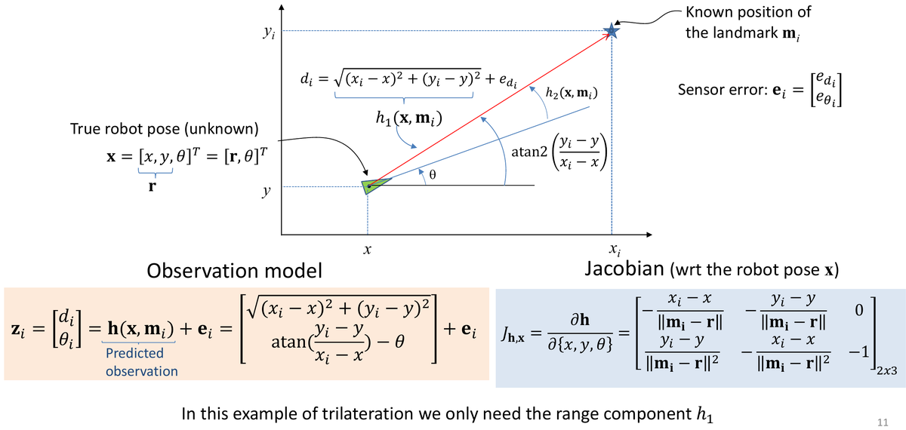

$$\mathbf{z}_i = \begin{bmatrix} d_i \\ \alpha_i \end{bmatrix} = \mathbf{h}(\mathbf{x}, \mathbf{m}_i) + \mathbf{e}_i = \begin{bmatrix} \sqrt{(x_i - x)^2 + (y_i - y)^2} \\ \operatorname{atan2}(y_i - y, x_i - x) - \theta \end{bmatrix} + \mathbf{e}_i$$

**Su jacobiano respecto a la pose** tiene una fila por cada medida y una columna por cada componente de la pose ($2 \times 3$):

$$J_{\mathbf{h},\mathbf{x}} = \frac{\partial\mathbf{h}}{\partial\{x, y, \theta\}} = \begin{bmatrix} -\dfrac{x_i - x}{\lVert\mathbf{m}_i - \mathbf{r}\rVert} & -\dfrac{y_i - y}{\lVert\mathbf{m}_i - \mathbf{r}\rVert} & 0 \\[2mm] \dfrac{y_i - y}{\lVert\mathbf{m}_i - \mathbf{r}\rVert^2} & -\dfrac{x_i - x}{\lVert\mathbf{m}_i - \mathbf{r}\rVert^2} & -1 \end{bmatrix}$$

Interpretación de los signos: si el robot avanza hacia el landmark, la distancia baja (signos negativos en la fila 1). Si el robot gira a la izquierda, el landmark parece girar a la derecha, y por eso aparece el $-1$.

> **Ejemplo resuelto (medida esperada y jacobiano).**
>
> **Enunciado.** Robot en $\mathbf{x} = [1, 2, 0{,}5]^T$ y landmark en $\mathbf{m} = (4, 6)$.
>
> **Qué buscamos y por qué.** Qué debería medir el robot desde esa pose y cómo cambia esa medida si la pose varía. Son las dos piezas que usan Gauss-Newton y el EKF.
>
> **Paso 1. Diferencias:** $\Delta x = 4 - 1 = 3$ y $\Delta y = 6 - 2 = 4$.
>
> **Paso 2. Distancia:** $d = \sqrt{3^2 + 4^2} = \sqrt{25} = 5$, y por tanto $d^2 = 25$.
>
> **Paso 3. Marcación:** $\alpha = \operatorname{atan2}(4, 3) - 0{,}5 = 0{,}9273 - 0{,}5 = 0{,}4273$ rad.
>
> **Paso 4. Jacobiano:** fila 1: $-3/5 = -0{,}6$; $-4/5 = -0{,}8$; $0$. Fila 2: $4/25 = 0{,}16$; $-3/25 = -0{,}12$; $-1$.
>
> **Resultado e interpretación.** $\mathbf{h} = [5;\ 0{,}4273]^T$ y $J = \begin{bmatrix} -0{,}6 & -0{,}8 & 0 \\ 0{,}16 & -0{,}12 & -1 \end{bmatrix}$. La primera fila es, cambiada de signo, el vector unitario que apunta al landmark: acercarse a él 1 m reduce la distancia 1 m.

### 3.4. Multilateración: posicionamiento solo con distancias

**Multilateración** (*range-only positioning*) estima la posición $\mathbf{r} = [x, y]^T$ a partir de las distancias $d_i$ a $n$ balizas conocidas. Es una especie de **GPS de interiores**. Con 3 balizas se llama **trilateración**.

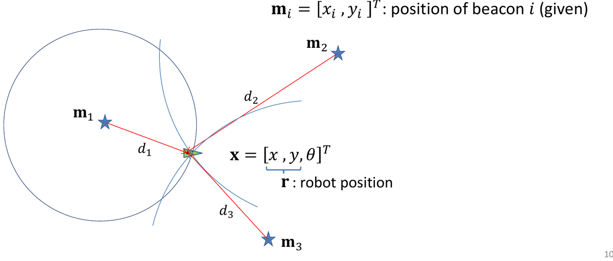

Modelo para 3 balizas, usando solo la componente de rango:

$$\mathbf{h}(\mathbf{r}) = \begin{bmatrix} \lVert\mathbf{m}_1 - \mathbf{r}\rVert \\ \lVert\mathbf{m}_2 - \mathbf{r}\rVert \\ \lVert\mathbf{m}_3 - \mathbf{r}\rVert \end{bmatrix} \qquad \mathbf{e} = \mathbf{z} - \mathbf{h}(\mathbf{r}) = \begin{bmatrix} d_1 - h_1(\mathbf{r}) \\ d_2 - h_2(\mathbf{r}) \\ d_3 - h_3(\mathbf{r}) \end{bmatrix}$$

**Las distancias no dependen de la orientación:** $\partial h_i/\partial\theta = 0$. Por tanto, **$\theta$ no es observable** con medidas solo de rango, y el estado se reduce a $\mathbf{r}$. Las derivadas son:

$$\frac{\partial h_i}{\partial x} = -\frac{x_i - x}{\lVert\mathbf{m}_i - \mathbf{r}\rVert} \qquad \frac{\partial h_i}{\partial y} = -\frac{y_i - y}{\lVert\mathbf{m}_i - \mathbf{r}\rVert}$$

**Dimensiones:** $J_{\mathbf{h}}$ es $3 \times 2$, $(J_{\mathbf{h}}^T J_{\mathbf{h}})$ es $2 \times 2$, $J_{\mathbf{h}}^T$ es $2 \times 3$, $\mathbf{e}$ es $3 \times 1$ y $\boldsymbol{\delta}$ es $2 \times 1$:

$$\boldsymbol{\delta}_{2 \times 1} = (J_{\mathbf{h}}^T J_{\mathbf{h}})^{-1}_{2 \times 2}\,(J_{\mathbf{h}}^T)_{2 \times 3}\,[\mathbf{z} - \mathbf{h}(\hat{\mathbf{r}})]_{3 \times 1}$$

> **Ejemplo resuelto (imprescindible: un paso de Gauss-Newton).**
>
> **Enunciado.** Balizas en $\mathbf{m}_1 = (0, 0)$, $\mathbf{m}_2 = (10, 0)$ y $\mathbf{m}_3 = (0, 10)$. Se miden las distancias $\mathbf{z} = [5{,}1;\ 8{,}0;\ 6{,}8]^T$ m. Estimación inicial: $\hat{\mathbf{r}}_0 = (4, 3)$.
>
> **Qué buscamos y por qué.** Cuánto hay que mover la estimación para que las distancias predichas se acerquen a las medidas.
>
> **Fórmula.** $\boldsymbol{\delta} = (J^T J)^{-1} J^T\mathbf{e}$, porque no se dan varianzas y todas las medidas valen igual. Los resultados se muestran redondeados, pero se han calculado con todos los decimales, por lo que al rehacerlo puede variar la última cifra.
>
> **Paso 1. Distancias predichas $\mathbf{h}(\hat{\mathbf{r}}_0)$:**
>
> - $h_1 = \sqrt{4^2 + 3^2} = 5$.
> - $h_2 = \sqrt{(10-4)^2 + 3^2} = \sqrt{45} = 6{,}708$.
> - $h_3 = \sqrt{4^2 + (10-3)^2} = \sqrt{65} = 8{,}062$.
>
> **Paso 2. Residuo:** $\mathbf{e} = \mathbf{z} - \mathbf{h} = [5{,}1 - 5;\ 8{,}0 - 6{,}708;\ 6{,}8 - 8{,}062]^T = [0{,}100;\ 1{,}292;\ -1{,}262]^T$.
>
> **Paso 3. Jacobiano.** Cada fila es $[-(x_i - x)/h_i,\ -(y_i - y)/h_i]$:
>
> - Baliza 1: $[-(0-4)/5,\ -(0-3)/5] = [0{,}8;\ 0{,}6]$.
> - Baliza 2: $[-(10-4)/6{,}708,\ -(0-3)/6{,}708] = [-0{,}894;\ 0{,}447]$.
> - Baliza 3: $[-(0-4)/8{,}062,\ -(10-3)/8{,}062] = [0{,}496;\ -0{,}868]$.
>
> **Paso 4. $J^T J$.** Es simétrica, así que basta con tres elementos:
>
> - Elemento $(1,1)$: $0{,}8^2 + 0{,}894^2 + 0{,}496^2 = 1{,}686$.
> - Elementos $(1,2)$ y $(2,1)$: $0{,}8 \cdot 0{,}6 - 0{,}894 \cdot 0{,}447 - 0{,}496 \cdot 0{,}868 = -0{,}351$.
> - Elemento $(2,2)$: $0{,}6^2 + 0{,}447^2 + 0{,}868^2 = 1{,}314$.
>
> Queda $J^T J = \begin{bmatrix} 1{,}686 & -0{,}351 \\ -0{,}351 & 1{,}314 \end{bmatrix}$.
>
> **Paso 5. Invertir.** Determinante: $1{,}686 \cdot 1{,}314 - 0{,}351^2 = 2{,}092$. Entonces $(J^T J)^{-1} = \begin{bmatrix} 0{,}628 & 0{,}168 \\ 0{,}168 & 0{,}806 \end{bmatrix}$.
>
> **Paso 6. $J^T\mathbf{e}$:**
>
> - Primera componente: $0{,}8 \cdot 0{,}1 - 0{,}894 \cdot 1{,}292 + 0{,}496 \cdot (-1{,}262) = -1{,}702$.
> - Segunda componente: $0{,}6 \cdot 0{,}1 + 0{,}447 \cdot 1{,}292 - 0{,}868 \cdot (-1{,}262) = 1{,}734$.
>
> **Paso 7. Incremento:** $\boldsymbol{\delta} = \begin{bmatrix} 0{,}628 \cdot (-1{,}702) + 0{,}168 \cdot 1{,}734 \\ 0{,}168 \cdot (-1{,}702) + 0{,}806 \cdot 1{,}734 \end{bmatrix} = \begin{bmatrix} -0{,}778 \\ 1{,}112 \end{bmatrix}$.
>
> **Paso 8. Actualizar:** $\hat{\mathbf{r}}_1 = (4 - 0{,}778;\ 3 + 1{,}112) = (3{,}222;\ 4{,}112)$.
>
> **Resultado e interpretación.** En un solo paso, el coste $\mathbf{e}^T\mathbf{e}$ baja de $3{,}272$ a $0{,}028$. Repitiendo el proceso:
>
> | Iteración $k$ | $\hat{\mathbf{r}}_k$ | Coste $\mathbf{e}^T\mathbf{e}$ | $\lVert\boldsymbol{\delta}\rVert$ del paso siguiente |
> |---|---|---|---|
> | 0 | $(4{,}000;\ 3{,}000)$ | $3{,}2720$ | $1{,}3570$ |
> | 1 | $(3{,}222;\ 4{,}112)$ | $0{,}0283$ | $0{,}1467$ |
> | 2 | $(3{,}121;\ 4{,}006)$ | $0{,}0038$ | $0{,}0008$ |
> | 3 | $(3{,}120;\ 4{,}006)$ | $0{,}0038$ | $\approx 0$ |
>
> Las medidas se simularon desde la posición real $(3, 4)$ con algo de ruido. La estimación final queda a unos $0{,}12$ m. El coste no llega a cero porque hay **3 ecuaciones y 2 incógnitas**, y el ruido las hace incompatibles.

### 3.5. Cuántas balizas hacen falta: la rosquilla de probabilidad

**Con una sola baliza** hay **infinitas soluciones**: la medida solo dice que el robot está en una **circunferencia** de radio $d_1$.

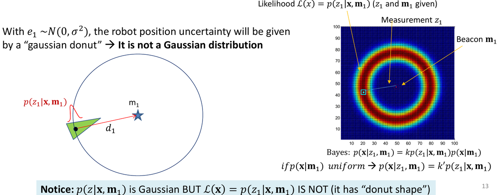

Con ruido gaussiano $e_1 \sim \mathcal{N}(0, \sigma^2)$, la incertidumbre de la posición es una «**rosquilla gaussiana**» (*gaussian donut*), que **no es una gaussiana**.

> **Una distinción importante.** $p(z_1 \mid \mathbf{x}, \mathbf{m}_1)$ **es gaussiana como función de $z_1$**, con $\mathbf{x}$ fijo. Pero la verosimilitud $\mathcal{L}(\mathbf{x}) = p(z_1 \mid \mathbf{x}, \mathbf{m}_1)$, con $z_1$ fijo y $\mathbf{x}$ variable, tiene **forma de rosquilla**. Es la distinción entre PDF y verosimilitud de L4.

Con Bayes, $p(\mathbf{x} \mid z_1, \mathbf{m}_1) = k\,p(z_1 \mid \mathbf{x}, \mathbf{m}_1)\,p(\mathbf{x} \mid \mathbf{m}_1)$. Si el prior $p(\mathbf{x} \mid \mathbf{m}_1)$ es **uniforme**, la posterior es proporcional a la verosimilitud: $p(\mathbf{x} \mid z_1, \mathbf{m}_1) = k'p(z_1 \mid \mathbf{x}, \mathbf{m}_1)$.

**Con dos balizas**, si las medidas son condicionalmente independientes, la posterior es el **producto de las dos rosquillas**, que deja **dos manchas** en los cortes de las circunferencias:

$$p(\mathbf{x} \mid z_1, z_2, M) = k'p(z_1, z_2 \mid \mathbf{x}, M) = k'p(z_1 \mid \mathbf{x}, M)\,p(z_2 \mid \mathbf{x}, M)$$

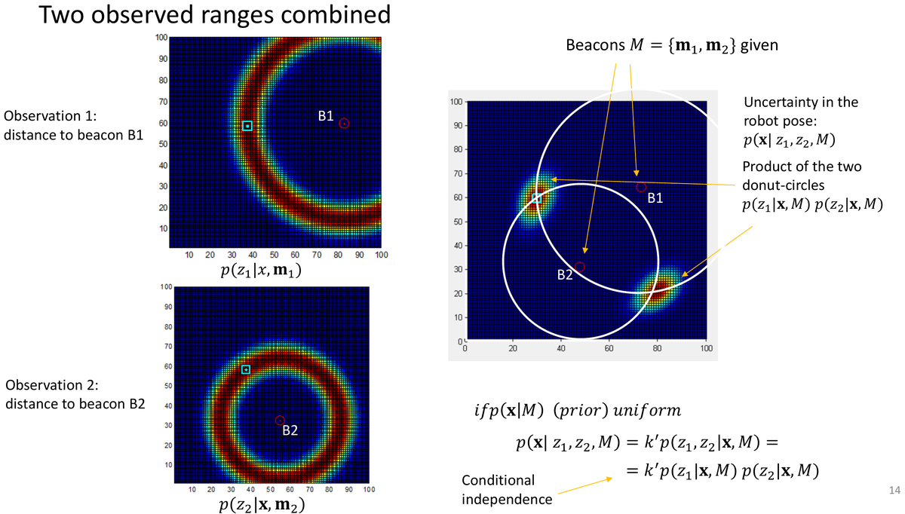

> **Ejemplo resuelto (la rosquilla y su producto, con números).**
>
> **Enunciado.** Baliza $\mathbf{m}_1 = (0, 0)$, medida $z_1 = 5$ m, $\sigma = 0{,}5$ m. Después se añade $\mathbf{m}_2 = (6, 0)$ con $z_2 = 5$ m.
>
> **Qué buscamos y por qué.** Ver qué posiciones son compatibles con una medida y con dos.
>
> **Fórmula.** Verosimilitud sin normalizar: $\mathcal{L}(\mathbf{r}) = \exp\left(-\dfrac{(z - \lVert\mathbf{m} - \mathbf{r}\rVert)^2}{2\sigma^2}\right)$. Con dos medidas, se multiplican.
>
> **Pasos.** Por ejemplo, para $(4, 4)$: $d_1 = \sqrt{32} = 5{,}657$, $e = 5 - 5{,}657 = -0{,}657$ y $\mathcal{L}_1 = \exp(-0{,}657^2 / 0{,}5) = e^{-0{,}863} = 0{,}422$. Con el resto:
>
> | Posición | $d_1$ | $\mathcal{L}_1$ | $d_2$ | $\mathcal{L}_2$ | $\mathcal{L}_1\mathcal{L}_2$ |
> |---|---|---|---|---|---|
> | $(3, 4)$ | $5$ | $1$ | $5$ | $1$ | $1$ |
> | $(3, -4)$ | $5$ | $1$ | $5$ | $1$ | $1$ |
> | $(5, 0)$ | $5$ | $1$ | $1$ | $1{,}3 \cdot 10^{-14}$ | $\approx 0$ |
> | $(0, 5)$ | $5$ | $1$ | $7{,}81$ | $1{,}4 \cdot 10^{-7}$ | $\approx 0$ |
> | $(4, 4)$ | $5{,}66$ | $0{,}42$ | $4{,}47$ | $0{,}57$ | $0{,}24$ |
>
> **Resultado e interpretación.** Con una baliza, $(3, 4)$, $(5, 0)$ y $(0, 5)$ son **igual de buenas**: todas están en la circunferencia. La segunda baliza descarta casi todo y deja **dos** máximos, $(3, 4)$ y $(3, -4)$. Hace falta una tercera baliza **no alineada** con las otras dos, o información previa, para decidir.

| Balizas (solo rango, en 2D) | Soluciones |
|---|---|
| 1 | Infinitas (circunferencia) |
| 2 | 2 (cortes de dos circunferencias) |
| 3 no alineadas | 1 |

### 3.6. Características de mínimos cuadrados

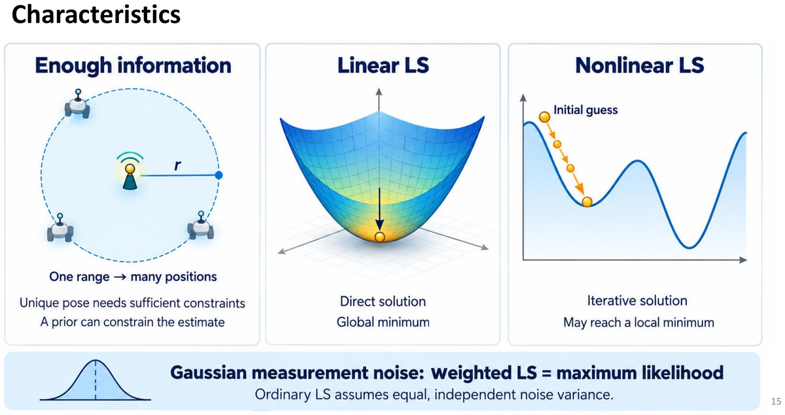

| Aspecto | Qué hay que recordar |
|---|---|
| **Información suficiente** | Una pose única requiere **suficientes restricciones**. Un **prior** también puede restringir la estimación. |
| **LS lineal** | **Solución directa** y **mínimo global**. El coste tiene forma de cuenco. |
| **LS no lineal** | **Solución iterativa**, que depende de la estimación inicial y **puede acabar en un mínimo local**. |
| **Ruido gaussiano** | **LS ponderado = máxima verosimilitud**. El LS ordinario supone varianza igual e independiente. |

> **Idea clave:** Gauss-Newton convierte un problema no lineal en una serie de problemas lineales, y hay que partir de una estimación razonable. En 2D y solo con distancias hacen falta **3 balizas no alineadas**, y la orientación no se puede obtener.

> **En las prácticas:** el notebook opcional 5.1 programa justo esto (LS, WLS y Gauss-Newton con balizas). No hay que entregarlo, pero sus fórmulas son las de esta sección.

---

## 4. Registro de conjuntos de puntos

### 4.1. Qué es registrar

**Registrar** es **superponer** un conjunto de puntos observados sobre otro, hasta encontrar la transformación rígida (rotación $R$ y traslación $\mathbf{t}$) que mejor los alinea.

| Se registra contra... | Qué se obtiene | Nombre |
|---|---|---|
| Un **mapa global** | La pose global de la observación | **Localización global** |
| Un **conjunto de puntos anterior** | La pose relativa entre ambos | **Odometría** (odometría visual, por ejemplo) |

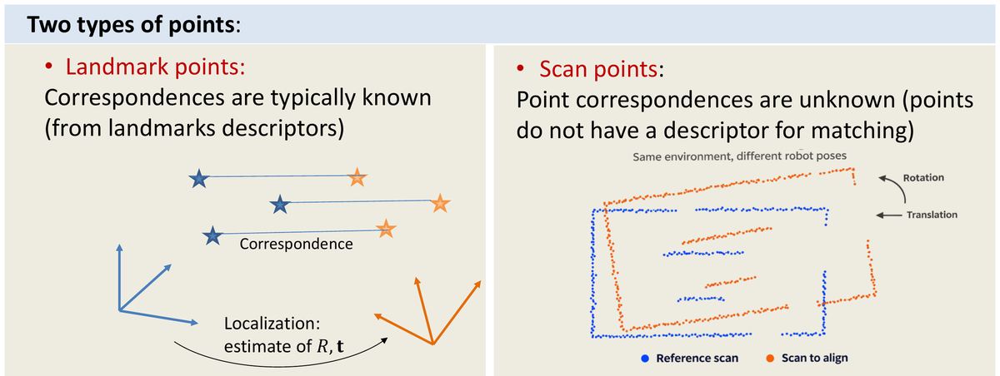

| Tipo de punto | Correspondencias | Por qué | Método |
|---|---|---|---|
| **Landmark** | **Conocidas** en general | Los landmarks tienen **descriptores** para emparejarlos | Gauss-Newton o forma cerrada (SVD) |
| **Scan** | **Desconocidas** | Un punto de láser no tiene descriptor | **ICP** |

### 4.2. Puntos landmark: correspondencias conocidas

Partimos de dos conjuntos, $\{\mathbf{m}_i\}_{i=1}^N$ (en el mapa) y $\{\mathbf{q}_i\}_{i=1}^N$ (observados desde el robot, en su marco), con cada pareja $(\mathbf{m}_i, \mathbf{q}_i)$ **en correspondencia**.

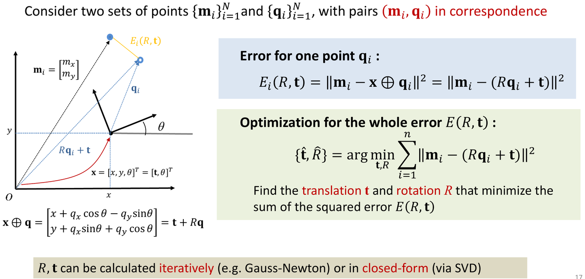

**Paso al marco del mapa.** Con $\mathbf{x} = [x, y, \theta]^T = [\mathbf{t}, \theta]^T$, se usa la composición de L3:

$$\mathbf{x} \oplus \mathbf{q} = \begin{bmatrix} x + q_x\cos\theta - q_y\sin\theta \\ y + q_x\sin\theta + q_y\cos\theta \end{bmatrix} = \mathbf{t} + R\mathbf{q}$$

**Error de un punto** y **problema completo**:

$$E_i(R, \mathbf{t}) = \lVert\mathbf{m}_i - \mathbf{x} \oplus \mathbf{q}_i\rVert^2 = \lVert\mathbf{m}_i - (R\mathbf{q}_i + \mathbf{t})\rVert^2$$

$$\{\hat{\mathbf{t}}, \hat{R}\} = \arg\min_{\mathbf{t}, R}\sum_{i=1}^{n}\lVert\mathbf{m}_i - (R\mathbf{q}_i + \mathbf{t})\rVert^2$$

$R$ y $\mathbf{t}$ se pueden calcular **iterativamente** (por ejemplo, Gauss-Newton) o en **forma cerrada** (mediante SVD).

> **Ejemplo resuelto (evaluar el error de varias poses).**
>
> **Enunciado.** Puntos del mapa: $\mathbf{m}_1 = (2, 2)$, $\mathbf{m}_2 = (0, 1)$, $\mathbf{m}_3 = (1, 3)$. Sus observaciones, en el marco del robot: $\mathbf{q}_1 = (1, 0)$, $\mathbf{q}_2 = (0, 2)$, $\mathbf{q}_3 = (2, 1)$. Compara tres poses candidatas: A $= (2, 1, 90°)$, B $= (2, 1, 0°)$ y C $= (2;\ 1{,}5;\ 90°)$.
>
> **Qué buscamos y por qué.** Cuál encaja mejor. Es lo que mide el coste que se minimiza al registrar.
>
> **Fórmula.** $E = \sum_i\lVert\mathbf{m}_i - (R\mathbf{q}_i + \mathbf{t})\rVert^2$. Con $\theta = 90°$: $\cos\theta = 0$, $\sin\theta = 1$ y $R\mathbf{q} = (-q_y, q_x)$. Con $\theta = 0°$: $R\mathbf{q} = \mathbf{q}$.
>
> **Candidata A ($\mathbf{t} = (2, 1)$, $90°$):**
>
> - $\mathbf{q}_1$: $(0, 1) + (2, 1) = (2, 2)$. Error frente a $\mathbf{m}_1$: 0.
> - $\mathbf{q}_2$: $(-2, 0) + (2, 1) = (0, 1)$. Error: 0.
> - $\mathbf{q}_3$: $(-1, 2) + (2, 1) = (1, 3)$. Error: 0.
> - Total: $E_A = 0$.
>
> **Candidata B ($\mathbf{t} = (2, 1)$, $0°$):**
>
> - $\mathbf{q}_1$: $(3, 1)$; diferencia con $\mathbf{m}_1$: $(-1, 1)$; error: $1 + 1 = 2$.
> - $\mathbf{q}_2$: $(2, 3)$; diferencia con $\mathbf{m}_2$: $(-2, -2)$; error: $4 + 4 = 8$.
> - $\mathbf{q}_3$: $(4, 2)$; diferencia con $\mathbf{m}_3$: $(-3, 1)$; error: $9 + 1 = 10$.
> - Total: $E_B = 20$.
>
> **Candidata C ($\mathbf{t} = (2;\ 1{,}5)$, $90°$):** todos los puntos quedan $0{,}5$ m por encima de su pareja, así que cada error vale $0{,}25$ y $E_C = 0{,}75$.
>
> **Resultado e interpretación.** La mejor es A, con error nulo. Un error de solo 0,5 m en $y$ cuesta $0{,}75$, mientras que equivocarse 90° en la orientación cuesta 20: los errores de orientación se **amplifican** con la distancia del punto al robot.

> **Para ampliar (no sale en las diapositivas).** Si la rotación ya se conoce, la traslación óptima tiene forma cerrada: $\hat{\mathbf{t}} = \bar{\mathbf{m}} - R\bar{\mathbf{q}}$, donde $\bar{\mathbf{m}}$ y $\bar{\mathbf{q}}$ son los **centroides** de cada conjunto. En el ejemplo, $\bar{\mathbf{m}} = (1, 2)$, $\bar{\mathbf{q}} = (1, 1)$ y $R\bar{\mathbf{q}} = (-1, 1)$, de donde $\hat{\mathbf{t}} = (2, 1)$. La SVD se usa para hallar la rotación.

### 4.3. Puntos de scan: el algoritmo ICP

Los puntos de un scan **no tienen descriptor**: no sabemos qué punto corresponde a cuál. **ICP** (*Iterated Closest Point*) resuelve las dos cosas **alternando**.

**Algoritmo ICP.** Se repite hasta converger:

1. **Emparejar:** para cada $\mathbf{q}_i$ de un conjunto, formar pareja con el **punto más cercano** $\mathbf{m}_j$ del otro.
2. **Alinear:** resolver un paso de Gauss-Newton para minimizar
$$E(R, \mathbf{t}) = \sum_{i=1}^{n}\lVert\mathbf{m}_j - R\mathbf{q}_i - \mathbf{t}\rVert^2$$

**Convergencia:** cuando $R$ y $\mathbf{t}$ calculados en el paso 2 son despreciables, o cuando las parejas del paso 1 no cambian.

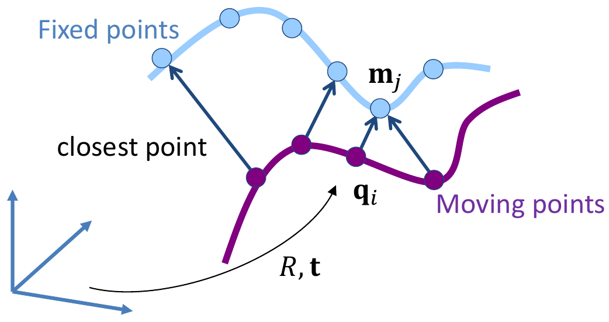

| Propiedad de ICP | Qué significa |
|---|---|
| **Converge a un mínimo local** | Está garantizado que converge, pero **no** al mínimo global |
| **Lento** | Buscar los puntos más cercanos es lo más costoso |
| **Preprocesado** | Se acelera con estructuras como el **KD-tree** |
| **Uso** | Registrar scans láser o nubes 3D de imágenes RGB-D |

> **Ejemplo resuelto (ICP a mano, solo con traslación en 1D).**
>
> **Enunciado.** Puntos fijos: $m = \{1, 3, 6\}$. Puntos móviles: $q = \{2{,}4;\ 4{,}0;\ 7{,}2\}$. Aplica ICP buscando solo una traslación $t$.
>
> **Qué buscamos y por qué.** Cómo avanza el algoritmo sin saber las correspondencias.
>
> **Fórmula.** Con $R$ fija, derivar $E = \sum(m_j - q_i - t)^2$ e igualar a cero da que $t$ es **la media de las diferencias**: $t = \frac{1}{n}\sum(m_j - q_i)$.
>
> **Iteración 1.**
>
> - Emparejar: $2{,}4 \to 3$ (dista $0{,}6$; el 1 dista $1{,}4$). $4{,}0 \to 3$. $7{,}2 \to 6$.
> - Error: $0{,}6^2 + 1{,}0^2 + 1{,}2^2 = 2{,}80$.
> - Alinear: $t = [(3 - 2{,}4) + (3 - 4) + (6 - 7{,}2)] / 3 = (0{,}6 - 1 - 1{,}2) / 3 = -0{,}533$.
> - Nuevos puntos: $\{1{,}867;\ 3{,}467;\ 6{,}667\}$.
>
> **Iteración 2.**
>
> - Emparejar: $1{,}867 \to 1$ (dista $0{,}867$; el 3 dista $1{,}133$). **La pareja ha cambiado.** $3{,}467 \to 3$. $6{,}667 \to 6$.
> - Error: $0{,}867^2 + 0{,}467^2 + 0{,}667^2 = 1{,}413$.
> - Alinear: $t = (-0{,}867 - 0{,}467 - 0{,}667) / 3 = -0{,}667$.
> - Nuevos puntos: $\{1{,}2;\ 2{,}8;\ 6{,}0\}$.
>
> **Iteración 3.**
>
> - Emparejar: $1{,}2 \to 1$; $2{,}8 \to 3$; $6{,}0 \to 6$. **Las parejas no cambian.**
> - Error: $0{,}2^2 + 0{,}2^2 + 0 = 0{,}08$.
> - Alinear: $t = (-0{,}2 + 0{,}2 + 0) / 3 = 0$. Converge.
>
> **Resultado e interpretación.** La traslación total es $-0{,}533 - 0{,}667 = -1{,}2$. Las primeras parejas pueden estar mal, pero **mejoran según se alinean los puntos**. El error residual de $0{,}08$ se debe a que los conjuntos no coinciden exactamente.

> **Ejemplo resuelto (ICP se queda atascado en un mínimo local).**
>
> **Enunciado.** $m = \{0, 4, 8\}$ y $q = \{5, 9, 13\}$. La solución real es $t = -5$, con error 0.
>
> **Qué buscamos y por qué.** Ver qué pasa si el punto de partida está lejos.
>
> **Iteración 1.** Parejas: $5 \to 4$; $9 \to 8$; $13 \to 8$. $t = (-1 - 1 - 5) / 3 = -2{,}333$. Nuevos puntos: $\{2{,}667;\ 6{,}667;\ 10{,}667\}$.
>
> **Iteración 2.** Parejas: $2{,}667 \to 4$; $6{,}667 \to 8$; $10{,}667 \to 8$. Diferencias: $1{,}333$, $1{,}333$ y $-2{,}667$. $t = 0$: **se detiene**.
>
> **Resultado e interpretación.** Termina con $E = 1{,}333^2 + 1{,}333^2 + 2{,}667^2 = 10{,}67$, muy lejos del error 0 alcanzable. Por eso ICP necesita una **buena estimación inicial**, y en entornos repetitivos, como un pasillo con puertas iguales, es especialmente delicado.

> **Idea clave:** con correspondencias conocidas se registra directamente. Sin ellas, ICP alterna **emparejar** y **alinear**, pero solo garantiza un mínimo local.

---

## 5. Filtrado bayesiano y filtro de rejilla

### 5.1. De una pose a una creencia

Hasta ahora buscábamos una sola pose $\hat{\mathbf{x}}$. El filtrado bayesiano mantiene una **creencia** (*belief*) sobre todas las poses posibles y la actualiza en un ciclo:

$$bel(\mathbf{x}_t) = p(\mathbf{x}_t \mid \mathbf{u}_{1:t}, \mathbf{z}_{1:t})$$

**Se repite: predecir con el movimiento → actualizar con las medidas.**

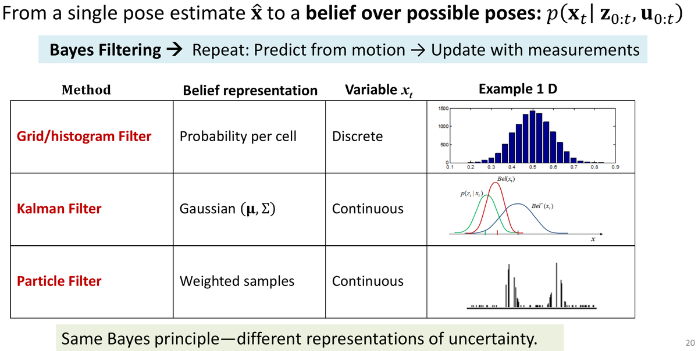

| Método | Representación de la creencia | Variable $\mathbf{x}_t$ |
|---|---|---|
| **Filtro de rejilla o histograma** | Probabilidad por celda | Discreta |
| **Filtro de Kalman** | Gaussiana $(\boldsymbol{\mu}, \Sigma)$ | Continua |
| **Filtro de partículas** | Muestras con peso | Continua |

**Mismo principio de Bayes, distintas formas de representar la incertidumbre.** El ciclo tiene dos pasos, y todos los filtros de este tema los comparten:

$$\underbrace{bel(\mathbf{x}_{t-1})}_{\text{posterior anterior}} \xrightarrow{\ p(\mathbf{x}_t \mid \mathbf{x}_{t-1}, \mathbf{u}_t)\ } \underbrace{\overline{bel}(\mathbf{x}_t)}_{\text{predicción (prior)}} \xrightarrow{\ p(\mathbf{z}_t \mid \mathbf{x}_t)\ } \underbrace{bel(\mathbf{x}_t)}_{\text{nueva posterior}}$$

| Paso | Qué lo produce | Regla | Efecto típico en la incertidumbre |
|---|---|---|---|
| **Predicción** | Movimiento del robot | Probabilidad total | **La extiende** |
| **Corrección** | Observación | Regla de Bayes | **La reduce** |

### 5.2. El filtro de rejilla

Se divide el mapa en celdas y se guarda **una probabilidad por celda**, $p_i = P(X = \text{celda}_i)$, con $\sum_i p_i = 1$. El conjunto forma un **histograma** que representa la creencia del robot. Admite **cualquier forma** de distribución, también con varios picos.

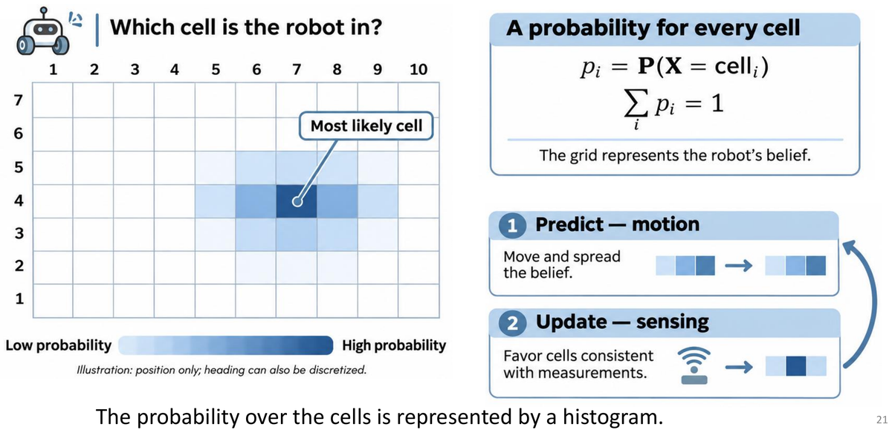

> **Ejemplo resuelto (cuánto ocupa una rejilla).**
>
> **Enunciado.** Mapa de $20 \times 20$ m, con celdas de 10 cm y orientación discretizada cada 5°.
>
> **Qué buscamos y por qué.** Cuántas probabilidades hay que guardar. Es el principal coste de este filtro.
>
> **Pasos.** Celdas en $x$: $20 / 0{,}1 = 200$. Celdas en $y$: 200. Orientaciones: $360 / 5 = 72$. Total: $200 \cdot 200 \cdot 72 = 2\,880\,000$.
>
> **Resultado e interpretación.** Casi 3 millones de valores para un mapa modesto. Reducir el tamaño de celda a la mitad en $x$ e $y$ cuadruplica la cuenta: la rejilla crece muy rápido con la resolución y la dimensión del estado.

### 5.3. Repaso de probabilidad con una rejilla

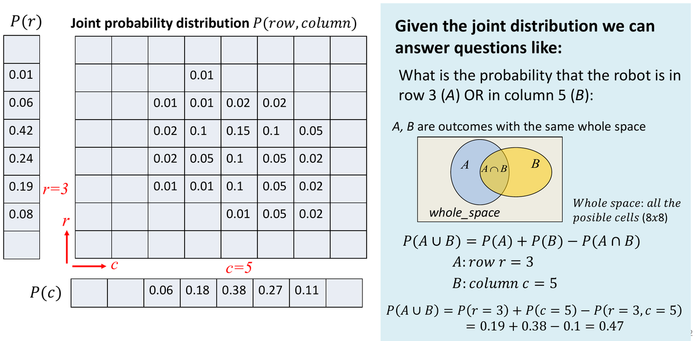

La tabla da la **distribución conjunta** $P(\text{fila}, \text{columna})$. Las **marginales** $P(r)$ y $P(c)$ son las sumas por filas y por columnas. Las filas se numeran **desde abajo**, como indica el eje $r$ de la figura.

> **Ejemplo resuelto (probabilidad de una unión).**
>
> **Enunciado.** Con la tabla de la figura, ¿qué probabilidad hay de que el robot esté en la fila 3 **o** en la columna 5?
>
> **Qué buscamos y por qué.** La probabilidad de una unión de sucesos, $A \cup B$. No basta con sumar: las celdas comunes se contarían dos veces.
>
> **Fórmula.** $P(A \cup B) = P(A) + P(B) - P(A \cap B)$, con $A$: fila $r = 3$ y $B$: columna $c = 5$.
>
> **Paso 1. Marginal de la fila 3:** $0{,}01 + 0{,}01 + 0{,}1 + 0{,}05 + 0{,}02 = 0{,}19$.
>
> **Paso 2. Marginal de la columna 5:** $0{,}01 + 0{,}1 + 0{,}1 + 0{,}15 + 0{,}02 = 0{,}38$.
>
> **Paso 3. Conjunta en el cruce:** $P(r = 3, c = 5) = 0{,}1$.
>
> **Paso 4. Aplicar la fórmula:** $0{,}19 + 0{,}38 - 0{,}1 = 0{,}47$.
>
> **Resultado e interpretación.** $P = 0{,}47$. Sumando sin restar saldría $0{,}57$, porque la celda del cruce contaría dos veces. Con la misma tabla se obtiene la condicional, por ejemplo $P(c = 5 \mid r = 3) = 0{,}1 / 0{,}19 = 0{,}526$: si sabemos que está en esa fila, la columna 5 es la más probable.

### 5.4. Ejemplo completo: un robot en un pasillo

Es el ejemplo de las diapositivas, y un candidato claro a pregunta de examen.

**Situación.** Un robot está en un pasillo de baldosas, $x \in \{0, 1, \ldots, 7\}$, con esta creencia inicial:

$$bel(x_{t-1}) = [0{,}2;\ 0{,}5;\ 0{,}2;\ 0{,}1;\ 0;\ 0;\ 0;\ 0]$$

**Modelo de movimiento.** Se le ordena $u = 1$ celda, pero el movimiento real es $\tilde{u} = 1 + e$, con error $e \in \{-1, 0, 1\}$ y probabilidades $0{,}2$, $0{,}6$ y $0{,}2$:

| Movimiento real $\tilde{u}$ | 0 (no se mueve) | 1 (lo ordenado) | 2 (se pasa) |
|---|---|---|---|
| $P(\tilde{u} \mid u = 1)$ | 0,2 | 0,6 | 0,2 |

**Modelo del sensor.** Observa su celda con error: $z_t = x_t + e_t$, con el mismo reparto $0{,}2$, $0{,}6$ y $0{,}2$.

> **Ejemplo resuelto (imprescindible: predicción).**
>
> **Qué buscamos y por qué.** La creencia tras moverse. Cada celda puede recibir probabilidad desde **varias** celdas anteriores.
>
> **Fórmula** (probabilidad total): $\overline{bel}(x_t) = \sum_{x_{t-1}} P(x_t \mid x_{t-1}, u_t)\,bel(x_{t-1})$.
>
> **Cómo se calcula cada celda.** Para llegar a la celda $k$: se estaba en $k$ y no se movió (0,2), se estaba en $k - 1$ y avanzó una (0,6), o se estaba en $k - 2$ y avanzó dos (0,2).
>
> | Celda | Cuenta | $\overline{bel}$ |
> |---|---|---|
> | 0 | $0{,}2 \cdot bel(0) = 0{,}2 \cdot 0{,}2$ | $0{,}04$ |
> | 1 | $0{,}2 \cdot bel(1) + 0{,}6 \cdot bel(0) = 0{,}10 + 0{,}12$ | $0{,}22$ |
> | 2 | $0{,}2 \cdot bel(2) + 0{,}6 \cdot bel(1) + 0{,}2 \cdot bel(0) = 0{,}04 + 0{,}30 + 0{,}04$ | $0{,}38$ |
> | 3 | $0{,}2 \cdot bel(3) + 0{,}6 \cdot bel(2) + 0{,}2 \cdot bel(1) = 0{,}02 + 0{,}12 + 0{,}10$ | $0{,}24$ |
> | 4 | $0{,}2 \cdot bel(4) + 0{,}6 \cdot bel(3) + 0{,}2 \cdot bel(2) = 0 + 0{,}06 + 0{,}04$ | $0{,}10$ |
> | 5 | $0{,}2 \cdot bel(5) + 0{,}6 \cdot bel(4) + 0{,}2 \cdot bel(3) = 0 + 0 + 0{,}02$ | $0{,}02$ |
> | 6 y 7 | Solo reciben de celdas con probabilidad 0 | $0$ |
>
> **Resultado e interpretación.** $\overline{bel} = [0{,}04;\ 0{,}22;\ 0{,}38;\ 0{,}24;\ 0{,}10;\ 0{,}02;\ 0;\ 0]$. Suma 1, como debe. No hace falta normalizar: la probabilidad total conserva la masa. El pico baja de $0{,}5$ a $0{,}38$: **el movimiento extiende la incertidumbre**.

> **Ejemplo resuelto (imprescindible: corrección).**
>
> **Enunciado.** El sensor mide $z = 3$.
>
> **Qué buscamos y por qué.** La creencia tras incorporar la medida. Las celdas compatibles con ella deben ganar peso.
>
> **Fórmula** (Bayes): $bel(x_t) = \eta\,P(z_t \mid x_t)\,\overline{bel}(x_t)$, donde $\eta$ es la constante que hace que todo sume 1.
>
> **Paso 1. Verosimilitud** de medir 3 desde cada celda: $P(z = 3 \mid x = 3) = 0{,}6$ (sin error); $P(z = 3 \mid x = 2) = 0{,}2$ (error $+1$); $P(z = 3 \mid x = 4) = 0{,}2$ (error $-1$). En las demás celdas vale 0.
>
> **Paso 2. Multiplicar por la predicción y normalizar:**
>
> | Celda | $\overline{bel}$ | $P(z = 3 \mid x)$ | Producto | $bel = \text{producto} / 0{,}24$ |
> |---|---|---|---|---|
> | 2 | $0{,}38$ | $0{,}2$ | $0{,}076$ | $0{,}317$ |
> | 3 | $0{,}24$ | $0{,}6$ | $0{,}144$ | $0{,}600$ |
> | 4 | $0{,}10$ | $0{,}2$ | $0{,}020$ | $0{,}083$ |
> | Resto | | $0$ | $0$ | $0$ |
> | **Suma** | | | $\mathbf{0{,}240}$ | $\mathbf{1}$ |
>
> La suma de los productos es $0{,}24$, así que $\eta = 1 / 0{,}24 = 4{,}167$.
>
> **Resultado e interpretación.** $bel = [0;\ 0;\ 0{,}317;\ 0{,}600;\ 0{,}083;\ 0;\ 0;\ 0]$. La celda 2 era la más probable tras predecir, pero la medida favorece la 3. **La observación reduce la incertidumbre**: el pico sube a $0{,}6$.

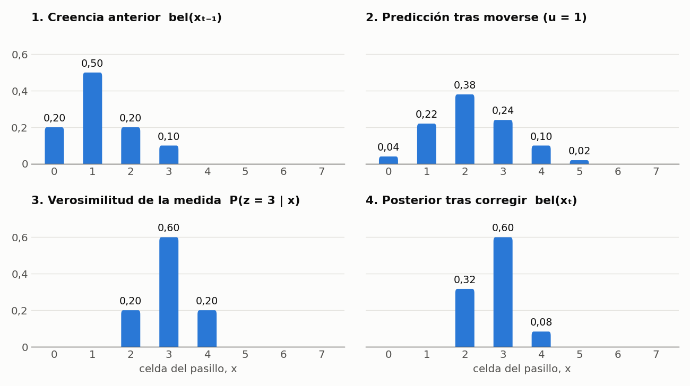

**Cómo cambia la incertidumbre en este ejemplo:**

| Creencia | Media | Varianza | Probabilidad máxima |
|---|---|---|---|
| Anterior | $1{,}20$ | $0{,}76$ | $0{,}50$ |
| Tras predecir | $2{,}20$ | $1{,}16$ | $0{,}38$ |
| Tras corregir | $2{,}77$ | $0{,}35$ | $0{,}60$ |

La media avanza justo 1 celda al predecir, porque el error del movimiento tiene media cero. La varianza **sube** al moverse (de $0{,}76$ a $1{,}16$) y **baja** al medir (de $1{,}16$ a $0{,}35$). Se comprueba además que predecir **suma varianzas**: $0{,}76 + 0{,}4 = 1{,}16$, donde $0{,}4$ es la varianza del error de movimiento ($0{,}2 \cdot 1 + 0{,}2 \cdot 1$).

> **Ojo con una diapositiva.** En la diapositiva 25 («*Conceptual idea*») las barras de la posterior están dibujadas en las celdas 3, 4 y 5, con un término $\eta \cdot 0{,}2 \cdot 0{,}2$. Lo correcto es lo de la diapositiva anterior y lo de este resumen: celdas **2, 3 y 4**, con $\eta \cdot 0{,}2 \cdot 0{,}1$. Con los valores de la diapositiva 25 no saldría $\eta = 1/0{,}24$.

**Receta para el examen:**

1. **Predicción:** para cada celda, sumar «probabilidad de la celda de origen × probabilidad de ese movimiento». No se normaliza.
2. **Corrección:** multiplicar celda a celda por la verosimilitud de la medida.
3. **Normalizar:** dividir entre la suma.
4. **Comprobar** que todo suma 1.

> **Idea clave:** el filtro de rejilla es Bayes «a la vista». Admite cualquier forma de distribución, a cambio de un coste que crece muy rápido con la resolución y con la dimensión.

---

## 6. El filtro de Kalman

### 6.1. De Bayes a Kalman

El filtro de Bayes para localización (llamado **localización de Markov**) es:

$$bel(\mathbf{x}_t) = \eta\,\underbrace{p(\mathbf{z}_t \mid \mathbf{x}_t)}_{\text{corrección}}\underbrace{\int p(\mathbf{x}_t \mid \mathbf{u}_t, \mathbf{x}_{t-1})\,bel(\mathbf{x}_{t-1})\,d\mathbf{x}_{t-1}}_{\text{predicción (prior)}}$$

| Paso | Calcula | Fórmula | Regla |
|---|---|---|---|
| **Predicción** | El prior | $\overline{bel}(\mathbf{x}_t) = \int p(\mathbf{x}_t \mid \mathbf{u}_t, \mathbf{x}_{t-1})\,bel(\mathbf{x}_{t-1})\,d\mathbf{x}_{t-1}$ | Probabilidad total |
| **Corrección** | La posterior | $bel(\mathbf{x}_t) = \eta\,p(\mathbf{z}_t \mid \mathbf{x}_t)\,\overline{bel}(\mathbf{x}_t)$ | Bayes |

**La idea de Kalman.** En general, esa integral no se puede resolver. Pero si se cumplen **dos condiciones**, todas las distribuciones son gaussianas y **basta con guardar media y covarianza**:

1. Los modelos de movimiento y de medida son **lineales**.
2. Todas las PDF son **gaussianas**: $p(\mathbf{x}_t \mid \mathbf{u}_t, \mathbf{x}_{t-1})$, $p(\mathbf{z}_t \mid \mathbf{x}_t)$ y $bel(\mathbf{x}_0)$.

### 6.2. El modelo

$$\mathbf{x}_t = A_t\mathbf{x}_{t-1} + B_t\mathbf{u}_t + \boldsymbol{\varepsilon}_t \qquad \boldsymbol{\varepsilon}_t \sim \mathcal{N}(\mathbf{0}, R_t)$$

$$\mathbf{z}_t = C_t\mathbf{x}_t + \boldsymbol{\delta}_t \qquad \boldsymbol{\delta}_t \sim \mathcal{N}(\mathbf{0}, Q_t)$$

Con estado de dimensión $n$, comando de dimensión $l$ y medida de dimensión $k$:

| Símbolo | Dimensión | Qué representa |
|---|---|---|
| $A_t$ | $n \times n$ | Cómo evoluciona el estado de $t - 1$ a $t$ **sin comando** |
| $B_t$ | $n \times l$ | Cómo cambia el estado el comando $\mathbf{u}_t$ |
| $C_t$ | $k \times n$ | Cómo se relaciona el estado con la observación |
| $\boldsymbol{\varepsilon}_t$, $R_t$ | $n \times 1$, $n \times n$ | Ruido del **movimiento** y su covarianza |
| $\boldsymbol{\delta}_t$, $Q_t$ | $k \times 1$, $k \times k$ | Ruido de la **medida** y su covarianza |

Los dos ruidos se suponen **independientes, de media cero y gaussianos**.

> **Para no confundirlos:** $R$ = ruido de **R**ecorrido (movimiento). $Q$ = ruido de lo que se **mide**. Ojo también: en la sección 2, $Q$ ya era la covarianza de la medida, igual que aquí.

### 6.3. La predicción

**Intuición.** Se mueve la media según el comando. La incertidumbre tiene dos orígenes: la que ya había, arrastrada por el movimiento, y la que añade el propio movimiento.

$$\bar{\boldsymbol{\mu}}_t = A_t\boldsymbol{\mu}_{t-1} + B_t\mathbf{u}_t \qquad\qquad \bar\Sigma_t = \underbrace{A_t\Sigma_{t-1}A_t^T}_{\text{incertidumbre anterior propagada}} + \underbrace{R_t}_{\text{ruido del movimiento}}$$

**De dónde salen.** Es la regla de cómo cambia una gaussiana con una **transformación lineal**, que la conserva gaussiana y propaga la covarianza **de forma exacta**:

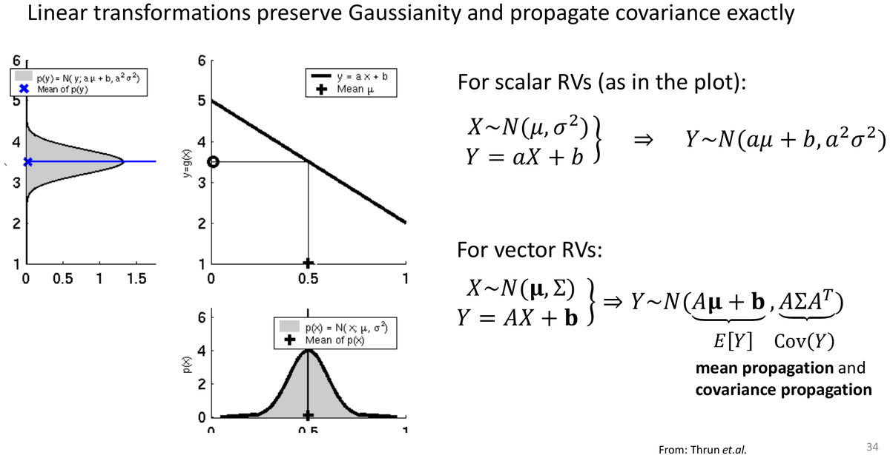

| | Si... | Entonces... |
|---|---|---|
| **Escalar** | $X \sim \mathcal{N}(\mu, \sigma^2)$, $Y = aX + b$ | $Y \sim \mathcal{N}(a\mu + b,\ a^2\sigma^2)$ |
| **Vector** | $X \sim \mathcal{N}(\boldsymbol{\mu}, \Sigma)$, $Y = AX + \mathbf{b}$ | $Y \sim \mathcal{N}(A\boldsymbol{\mu} + \mathbf{b},\ A\Sigma A^T)$ |

> **Ejemplo resuelto (propagar una gaussiana).**
>
> **Enunciado.** (a) $X \sim \mathcal{N}(2;\ 0{,}25)$ e $Y = -3X + 5$. (b) $X \sim \mathcal{N}(\boldsymbol{\mu}, \Sigma)$, con $\Sigma = \operatorname{diag}(1, 2)$, e $Y = AX$, con $A = \begin{bmatrix} 1 & 1 \\ 0 & 1 \end{bmatrix}$.
>
> **Qué buscamos y por qué.** La distribución resultante. Es justo lo que hace el paso de predicción.
>
> **Caso (a).** Media: $-3 \cdot 2 + 5 = -1$. Varianza: $(-3)^2 \cdot 0{,}25 = 2{,}25$. Observa que **el signo no afecta a la varianza** y que **la $b$ tampoco**: desplazar no añade incertidumbre.
>
> **Caso (b).** $A\Sigma = \begin{bmatrix} 1 & 2 \\ 0 & 2 \end{bmatrix}$, y multiplicando por $A^T = \begin{bmatrix} 1 & 0 \\ 1 & 1 \end{bmatrix}$ queda $A\Sigma A^T = \begin{bmatrix} 3 & 2 \\ 2 & 2 \end{bmatrix}$.
>
> **Resultado e interpretación.** Aunque las componentes de $X$ eran independientes (diagonal), $Y$ tiene **correlación** (el 2 fuera de la diagonal), porque $Y_1$ depende de $X_2$. Por eso predecir suele correlar el estado.

### 6.4. La corrección

**Intuición.** Se compara lo que se mide con lo que se esperaba medir, y se mueve la estimación en proporción a esa diferencia. Cuánto se mueve depende de en quién se confía más.

$$K_t = \bar\Sigma_t C_t^T(C_t\bar\Sigma_t C_t^T + Q_t)^{-1}$$

$$\boldsymbol{\mu}_t = \bar{\boldsymbol{\mu}}_t + K_t(\mathbf{z}_t - C_t\bar{\boldsymbol{\mu}}_t)$$

$$\Sigma_t = (I - K_t C_t)\bar\Sigma_t$$

| Término | Nombre | Significado |
|---|---|---|
| $\mathbf{z}_t - C_t\bar{\boldsymbol{\mu}}_t$ | **Innovación** | Discrepancia entre lo observado y lo predicho |
| $C_t\bar\Sigma_t C_t^T + Q_t$ | **Covarianza de la innovación** | Incertidumbre de la predicción, llevada al espacio de la medida, más la del sensor |
| $K_t$ | **Ganancia de Kalman** ($n \times k$) | **Equilibra** la incertidumbre de la predicción frente a la de la medida |

La corrección **no aumenta** la covarianza predicha: $\det(\Sigma_t) \le \det(\bar\Sigma_t)$.

**La ganancia, en los casos extremos** (1D, $C = 1$, con $K = \bar\sigma^2 / (\bar\sigma^2 + Q)$):

| Situación | $K$ | Qué hace el filtro |
|---|---|---|
| Sensor perfecto ($Q \to 0$) | $\to 1$ | Se cree del todo la medida: $\mu \to z$ |
| Sensor inútil ($Q \to \infty$) | $\to 0$ | La ignora: $\mu \to \bar\mu$ |
| Predicción muy incierta ($\bar\sigma^2$ grande) | $\to 1$ | Hace más caso a la medida |
| Predicción muy segura ($\bar\sigma^2 \to 0$) | $\to 0$ | Hace poco caso a la medida |

### 6.5. El algoritmo completo

**Algoritmo** Kalman_filter$(\boldsymbol{\mu}_{t-1}, \Sigma_{t-1}, \mathbf{u}_t, \mathbf{z}_t)$:

$$
\begin{aligned}
&\textbf{Predicción:} \\
&\quad \bar{\boldsymbol{\mu}}_t = A_t\boldsymbol{\mu}_{t-1} + B_t\mathbf{u}_t \\
&\quad \bar\Sigma_t = A_t\Sigma_{t-1}A_t^T + R_t \\
&\textbf{Corrección:} \\
&\quad K_t = \bar\Sigma_t C_t^T(C_t\bar\Sigma_t C_t^T + Q_t)^{-1} \\
&\quad \boldsymbol{\mu}_t = \bar{\boldsymbol{\mu}}_t + K_t(\mathbf{z}_t - C_t\bar{\boldsymbol{\mu}}_t) \\
&\quad \Sigma_t = (I - K_t C_t)\bar\Sigma_t \\
&\textbf{Devuelve } \boldsymbol{\mu}_t, \Sigma_t
\end{aligned}
$$

### 6.6. Ejemplo en 1D

> **Ejemplo resuelto (imprescindible: un ciclo completo).**
>
> **Enunciado.** Un robot en un pasillo está en $\mu_{t-1} = 2$ m con $\Sigma_{t-1} = 1$ m². Se le ordena avanzar $u = 1$ m, con ruido $R = 0{,}5$ m² ($A = 1$, $B = 1$). Después, un sensor que mide la posición directamente ($C = 1$) con $Q = 0{,}5$ m² da $z = 4$ m.
>
> **Qué buscamos y por qué.** La estimación tras moverse y tras medir, y cuánto se confía en ella.
>
> **Paso 1. Media predicha:** $\bar\mu = A\mu_{t-1} + Bu = 2 + 1 = 3$ m.
>
> **Paso 2. Varianza predicha:** $\bar\Sigma = A\Sigma_{t-1}A + R = 1 + 0{,}5 = 1{,}5$ m². **Ha crecido.**
>
> **Paso 3. Ganancia:** $K = \dfrac{\bar\Sigma C}{C\bar\Sigma C + Q} = \dfrac{1{,}5}{1{,}5 + 0{,}5} = 0{,}75$.
>
> **Paso 4. Innovación:** $z - C\bar\mu = 4 - 3 = 1$ m. El robot está más adelante de lo que esperaba.
>
> **Paso 5. Media corregida:** $\mu = 3 + 0{,}75 \cdot 1 = 3{,}75$ m.
>
> **Paso 6. Varianza corregida:** $\Sigma = (1 - KC)\bar\Sigma = 0{,}25 \cdot 1{,}5 = 0{,}375$ m².
>
> **Resultado e interpretación.** $\mu = 3{,}75$ m y $\Sigma = 0{,}375$ m². La media queda entre la predicción (3) y la medida (4), más cerca de la medida, porque esta es tres veces más precisa ($0{,}5$ frente a $1{,}5$). La varianza queda **por debajo de las dos**: $0{,}375 < 0{,}5 < 1{,}5$.

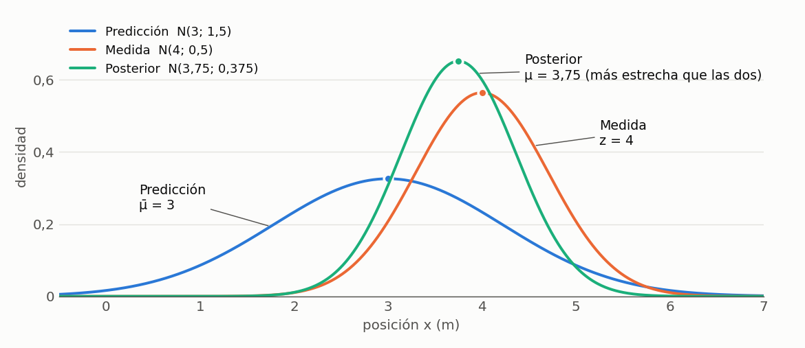

### 6.7. Ejemplo con matrices: medir $x$ también corrige $y$

> **Ejemplo resuelto (correlaciones en acción).**
>
> **Enunciado.** Estado $\mathbf{x} = [x, y]^T$, con $\boldsymbol{\mu}_{t-1} = [1, 2]^T$, $\Sigma_{t-1} = \begin{bmatrix} 0{,}5 & 0{,}2 \\ 0{,}2 & 0{,}4 \end{bmatrix}$. $A = I$, $B = I$, $\mathbf{u} = [1, 0]^T$ y $R = \operatorname{diag}(0{,}1;\ 0{,}1)$. Un sensor mide **solo $x$**: $C = [1\ \ 0]$, con $Q = 0{,}2$ y $z = 2{,}4$.
>
> **Qué buscamos y por qué.** El ciclo con matrices, y comprobar qué le pasa a $y$, que nadie mide.
>
> **Paso 1. Predicción de la media:** $\bar{\boldsymbol{\mu}} = [1 + 1;\ 2 + 0]^T = [2, 2]^T$.
>
> **Paso 2. Predicción de la covarianza.** Como $A = I$: $\bar\Sigma = \Sigma_{t-1} + R = \begin{bmatrix} 0{,}6 & 0{,}2 \\ 0{,}2 & 0{,}5 \end{bmatrix}$.
>
> **Paso 3. Covarianza de la innovación.** $C\bar\Sigma C^T$ extrae el elemento de $x$: $0{,}6$. Entonces $S = 0{,}6 + 0{,}2 = 0{,}8$. Es un escalar porque se mide un solo valor.
>
> **Paso 4. Ganancia.** $\bar\Sigma C^T$ es la primera columna de $\bar\Sigma$, $[0{,}6;\ 0{,}2]^T$. Por tanto, $K = [0{,}6;\ 0{,}2]^T / 0{,}8 = [0{,}75;\ 0{,}25]^T$. Tiene dimensión $2 \times 1$ ($n \times k$).
>
> **Paso 5. Innovación:** $\nu = 2{,}4 - 2 = 0{,}4$.
>
> **Paso 6. Media corregida:** $\boldsymbol{\mu} = [2 + 0{,}75 \cdot 0{,}4;\ 2 + 0{,}25 \cdot 0{,}4]^T = [2{,}3;\ 2{,}1]^T$.
>
> **Paso 7. Covarianza corregida:** $I - KC = \begin{bmatrix} 0{,}25 & 0 \\ -0{,}25 & 1 \end{bmatrix}$ y, multiplicando por $\bar\Sigma$, $\Sigma = \begin{bmatrix} 0{,}15 & 0{,}05 \\ 0{,}05 & 0{,}45 \end{bmatrix}$.
>
> **Resultado e interpretación.** **$y$ también se ha corregido**, de 2 a 2,1, aunque solo se ha medido $x$, porque $x$ e $y$ estaban **correlacionadas** ($0{,}2$ fuera de la diagonal). Su varianza baja poco (de $0{,}5$ a $0{,}45$) y la de $x$ baja mucho (de $0{,}6$ a $0{,}15$). El determinante pasa de $0{,}26$ a $0{,}065$: confirma que corregir no aumenta la incertidumbre.

### 6.8. La corrección de Kalman como estimación MAP

La misma corrección se puede ver como una **optimización**: un mínimos cuadrados ponderados **con un prior**.

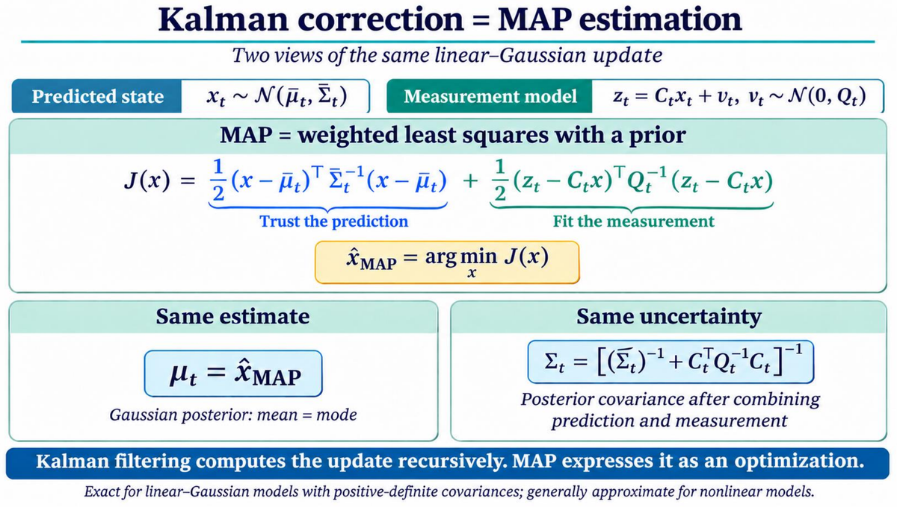

$$J(\mathbf{x}) = \underbrace{\frac{1}{2}(\mathbf{x} - \bar{\boldsymbol{\mu}}_t)^T\bar\Sigma_t^{-1}(\mathbf{x} - \bar{\boldsymbol{\mu}}_t)}_{\text{fiarse de la predicción}} + \underbrace{\frac{1}{2}(\mathbf{z}_t - C_t\mathbf{x})^T Q_t^{-1}(\mathbf{z}_t - C_t\mathbf{x})}_{\text{ajustarse a la medida}} \qquad\qquad \hat{\mathbf{x}}_{\text{MAP}} = \arg\min_{\mathbf{x}} J(\mathbf{x})$$

- **Misma estimación:** $\boldsymbol{\mu}_t = \hat{\mathbf{x}}_{\text{MAP}}$, porque en una posterior gaussiana media y moda coinciden.
- **Misma incertidumbre:** $\Sigma_t = [\bar\Sigma_t^{-1} + C_t^T Q_t^{-1}C_t]^{-1}$.

El filtro de Kalman calcula la actualización **de forma recursiva**; MAP la expresa **como una optimización**. Es exacto para modelos lineales y gaussianos con covarianzas definidas positivas, y en general aproximado si no son lineales.

> **Ejemplo resuelto (comprobar la equivalencia).**
>
> **Enunciado.** Con el ejemplo 1D: $\bar\mu = 3$, $\bar\Sigma = 1{,}5$, $z = 4$, $Q = 0{,}5$ y $C = 1$.
>
> **Qué buscamos y por qué.** Obtener el mismo resultado sin usar la ganancia, con la media pesada de la sección 2.4.
>
> **Paso 1. Varianza:** $\Sigma = \left[\dfrac{1}{1{,}5} + \dfrac{1}{0{,}5}\right]^{-1} = [0{,}667 + 2]^{-1} = 0{,}375$.
>
> **Paso 2. Media:** $\mu = \Sigma\left(\dfrac{3}{1{,}5} + \dfrac{4}{0{,}5}\right) = 0{,}375 \cdot (2 + 8) = 3{,}75$.
>
> **Paso 3. Coste:** $J(3) = 1{,}00$; $J(3{,}75) = 0{,}25$; $J(4) = 0{,}33$. El mínimo está en $3{,}75$.
>
> **Resultado e interpretación.** Sale lo mismo que con Kalman: $\mu = 3{,}75$ y $\Sigma = 0{,}375$. Las **inversas de las varianzas se suman**, y cada dato pesa según su precisión. Corregir con Kalman es un mínimos cuadrados ponderados entre lo predicho y lo medido.

### 6.9. Resumen del filtro de Kalman

- **Computacionalmente eficiente:** solo se propagan el vector de medias y la matriz de covarianza.
- **Solución exacta del filtro de Bayes** en sistemas lineales y gaussianos.
- La media de la posterior es la estimación **óptima de mínimo error cuadrático medio** (MMSE).
- **Pero** la mayoría de los modelos de movimiento y de sensores en robótica son **no lineales**, así que no se puede aplicar directamente.

---

## 7. El filtro de Kalman extendido (EKF)

### 7.1. El problema y la solución

El EKF extiende el filtro de Kalman a modelos **no lineales**:

| | Kalman | EKF |
|---|---|---|
| **Movimiento** | $\mathbf{x}_t = A_t\mathbf{x}_{t-1} + B_t\mathbf{u}_t + \boldsymbol{\varepsilon}_t$ | $\mathbf{x}_t = \mathbf{g}(\mathbf{x}_{t-1}, \mathbf{u}_t) + \boldsymbol{\varepsilon}_t$ |
| **Medida** | $\mathbf{z}_t = C_t\mathbf{x}_t + \boldsymbol{\delta}_t$ | $\mathbf{z}_t = \mathbf{h}(\mathbf{x}_t) + \boldsymbol{\delta}_t$ |

**El problema.** Una transformación no lineal de una gaussiana **en general ya no es gaussiana**, de modo que media y covarianza no bastan para representarla con exactitud.

**La solución del EKF.** **Linealizar localmente** los modelos y **aproximar** la creencia con una gaussiana.

### 7.2. Cuándo funciona: el tamaño de la incertidumbre

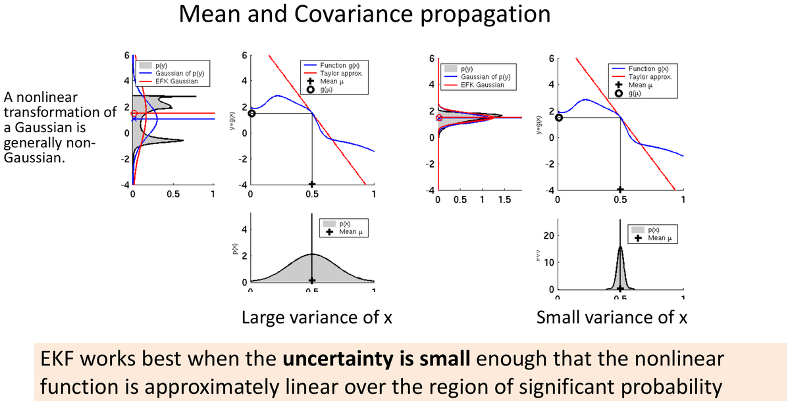

**El EKF funciona mejor cuando la incertidumbre es pequeña**, de modo que la función no lineal sea aproximadamente lineal en la región con probabilidad significativa.

> **Ejemplo resuelto (el error de linealizar, con $Y = X^2$).**
>
> **Enunciado.** $X \sim \mathcal{N}(1, \sigma^2)$ e $Y = g(X) = X^2$. Compara lo que da la linealización con el valor exacto, para $\sigma^2 = 0{,}01$ y para $\sigma^2 = 1$.
>
> **Qué buscamos y por qué.** Medir cuánto se equivoca linealizar según lo grande que sea la incertidumbre.
>
> **Fórmulas.**
>
> - Linealización en $\mu$: media $\approx g(\mu) = \mu^2$; varianza $\approx g'(\mu)^2\sigma^2 = (2\mu)^2\sigma^2$.
> - Valores exactos para una gaussiana: $E[X^2] = \mu^2 + \sigma^2$; $\operatorname{Var}[X^2] = 2\sigma^4 + 4\mu^2\sigma^2$.
>
> **Pasos, con $\mu = 1$:**
>
> | $\sigma^2$ | Media linealizada | Media exacta | Varianza linealizada | Varianza exacta |
> |---|---|---|---|---|
> | $0{,}01$ | $1$ | $1{,}01$ | $0{,}0400$ | $0{,}0402$ |
> | $1$ | $1$ | $2$ | $4$ | $6$ |
>
> **Resultado e interpretación.** Con poca incertidumbre, el error es despreciable. Con mucha, la media exacta es el doble de la linealizada y la varianza linealizada se queda un 33 % corta. Por eso el EKF necesita correcciones frecuentes que mantengan $\Sigma$ pequeña.

### 7.3. Linealizar la predicción

Se usa Taylor de primer orden en torno a la media $\boldsymbol{\mu}_{t-1}$:

$$\mathbf{g}(\mathbf{x}_{t-1}, \mathbf{u}_t) \approx \mathbf{g}(\boldsymbol{\mu}_{t-1}, \mathbf{u}_t) + G_t\,\Delta\mathbf{x}_{t-1} \qquad G_t = \left.\frac{\partial\mathbf{g}(\mathbf{x}, \mathbf{u}_t)}{\partial\mathbf{x}}\right|_{\mathbf{x} = \boldsymbol{\mu}_{t-1}} \qquad \Delta\mathbf{x}_{t-1} = \mathbf{x}_{t-1} - \boldsymbol{\mu}_{t-1}$$

Las variables aleatorias son $\Delta\mathbf{x}_{t-1} \sim \mathcal{N}(\mathbf{0}, \Sigma_{t-1})$ y $\boldsymbol{\varepsilon}_t \sim \mathcal{N}(\mathbf{0}, R_t)$. Por tanto:

$$\overline{bel}(\mathbf{x}_t) \approx \mathcal{N}(\mathbf{x}_t; \bar{\boldsymbol{\mu}}_t, \bar\Sigma_t) \quad \text{con} \quad \bar{\boldsymbol{\mu}}_t = \mathbf{g}(\boldsymbol{\mu}_{t-1}, \mathbf{u}_t) = \boldsymbol{\mu}_{t-1} \oplus \mathbf{u}_t \qquad \bar\Sigma_t = G_t\Sigma_{t-1}G_t^T + R_t$$

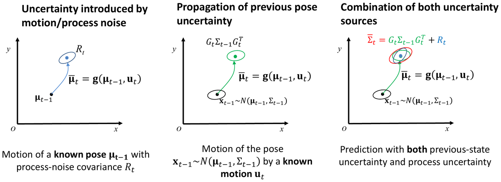

Las **dos fuentes de incertidumbre**, de izquierda a derecha en la figura:

1. **$R_t$:** el ruido que introduce el movimiento, aunque se partiera de una pose exacta.
2. **$G_t\Sigma_{t-1}G_t^T$:** la incertidumbre que ya había, propagada por el movimiento.
3. **$\bar\Sigma_t$:** la suma de ambas.

Para un robot que se mueve por composición de poses, $\mathbf{g} = \mathbf{x} \oplus \mathbf{u}$, y los jacobianos son los de L3 y la práctica 5.2:

$$G_t = \begin{bmatrix} 1 & 0 & -u_x\sin\theta - u_y\cos\theta \\ 0 & 1 & u_x\cos\theta - u_y\sin\theta \\ 0 & 0 & 1 \end{bmatrix} \qquad J_2 = \begin{bmatrix} \cos\theta & -\sin\theta & 0 \\ \sin\theta & \cos\theta & 0 \\ 0 & 0 & 1 \end{bmatrix}$$

Si el ruido del comando se da en el marco del robot, con covarianza $\Sigma_{\mathbf{u}}$, se lleva al mundo así: $R_t = J_2\Sigma_{\mathbf{u}}J_2^T$. Ambos jacobianos se evalúan en $\boldsymbol{\mu}_{t-1}$.

### 7.4. Linealizar la corrección

Se linealiza $\mathbf{h}$ en torno a la **media predicha**, $\bar{\boldsymbol{\mu}}_t$:

$$\mathbf{h}(\mathbf{x}_t) \approx \mathbf{h}(\bar{\boldsymbol{\mu}}_t) + H_t(\mathbf{x}_t - \bar{\boldsymbol{\mu}}_t) \qquad H_t = \left.\frac{\partial\mathbf{h}(\mathbf{x})}{\partial\mathbf{x}}\right|_{\mathbf{x} = \bar{\boldsymbol{\mu}}_t}$$

Con eso, la **verosimilitud aproximada** tiene forma gaussiana en $\mathbf{x}_t$, $p(\mathbf{z}_t \mid \mathbf{x}_t) \approx \mathcal{N}(\mathbf{z}_t; \mathbf{h}(\bar{\boldsymbol{\mu}}_t) + H_t(\mathbf{x}_t - \bar{\boldsymbol{\mu}}_t), Q_t)$. Al multiplicarla por la predicción sale la posterior.

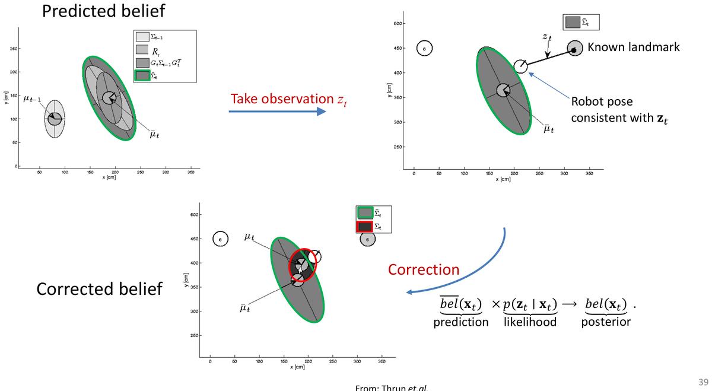

La figura muestra la idea: tras observar el landmark, solo las poses de la elipse **compatibles con la medida** sobreviven, y la creencia corregida es mucho más pequeña.

### 7.5. El algoritmo del EKF

**Algoritmo** Extended_Kalman_filter$(\boldsymbol{\mu}_{t-1}, \Sigma_{t-1}, \mathbf{u}_t, \mathbf{z}_t)$:

$$
\begin{aligned}
&\textbf{Predicción:} \\
&\quad 1.\ \bar{\boldsymbol{\mu}}_t = \mathbf{g}(\boldsymbol{\mu}_{t-1}, \mathbf{u}_t) = \boldsymbol{\mu}_{t-1} \oplus \mathbf{u}_t \\
&\quad 2.\ \bar\Sigma_t = G_t\Sigma_{t-1}G_t^T + R_t \\
&\textbf{Corrección:} \\
&\quad 1.\ K_t = \bar\Sigma_t H_t^T(H_t\bar\Sigma_t H_t^T + Q_t)^{-1} \\
&\quad 2.\ \boldsymbol{\mu}_t = \bar{\boldsymbol{\mu}}_t + K_t(\mathbf{z}_t - \mathbf{h}(\bar{\boldsymbol{\mu}}_t)) \\
&\quad 3.\ \Sigma_t = (I - K_t H_t)\bar\Sigma_t \\
&\textbf{Devuelve } \boldsymbol{\mu}_t, \Sigma_t
\end{aligned}
$$

**Misma estructura que Kalman, con los modelos no lineales $\mathbf{g}$ y $\mathbf{h}$ y sus jacobianos locales $G_t$ y $H_t$.**

**Qué cambia exactamente:**

| Elemento | Kalman | EKF | Detalle clave |
|---|---|---|---|
| Media predicha | $A_t\boldsymbol{\mu}_{t-1} + B_t\mathbf{u}_t$ | $\mathbf{g}(\boldsymbol{\mu}_{t-1}, \mathbf{u}_t)$ | Con el modelo **no lineal**, sin aproximar |
| Covarianza predicha | $A_t$ | $G_t$ | Jacobiano en $\boldsymbol{\mu}_{t-1}$ |
| Medida esperada | $C_t\bar{\boldsymbol{\mu}}_t$ | $\mathbf{h}(\bar{\boldsymbol{\mu}}_t)$ | Con el modelo **no lineal** |
| Ganancia y covarianza | $C_t$ | $H_t$ | Jacobiano en $\bar{\boldsymbol{\mu}}_t$ |

**En el notebook de la práctica 5.2** (detalle en la [guía](../../../web/parcial2/P5.2_EKF_Localization.html)):

| Fórmula | Código |
|---|---|
| $\bar{\boldsymbol{\mu}}_t$ | `xPred = tcomp(robot.xEst, u)` |
| $G_t$, $J_2$ | `G = J1(robot.xEst, u)`, `j2 = J2(robot.xEst, u)` |
| $\bar\Sigma_t$ | `PPred = G@robot.PEst@G.T + j2@robot.cov_move@j2.T` |
| $Q_t$ | `Q_t = np.kron(np.eye(landmark.shape[0]), sensor.cov)` |
| $K_t$ | `K = PPred@H.T@linalg.inv(H@PPred@H.T + Q_t)` |
| Innovación | `z - sensor.observe(xPred, Map[:, landmark], noisy=False)`, con la marcación normalizada |
| $\boldsymbol{\mu}_t$ | `xEst = xPred + K@innovation` |
| $\Sigma_t$ | `PEst = (np.eye(3) - K@H)@PPred` |

### 7.6. Ejemplo en 1D

> **Ejemplo resuelto (imprescindible: una corrección con un sensor no lineal).**
>
> **Enunciado.** Un robot se mueve sobre el eje $x$ y mide la distancia a una baliza colocada a 3 m de altura, sobre el origen: $h(x) = \sqrt{x^2 + 3^2}$. La predicción es $\bar\mu = 4$ m, con $\bar\Sigma = 1$ m². El sensor tiene $Q = 0{,}36$ m² y mide $z = 5{,}5$ m.
>
> **Qué buscamos y por qué.** La corrección. El sensor es no lineal, así que Kalman no sirve directamente y hay que linealizar en $\bar\mu$.
>
> **Paso 1. Medida esperada:** $h(4) = \sqrt{16 + 9} = 5$ m.
>
> **Paso 2. Jacobiano (aquí, una derivada):** $H = \dfrac{dh}{dx} = \dfrac{x}{\sqrt{x^2 + 9}}$, evaluada en $\bar\mu = 4$: $H = 4/5 = 0{,}8$. Significa que, cerca de $x = 4$, avanzar 1 m aumenta la distancia unos $0{,}8$ m.
>
> **Paso 3. Covarianza de la innovación:** $S = H\bar\Sigma H + Q = 0{,}8^2 \cdot 1 + 0{,}36 = 0{,}64 + 0{,}36 = 1$.
>
> **Paso 4. Ganancia:** $K = \bar\Sigma H / S = 1 \cdot 0{,}8 / 1 = 0{,}8$.
>
> **Paso 5. Innovación:** $\nu = z - h(\bar\mu) = 5{,}5 - 5 = 0{,}5$ m. Se usa $h$, **no** $H \cdot \bar\mu$.
>
> **Paso 6. Media:** $\mu = 4 + 0{,}8 \cdot 0{,}5 = 4{,}4$ m.
>
> **Paso 7. Varianza:** $\Sigma = (1 - KH)\bar\Sigma = (1 - 0{,}8 \cdot 0{,}8) \cdot 1 = 0{,}36$ m².
>
> **Resultado e interpretación.** $\mu = 4{,}4$ m y $\Sigma = 0{,}36$ m². Comprobación: desde $x = 4{,}4$, la distancia predicha es $\sqrt{19{,}36 + 9} = 5{,}33$ m, más cerca de los $5{,}5$ m medidos que los 5 m iniciales. Si el robot estuviera cerca de $x = 0$, $H \approx 0$: la distancia casi no cambia al moverse, $K \approx 0$ y la medida apenas informaría.

### 7.7. Ejemplo planar: un ciclo completo

> **Ejemplo resuelto (el EKF de la práctica, a mano).**
>
> **Enunciado.** $\boldsymbol{\mu}_{t-1} = [0, 0, 0]^T$, $\Sigma_{t-1} = \operatorname{diag}(0{,}04;\ 0{,}04;\ 0{,}01)$. Comando $\mathbf{u} = [1, 0, 0]^T$, con $\Sigma_{\mathbf{u}} = \operatorname{diag}(0{,}02;\ 0{,}02;\ 0{,}01)$. Se observa un landmark en $\mathbf{m} = (4, 4)$ con $Q = \operatorname{diag}(0{,}01;\ 0{,}01)$, y la medida es $\mathbf{z} = [5{,}1;\ 0{,}95]^T$.
>
> **Qué buscamos y por qué.** Recorrer el algoritmo entero. En el examen probablemente se pida solo una parte, pero aquí se ve cómo encajan las piezas.
>
> **Paso 1. Pose predicha.** Con $\theta = 0$: $\bar{\boldsymbol{\mu}} = [0 + 1,\ 0,\ 0]^T = [1, 0, 0]^T$.
>
> **Paso 2. Jacobianos.** Con $\theta = 0$ y $\mathbf{u} = [1, 0, 0]^T$: $G = \begin{bmatrix} 1 & 0 & 0 \\ 0 & 1 & 1 \\ 0 & 0 & 1 \end{bmatrix}$ y $J_2 = I$.
>
> **Paso 3. Covarianza predicha.** $G\Sigma G^T = \begin{bmatrix} 0{,}04 & 0 & 0 \\ 0 & 0{,}05 & 0{,}01 \\ 0 & 0{,}01 & 0{,}01 \end{bmatrix}$. Sumando $J_2\Sigma_{\mathbf{u}}J_2^T = \Sigma_{\mathbf{u}}$: $\bar\Sigma = \begin{bmatrix} 0{,}06 & 0 & 0 \\ 0 & 0{,}07 & 0{,}01 \\ 0 & 0{,}01 & 0{,}02 \end{bmatrix}$. Al avanzar, el error de orientación se convierte en error lateral: por eso crece $y$ y aparece la correlación $y$–$\theta$.
>
> **Paso 4. Medida esperada.** Desde $\bar{\boldsymbol{\mu}}$: $\Delta x = 3$, $\Delta y = 4$ y $d = 5$. $\mathbf{h} = [5;\ \operatorname{atan2}(4, 3) - 0]^T = [5;\ 0{,}9273]^T$.
>
> **Paso 5. Innovación.** $\boldsymbol{\nu} = [5{,}1 - 5;\ 0{,}95 - 0{,}9273]^T = [0{,}1;\ 0{,}0227]^T$.
>
> **Paso 6. Jacobiano de observación:** $H = \begin{bmatrix} -0{,}6 & -0{,}8 & 0 \\ 0{,}16 & -0{,}12 & -1 \end{bmatrix}$.
>
> **Paso 7. Covarianza de la innovación.** $S = H\bar\Sigma H^T + Q = \begin{bmatrix} 0{,}0764 & 0{,}0090 \\ 0{,}0090 & 0{,}0349 \end{bmatrix}$. Por ejemplo, $S_{11} = 0{,}36 \cdot 0{,}06 + 0{,}64 \cdot 0{,}07 + 0{,}01 = 0{,}0764$.
>
> **Paso 8. Ganancia.** $K = \bar\Sigma H^T S^{-1}$, con $\bar\Sigma H^T = \begin{bmatrix} -0{,}036 & 0{,}0096 \\ -0{,}056 & -0{,}0184 \\ -0{,}008 & -0{,}0212 \end{bmatrix}$ y $S^{-1} = \begin{bmatrix} 13{,}495 & -3{,}460 \\ -3{,}460 & 29{,}504 \end{bmatrix}$:
>
> $$K = \begin{bmatrix} -0{,}519 & 0{,}408 \\ -0{,}692 & -0{,}349 \\ -0{,}035 & -0{,}598 \end{bmatrix}$$
>
> **Paso 9. Pose corregida.** $K\boldsymbol{\nu} = [-0{,}0426;\ -0{,}0771;\ -0{,}0170]^T$, así que $\boldsymbol{\mu} = [0{,}957;\ -0{,}077;\ -0{,}017]^T$.
>
> **Paso 10. Covarianza corregida.** $\Sigma = (I - KH)\bar\Sigma$, cuya diagonal es $[0{,}0374;\ 0{,}0248;\ 0{,}0071]$.
>
> **Resultado e interpretación.** El landmark se ve **más lejos** de lo esperado (5,1 frente a 5), así que el robot corrige **alejándose de él**: $x$ e $y$ bajan. Las tres varianzas bajan respecto a $\bar\Sigma$ ($0{,}06$, $0{,}07$, $0{,}02$). Comprobación: desde la nueva pose se predice $[5{,}087;\ 0{,}947]^T$, mucho más cerca de la medida $[5{,}1;\ 0{,}95]^T$. **Dimensiones:** $H$ es $2 \times 3$, $S$ es $2 \times 2$ y $K$ es $3 \times 2$.

> **Normalizar el ángulo de la innovación.** La marcación es un ángulo, así que la innovación debe devolverse a $[-\pi, \pi]$. Si se espera $\hat\alpha = 179°$ y se mide $\alpha = -179°$, la resta da $-358°$, pero la diferencia real es de solo $+2°$. Sin normalizar, el filtro haría una corrección enorme y absurda.

### 7.8. El EKF en acción y sus límites

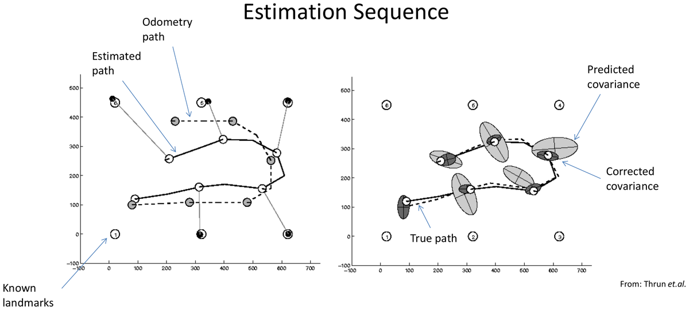

Con landmarks conocidos, la covarianza crece al predecir y se encoge al corregir. La trayectoria estimada se mantiene cerca de la real, mientras que la odometría se aleja. Es el ejemplo que se programa en la **práctica 5.2**.

**Limitaciones,** que se deducen de usar una sola gaussiana y de linealizar:

- Solo representa **una hipótesis**. No puede representar la rosquilla de la sección 3.5 ni dos manchas.
- Si la incertidumbre crece mucho, linealizar deja de ser una buena aproximación.
- Por eso encaja bien en **seguimiento de posición**, y no en localización global.

> **Idea clave:** EKF = Kalman + jacobianos. La media se calcula con los modelos **no lineales**; las covarianzas y la ganancia, con sus **jacobianos**.

---

## 8. El filtro de partículas

### 8.1. La idea

El filtro de partículas es una **implementación de Monte Carlo del filtro de Bayes recursivo**: la posterior se aproxima con un **conjunto de muestras aleatorias** (**partículas**). Cada partícula es una hipótesis de pose.

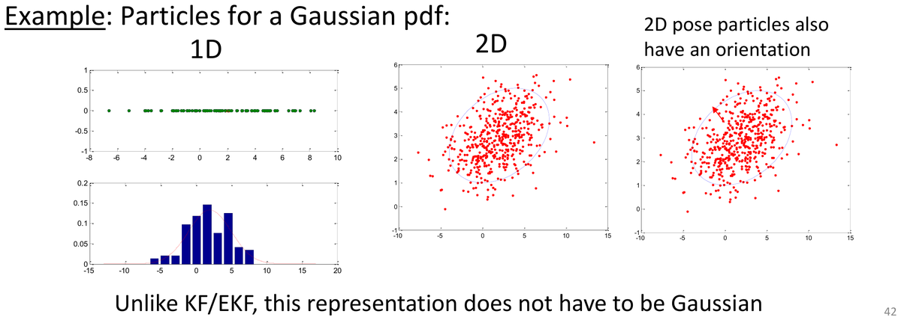

Donde hay más partículas, hay más probabilidad. **A diferencia de KF y EKF, esta representación no tiene por qué ser gaussiana**: puede tener cualquier forma, también varios picos.

Una partícula en 2D también lleva orientación, $\mathbf{x}^{[i]} = [x, y, \theta]^T$. En las diapositivas se usa $M$ o $N$ para el número de partículas y $t$ o $k$ para el instante; significan lo mismo.

### 8.2. Los pasos: 2 + 1

$$
\begin{aligned}
&\textbf{1. Predicción:} && \mathbf{x}_t^{[i]} \sim p(\mathbf{x}_t \mid \mathbf{x}_{t-1}^{[i]}, \mathbf{u}_t) && \text{mover cada partícula con ruido} \\
&\textbf{2. Corrección:} && w_t^{[i]} \propto p(\mathbf{z}_t \mid \mathbf{x}_t^{[i]}) && \text{pesar cada partícula} \\
&\textbf{3. Remuestreo:} && \tilde{w}_t^{[i]} = 1/M && \text{sortear } M \text{ partículas con reemplazo según } w_t^{[i]}
\end{aligned}
$$

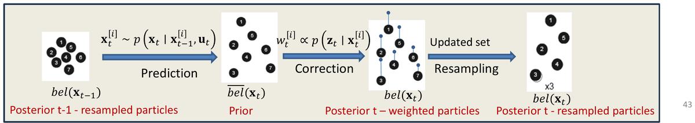

| Paso | Regla de Bayes que implementa | Antes → después |
|---|---|---|
| **Predicción** | Probabilidad total: se **sustituye la integral por muestreo** | Posterior anterior remuestreada → **prior** |
| **Corrección** | Bayes: se **evalúa la verosimilitud** en cada partícula | Prior → **posterior con pesos** |
| **Remuestreo** | Convierte pesos en densidad de partículas | Posterior con pesos → **posterior remuestreada**, todas con peso $1/M$ |

La implementación clásica se llama **SIR** (*Sequential Importance Resampling*):

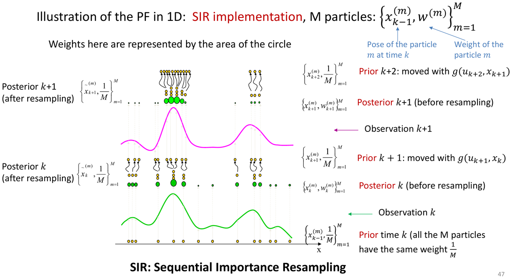

**Cómo leer la figura, de abajo arriba.** Las partículas parten con el mismo peso ($1/M$). Llega una observación (curva verde) y cada partícula recibe un peso según lo alto que quede en la curva. Las de más peso se **replican** al remuestrear y las de poco peso desaparecen. Se mueven con ruido, de manera que las copias se separan. Llega otra observación y se repite.

### 8.3. Predicción: muestrear el modelo de movimiento

Cada partícula se mueve con **su propia muestra de ruido**:

```python
def sample_motion_model(x, u, R):
    # x: (3,) pose anterior de la partícula [x, y, theta]
    # u: (3,) incremento nominal de movimiento [dx, dy, dtheta]
    # R: (3,3) covarianza de la incertidumbre del movimiento
    # devuelve: (3,) nueva pose muestreada
    noise = np.random.multivariate_normal(np.zeros(3), R)
    return compose(x, u + noise)

# particles: array (N,3) con las N poses de las partículas
for i in range(N):
    particles[i] = sample_motion_model(particles[i], u_t, R_t)
```

> **Ojo:** el ruido es imprescindible. Sin él, las copias creadas al remuestrear seguirían siempre juntas, y el conjunto colapsaría en unas pocas poses.

> **Ejemplo resuelto (mover una partícula).**
>
> **Enunciado.** Partícula en $\mathbf{x} = [2, 1, \pi/2]^T$, comando $\mathbf{u} = [1, 0, 0]^T$ y muestra de ruido $[0{,}1;\ -0{,}1;\ 0{,}05]^T$.
>
> **Qué buscamos y por qué.** La nueva pose de esta partícula: es lo que hace `compose(x, u + noise)`.
>
> **Paso 1. Sumar el ruido al comando:** $\mathbf{u}' = [1{,}1;\ -0{,}1;\ 0{,}05]^T$.
>
> **Paso 2. Componer** (con $\cos 90° = 0$ y $\sin 90° = 1$):
>
> - $x' = 2 + 1{,}1 \cdot 0 - (-0{,}1) \cdot 1 = 2{,}1$.
> - $y' = 1 + 1{,}1 \cdot 1 + (-0{,}1) \cdot 0 = 2{,}1$.
> - $\theta' = \pi/2 + 0{,}05 = 1{,}621$ rad.
>
> **Resultado e interpretación.** $[2{,}1;\ 2{,}1;\ 1{,}621]^T$. Sin ruido sería $[2;\ 2;\ 1{,}571]^T$: el robot mira hacia $+y$, así que avanzar 1 m le sube la $y$. Otra partícula tendría otro ruido y acabaría en otro sitio: así se **extiende la nube**.

### 8.4. Corrección: pesar las partículas

Tres pasos para cada partícula, que aquí se ilustran con un sensor de marcación:

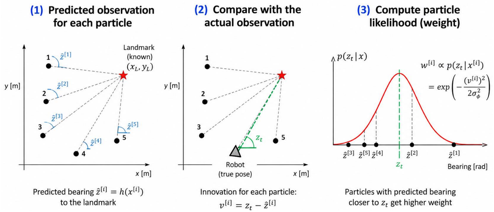

1. **Observación predicha** desde cada partícula: $\hat{z}^{[i]} = h(\mathbf{x}^{[i]})$.
2. **Innovación:** $\nu^{[i]} = z_t - \hat{z}^{[i]}$.
3. **Peso,** con la verosimilitud gaussiana:

$$w^{[i]} \propto p(z_t \mid \mathbf{x}^{[i]}) = \exp\left(-\frac{(\nu^{[i]})^2}{2\sigma_z^2}\right)$$

Y se **normalizan** para que sumen 1. El código de las diapositivas lo hace para un sensor de **rango**:

```python
# particles: (N,3) poses predichas [x, y, theta]
# landmark: (2,) posición conocida [xL, yL]
# z_t: rango observado; sigma_z: desviación típica del sensor
# weights: (N,) pesos de las partículas
for i in range(N):
    z_pred = range_sensor_model(particles[i], landmark)  # observación predicha
    innov = z_t - z_pred                                 # innovación
    weights[i] = np.exp(-0.5 * innov**2 / sigma_z**2)    # verosimilitud
weights /= np.sum(weights)                               # normalizar
```

> **Detalles:** la constante $1/(\sigma\sqrt{2\pi})$ no hace falta, porque se cancela al normalizar. Y si el sensor mide marcación, como en la figura, la innovación es un ángulo y **hay que normalizarla** a $[-\pi, \pi]$.

> **Ejemplo resuelto (imprescindible: pesos de unas partículas).**
>
> **Enunciado.** Un pasillo con un landmark en $m = 40$ m. El sensor mide $z = 30$ m con $\sigma_z = 1$ m. Hay 5 partículas en $x = 8;\ 9{,}5;\ 10{,}5;\ 13;\ 25$.
>
> **Qué buscamos y por qué.** Cuánto cuenta cada partícula. Las compatibles con la medida deben pesar más.
>
> **Fórmulas.** $\hat{z} = m - x$; $\nu = z - \hat{z}$; $w = \exp(-\nu^2/2\sigma_z^2)$; y después se divide entre la suma.
>
> | Partícula $x$ | $\hat{z} = 40 - x$ | $\nu = 30 - \hat{z}$ | $w = e^{-\nu^2/2}$ | $w$ normalizado |
> |---|---|---|---|---|
> | $8$ | $32$ | $-2$ | $0{,}1353$ | $0{,}071$ |
> | $9{,}5$ | $30{,}5$ | $-0{,}5$ | $0{,}8825$ | $0{,}462$ |
> | $10{,}5$ | $29{,}5$ | $0{,}5$ | $0{,}8825$ | $0{,}462$ |
> | $13$ | $27$ | $3$ | $0{,}0111$ | $0{,}006$ |
> | $25$ | $15$ | $15$ | $\approx 0$ | $\approx 0$ |
> | **Suma** | | | $1{,}9114$ | $1$ |
>
> **Resultado e interpretación.** La medida dice que el robot está cerca de $x = 40 - 30 = 10$ m, y las dos partículas más próximas se llevan el 92 % del peso. La posición estimada, como media pesada, es $\sum w_i x_i = 9{,}88$ m.

### 8.5. Remuestreo: supervivencia del más apto

**Idea.** Las partículas con más peso ocupan **intervalos más grandes** de la distribución acumulada, y por tanto reciben más «dardos» al sortear.

**Paso 1. Construir la distribución acumulada** de los pesos normalizados:

$$C_k = \sum_{i=1}^{k}\tilde{w}_t^{[i]} \qquad C_N = 1$$

**Paso 2. Sortear.** Se generan $N$ números aleatorios $r_j \sim U(0, 1)$ y, para cada uno, se elige **la partícula cuyo intervalo acumulado lo contiene**.

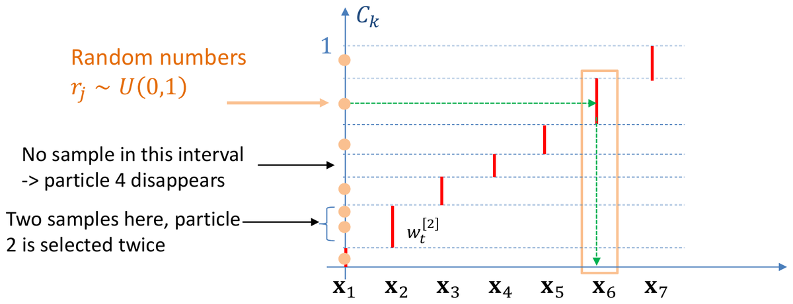

Las partículas de más peso **pueden salir varias veces**. Al final, todas tienen peso $1/N$:

$$\{\mathbf{x}_t^{[i]}, \tilde{w}_t^{[i]}\}_{i=1}^N \xrightarrow{\text{remuestreo}} \{\mathbf{x}_t^{[i]}, 1/N\}_{i=1}^N$$

> **Ejemplo resuelto (imprescindible: remuestreo a mano).**
>
> **Enunciado.** 7 partículas con pesos $\tilde{w} = [0{,}10;\ 0{,}25;\ 0{,}15;\ 0{,}05;\ 0{,}15;\ 0{,}25;\ 0{,}05]$. Los números aleatorios son $r = 0{,}07;\ 0{,}22;\ 0{,}31;\ 0{,}46;\ 0{,}62;\ 0{,}81;\ 0{,}97$.
>
> **Qué buscamos y por qué.** Qué partículas sobreviven.
>
> **Paso 1. Acumulada** (cada valor es el anterior más el peso siguiente):
>
> | Partícula | 1 | 2 | 3 | 4 | 5 | 6 | 7 |
> |---|---|---|---|---|---|---|---|
> | Peso | $0{,}10$ | $0{,}25$ | $0{,}15$ | $0{,}05$ | $0{,}15$ | $0{,}25$ | $0{,}05$ |
> | $C_k$ | $0{,}10$ | $0{,}35$ | $0{,}50$ | $0{,}55$ | $0{,}70$ | $0{,}95$ | $1{,}00$ |
> | Intervalo | $[0;\ 0{,}10)$ | $[0{,}10;\ 0{,}35)$ | $[0{,}35;\ 0{,}50)$ | $[0{,}50;\ 0{,}55)$ | $[0{,}55;\ 0{,}70)$ | $[0{,}70;\ 0{,}95)$ | $[0{,}95;\ 1)$ |
>
> **Paso 2. Buscar cada $r_j$:**
>
> | $r_j$ | $0{,}07$ | $0{,}22$ | $0{,}31$ | $0{,}46$ | $0{,}62$ | $0{,}81$ | $0{,}97$ |
> |---|---|---|---|---|---|---|---|
> | Partícula | 1 | 2 | 2 | 3 | 5 | 6 | 7 |
>
> **Resultado e interpretación.** El nuevo conjunto es $\{1, 2, 2, 3, 5, 6, 7\}$, todas con peso $1/7$. La **partícula 2 sale dos veces** y la **partícula 4 desaparece**: su intervalo es muy estrecho y ningún número cae en él. Es solo una tirada: con otros números podría salir distinto, aunque una partícula de peso alto tiende a sobrevivir.

### 8.6. Ejemplo en 1D: seguimiento de posición

Un robot en un pasillo mide la distancia a **un** landmark, en $m = 40$ m, al final del pasillo. Con 20 partículas, movimiento de 5 m con ruido y medidas con $\sigma_z = 1$ m. En $t = 0$ no sabe dónde está: partículas uniformes en $[0, 50]$.

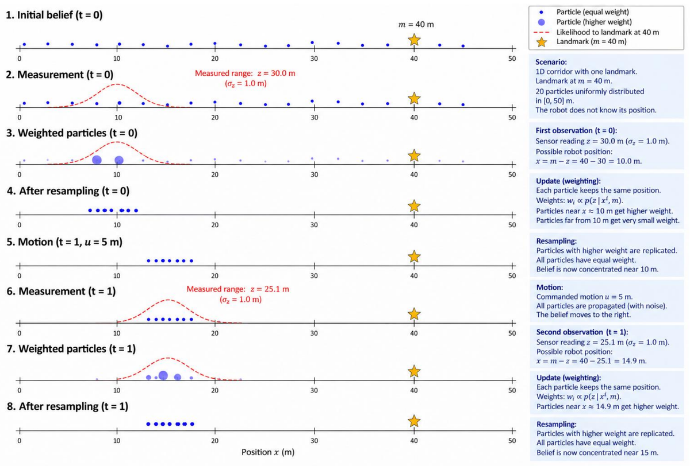

| Instante | Qué ocurre | Cálculo | Creencia |
|---|---|---|---|
| $t = 0$, medida | $z = 30{,}0$ m | $x = m - z = 40 - 30 = 10$ m | Pesan más las partículas cerca de 10 m |
| $t = 0$, remuestreo | Se replican las de más peso | | Concentrada cerca de 10 m |
| $t = 1$, movimiento | $u = 5$ m con ruido | $10 + 5 = 15$ m | Se desplaza a la derecha |
| $t = 1$, medida | $z = 25{,}1$ m | $x = 40 - 25{,}1 = 14{,}9$ m | Coherente con lo predicho |
| $t = 1$, remuestreo | | | Concentrada cerca de 15 m |

### 8.7. Ejemplo en 1D: varias hipótesis

Ahora hay **dos landmarks iguales**, $m_1 = 40$ m y $m_2 = 50$ m, y el robot **no sabe cuál está midiendo** (**asociación de datos** desconocida). El peso de cada partícula suma las dos posibilidades:

$$w_i \propto p(z \mid x^{[i]}, m_1) + p(z \mid x^{[i]}, m_2)$$

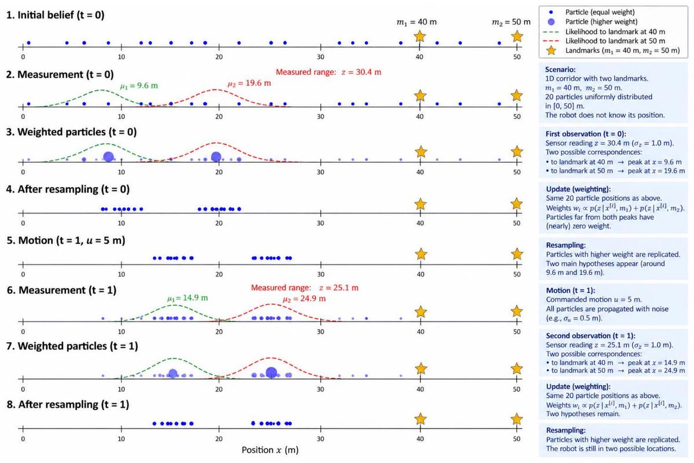

> **Ejemplo resuelto (peso con dos correspondencias posibles).**
>
> **Enunciado.** $z = 30{,}4$ m con $\sigma_z = 1$ m. Calcula el peso sin normalizar de las partículas en $x = 9$, $x = 20$ y $x = 15$.
>
> **Qué buscamos y por qué.** Ver por qué sobreviven **dos grupos** de partículas. Los picos deben estar en $40 - 30{,}4 = 9{,}6$ m y en $50 - 30{,}4 = 19{,}6$ m.
>
> **Fórmula.** Para cada landmark, $e^{-\nu^2/2}$ con $\nu = z - (m - x)$. Después se suman los dos valores.
>
> | Partícula | $\nu$ con $m_1$ | $e^{-\nu^2/2}$ | $\nu$ con $m_2$ | $e^{-\nu^2/2}$ | Peso (suma) |
> |---|---|---|---|---|---|
> | $x = 9$ | $30{,}4 - 31 = -0{,}6$ | $0{,}835$ | $30{,}4 - 41 = -10{,}6$ | $\approx 0$ | $0{,}835$ |
> | $x = 20$ | $30{,}4 - 20 = 10{,}4$ | $\approx 0$ | $30{,}4 - 30 = 0{,}4$ | $0{,}923$ | $0{,}923$ |
> | $x = 15$ | $30{,}4 - 25 = 5{,}4$ | $4{,}7 \cdot 10^{-7}$ | $30{,}4 - 35 = -4{,}6$ | $2{,}5 \cdot 10^{-5}$ | $\approx 0$ |
>
> **Resultado e interpretación.** $x = 9$ y $x = 20$ tienen pesos altos, cada una gracias a un landmark distinto, mientras que $x = 15$ queda eliminada. Tras moverse 5 m y medir $z = 25{,}1$ m, los picos pasan a $14{,}9$ m y $24{,}9$ m: las dos hipótesis siguen siendo compatibles y **el robot sigue en dos ubicaciones posibles**. Un EKF no podría representar esto, y la media de los dos grupos ($\approx 14{,}6$ m en $t = 0$) caería justo donde no está (sección 1.2).

### 8.8. Ventajas e inconvenientes

| Ventajas | Inconvenientes |
|---|---|
| Representa creencias **no gaussianas** y **multimodales** | Necesita **suficientes partículas** para aproximar bien |
| Admite **modelos de movimiento y de sensor flexibles** | El remuestreo puede **reducir la diversidad** y **descartar hipótesis plausibles** |
| **Algoritmo básico sencillo:** predecir, pesar, remuestrear | Los **estados de más dimensión** suelen exigir más partículas y más cómputo |

> **Idea clave:** cada partícula es una hipótesis. Moverlas con ruido aplica el movimiento, pesarlas aplica la medida y remuestrear concentra el esfuerzo donde hay probabilidad.

---

## 9. Resumen del tema

### 9.1. Estimación puntual de la pose

**Objetivo:** estimar la pose $\mathbf{x}_t$ a partir de observaciones y un mapa.

| Método | Qué hace | Solución |
|---|---|---|
| **LS lineal** | Minimiza $\lVert\mathbf{z} - H\mathbf{x}\rVert^2$ | Forma cerrada |
| **LS ponderado** | Tiene en cuenta la incertidumbre de la medida | Forma cerrada, con $Q^{-1}$ |
| **LS no lineal** | Minimiza $\lVert\mathbf{z} - \mathbf{h}(\mathbf{x})\rVert^2$ | Iterativa: Gauss-Newton |
| **Registro con correspondencias** | Alinea landmarks: halla $(R, \mathbf{t})$ | Gauss-Newton o SVD |
| **ICP** | Alinea scans sin correspondencias | Alterna emparejar y estimar la pose |

Registrar **contra un mapa** da **localización**; **contra un scan anterior**, **odometría**.

### 9.2. Filtrado bayesiano

**Objetivo:** estimar la creencia completa $bel(\mathbf{x}_t) = p(\mathbf{x}_t \mid \mathbf{u}_{1:t}, \mathbf{z}_{1:t})$ con un ciclo recursivo: **predicción** con el modelo de movimiento y **corrección** con la verosimilitud del sensor y la regla de Bayes.

| Filtro | Representación | Característica principal | Lo que le cuesta |
|---|---|---|---|
| **Rejilla** | Probabilidad por celda | Discreto, distribuciones arbitrarias | Crece muy rápido con la resolución y la dimensión |
| **Kalman** | Gaussiana $(\boldsymbol{\mu}, \Sigma)$ | Exacto en modelos lineales y gaussianos | No admite modelos no lineales |
| **EKF** | Gaussiana $(\boldsymbol{\mu}, \Sigma)$ | Modelos no lineales con linealización local | Una sola hipótesis; incertidumbre pequeña |
| **Partículas** | Partículas con peso | Creencias no gaussianas y multimodales | Muchas partículas en estados grandes |

### 9.3. Qué método para qué problema

Esta tabla **no aparece en las diapositivas**. Es una deducción a partir de lo anterior, útil para razonar preguntas conceptuales:

| Problema | Encaje natural | Por qué |
|---|---|---|
| **Seguimiento de posición** | EKF | Una hipótesis e incertidumbre pequeña; es lo que hace la práctica 5.2 |
| **Localización global** | Rejilla o partículas | Hay que representar varias hipótesis a la vez |
| **Robot secuestrado** | Partículas o rejilla, con algún mecanismo adicional | Hay que poder mantener probabilidad en otras zonas. Sin más, la nube ya concentrada no contiene la pose nueva |

---

## 10. Fórmulas para el examen

| Concepto | Fórmula | Cuándo se usa / notas |
|---|---|---|
| Estimación MAP / media | $\arg\max_{\mathbf{x}} p(\mathbf{x} \mid \text{datos})$ / $E[\mathbf{x} \mid \text{datos}]$ | Coinciden en una gaussiana |
| LS lineal | $\hat{\mathbf{x}} = (H^T H)^{-1}H^T\mathbf{z}$ | $H$ de $m \times n$; requiere rango $n$ |
| LS ponderado | $\hat{\mathbf{x}} = (H^T Q^{-1}H)^{-1}H^T Q^{-1}\mathbf{z}$ | Peso de cada medida: $1/\sigma_i^2$ |
| Covarianza de WLS | $\Sigma_{\hat{\mathbf{x}}} = (H^T Q^{-1}H)^{-1}$ | Propagada desde $Q$ |
| Media pesada (escalar) | $\hat{x} = \dfrac{\sum z_i/\sigma_i^2}{\sum 1/\sigma_i^2}$; $\sigma_{\hat{x}}^2 = \dfrac{1}{\sum 1/\sigma_i^2}$ | Varias medidas de lo mismo |
| Inversa de $2 \times 2$ | $\begin{bmatrix} a & b \\ c & d \end{bmatrix}^{-1} = \dfrac{1}{ad - bc}\begin{bmatrix} d & -b \\ -c & a \end{bmatrix}$ | Imprescindible en los cálculos a mano |
| Gauss-Newton | $\boldsymbol{\delta} = (J^T Q^{-1}J)^{-1}J^T Q^{-1}[\mathbf{z} - \mathbf{h}(\hat{\mathbf{x}})]$; $\hat{\mathbf{x}} \leftarrow \hat{\mathbf{x}} + \boldsymbol{\delta}$ | Sin ponderar: quitar $Q^{-1}$ |
| Rango y marcación | $d = \sqrt{\Delta x^2 + \Delta y^2}$; $\alpha = \operatorname{atan2}(\Delta y, \Delta x) - \theta$ | $\Delta x = x_i - x$; $\Delta y = y_i - y$ |
| Jacobiano de observación | $\begin{bmatrix} -\Delta x/d & -\Delta y/d & 0 \\ \Delta y/d^2 & -\Delta x/d^2 & -1 \end{bmatrix}$ | $2 \times 3$ por landmark |
| Jacobiano solo de rango | Filas $[-\Delta x/d,\ -\Delta y/d]$ | $n \times 2$; $\theta$ no observable |
| Composición | $\mathbf{x} \oplus \mathbf{q} = \mathbf{t} + R\mathbf{q}$ | $R\mathbf{q} = (q_x\cos\theta - q_y\sin\theta,\ q_x\sin\theta + q_y\cos\theta)$ |
| Registro | $E(R, \mathbf{t}) = \sum_i\lVert\mathbf{m}_i - (R\mathbf{q}_i + \mathbf{t})\rVert^2$ | ICP: parejas por punto más cercano |
| Traslación óptima (1D, $R$ fija) | $t = \frac{1}{n}\sum(m_j - q_i)$ | Media de las diferencias |
| Probabilidad de una unión | $P(A \cup B) = P(A) + P(B) - P(A \cap B)$ | Rejilla: fila o columna |
| Predicción de Bayes (rejilla) | $\overline{bel}(x_t) = \sum_{x_{t-1}} P(x_t \mid x_{t-1}, u_t)\,bel(x_{t-1})$ | No normalizar |
| Corrección de Bayes (rejilla) | $bel(x_t) = \eta\,P(z_t \mid x_t)\,\overline{bel}(x_t)$ | $\eta = 1 / \sum$ de los productos |
| Gaussiana transformada | $Y = aX + b \Rightarrow \mathcal{N}(a\mu + b,\ a^2\sigma^2)$; $Y = AX + \mathbf{b} \Rightarrow \mathcal{N}(A\boldsymbol{\mu} + \mathbf{b},\ A\Sigma A^T)$ | Exacto si es lineal |
| Predicción de Kalman | $\bar{\boldsymbol{\mu}} = A\boldsymbol{\mu} + B\mathbf{u}$; $\bar\Sigma = A\Sigma A^T + R$ | La incertidumbre crece |
| Corrección de Kalman | $K = \bar\Sigma C^T(C\bar\Sigma C^T + Q)^{-1}$; $\boldsymbol{\mu} = \bar{\boldsymbol{\mu}} + K(\mathbf{z} - C\bar{\boldsymbol{\mu}})$; $\Sigma = (I - KC)\bar\Sigma$ | $K$ de $n \times k$ |
| Kalman en 1D | $K = \dfrac{\bar\sigma^2 C}{C^2\bar\sigma^2 + Q}$ | Con $C = 1$: $K = \bar\sigma^2/(\bar\sigma^2 + Q)$ |
| Forma MAP | $\Sigma^{-1} = \bar\Sigma^{-1} + C^T Q^{-1}C$ | Las inversas se suman |
| Predicción del EKF | $\bar{\boldsymbol{\mu}} = \mathbf{g}(\boldsymbol{\mu}, \mathbf{u}) = \boldsymbol{\mu} \oplus \mathbf{u}$; $\bar\Sigma = G\Sigma G^T + R$ | $G$ evaluado en $\boldsymbol{\mu}_{t-1}$ |
| Corrección del EKF | $K = \bar\Sigma H^T(H\bar\Sigma H^T + Q)^{-1}$; $\boldsymbol{\mu} = \bar{\boldsymbol{\mu}} + K(\mathbf{z} - \mathbf{h}(\bar{\boldsymbol{\mu}}))$; $\Sigma = (I - KH)\bar\Sigma$ | $H$ evaluado en $\bar{\boldsymbol{\mu}}_t$; normalizar ángulos |
| Jacobiano del movimiento | $G = \begin{bmatrix} 1 & 0 & -u_x\sin\theta - u_y\cos\theta \\ 0 & 1 & u_x\cos\theta - u_y\sin\theta \\ 0 & 0 & 1 \end{bmatrix}$ | $R_t = J_2\Sigma_{\mathbf{u}}J_2^T$ |
| Peso de una partícula | $w^{[i]} \propto \exp(-(\nu^{[i]})^2 / 2\sigma_z^2)$; $\nu^{[i]} = z - \hat{z}^{[i]}$ | Después, normalizar |
| Acumulada para remuestrear | $C_k = \sum_{i=1}^k\tilde{w}^{[i]}$ | $r_j$ elige la partícula con $C_{k-1} \le r_j < C_k$ |

**Dimensiones que conviene recordar:**

| Elemento | Kalman (estado $n$, medida $k$) | EKF planar con $L$ landmarks |
|---|---|---|
| $\boldsymbol{\mu}$ | $n \times 1$ | $3 \times 1$ |
| $\Sigma$, $R$, $A$ o $G$ | $n \times n$ | $3 \times 3$ |
| $\mathbf{z}$, innovación | $k \times 1$ | $2L \times 1$ |
| $C$ o $H$ | $k \times n$ | $2L \times 3$ |
| $Q$, $S$ | $k \times k$ | $2L \times 2L$ |
| $K$ | $n \times k$ | $3 \times 2L$ |

---

## 11. Errores típicos

1. **Confundir $H^T H$ con $H H^T$:** la matriz que se invierte es la de $n \times n$, $(H^T H)^{-1}$.
2. **Pensar que $m > n$ garantiza solución:** hacen falta $n$ ecuaciones **independientes**. Hay que mirar el **rango**.
3. **Ponderar con $\sigma$ o con $Q$ en vez de con $Q^{-1}$:** el peso es **la inversa de la varianza**. Una medida mala debe pesar poco.
4. **Poner $\sigma$ en vez de $\sigma^2$ en $Q$.**
5. **Olvidar recalcular el jacobiano** en cada iteración de Gauss-Newton.
6. **Equivocar los signos del jacobiano:** $\partial d/\partial x = -(x_i - x)/d$. La medida es $\mathbf{m}_i - \mathbf{r}$, y $\mathbf{r}$ va restando.
7. **Creer que la orientación se obtiene de distancias:** $\partial h_i/\partial\theta = 0$. Con solo rango, **$\theta$ no es observable**.
8. **Decir que 2 balizas bastan en 2D:** dan **dos** soluciones. Hacen falta 3 no alineadas.
9. **Decir que la verosimilitud de una distancia es gaussiana en $\mathbf{x}$:** es gaussiana en $z$. En $\mathbf{x}$ tiene forma de **rosquilla**.
10. **Afirmar que ICP encuentra el óptimo global:** solo garantiza un **mínimo local**, y depende de la estimación inicial.
11. **Confundir para qué sirve registrar:** contra un mapa = localización; contra un scan anterior = odometría.
12. **Normalizar en la predicción de la rejilla:** no hace falta, porque suma 1. Se normaliza en la **corrección**.
13. **Rejilla: olvidar alguna celda de origen.** Para cada celda de destino, hay que sumar **todos** los movimientos que llegan a ella.
14. **Unión de sucesos sin restar la intersección.**
15. **Confundir $R$ y $Q$:** $R$ es del movimiento y se usa al **predecir**; $Q$ es del sensor y se usa al **corregir**.
16. **Olvidar $A^T$ o $G^T$:** $\bar\Sigma = A\Sigma A^T + R$, no $A\Sigma + R$.
17. **Olvidar $R$ en $\bar\Sigma$:** la incertidumbre tiene dos fuentes.
18. **Usar la covarianza anterior en la corrección:** se usa $\bar\Sigma_t$, la predicha, tanto en $K_t$ como en $\Sigma_t$.
19. **Invertir la ganancia:** con $Q$ grande, $K$ **baja**. Si desconfías del sensor, le haces menos caso.
20. **EKF: usar $H\bar{\boldsymbol{\mu}}$ como medida esperada.** Se usa el modelo no lineal, $\mathbf{h}(\bar{\boldsymbol{\mu}})$. Los jacobianos solo van en las covarianzas y en $K$.
21. **EKF: evaluar $H$ en $\boldsymbol{\mu}_{t-1}$:** se evalúa en $\bar{\boldsymbol{\mu}}_t$. $G$ sí va en $\boldsymbol{\mu}_{t-1}$.
22. **No normalizar los ángulos** de la innovación. Una diferencia de $-358°$ es en realidad de $+2°$.
23. **Decir que Kalman o el EKF sirven para varias hipótesis:** una gaussiana tiene **un solo pico**.
24. **Partículas: olvidar el ruido al moverlas** o aplicar el mismo a todas.
25. **Partículas: no normalizar los pesos** antes de construir la acumulada, que tiene que acabar en 1.
26. **Remuestreo: pensar que no se repiten partículas.** Es **con reemplazo**: una partícula puede salir varias veces y otra, ninguna.
27. **Mantener los pesos tras remuestrear:** después, todas valen $1/N$.
28. **Resumir una creencia multimodal con la media:** puede caer donde no hay probabilidad.

---

## 12. Avisos sobre las diapositivas

Comprobado contra el PDF v3. Son detalles de las diapositivas que no coinciden entre sí o que pueden despistar:

| Diapositiva | Qué pone | Qué conviene saber |
|---|---|---|
| 1 | *Probabilistic Robotics*, 2001 | La edición del libro es de 2005 |
| 11 | $\operatorname{atan}(\cdot)$ en la fórmula y $\operatorname{atan2}$ en la figura | Se usa **atan2**, porque `atan` pierde el cuadrante |
| 11 | $\theta_i$ para la marcación | Aquí se escribe $\alpha_i$, para distinguirla de la orientación $\theta$ |
| 22 | Filas de la rejilla | Se numeran desde abajo: la fila 3 tiene marginal $0{,}19$ |
| 25 | Posterior en las celdas 3, 4 y 5, con $\eta \cdot 0{,}2 \cdot 0{,}2$ | Lo correcto es **2, 3 y 4, con $\eta \cdot 0{,}2 \cdot 0{,}1$**, como en la diapositiva anterior |
| MAP (entre la 31 y la 32) | Ruido de medida $v_t$ | Es el mismo ruido que $\boldsymbol{\delta}_t$ en las demás |
| 44–47 | Instante $k$, $M$ partículas, $g(u_{k+1}, x_k)$ | Es lo mismo que $t$, $N$ y $\mathbf{g}(\mathbf{x}_{t-1}, \mathbf{u}_t)$ de otras diapositivas |
| 49 | El título y la figura hablan de marcación; el código, de rango | La fórmula del peso es la misma, pero la marcación hay que normalizarla |

La numeración impresa tampoco es correlativa: hay dos diapositivas «3» y dos «23», no hay «24» y la de MAP no sigue la secuencia. El PDF tiene 58 páginas y la última lleva el número 56.
